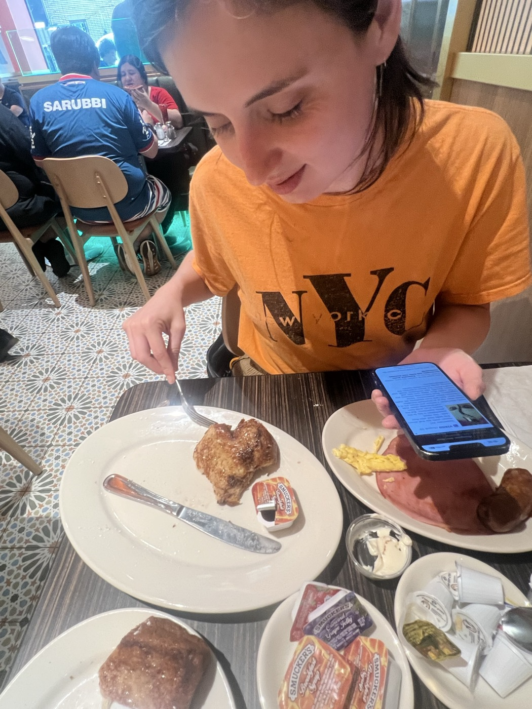
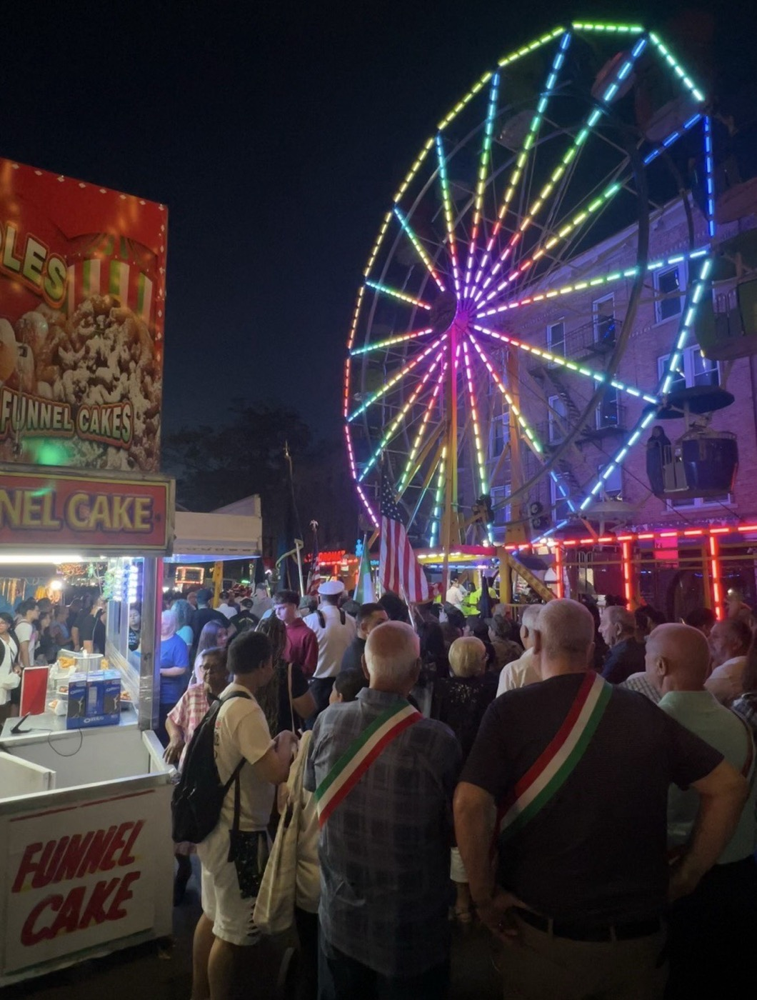
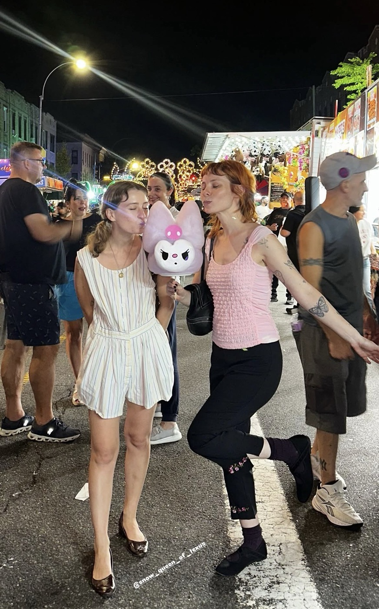
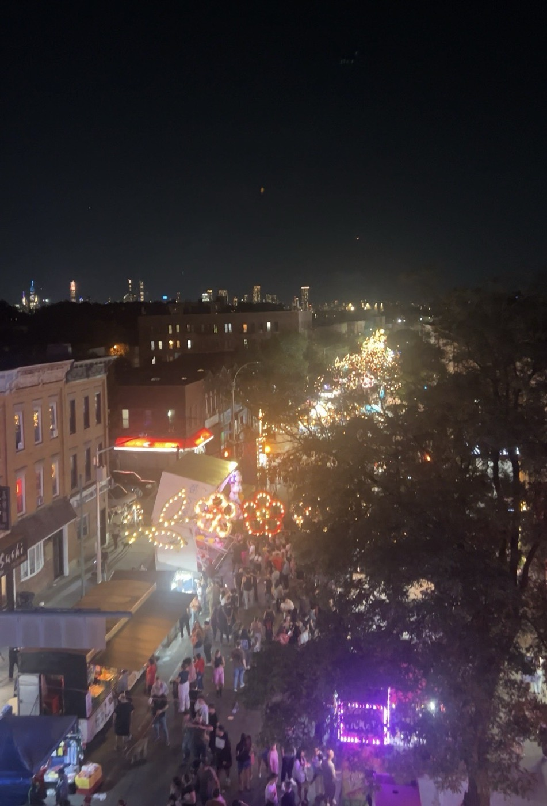
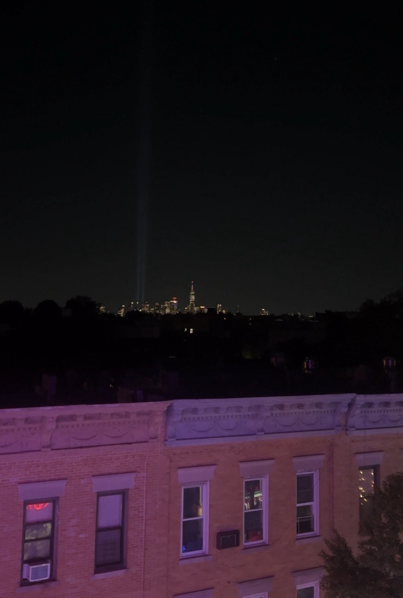

# 2026-09-12 I'm thirty  
  
### and here's some of what I did to celebrate.  
  
  
Katy got me french toast and it looked like a heart (moreso in person) 😃 😊 then she flew away forever again  
  
we saw a 9/11 memorial parade and ceremony featuring Italian American military veterans  
  
  
Elaine and Shannon wouldn't leave me alone <3  
(Amana, Ashley, Lucinda, and Becca also came by)  
  
... and I finally rode the ferris wheel. it was terrifying. god bless this neighborhood, this city, my dumb life.  
  
  
  
the next night I sat at GC gazing quietly at the skyline. after several years of hypersocial blowout celebrations it felt right to spend the day quietly with and within myself. but of course Julia came and found me.   
