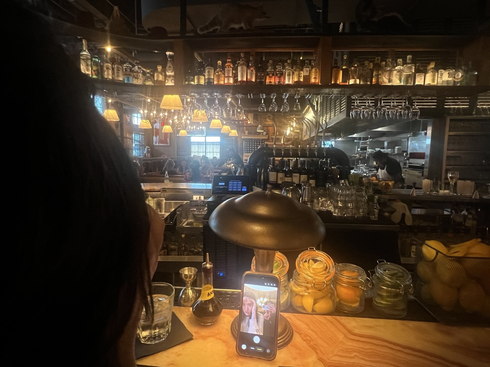
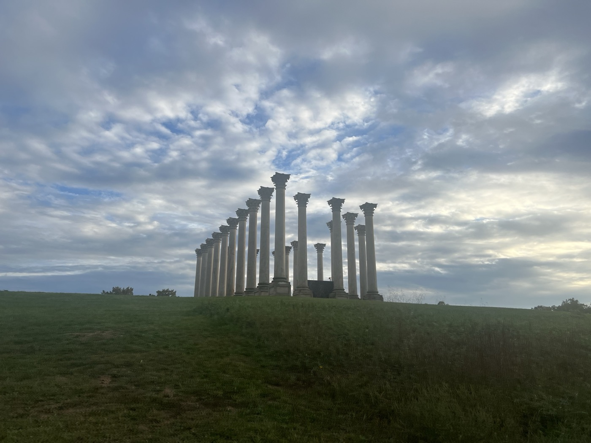
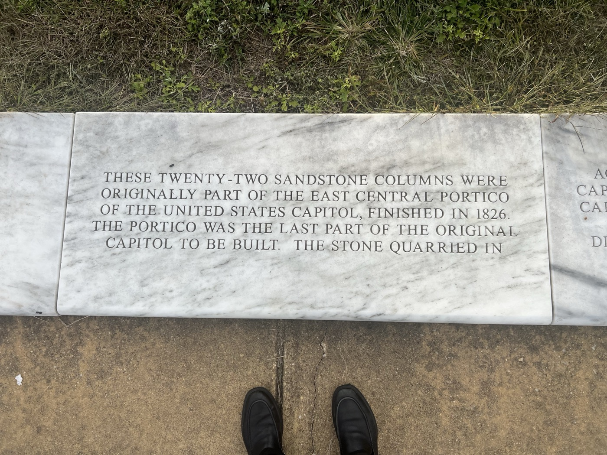
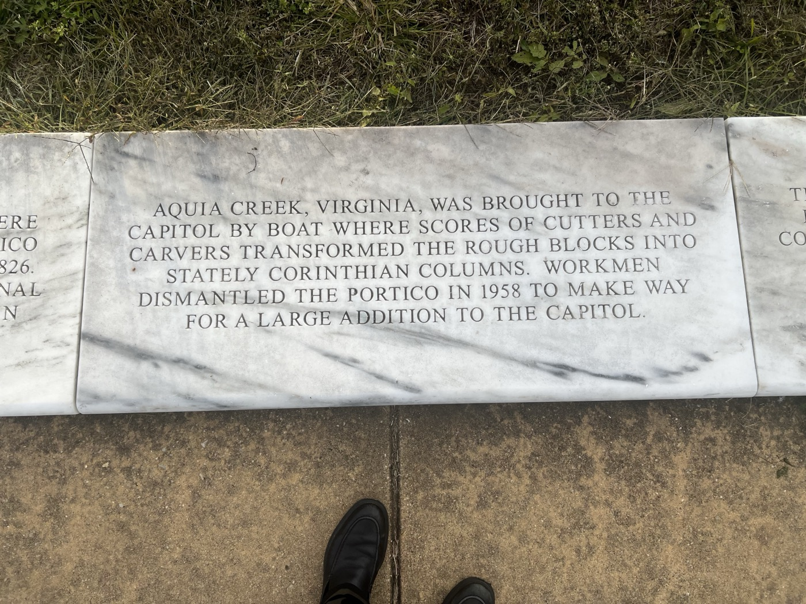
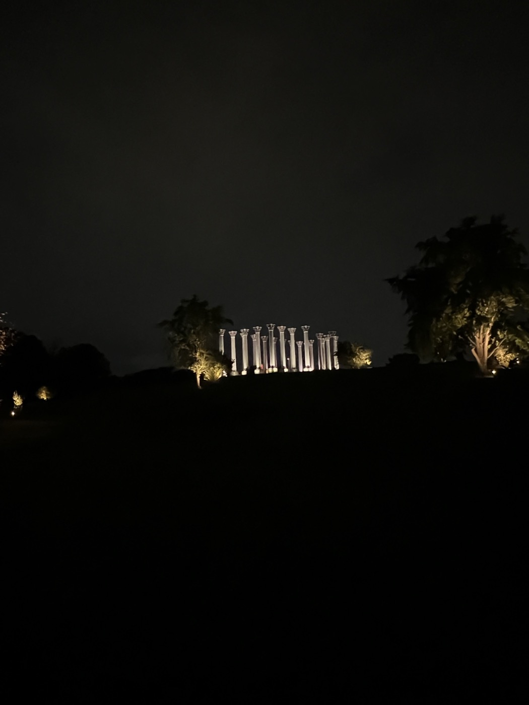

# 2026-10-10 in the garden  
  
We struggled to find sustenance because this place is inhospitable. I was shocked to discover we were right by Songbyrd.  
  
  
  
So many things in D.C. are just like, "Ok....."   
  
  
  
An arbitrary town where one can really feel the flimsiness of the project we've chosen to center here. We set up for cocktails here. I played deep house music under these columns. During setup three fighter jets did a flyover directly overhead. It was the loudest and most upsetting thing in the world. Recently, Trump took flak for flinching at a flyover while standing side-by-side with Xi. Can I say I don't blame him? All that air getting shoved around like that.   
  
  
  
**Poem No. 3**  
  
> The columns at night,  
> 
> the nine PM coffee.   
>   
> Three fighter jets conduct   
> 
> a deafening flyby over   
> 
> our heads.   
>   
> They are bringing   
> 
> democracy  
> 
> to the Banana Ball Finals.   
  
  
  
