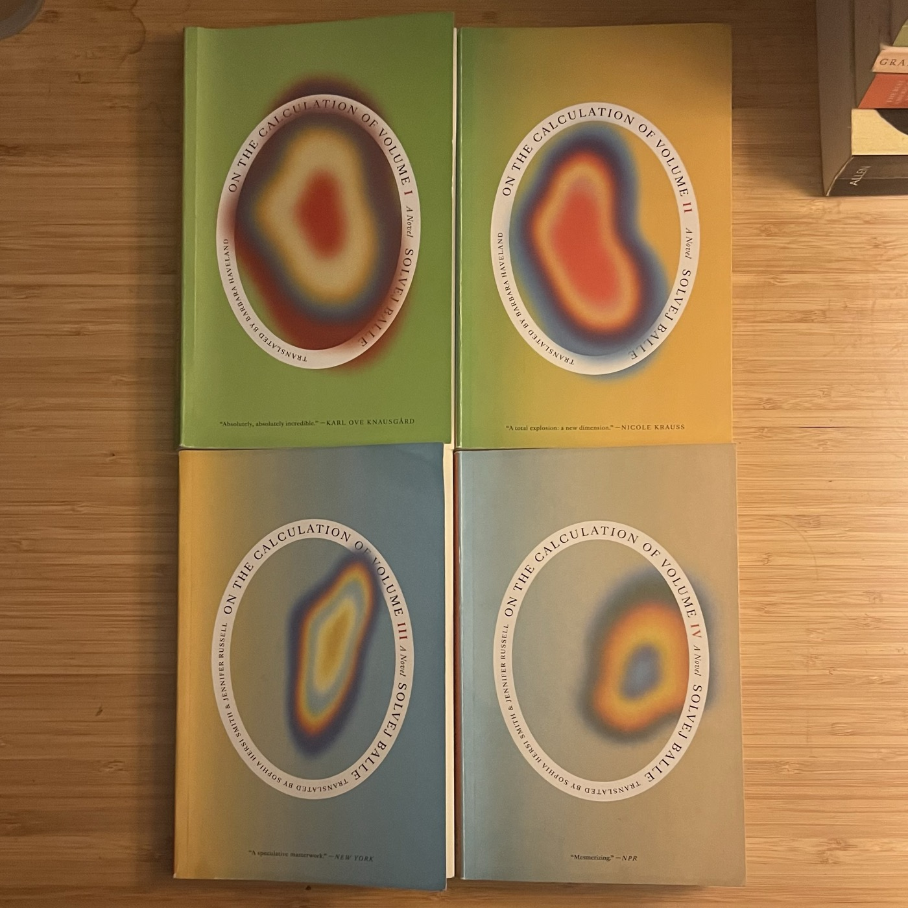

# 2026-10-26 after *on the calculation of volume (i - iv)*  
### by solvej balle  
  
  
  
> *Maybe that is why I write. Maybe it’s my way of being alone. Maybe the page is my door out of the disarray. A means of finding a way through all the thoughts and voices that blur together. To sit alone with paper and a pen and know that there is nothing but Tara's hand moving gently across the page, gathering the voices and gestures into that motion, ideas and explanations, all that we share, that we are many, a community, a flock, an odd bunch, and yet: my hand moves simply with all that has seeped into my sentences, into my hand, and I write myself onto a narrow path, sentence by sentence, I make my way forward, tiptoeing, so softly. Alone.*  
  
---  
  
(words pending)  
  
Makes me want to learn Danish / A.O. Scott says she's "our century's answer to Proust" / looking forward to November 18th / I should like the ponderings on language more / no offense but you can tell the author is NOT the age of her narrator / ilulix and I agree that there are some sillinesses and head-scratching oversights but some amount of those kinds of holes will always come with a project like this / why is it called that? how much can a day contain? / i wonder if she will go straight sci-fi, but i kind of hope the next volume leans more romance 😍 / the worst thing that could happen is that ballej could sully the glory of the first book by continuing to philosophize meandersomely  
