# 2026-10-28 "i had one destination in mind and that destination was the Halloween Store"  
  
I'd like to take a second to acknowledge again the perfection of the weather over these last weeks. In the morning I call Katy and enlist her help on my Halloween errands. So she joins me on a tramp into Bushwick. We keep breaking out into "Arthur McBride" and ducking into thrift stores. This is about the only time in the history of our friendship that both of us have wanted to shop for clothes and I wonder if she's reveling in the opportunity.  
  
We land at Richard and Pearl's. I've Richard's guitar on my back and I return it to Pearl in exchange for an insane LED headlamp, which he calls his "pride and joy." Katy says her brother also loves his headlamp. I'm just trying to be Geologist from Animal Collective. Pearl's aglow with birthdayness and recommends that we actually try the double-decker bus tours of Midtown sometime. *You can actually see the buildings from up there*, she says.   
  
A change in perspective can be nice. There at the bottom of my old block I can see the tree outside my old bedroom window and it feels like a collegiate memory even though I'm staring right at it. Because I am thirty-one now and I was twenty-eight then.   
  
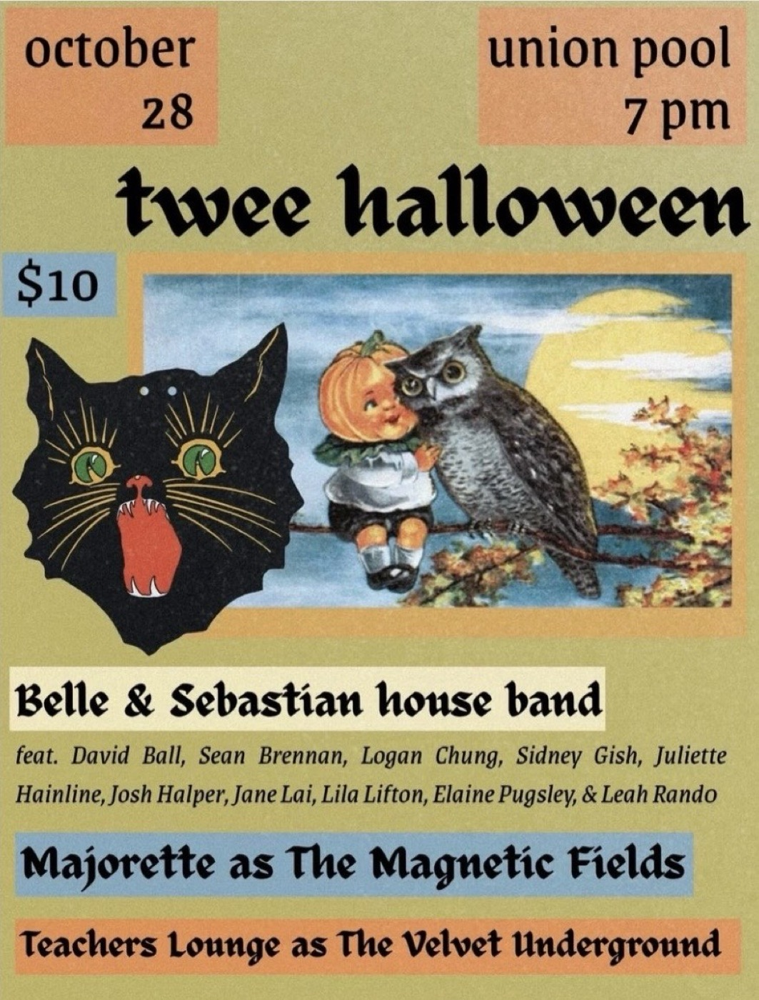  
> *the night's event*  

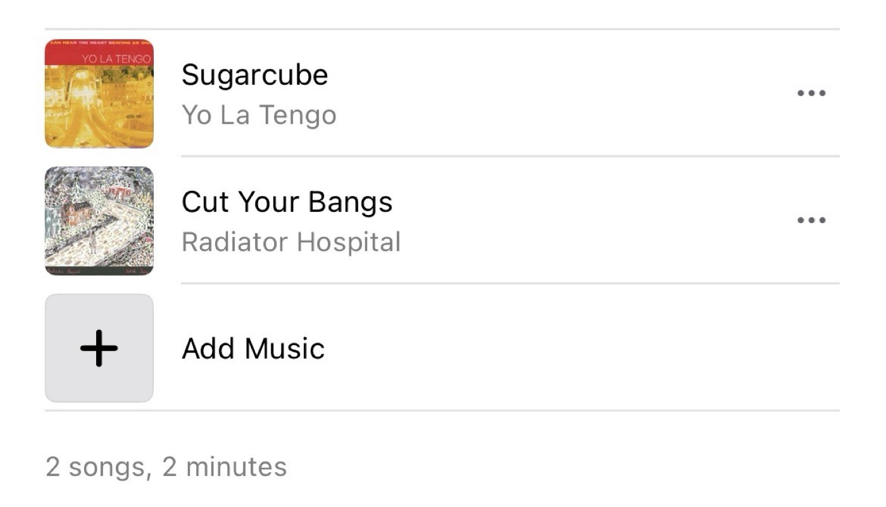  
> *WHY MORE SONGS NOT FEEL LIKE THIS?!?!?*  
  
---  
  
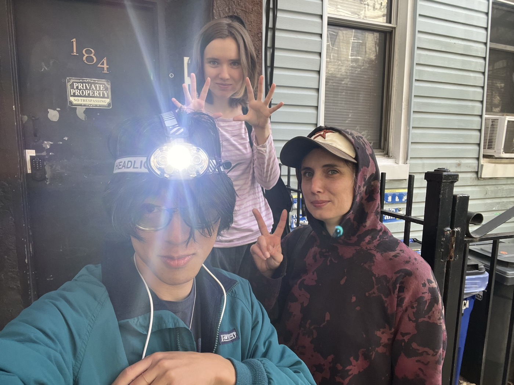  
  
I have historically disliked Halloween, but I am feeling excited this year, mainly because I have multiple costume ideas and I think that it's neat that the Time Change will happen during the festivities on Saturday night. I've got my Geologist "costume" covered but we are still searching for a chartreuse blazer so I can be Dougie Jones, an idea which I had at some point last year and forgot about, but at some point set as a reminder in my phone, because I plan ahead for these things. It felt like a little gift from a prior self, as Coop might say.  
  
I've also historically hated shopping for clothes, as I have a form of something like sartorial blindness, but there's some providence at play today. We try OPC and strike out, and then move on to Le Point Value on Flushing. I've been unsure whether a perfectly-oversized chartreuse blazer will be difficult to find or not, but like I said, providence: as soon as we enter, there's a blazing greenish jacket and pants combo sitting alone on a rack within clear eyeshot of the entrance.   
  
I'm reminded of Dougie's scenes in the casino where a glowing red light tells the mentally-damaged man how to win a fortune at the slots. Katy says it's God who smiled up on us. Austin says it was David himself giving me "my own little Mr. Jackpots moment."   
  
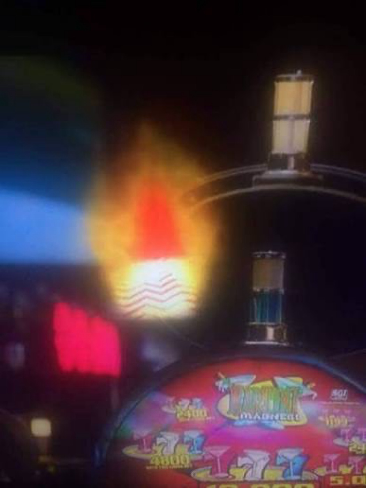  
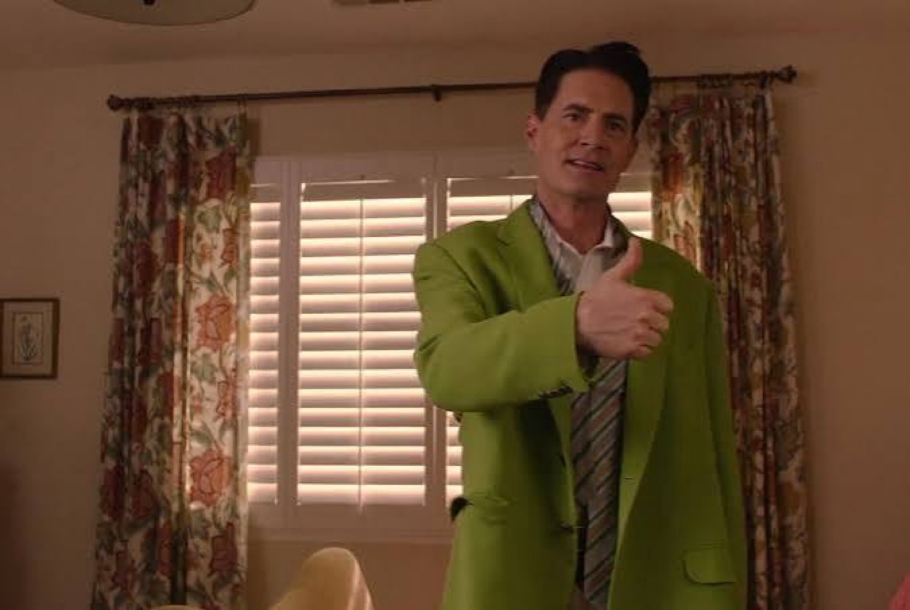  
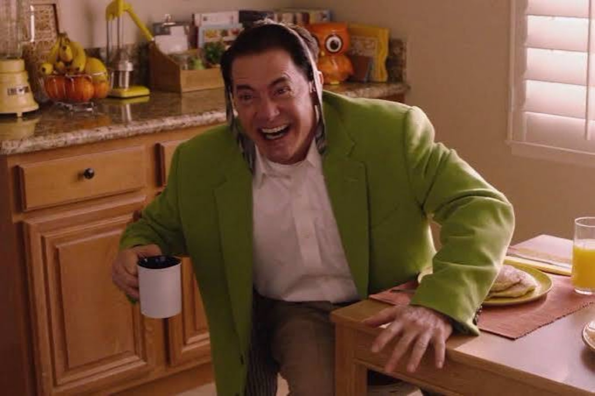  
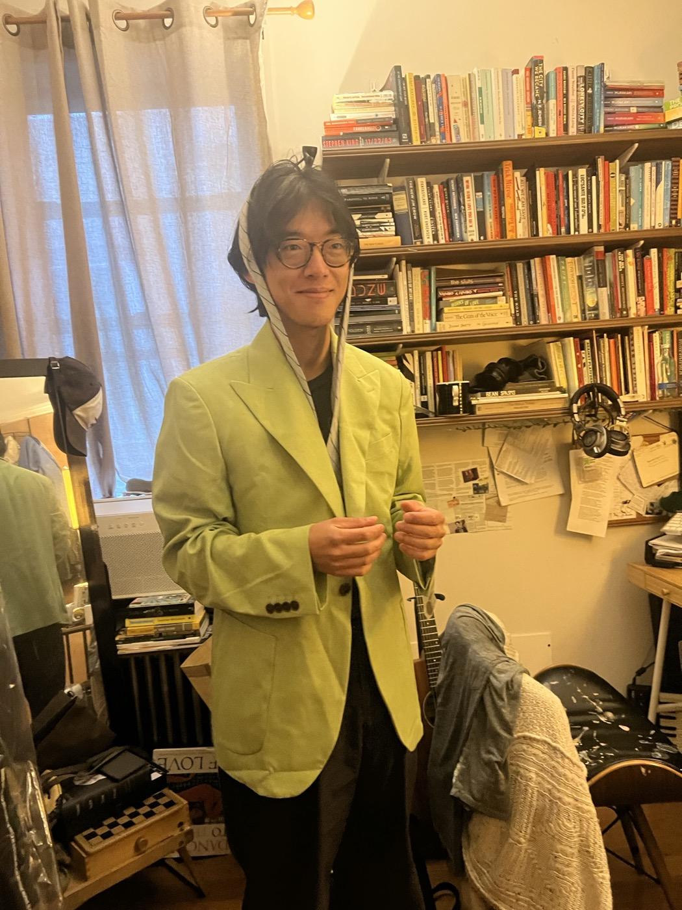  
  
Back in Ridgewood there's some exchanging of items that Katy and I still need to handle; she wants to show me her beautiful new guitar and bestow upon me the blessed Purple, our favorite instrument in the world. I venture that maybe it's my turn to write a great album on Purple and she wagers that it is indeed. We're greeted in front of her building by Joey and Shannon, who's just received some horrible news. I hold her tightly for a moment and then Katy and I clear out. Katy trims my hair at Light of Twenty Miles' and then we drop her off at work.  
  
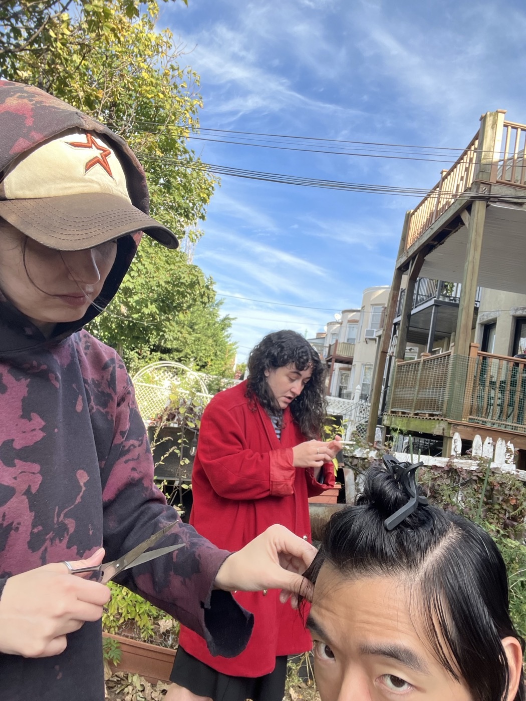  
  
Katy "takes a nap" in my bed while I get ready for the evening's festivities. She is playing a card game on her phone. At some point I actually do take a nap next to her and then we have a crisis of hunger which we address at Aunt Ginny's.   
  
---   
  
## TWEE HALLOWEEN at Union Pool  
  
Sweet Alyana is working door which means my latecoming friends won't be getting in. Katy and Josh get stoned together while I play with my headlamp. Throughout the course of the evening's opening festivities, I realize that the headlamp is coming across as a strangely aggressive piece of headwear. I'm not turning it on, of course, and no one asks me to, not even the boys, but there must be something about the possibility of being suddenly engulfed in a bright white light emanating from my forehead that is threatening to people. I can tell by the way their glances flicker to my forehead while we're talking or standing near each other. Only one person, Sean, even understands when I tell them that I am Geologist from Animal Collective. Elaine does her joke where she simply blinks. Eventually I'm more or less forced to retire the costume idea. Luckily, between my twee-leaning outfit, Katy's new haircut, and Lane's scarf it is easy to blend in with the twee crowd here at Williamsburg's most venerated Millennial hookup rock club.   
  
Jane asks for a rundown of the Nashville Number system and symbology; I say hello to KE who's just moved to the city finally. Her hair is long and her cap is perfectly askew thanks to Erica's styling. She says she's subletting by the park until Christmas. Carol asks if she can borrow Lane's scarf for her Little Red Riding Hood costume, and I'm struck with an awesome fear at the mere thought of such a costume's overwhelming cuteness. But she dons it, and it is undeniably perfect, and even though I lose the scarf for the duration of our set, we find it again and she takes it home and the picture she sends me in her full costume nearly ends my life. From adorableness.   
  
I spend some time singing along to the Magnetic Fields and the Velvet Underground. After the VU set Elaine walks towards me with a fixed gaze of mild concern. "Did you know there's a special guest?" she asks. I say no, this wasn't one of those events, even though someone apparently asked Jane when Sidney would be playing. Elaine says that Olivia Rodrigo is here. I say Oh! and then remember how this would be the case. I never see her and I think she leaves before I sing.   
  
From the stage it's hard to make out faces in the crowd but I make smiling eye contact with SF a few times. Shortly before our set began I had confided to her my Stuart Murdoch secret, which is that it is probably a good thing that he's never asked my songwriting advice, because I can't make heads or tails of his music most of the time. But the show is sweet, Xtian comes up to "duet" with me on "The Boy Done Wrong Again," (Katy, Lane, and Austin never even enter), the people are dancing, Ashley and Rachel appear, and the whole time I'm watching the Brewers win the World Series on my phone.   
  
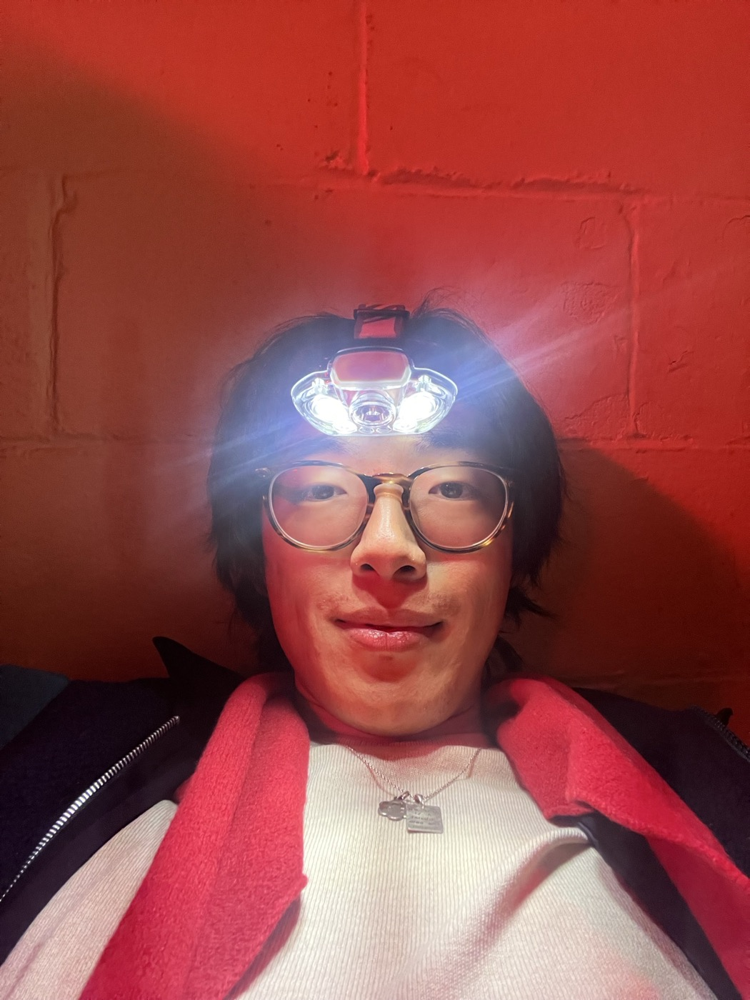  
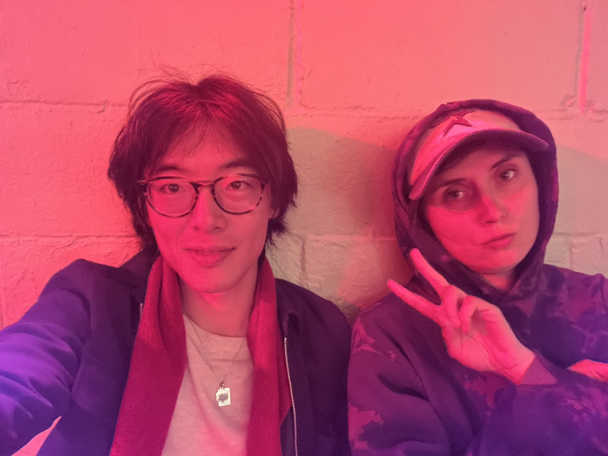  
  
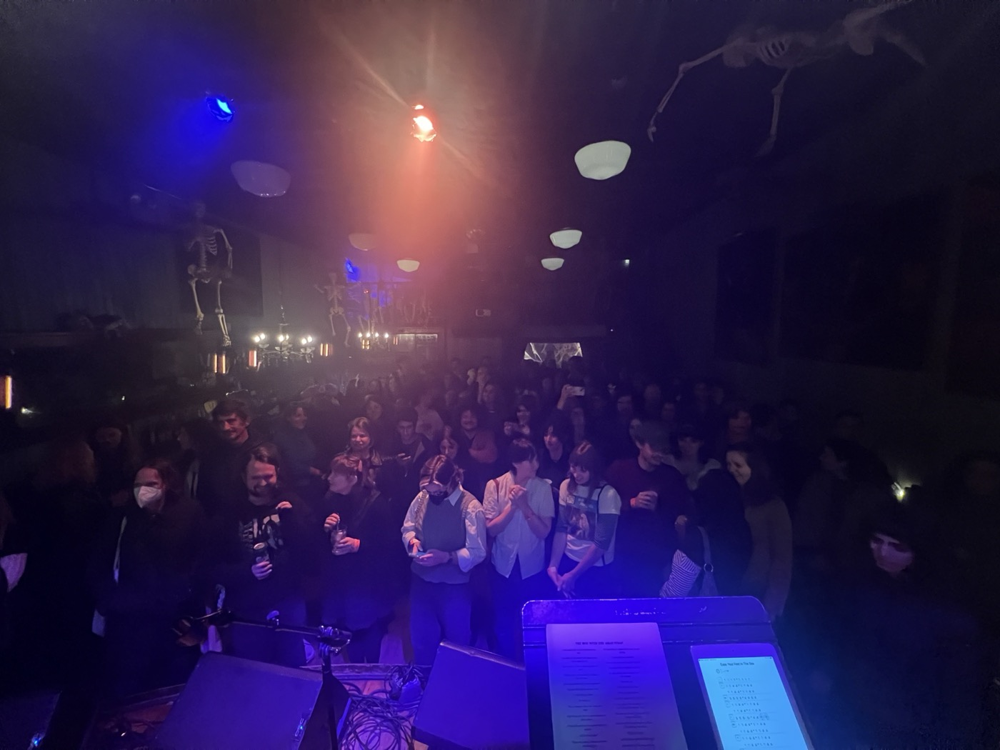  
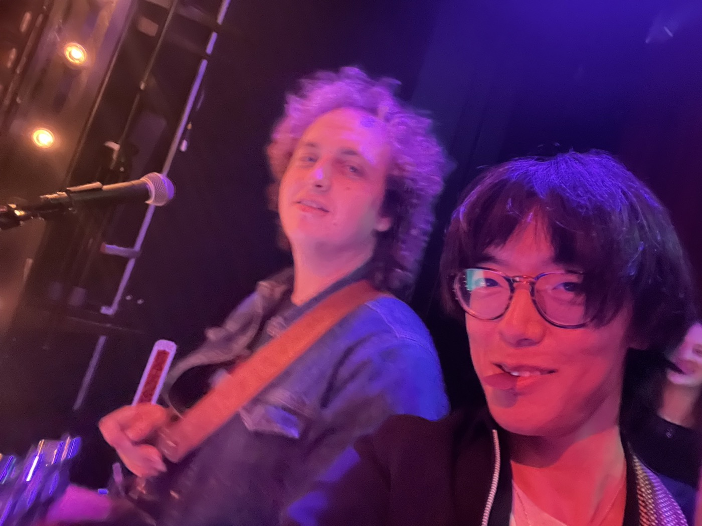  
