# 2026-10-30 help! I'm trapped in the past  
  
### Our bodies get bigger but our hearts get torn up 🥺  
  
I can't stop thinking about ten years ago, but at least this weekend it's not my fault.   
  
It has been fun, or "interesting" might be a better word, it has been interesting to feel certain memories bubble back up as I make my way through Union Square or Madison Square, places which I have visited likely hundreds of times in the past decade, but something about the decennial pre-election resonance is drudging up old feeling states from the pits where I'd probably prefer them to stay.   
  
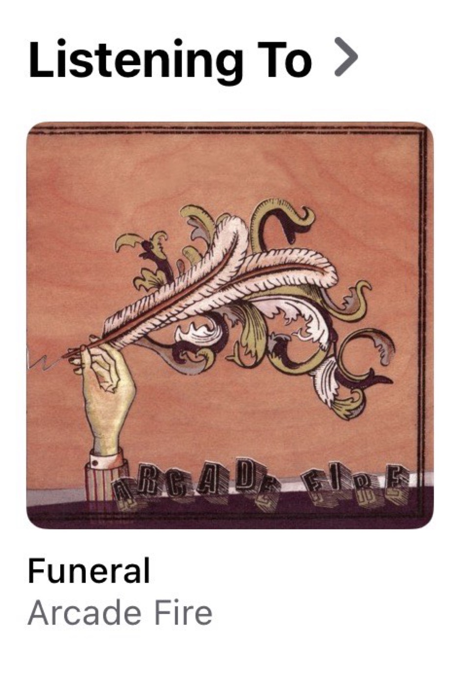  
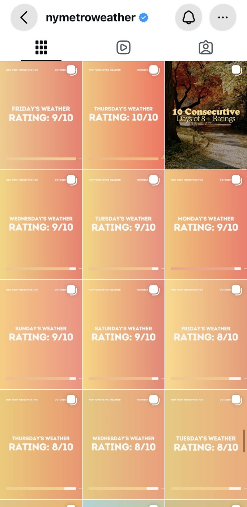  
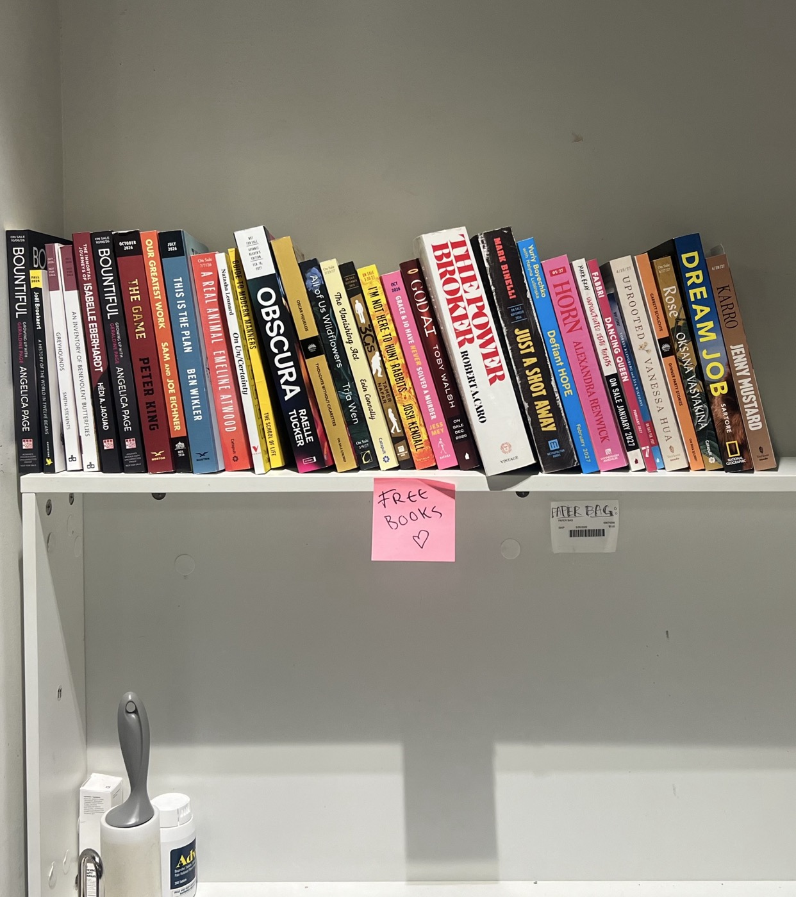  
*I remember listening to "Visions of Johanna" the night before Trump beat Clinton (for some reason), after a day interning at the record label in the building across from Rizzoli, where today I had an interview for a job that would see me making less money than I might have made at the record label; I remember seeing the scaffolding go up on the Flatiron and last week seeing it finally re-revealed; the surprisingly quick walk from Madison to Union Squares which I would take every day after work...*  
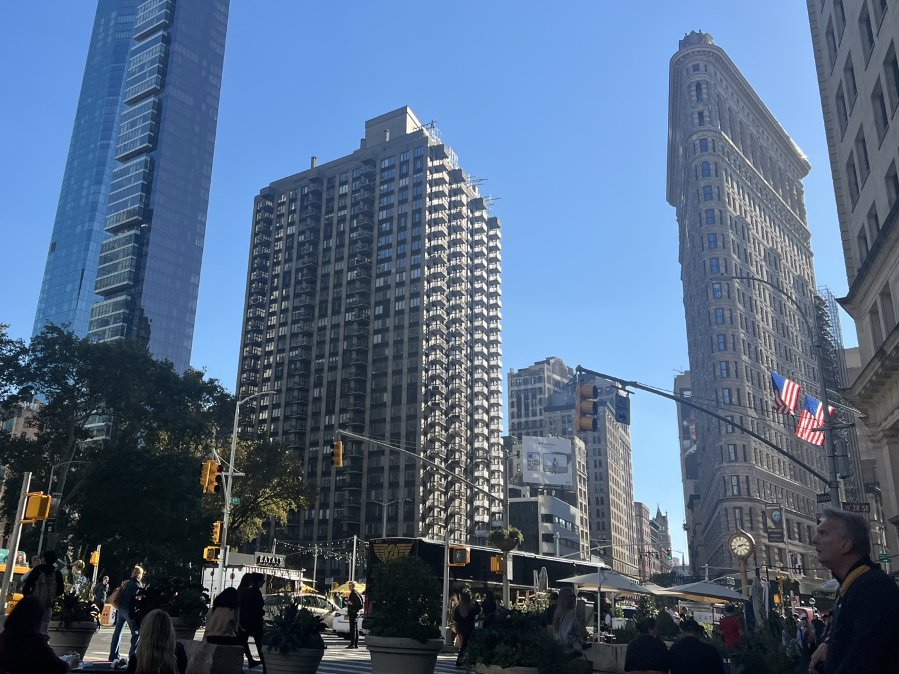  
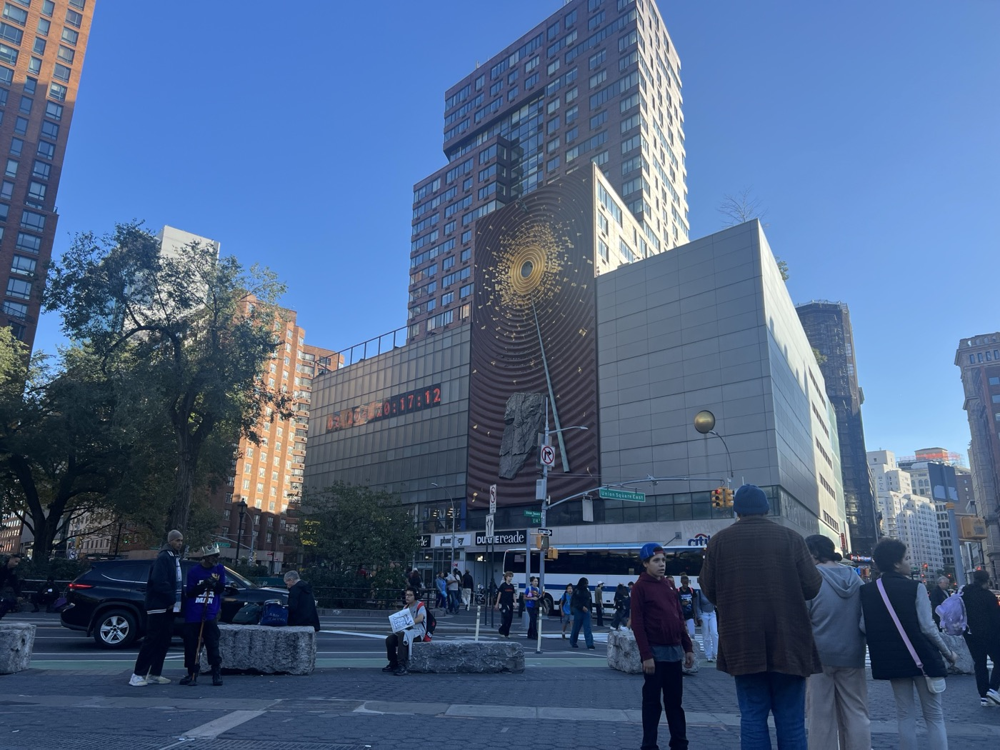  
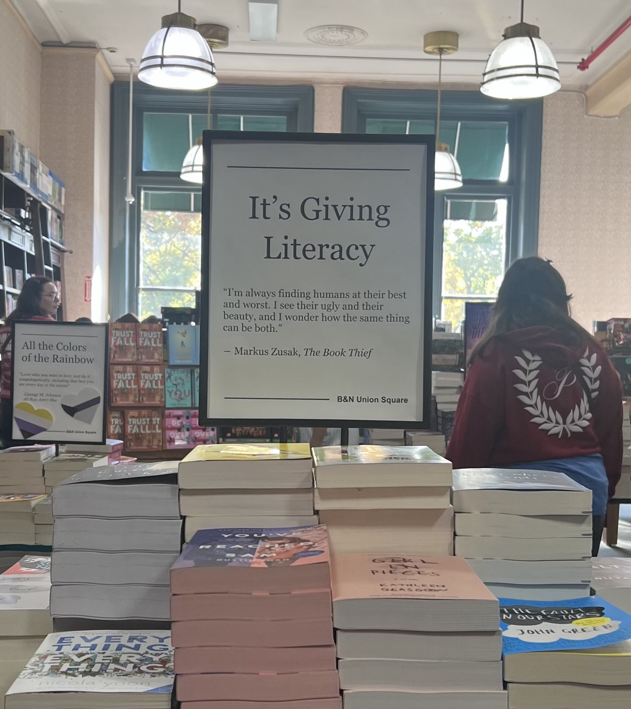  
*...today I used that saunter to buy some Rizzoli-friendly pants at Uniqlo; I remember reading both Bernie and Hillary's books for some reason at the B&N Café, marching up Fifth Avenue on November 9th, I met my first real-life socialists here at the start of that march, I'd give them my labor half-a-decade later; I remember when that fucking clock said twelve years, not two, and since when are there public bathrooms here?*  
  
---  
  
Ultimately I am glad that I did not participate in this show, because it meant that I got to have an extreme amount of fun in the front row. I have learned about myself that I really do not like being in costume but I will do it again tomorrow.  
  
  
  
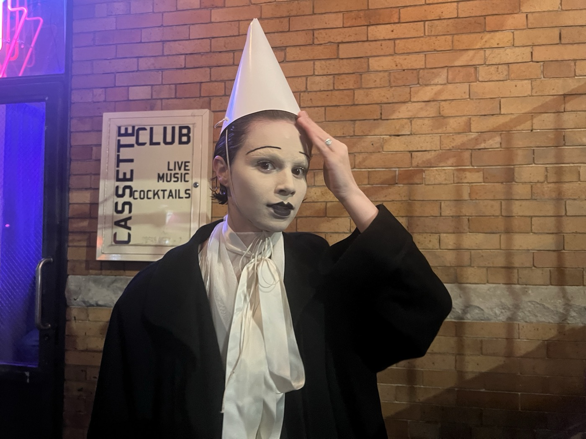  
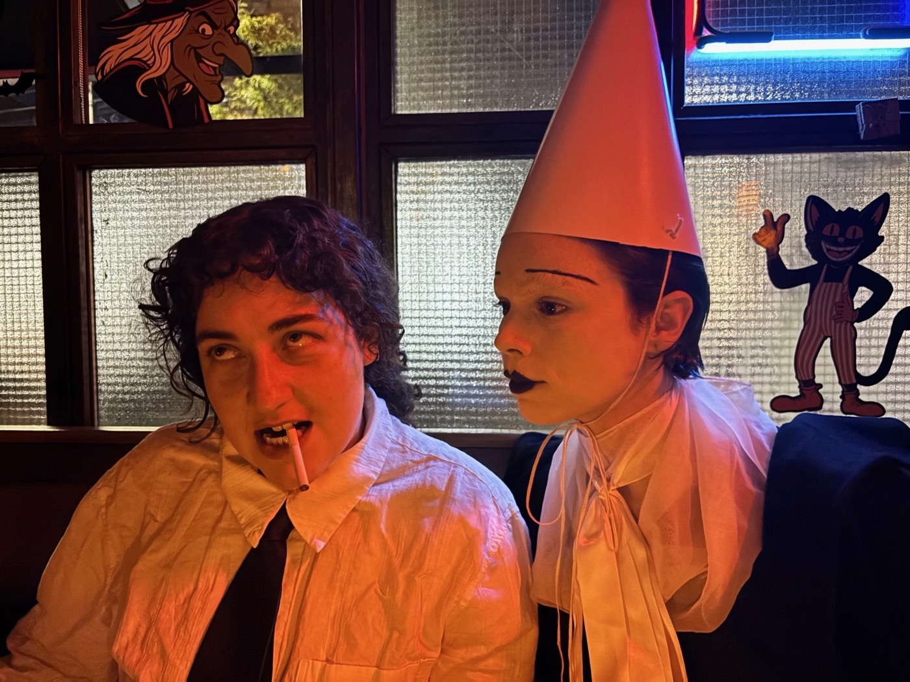  
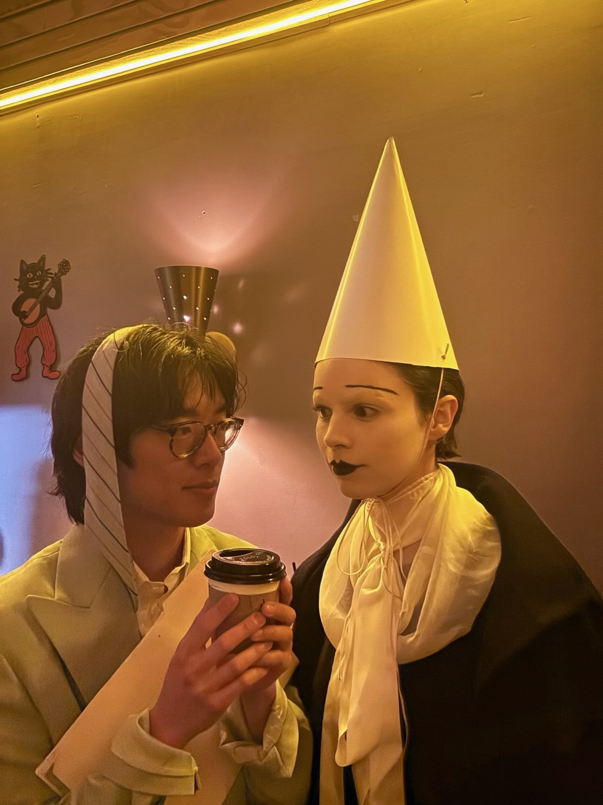  
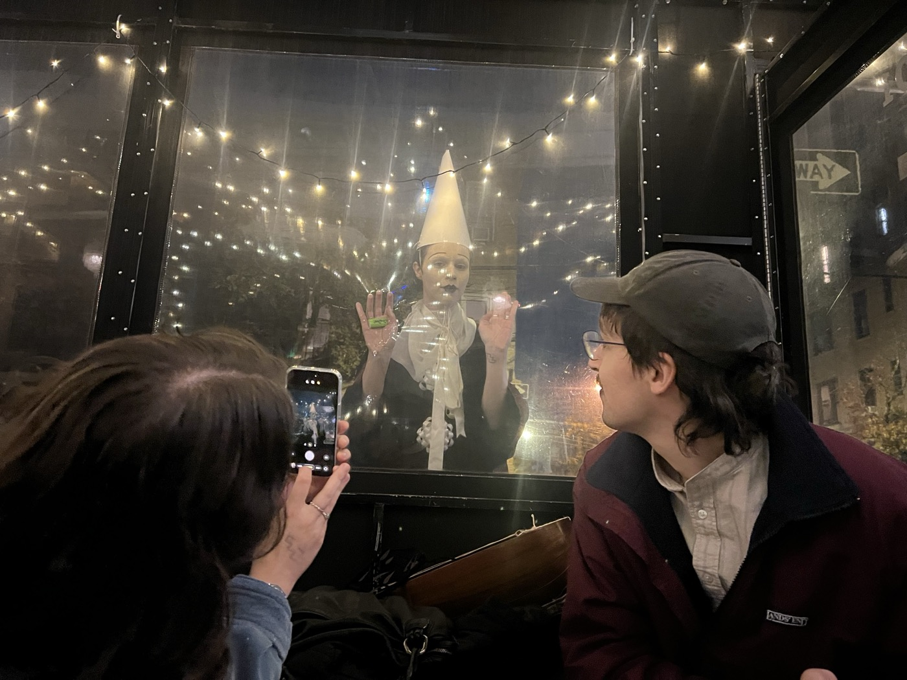  
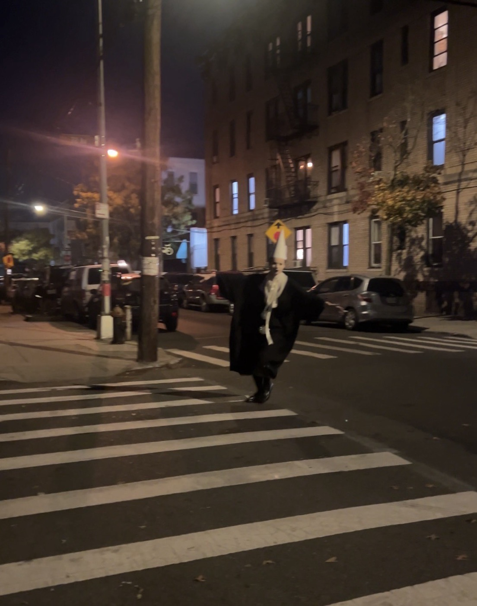  
