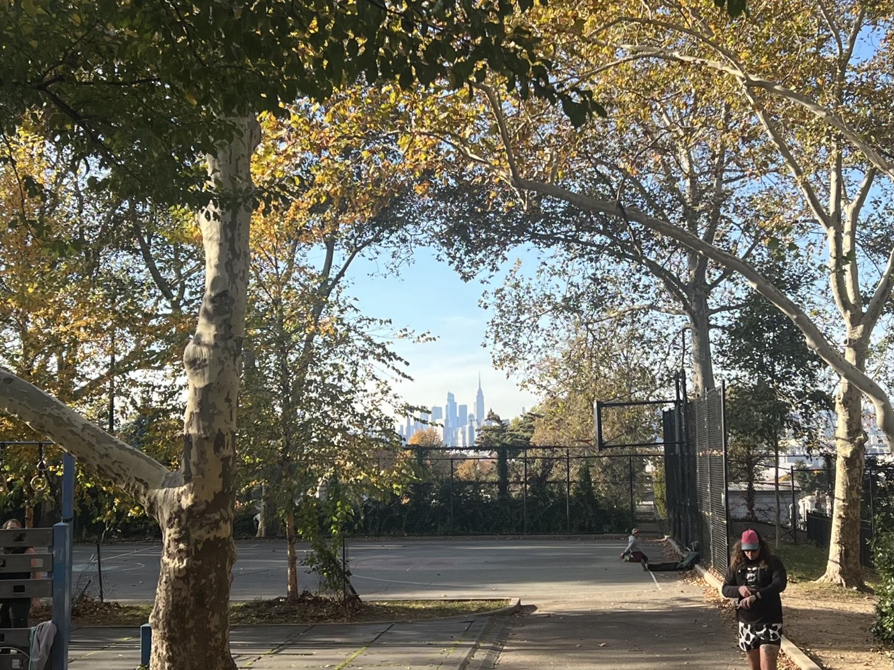
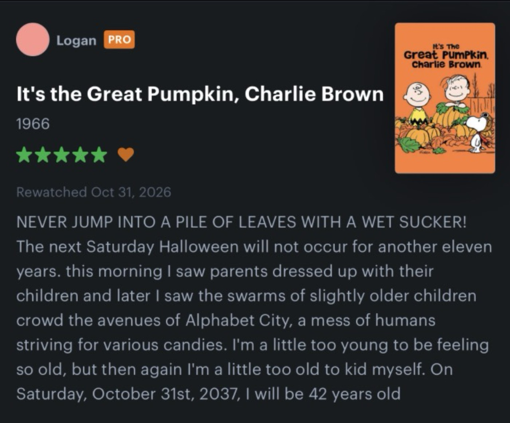
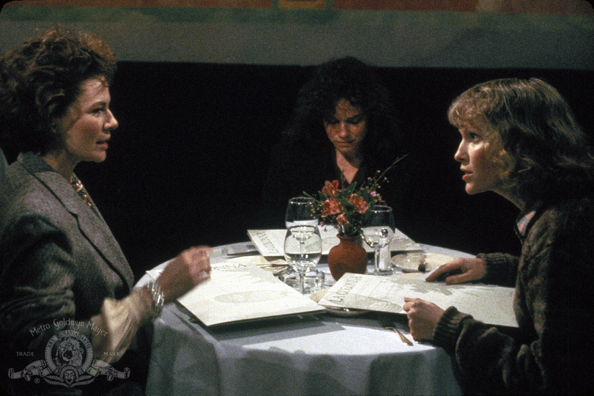
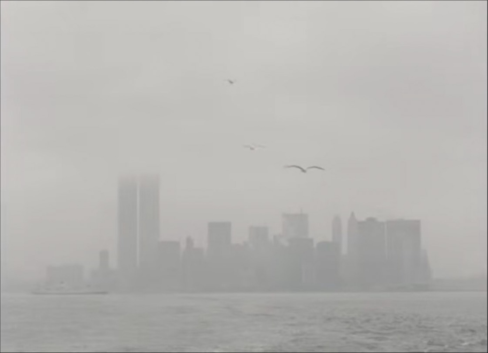

# 2026-11-01 i watched movies, hosted karaoke...  
  
*...and today, Democratic former candidate for Senate in Michigan, Haley Stevens, endorsed the MAGA Republican Mike Rogers over Democrat Abdul El-Sayed due to hurt feelings at the way their primary went down. It was honestly a very fun day to be online. Remember last year when Jessica Ramos did effectively this and tanked her career? Schaudenfreude over feckless liberals is a special feeling these days. I wish I could bottle it up and use it like a supplement for the drier political seasons. Tuesday will be special. The sun set at 4:52pm and then I took a nap. *  
  
  
  
---  
  
  
*Hannah and Her Sisters* (1986) // *News From Home* (1976)  
