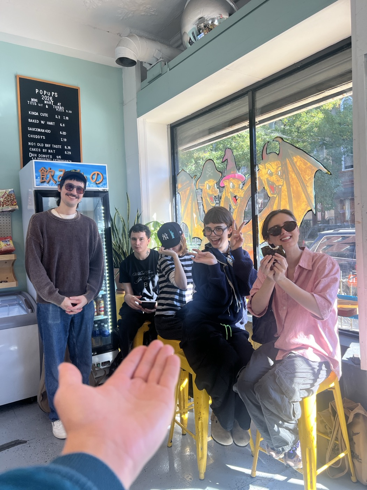
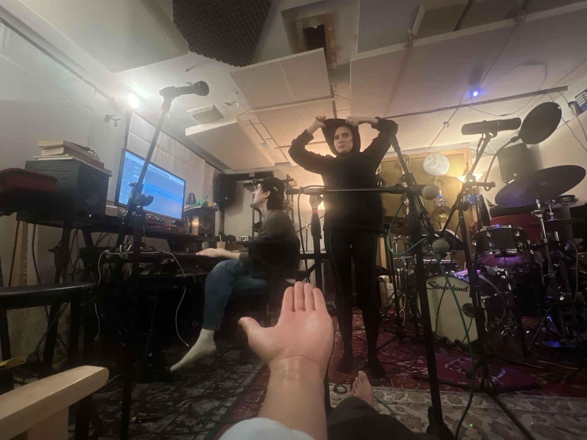

# 2026-11-04 pt 2  
  
---  
  
  
  
  
last night after a joyous morning sending Richard, Pearl, and Lanet off to a striking Paris, and after then spending the afternoon hungover at the studio and making Christmas music with Austin and Katy, our specialty, and after a stopover at SEY and getting to hug L and also running into D, after this I opted to hit Mr. Nancy's for the reading instead of Music Hall for the show, and I met via R a nice young woman whose name now escapes me and who loves Jesse Ball, we were getting along quite well even though I couldn't hear a word she was saying, I was having to lean in at a rather extreme angle just to catch something like half of the words she was saying, I found her interesting and then realized she was probably quite young when she said her favorite writer is Kerouac, or maybe he really is just her favorite writer and she is my age, anyway she said she left a page from his journal with some journaling of her own while happening to drive past his grave in Massachussetts, she works at *Publisher's Weekly* and was enjoying telling me about New Directions, later after the readings she touched base with T and left without saying goodbye to me, which is totally fine, our conversation had run its course.   
  
and I realize I don't know where J is from and so I checked her area code and immediately thought of Paul and bam there I am ten years ago again; talking with the girl made me realize that I've accidentally stumbled into a trend of reading psychological novels, not something I'm really that interested in but I guess it's become interesting just by nature of my being stuck in these books, and also probably partially due to the rug-pull that was the first book of *On the Calculation of Volume*. T's material (and delivery) is dry but charming, playing off of opposites a lot, striking an almost Tate-esque everyman sardonicism or maybe that's just his voice; R likes to really hammer it home into the microphone, and J reads several poems as well which I really do adore, the last of which is a brief and brand-new one called "Crickets" and it makes my heart flutter. multiple people asked me last night whether/when I would be reading and I guess this is as good of an actionable goal as any to slide into my slightly-extant "twelve-month plan to have a twelve-month plan." it is fun and freeing to write like this but sort of in the way that diarrheal incidents can feel that way.  
  
there was something else I wanted to write about. outside of Nancy's I spy JR and his friend. they've just spent the afternoon and evening in Central Park and were marveling at the new JPMorganChase Tower. we feel similarly about it in several ways: when the fuck did it get there, it feels like it just appeared out of nowhere, it's disgusting but distinctive and maybe that's at least better than those super-tall spindles of glass; apparently on the inside it is "insane." i think we should organize a field trip somehow. it is an affront to the rest of the skyline but in ways that at least feel directly rooted in our time rather than trying to stand outside of it (like the glass spindles) or ignore it entirely like the brutalists; although JR's friend says that the base is apparently quite brutalist indeed. when i see the building across the water it does fill me with revulsion. it feels like it has been pulled out of some fiction and placed here. which at least makes it interesting. it cost six billion dollars.  
  
