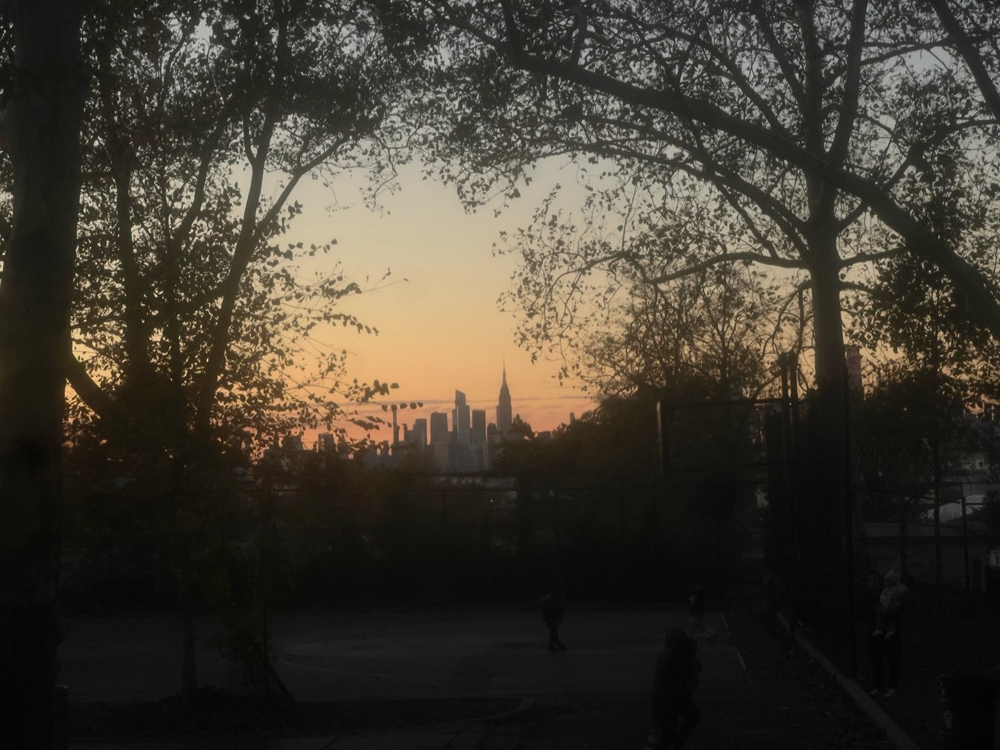
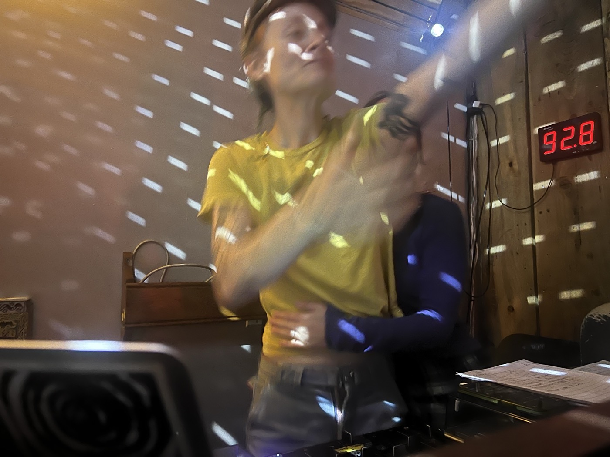
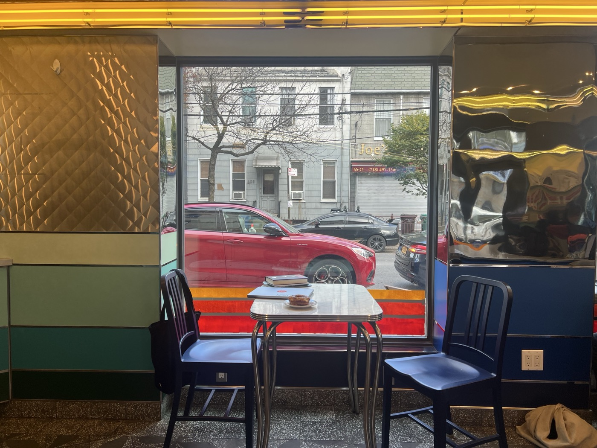
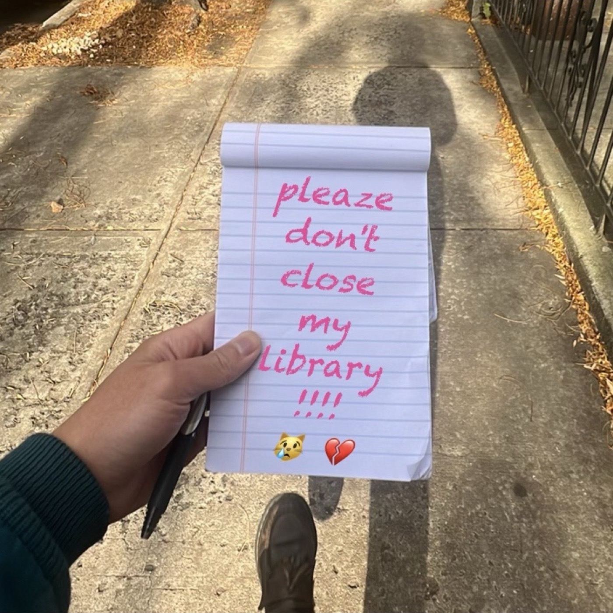
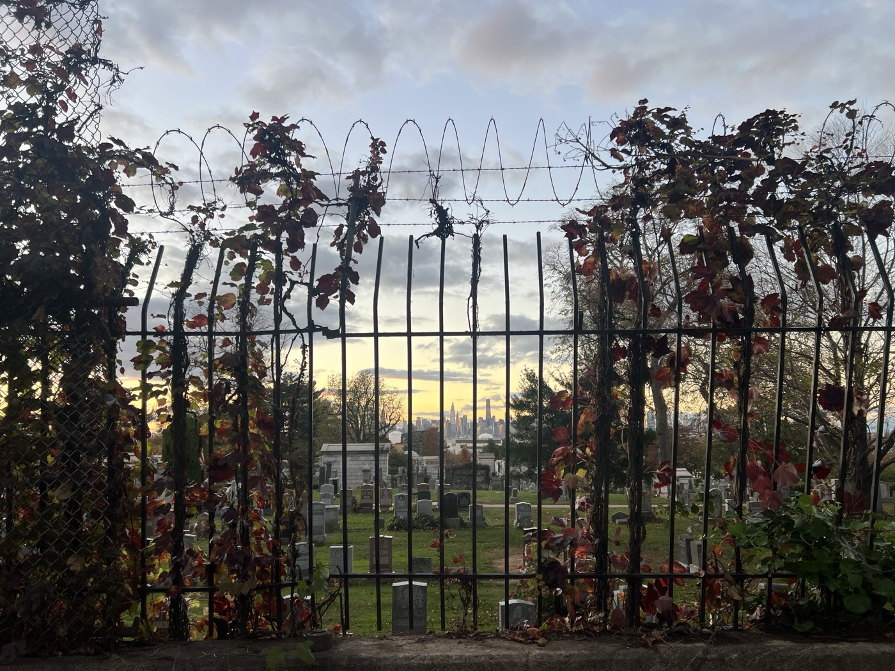
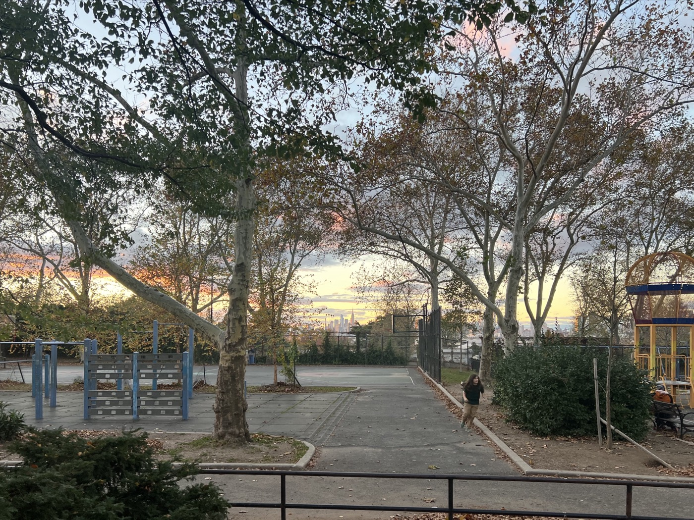
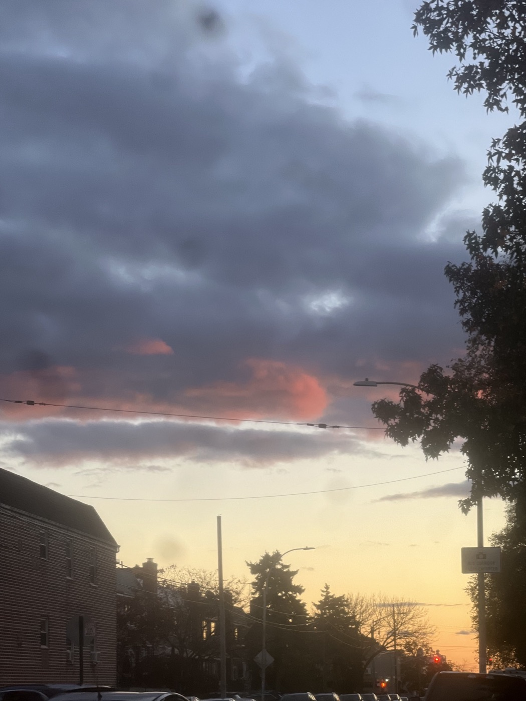
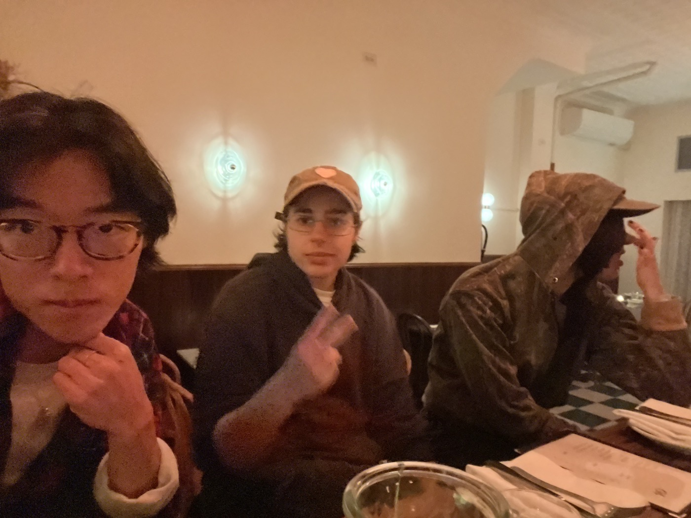

# 2026-11-09 a productive day  
  
---  
  
and so ten years came and went. Bella is in Florence and somehow the fact that I was in New York only one year after Florence, and at Sportsman's only one year after that, and in Austin only one year after that, and it's been eight years since then.... I don't know what to think. what does that make me?   
  
I have been seeing the sun off and the skies have been periwinkle and amber and a brilliant glowing pink. I've sung "Stardust" and "Bobby" with Uly and Becca and have been full of ideas. the holidays are coming. They've strung the lights and decor up over Myrtle Avenue, all that's left is to hit the switch and the lights will glow!  
  
Richard Lloyd died while I was upstate with Ashley; I've been listening to Television on my walks, jealously, I'm always so jealous listening to them. How amazing it must have felt to play music like this. Strange that we have more Beatles left than members of Television. I sometimes think a band should all die together, or else live forever.   
  
at BOOK CLUB, we ***[REDACTED]***. and I think about what makes writing good; the MFAs among us declare that it is bad writing because it is unclear, but I'm fascinated by the overall success of ***[REDACTED]***'s bizarre prose. we certainly don't expect technical mastery or one particular definition of clarity from music, or even poetry. even Verlaine and Lloyd hit bum notes.   
  
what if I grant to writing the same freedom? (Or, reversed: what might music influenced by this sound like??) setting aside the overall unpleasantness (putting it lightly) of the novel, ***[REDACTED]***'s approach is interesting to me for its notable lack of directness or tactical precision.... an understanding of occurences and characters nevertheless arises out of the passivity and remove, despite the janky sentences and disjointed time, all the skipping and *wallness* becomes a part of the psychology of the protaganist — .........  
  
but anyway. I'd like to host a SPELLING BEE.  
  
  
  
  
  
  
  
  
  
  
  
  
#life #lit   
