# 2026-11-11 music is  good for you  
  
---  
  
### *REPEAT TIL MANTRA: "I AM NOT A USELESS PERSON"*  
  
My day started with the music of friends, was helped along over lunch and sunset by the same, and then ended — by surprise — with the same.   
  
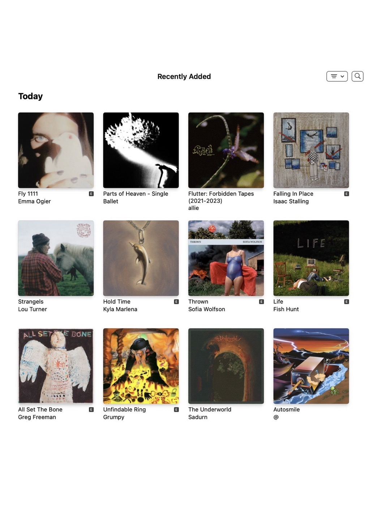  
  
---  
  
### JACKSON HEIGHTS  
  
w/ Yvonne and her lovely friend Emma. together they inform me of a wonderful list of things to be researched further, such as the Zlatne Uste Golden Festival at Astoria World Manor. Emma is singing in a Bulgarian folk choir there. Yvonne tells us some bad news about Maybelline.   
  
after arepas Yvonne walks us to a park that she likes and oh boy do I love it too, even though it's a very normal park. it's Travers Park and we sit in the grass as the sun goes down. we talk about books and Emma recommends *The Anthropologists* by Ayşegül Savaş, for its warmth. it's nice to leave a hang feeling excited to have homework.  
  
on our phones, M and I drift in and out about the magic of music. I get weepy hearing the debut album from Emma Ogier, *Fly 1111*, in stores now. I think of Fairhope, gathered around the live stream, the party afterwards. how much happened afterwards, pretty much everything. you might have said we had the world on our plate.   
  
> *It feels so dangerous keepin' him close*  
> 
> *I aim to make a livin' runnin' coast to coast*  
> 
> *I think of my grandma, we sit on her furniture*  
> 
> *Reminds me she's gone now*  
> 
> *When I was out on the road, I missed her funeral*  
> 
> *I wish I would've known, heard she looked so beautiful*  
> 
> *Now I'm dyin' at the airport, never gonna land*  
> 
> *I'm tryin' not to miss him, but damn, that's my man, that's my man*  
  
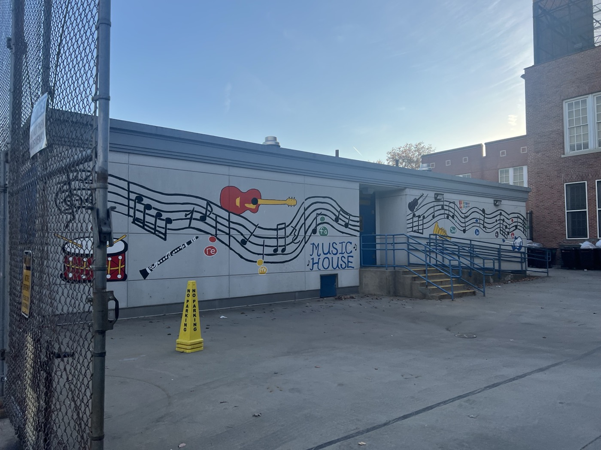  
  
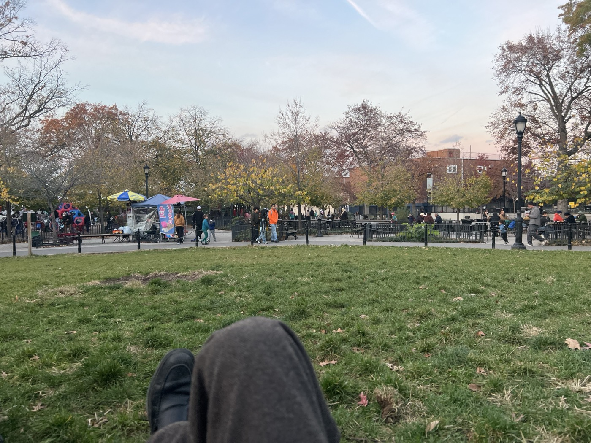  
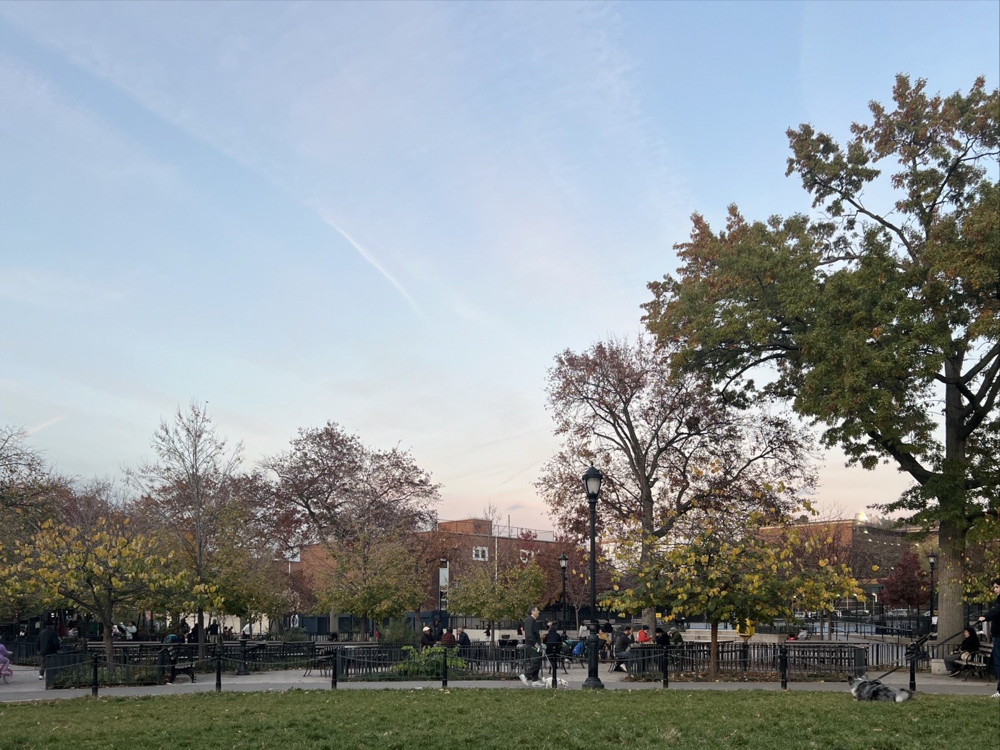  
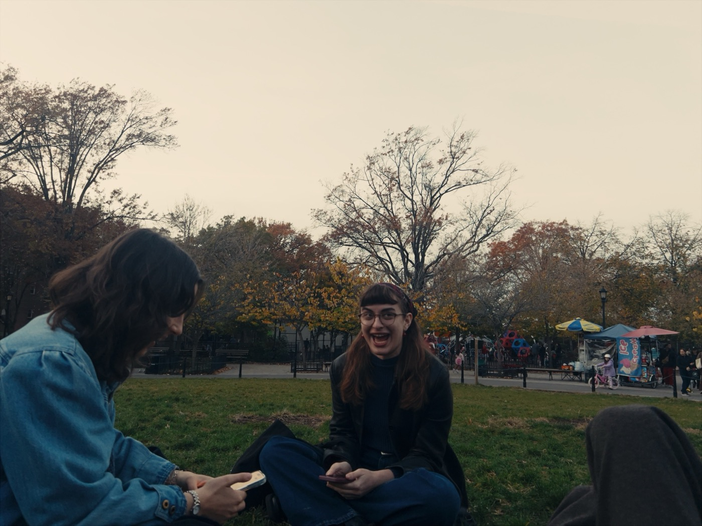  
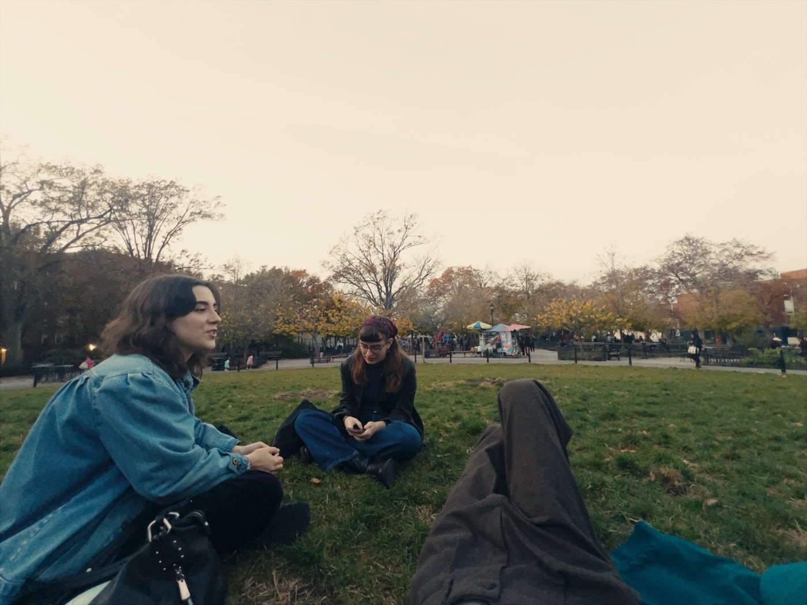  
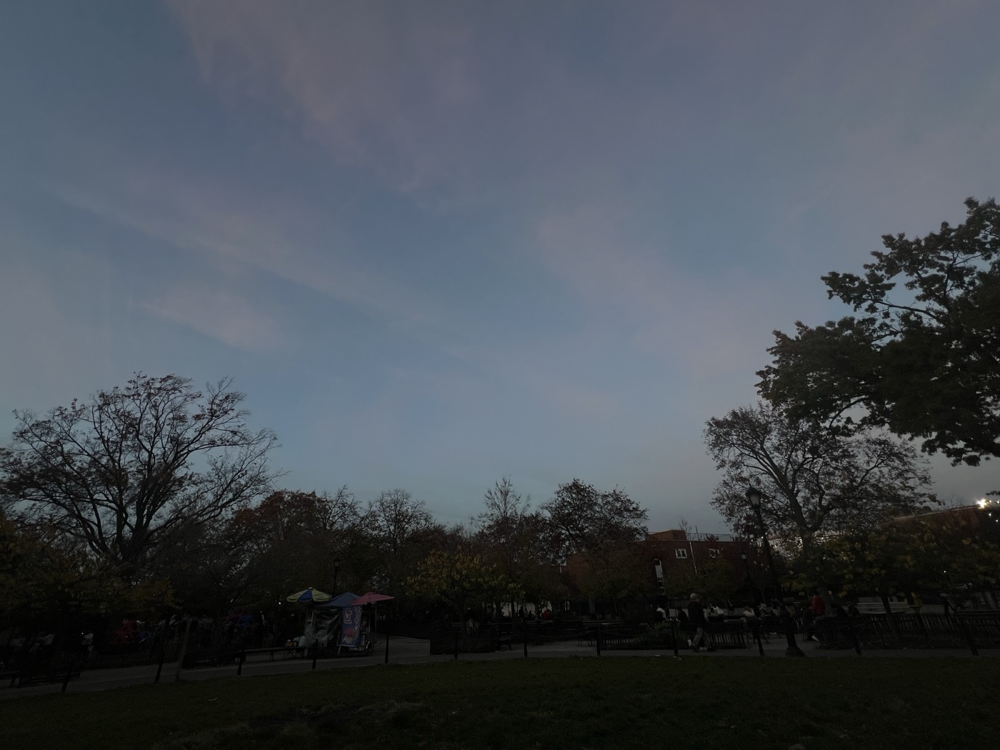  
  
as the sun sinks farther below the horizon the light does its nightly choreography, changing every ten seconds. the golden shadow of the sun brings out the blues and pinks of dusk. I keep pointing at the clouds, blazing and then rich and somber. *I guess this will be the rest of my life*, I say.   
  
---  
  
Afterwards I ride the M train in its near-loop all the way back to Ridgewood, less than three miles away, and read *Switzy*. I have the luxury of taking some time off of our BOOK CLUB book and am enjoying *Switzy* enough to finish it. In fact they make for interesting contrasts, at least in terms of their both having a disassociative protaganist. and I think of Taryn Simon's parents and her FBI agent's sudden episode of transient global amnesia. This whole thing is balancing on a knife's edge inside our brains. *Switzy* is the kind of book whose prose is just slight enough that I can participate at free-will. I'm writing a lot of thoughts down while reading it, is what I mean.  
  
later at the show, C asks S and I if we would consider Dignitas. S has seen the suffering and been ordered by loved ones to put an end to it if ever he was in the position to make such a horrible call. C says that people go through self-altering episodes even without dementia, she speaks of it like being taken over by a spirit. I hold her hand under the table for a while. I wasn't expecting to be here but she asked if I would want to attend, and it's nice to be reunited with some Nashvilles and some back-from-tours. C is severely underslept and overworked and her heart is a bit confused. so I come to the show and hug her and hold her hand.   
  
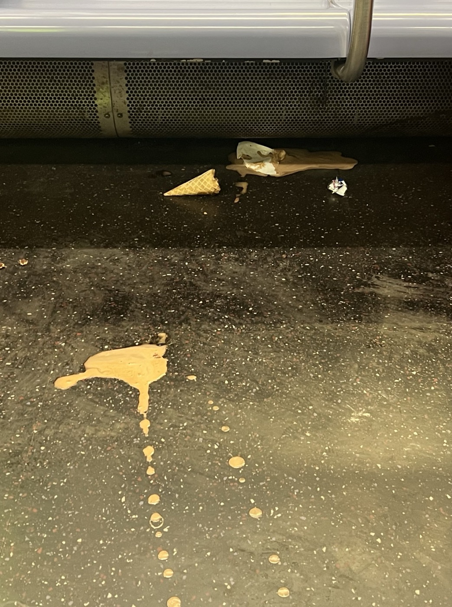  
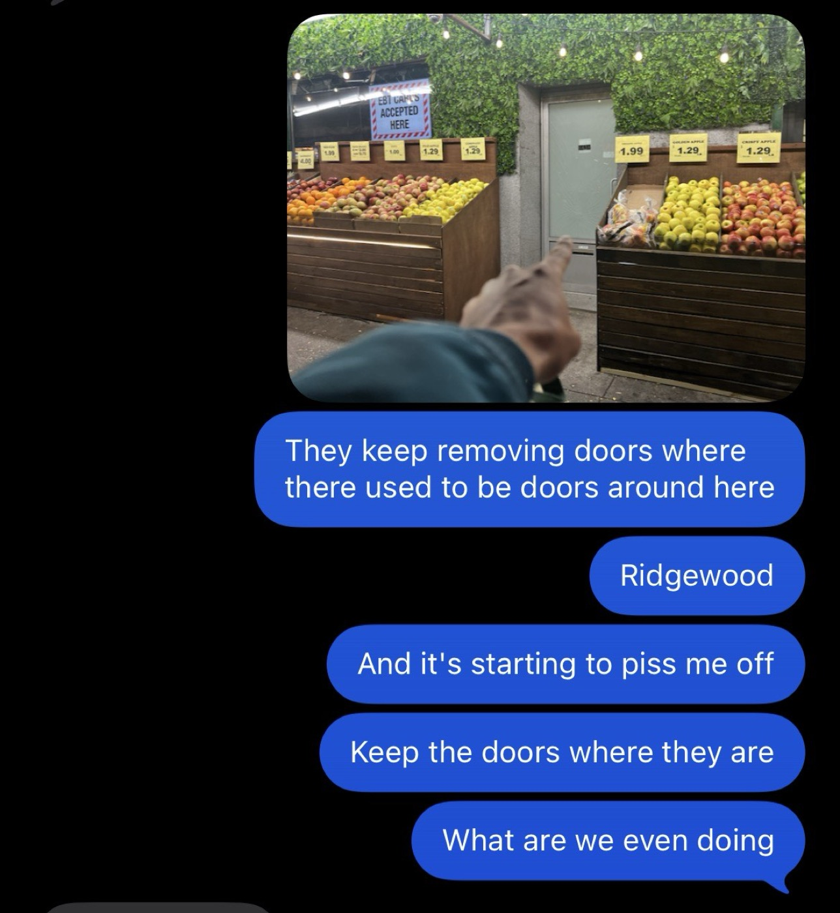  
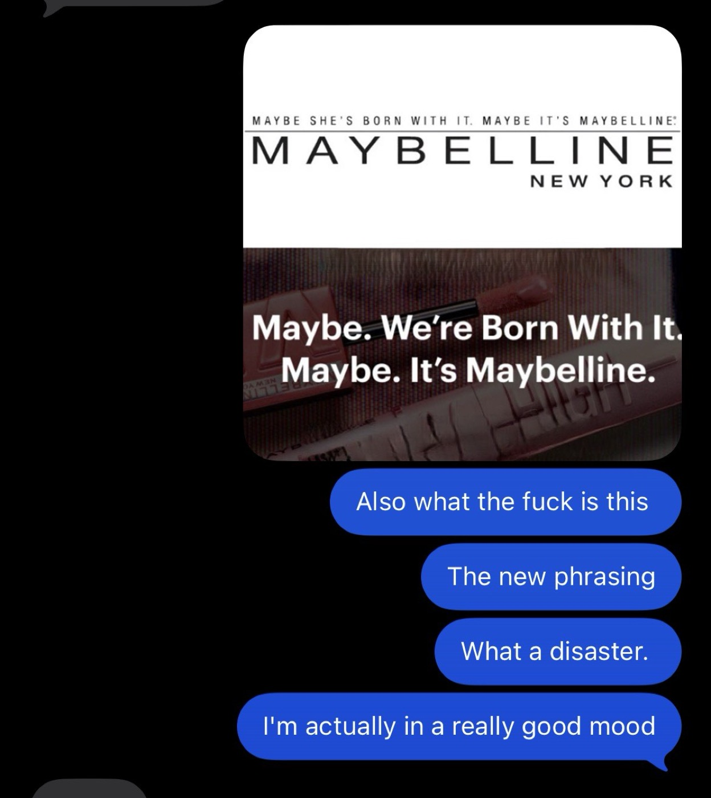  
  
  
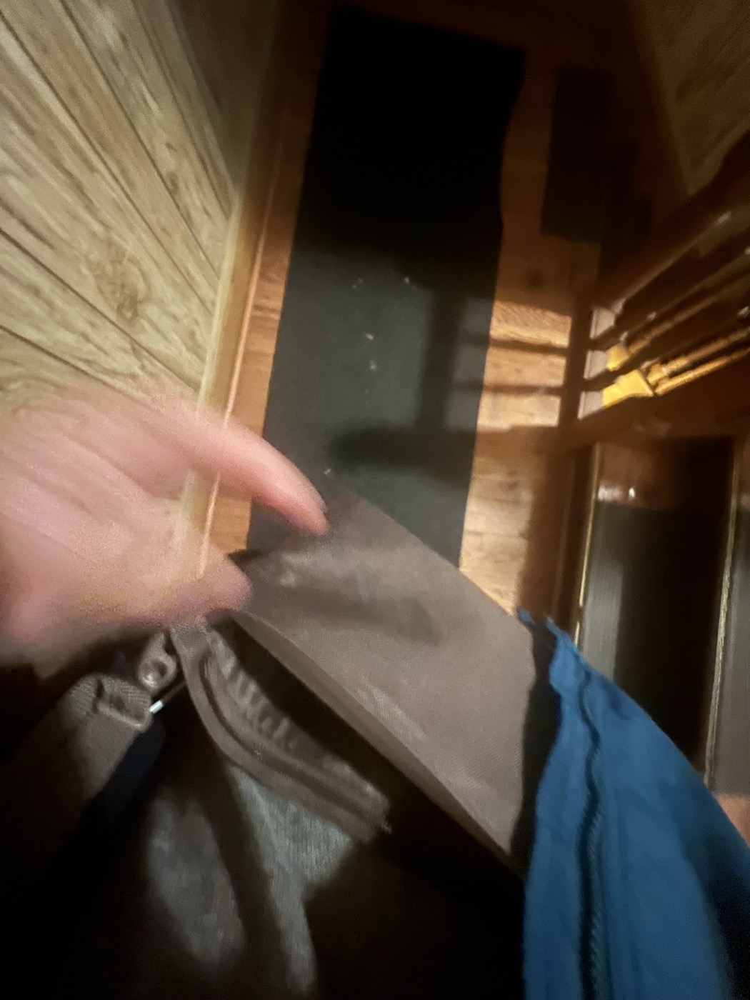  
  
...and I "tried a new bag" tonight.  
  
---  
  
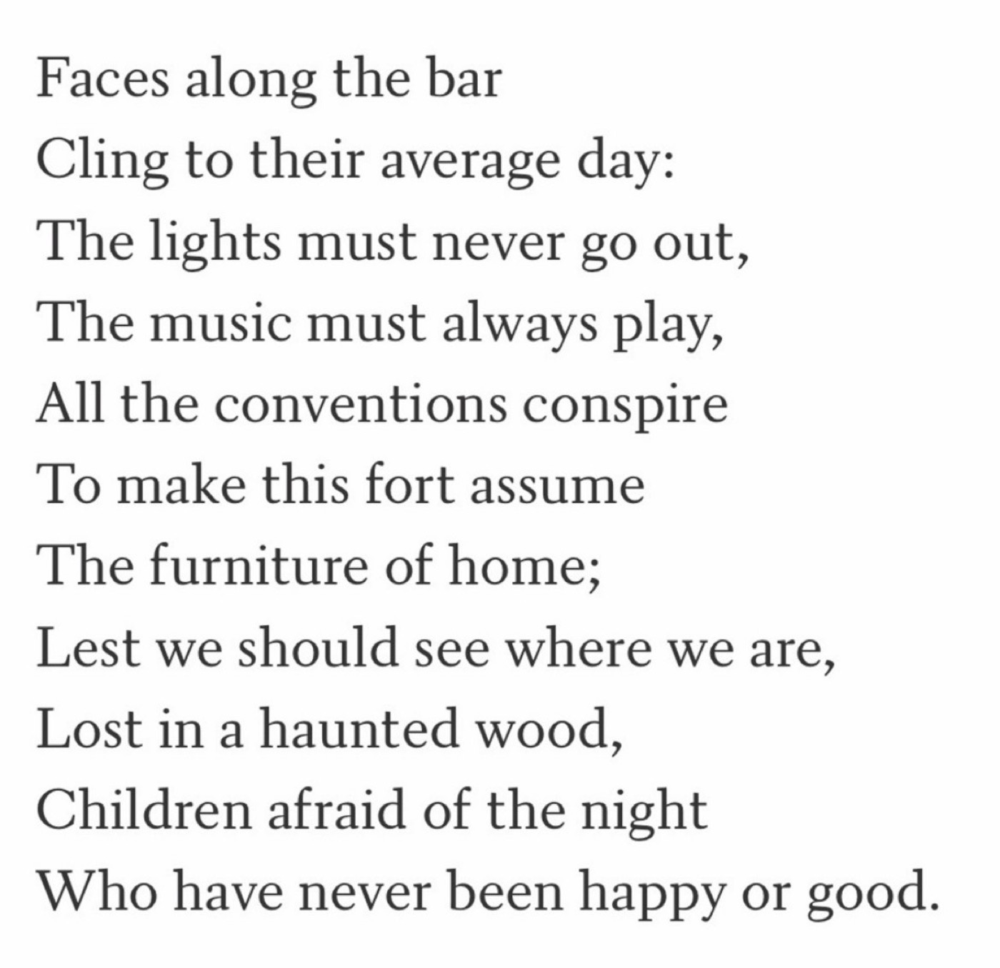  
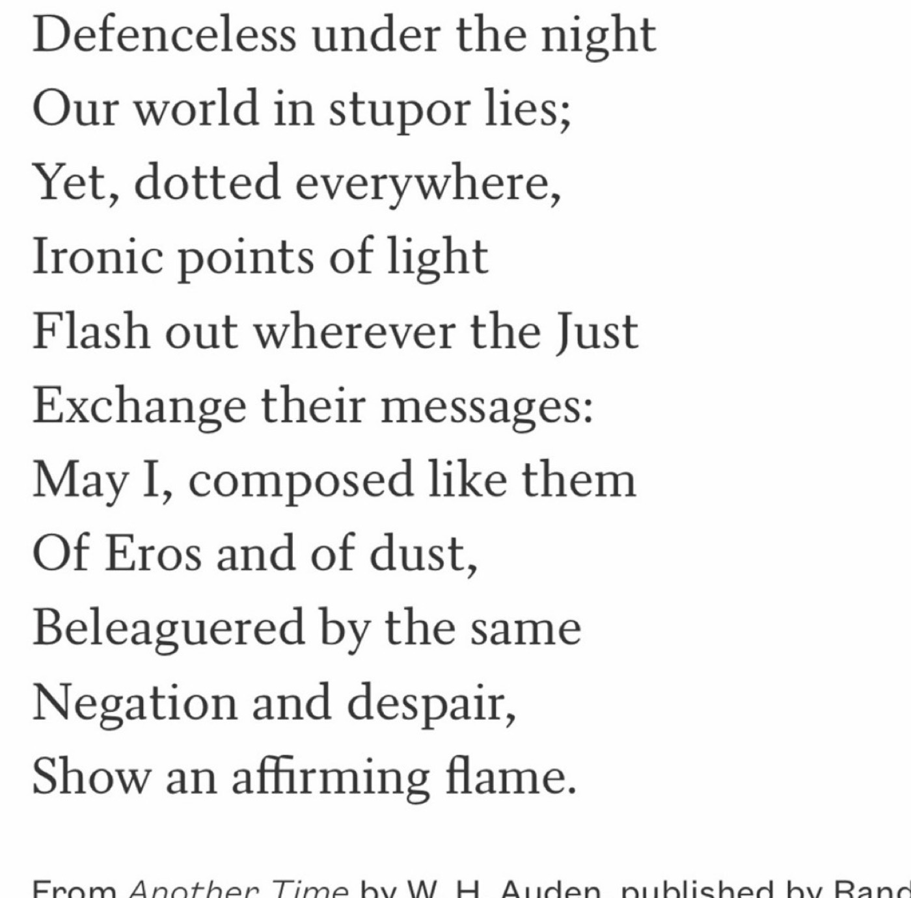  
  
---  
  
#life #nyc #music   
