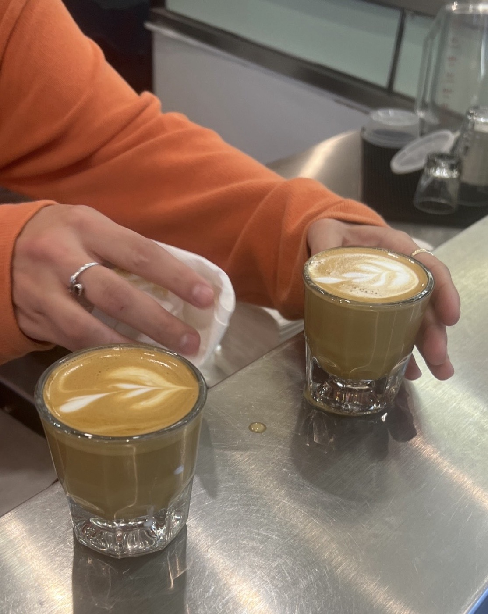
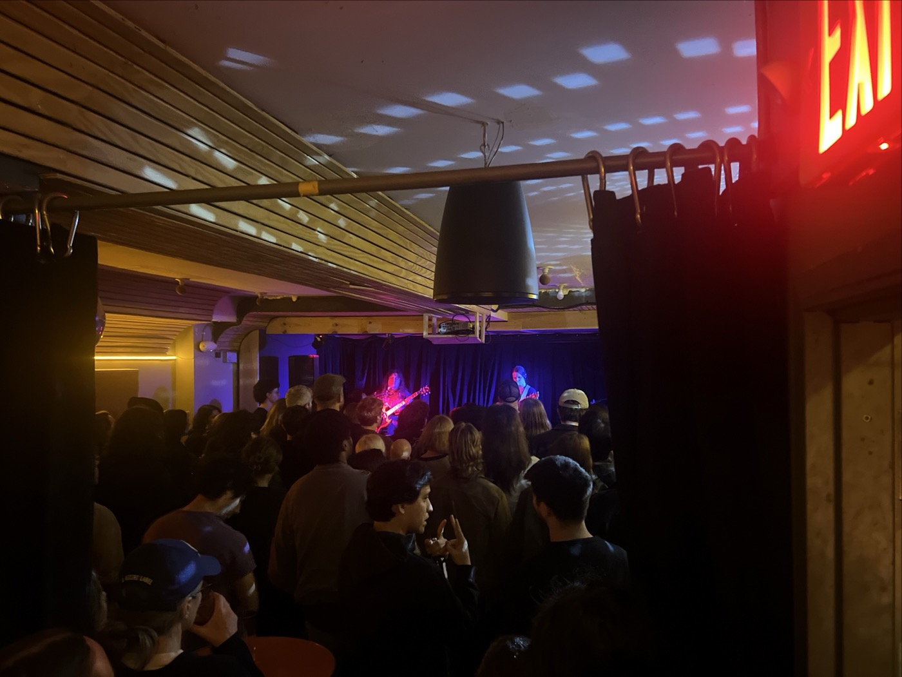

# 2026-11-12 rain, pt 1  
  
---  
  
the only photos I have to prove I lived outside of my room on November 12th, 2026.  
  
  
  
  
it's rainy all day. this catches me by surprise. I read *Switzy* in the office window (why do both Ridgewood and Bushwick branches have this?) and saw the shift change. fielding visitors all day, office hours, it feels like 2022 again but just a few stops down the line. even H walks by, and I meet A, who is apparently my neighbor. he's in town til Monday and she tells me they're going to a spelling bee at a cooler place In the City on Sunday. learning about this much cooler spelling bee fills me with irritation.  
  
I text Y about this kind of grumpiness and disdain for the other members of our general sociopolitical class. it's tough to say if she has it worse living on the block with the Radical Bakery, or if the Poles are correct and there is something truly rotten happening in Ridgewood, Queens. but we talk ourselves through it; it's important to do the whole dialectic and arrive back at love for your neighbor. and all that.  
  
CJ asked if I wanted list for her show with El so it's another night doing that. SF and I share a nice exchange. her eyes are always kind. and I meet Mr. J; I'm collecting all the members of the family like Pokémon. during the show he's loudly Facetiming her mother. it's fairly disruptive and extremely adorable. I catch up, too, with LF and her friend M, who I know from being exuberantly drunk at karaoke.   
  
on that note, CJ says that she's become obsessed with "Heartache Tonight" and we laugh about the lyrics: *Where the hell is this happening? On behalf of whom are we singing?* and she says that the short-lived Spongebob musical was the best musical she's ever seen.   
  
something this week about Upper West Siders, I suppose. CJ is drinking tea out of her Zabar's mug, and my new friend J who knows the Grumpy folks lives just a block or two away from her. they reminisce on watching the inflation of the parade floats every Thanksgiving. this year is the 100th, apparently.   
  
i have been thinking about where i am from —  
  
---  
  
#life   
  
  
