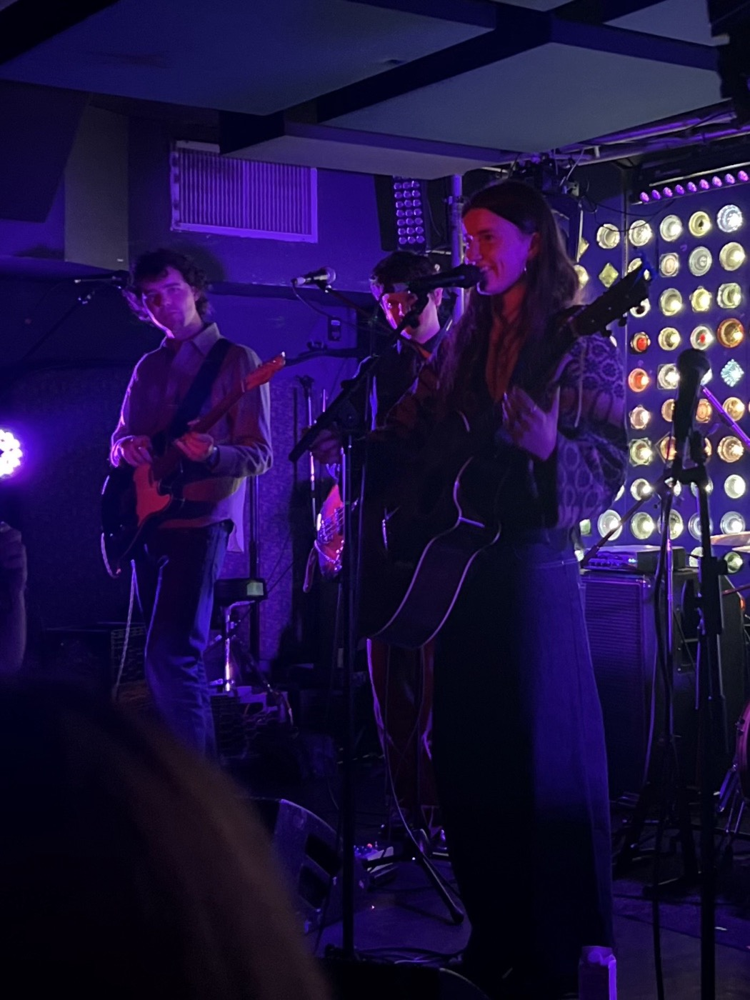
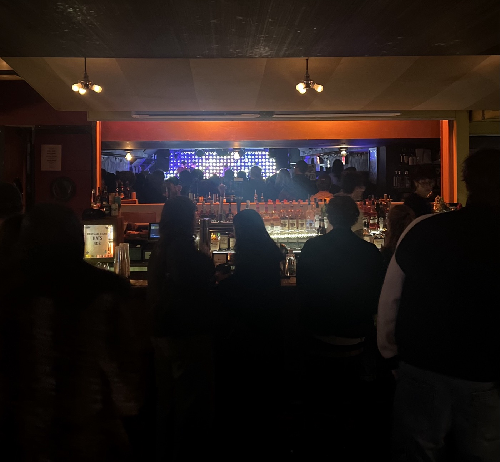
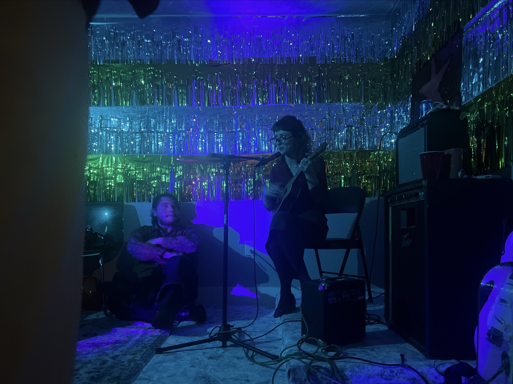
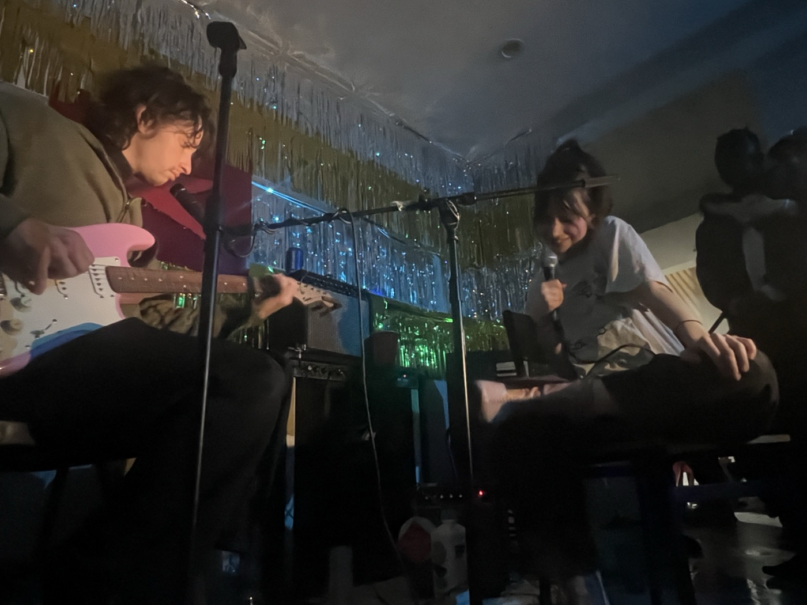

# 2026-11-13 it has arrived: Actual Cold  
  
---  
  
  
  
  
at the shows. from Babies to Bushwick first with Kathy and then with Xtian. good hangs afterwards with each and one of the best cold turkey sandwiches I've ever had. I'm too old for certain things and need to fix my anhedonia problem. It's very easy, you know, to shut yourself off from music. You have to give a little of yourself to it or else risk losing the channel. Emma's band was so, so good. It was marvelous to hear them and I'm so glad she sold the place out like that. I'll always remember my big hug with Caroline. some reunions and nice, if brief, chats. David Baron's son Oskar has an epic keys setup. They cover "Frankie's Gun" as the encore. Aidan, who's a fantastic guitar player, says he met a girl at ACL and they've fallen easily and naturally into dating. I think of—  
  
fleeing to ERB with Kathy. I'm not sure where anyone else went but no one arrives. that's fine, we have our booth and one of our very good hangs. what I'd do without her. then afterwards watching Sophiæ & Tucker and feeling the lift of happiness send away the tired grumpiness that somehow set in between saying goodbye to Kathy and arriving. a drunk boy is "doing sound." amazing to hear such a powerful pair of voices for the first time. Elaine points out that I'm just muttering to myself and it makes me laugh, wakes me up. I don't talk to anyone new. they have a sticky wall. I almost fall asleep sitting on a milk crate leaning against the sticky wall. it's labeled: Sticky Wall. it is sticky, my shirt sticks to the wall. every time I straighten up or adjust my posture the sound of fabric de-adhesion. Xtian walks me nearly all the way home. I listen to the recording of "Land" I made for Mavis. you can hear me and Caroline's embrace.   
  
  
  
  
---  
  
#lit  
