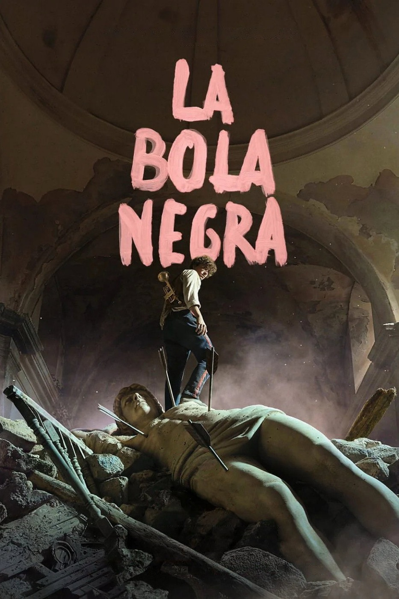

# 2026-11-17 after *La Bola Negra* (2026)  
  
### dirs. Los Javis (Javier Ambrossi, Javier Calvo)  
  
  
  
---  
  
Has that miniseries feel and look. Tough to say whether the combination of overly-literal, hysterically-aestheticized melodramatic "saturated realism" is inherent to the Netflix of it all or whether it's just par-for-the-course for Spanish drama. I'm sick to death of the first. I've adored my fair share of works which are suffuse with the latter but just couldn't fully ride it out with this one, I don't know. In this movie, people say things like:  
  
> ***JULIO TORRES:**** You're a historian, right? [Why am I asking you this? I am your cohabitating boyfriend]*  
>   
> ***ALBERTO: ****Yes**.***  
>   
> ***JULIO:**** Don't you find it funny that the only story you don't care about.... is your own?*  
  
Julio Torres is speaking here, of course, not to Alberto, but to us. Thank you, Julio! He turned off Alberto's music to say this. Which reminds me: the music was a huge miss for me. The score, soundtrack, and musical cues felt astoundingly out-of-place nearly the whole time. Even the musical moments that were more diagetic rang a little hollow; I could almost feel the studio's glee at the varying attempt to "Do the *Sinners* thing!" or "Do a Fellini thing!" But, hey.   
  
In this scene, Alberto had been listening to and studying Greek *rebetiko* music (a genre which I've gotten to know briefly thanks to Bar Cassette in Ridgewood, Queens). This historical connection, and the tradition's proximity to queer culture in the early 20th century (both of which are explained to us/Julio Torres by Alberto) is legitimately interesting, but it is an example of a thread that "Los Javis" seem disinterested in pulling on. More power to them, I suppose, but it gets at my issue with the thing as a whole. The film has a schizoid relationship with the history its predicated upon.  
  
For example, the rich and variegated history of Spanish/Iberian/Mediterranean music feels either absent or elsewhere obscured by a bizarre flair for the contemporary, which is a curious choice for a work which elsewhere seems obsessed with the romanticization of the past. A rather cloying and yassified piano ballad sullies what should be the film's emotional climax. Why not a traditional song? Even an adapted one? Do we respect the past or not? The last word in the screenplay is "haunted" !!!   
  
And there is a strange feeling of disconnection from the Spanish Civil War itself — one gets the feeling that this could be about any armed conflict, anywhere, within the last century or so. That's not the worst thing in the world. *Romeo and Juliet *works in a lot of different transmutations. But maybe that feeling of disconnection is downstream from the lack of truly compelling performances from almost anyone, and writing which seeks to explain these characters rather than trust the performers and the audience to get to know each other. Even at the start of the second act, when one realizes (or rather, when it's explained to the viewer) that the earliest of the three plotlines is actually lifted from Lorca's missing play, the melodramatic elements barely sit better because the more "real" storylines suffer the exact same overemphasis on style and symbology than substance and subtlety.   
  
Overall, it seems that Los Javis are much more interested in the symbology and aesthetic of the past than any kind of real, earthy exploration of the human experience of it. Which is a great match for the "miniseries" feel which we seem to have perfected over the last decade or so, where emotional cues are driven less by organic story or character development and mostly by technical, aesthetic, and especially musical cues — cry *here*, and now, *this* part is *dramatic* and here we are *yearning*... and if it works, it works, I guess, but it strikes me as a tragedy that the great Lorca, and the very real tragedy of his very real life in a very real war, serves as little more than an avatar for the directors' chosen Themes.   
  
But powerful Themes they are, and all of that said, I was rooting for this movie the whole time — and who am I to argue with the weeping gay couples around me after our Tuesday morning screening. The setup and some of the plot points were right down my alley, and I bet the screenplay, if novelized, could have won my heart (and maybe even the Pulitzer), in, say, 2014. In the end, even though it's melodramatic, that's not the worst sin. And since so much of this really happened, despite Los Javis' seeming ambivalence towards exploring this history with any kind of real texture, I do hope history itself will be rather kind to this movie (if anyone elects to sit through its runtime on their living room couch).  
	  
---  
  
#film  
