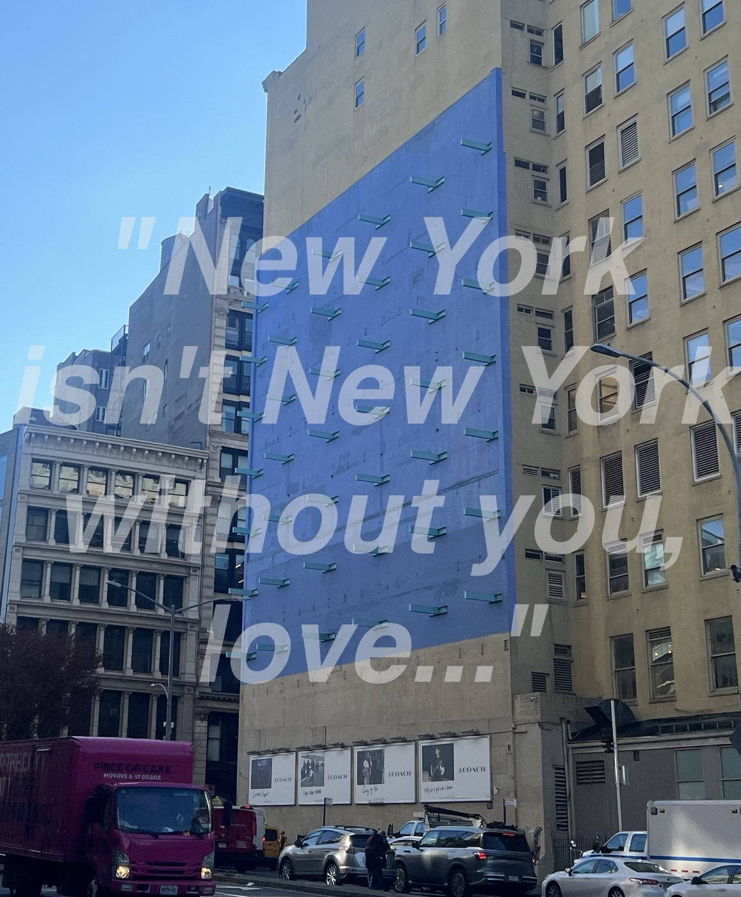
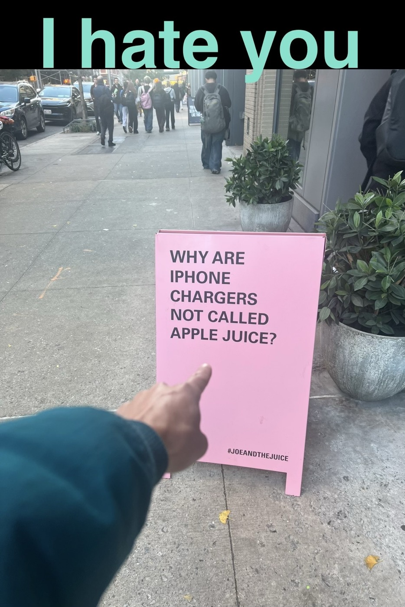
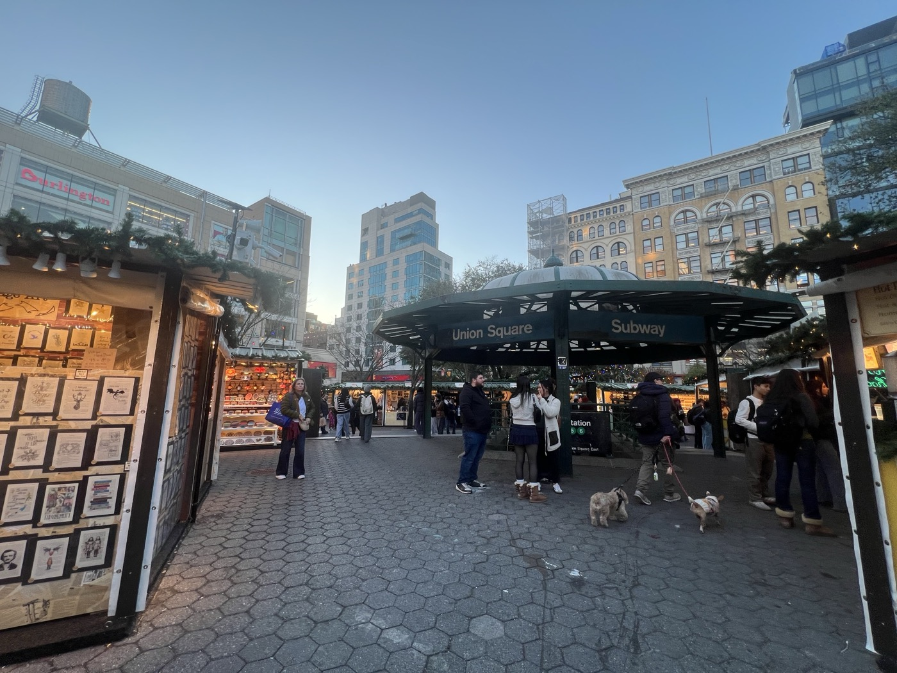
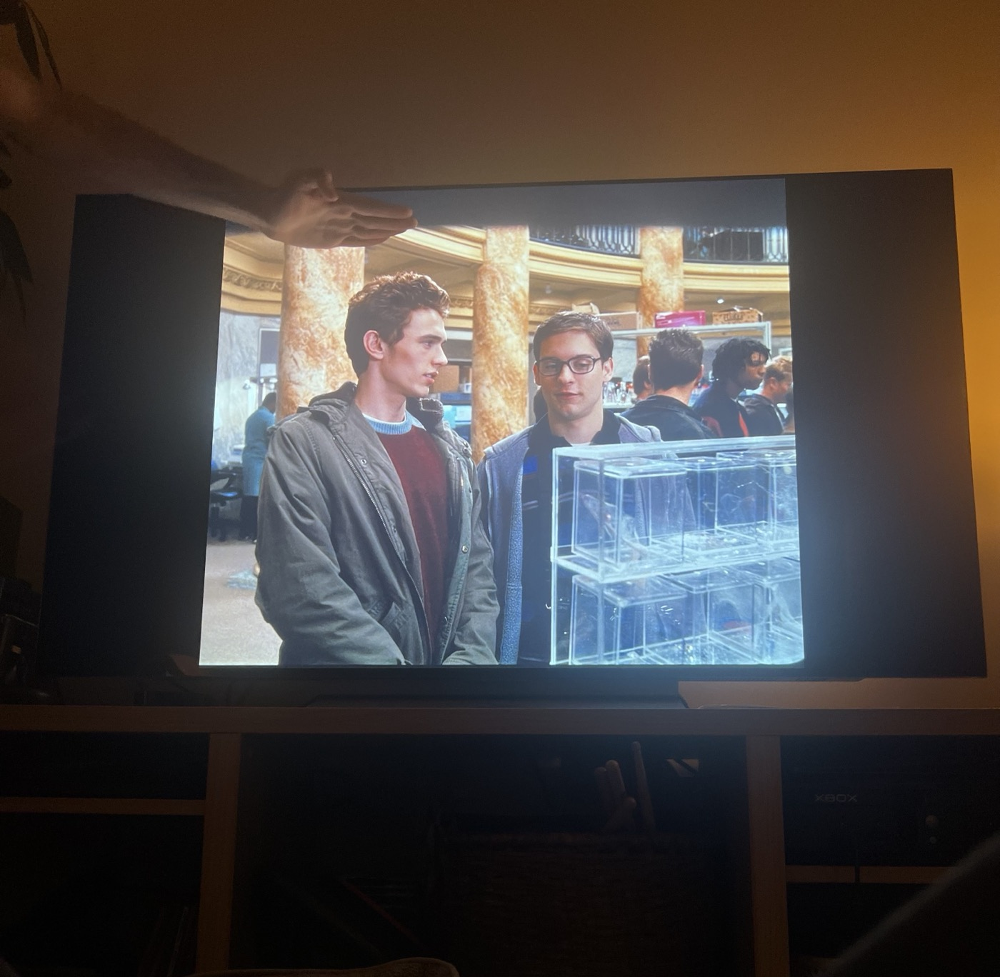

# 2026-11-17 your underemployed friend on a Tuesday:  
  
---  
  
I've been ignoring my phone in the mornings. one of the first things I see upon checking it is a Substack essay by a no-doubt passionate believer in music. It's titled *I am siding with Karly Hartzman in her breakup with MJ Lenderman* — I find this a bit surprising, not the least because said breakup is a relic from the Biden Era, but also because I thought we were all adults.   
  
It's a Tuesday morning, so naturally, after breakfast I trek into the city to watch a movie. I was split between two new Spanish-flavored offerings — Martin McDonagh's latest, *Wild Horse Nine*, and *La Bola Negra* — and decided at the last minute on the latter. It was a solid two hours and forty minutes long, so the risks were significant on the first truly temperate day in weeks. The risks did not pay off, unfortunately.   
  
But I walked around SoHo, bought the brand-new fifth volume of the Balle, sat in Washington Square Park for a while, and perused the holiday market at Union Square. I walked up and down the labyrinth looking for Taylor but he's obviously not here. On the second posting app, I tell the story of my jewelry sales career. It still feels strange not to be standing in that silly stall each weekend and it feels strange to remember that I won't be going to Brooklyn Heights this year. I'm having to summon the holidays using brute force of will, almost like a prayer. Fishing for the feeling from the cosmos.  
  
Lane leaves tomorrow with Richard and Pearl. She won't be back til a week after Thanksgiving. We have spaghetti and wine and watch the 35mm open-matte print of Spiderman (2002).   
  
  
  
  
  
  
  
---  
  
#threeboroughday  
