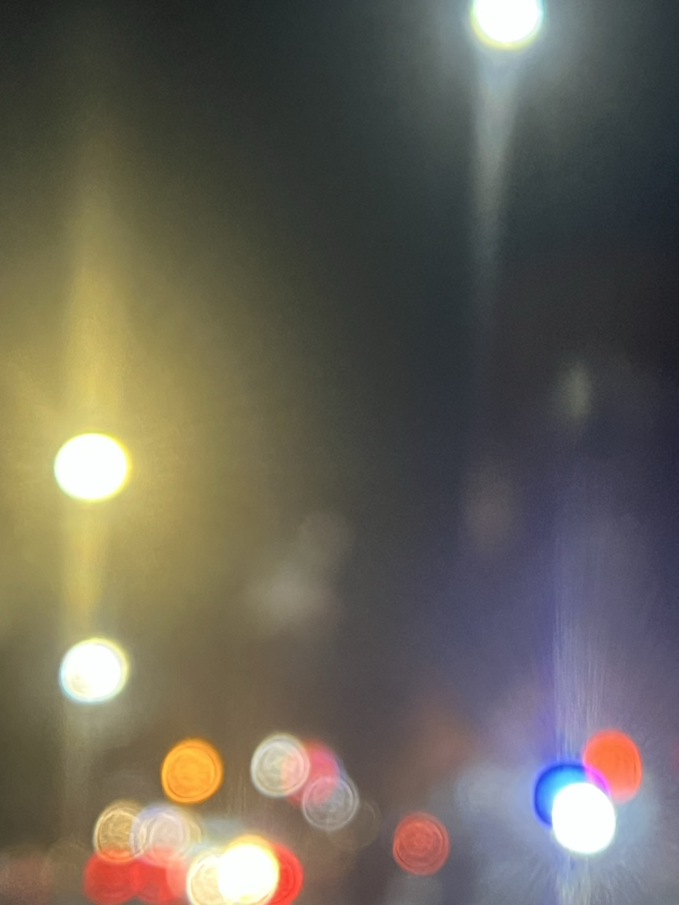
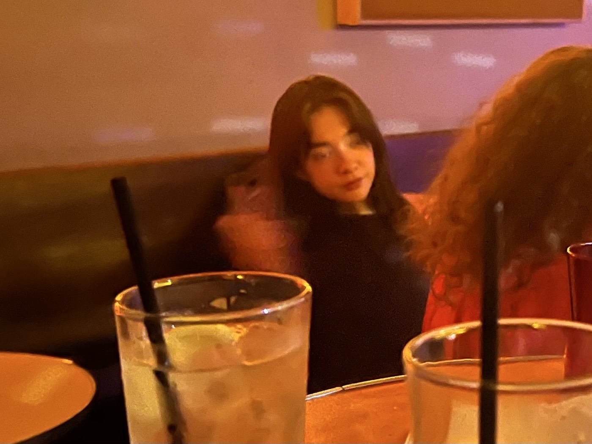
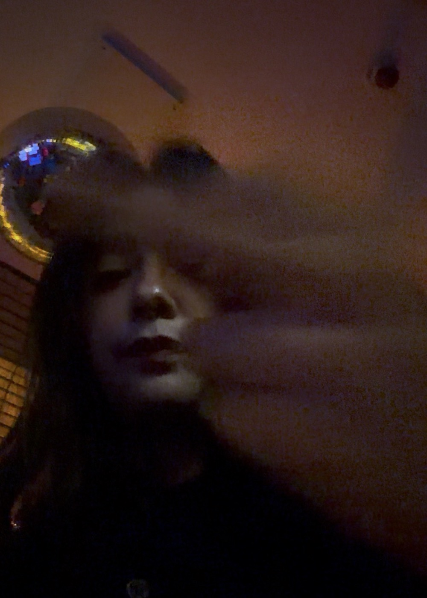
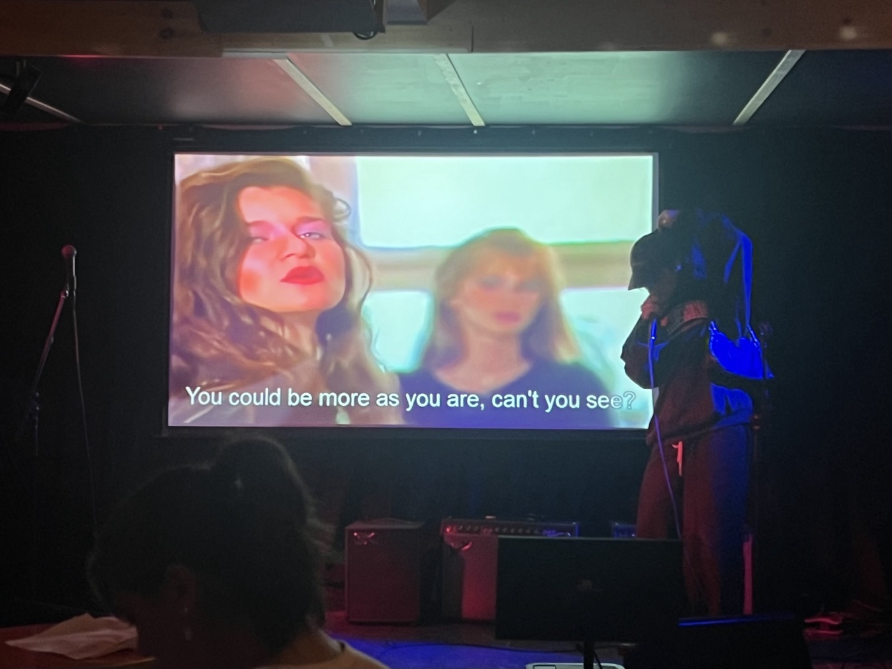
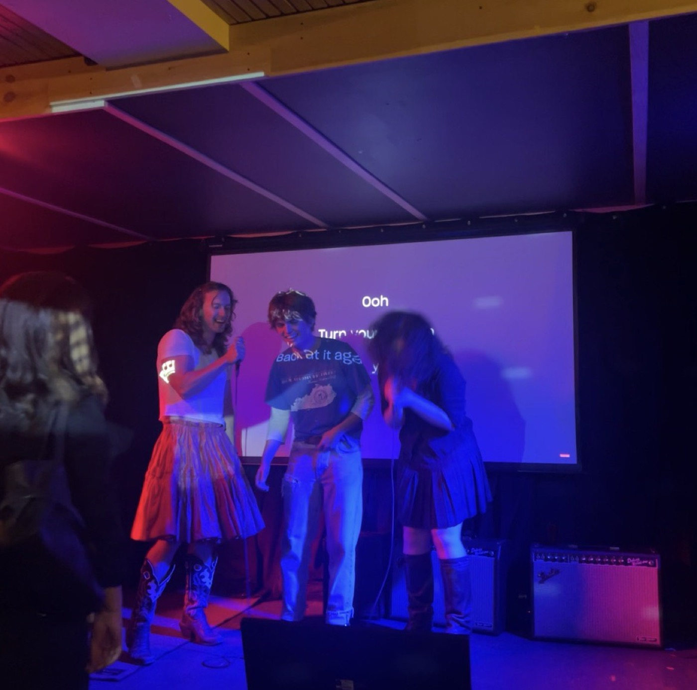
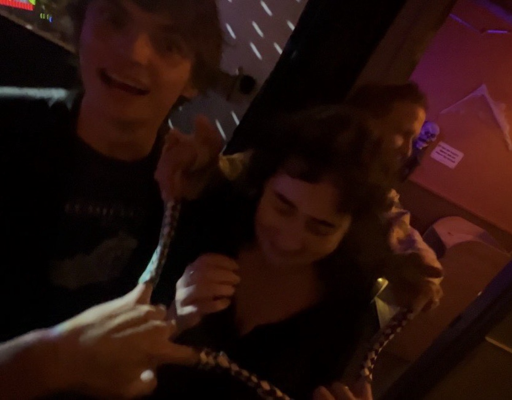

# 26.10-25 something star-crossed in the Sudafed  
  
have had multiple synchronistic encounters with the greatest romance of a certain W. Shakespeare this week. this morning woke inexplicably with the Dire Straits "Romeo & Juliet" playing in my head. I lay in bed for a few minutes letting the day gather around me and listened. what a miraculous song. during the morning though I listen to *the afterparty *from Mr. Shauf.   
  
one of my friends on posting2 posts the prologue from *Romeo & Juliet*, Lucinda says she's also been mulling over Knopfler's Miracle on her walks the last day or so. what could all of this mean? later at karaoke, I sign up for "Romeo & Juliet" and realize that I've never written out *Dire Straits *by hand.   
  
I sing Andy's "Hometown Hero" at karaoke, too. I also sing "Comfy in Nautica" and Lane sings "Impregnable Question" for me. Daniel signs Jesse up for "Yesterday" and we all do the thing where we get on stage and are as annoying as fuck. Tayo works as head chef at an Ethopian café in Sunnyside, right off of the 39. Will be visiting him there soon.  
  
the full moon is frighteningly gorgeous, loudly luminous, and I watch it the whole way home. it's almost *Moonstruck *season. but let's take the holidays one day at a time.   
  
  
  
a crew of very drunk youngins has infiltrated the basement on an otherwise quiet night for the olds. I've seen most of them around town before, but not necessarily here. after my Shauf, one of the girls, wearing a beautiful dress, comes up and compliments me and starts begging me to sing "I Will Follow You Into the Dark." she says my voice is perfect for it.  
  
I decide to be vulnerable with a beautiful stranger and tell her the truth, which is that while my voice was developing during puberty, Ben Gibbard was my favorite songwriter, and that at some point I became extremely concerned that my voice would wind up sounding too much like him, and I stopped listening for a long time out of that fear. I tell the girl that I'd be scared singing that song onstage. *I'm scared I'd have some kind of episode, *I say.   
  
but she is very beautiful and insistent. she's holding my hand. *Come meet all my friends*, she says, pointing to the rest of her table. I walk over and introduce myself and realize that they're all drunk. I meet them and forget most of their names immediately; I'm talking with Y and there's also a K, and I realize where I know them from. eventually I make a polite exit from their debauchery and by the time I'm back to Lane, Y, who I thought was flirting with me, is kissing one of the boys.   
  
  
  
  
> **unfortunately, my BULLY was also in attendance!!!**  
  
  
  
  
