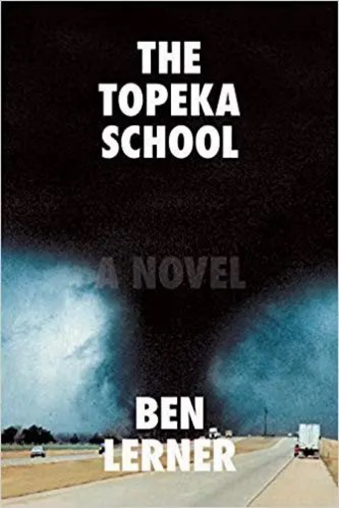

# on Ben Lerner's *The Topeka School *(2019)  

  

### a blathering, blithering, glossolalia?  

---
    
:/// this could have been an essay?  

*Topeka School *was tough, almost a minor heartbreak. Last year I lent my beloved copy of @10:04 * *to a dear friend — I ++never++ lend out my books, but I adore that novel and she wanted to read it — only to have her slap it down in front of me a week or so later, declaring only, "Pretentious! Self-involved! Bullshit."  
  
Well... to each their own. I'll still defend *10:04 *from its detractors, even while granting that Lerner is indeed self-involved and pretentious. With that prior project, however, his compositional skill and the relatively limited focus allow him to transcend or sidestep these facts of himself. No such luck with *The Topeka School.*  
  
Reading this book brought about a unique kind of frustration that can sometimes occur when an artist you respect despite valid and consistent critiques manages in a single work to simultaneously stick to their guns, altering nothing about the aspects of their project that you defend/admire, while also spoiling all your hard work on defense by affirming every criticism against which you've defended them.  
  
**The premise of *The Topeka School* seems to be that the demise of functional familial relations, masculinity, and political discourse in the United States can be interestingly analyzed through the reflective autofictional narration of Ben Lerner's experiences as a regionally talented high school debater** — a premise which I accept, but which ultimately here becomes taxing.  
  
Lerner is certainly in a solid position to pursue this conceit, given his successful turns as poet-novelist and essayist-autofictional author. The strongest parts of the book find him operating more in the mode of the latter, with a particular emphasis on the essayistic. But these moments also embody the most major flaws of the project: whatever character he's apparently attempting to narrate through/as drops away and you get the feeling that you're suddenly reading a repurposed *Harper's* piece.  
  
And when placed in contrast to the novel's overarching premise, these moments also illustrate the weaknesses and limits of the project's construction. For example, the Lerner stand-in's mother will suddenly be offering "her" opinions on debate techniques and their connections to the kind of post-Truth, "firehose" blather we're dealing with in the Trump Era, but this narration will occur during a scene which occurs in the 1990s.  
  
Even if I were to grant that this premise's *interestingness* outweighs its *taxingness*, I'm still left wondering about its *usefulness*. Which, as a practicant of the world's least empirically useful medium (I am a musician), "usefulness" is actually critical metric I disdain — this book really has turned me into my own worst enemy :(. ... But Lerner himself seems to have fretted about this aspect as well — hence the novel's infamous ending portion, which accomplishes nothing other than to leave the entire composition as meaningless as its characters fear speech itself has become.

#books #language #politics
