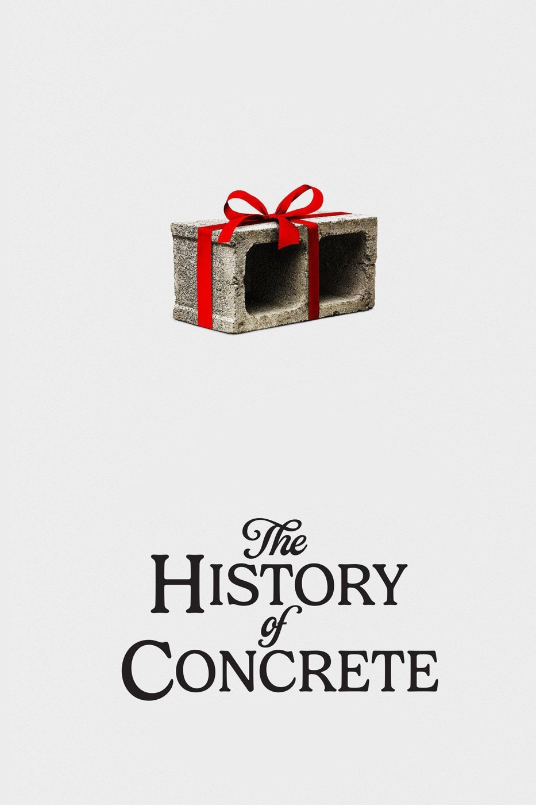

# after *The History of Concrete*  
**2026, dir. John Wilson**  
  

[_Letterboxd_](https://letterboxd.com/mufasa_lives/film/the-history-of-concrete/)  
  
---   
  
John Wilson is my Walt Whitman. hopefully this moves more people to watch *How-To*, which I think is the best and most humanistic use of the televisual delivery format, one of my favorite Things ever made, and a wet blanket (complimentary) upon the feverish sickness that has so severely afflicted American culture and New York's most recent waves of new denizens: Main Character Syndrome.   
  
I was as excited to see particular individual slabs of my neighborhood's sidewalks and local businesses as I was to see celebrity cameos. clever pun about him always and literally gathering "Material." in Wilson's method, human and non-human elements sit alongside each other in a kind of necessary and democratic tapestry which aggregates into a city, and capturing these with clarity, curiousity, and honesty leads naturally to a portrait of all of us, in all our fullest weirdness and capability.   
  
so much of this would not be possible without his seeming willingness and ability to disappear into what is being captured while also guiding and shaping the development of each "segment" (one of my favorite moments involves a subject randomly invoking the word "segment", which clearly takes Wilson aback as well, as he quietly parrots the word). this requires a kind of wisdom and, I kid you not, Whitman-esque transcendentalism.  
  
Wilson's lovingly humanistic project was uniquely suited for television, with its kaleidoscopic collision of per-episode granulated focus and long-term execution. after seeing a string of older documentary films which clearly influenced him, it was a joy to spend so much time back in familiar company and "surroundings." when I first found his show I would tell people that I could watch his work forever. this holds true.   
  
also, the soundtrack was killer — Suzanne Ciani's *Seven Waves *is something like the Ridgewood, Queens of electronic music. and a neat look back at the "City of Yes" moment, which will remain a nifty time capsule of city housing politics in the waning days of the Adams administration, regardless of how things pan out with his successor — who has at long last committed to fixing the crumbling BQE.  
  
#film #nyc   
