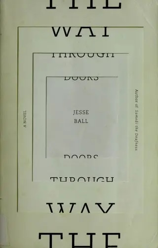

# on Jesse Ball's *The Way Through Doors *(2009)  
  
  
  
> *Who can say therefore where a certain person is, for what is it that anchors a person? Is it their place in the story to which you are a part? Many stories hereabouts run side by side, and you cannot be at pains to unpin them, for they are sharp, and you will only sting the tips of your fingers.*  
  
  
---  

### somewhere between Calvino and... Lemony Snicket?
  
some friends of mine recommended Jesse Ball while we were somewhat drunkenly discussing contemporary fiction writers whose work is defined by *heart* rather than misanthropy — i.e., writers whose work radiates love for human beings. I trust my friends' tastes immensely and went within a day or two to the Strand, the only store with this novel, which was Ball's first, in stock.  
  
my friends were right: there is a whole lot of heart here, a playfulness and a whimsicality that I found wholly engaging and charming. my friends had also said that the prose style is reminiscent almost of children's literature, which I would also agree with. they also also mentioned that despite this childlike whimsy, there is a sense of respect for the reader coming from Ball (or his narrator(s)), rather than condescension. this is also true, to an extent.  
  
the conceit of this novel is given away on the cover — tasked with keeping a concussed and amnestic girl awake, our first narrator begins to tell a story, which winds up leading to a series of other nested stories. (I would list the page counts, but even those are playfully fucked with, demarked by fives, seemingly placed at random in the margins.) that is to say, a character in one story will begin relaying to another character in the story, a new story, and so on and so forth, and likely will suddenly reappear another handful of "levels" "down" the story-within-story-within-story-within-etc.  
  
the effect at first is riveting, and then at some point one recognizes that maybe you're supposed to just sit there and* take it all in*, as it were. the fact that it took me over 2/3rds of the book to get tired and irritated of the project is a testament to Ball's ability to spin these yarns and tangle them all together even as they're each still unfurling. but tire of it I did, especially once the thrust of the project *clicked*, or at least my reading of it: *is this really any different from how life itself works?*  
  
and, true, a hundred different stories are unfolding upon us at once, and "characters" — though we'd be well-advised not to think of other humans merely as characters in a story within the story of our lives — characters from one story often appear in a completely different narrative arc. it calls into question the value of literature, maybe, or the value of fiction, or the value of imagination, or the purpose of narrativizing our lives, sure. I can see certain things from this book sticking with me because of that.  
  
but ultimately, by around "page 1000", I found myself feeling that Ball (or his narrator(s)) had not nailed a compelling enough execution for me to be too-terribly interested in seeing this one through to its conclusion — though I did, because it is terrifically readable. I hear that all his books are quite different from one another, but each unpretentiously experimental and thought-provoking. perhaps I will pick one up sometime but I'm not feeling as eager as I was when I initially opened the first door.

#books #language
