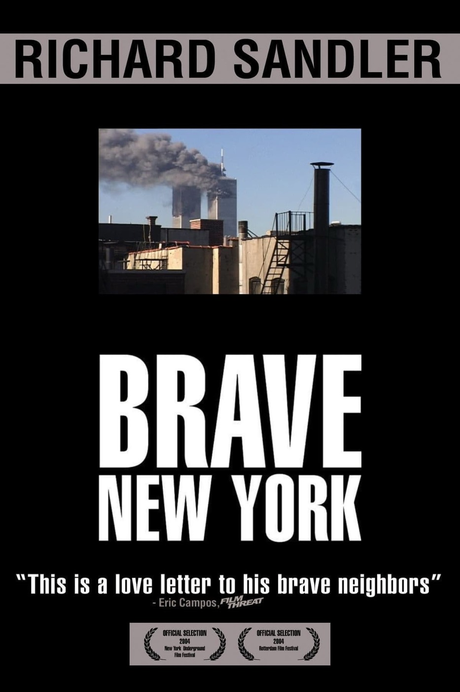

# after *Brave New York*  
**2004, dir. Richard Sandler**  
  
##   
[Letterboxd](https://letterboxd.com/mufasa_lives/film/brave-new-york/)  
  
---   
  
you can feel the real love Richard Sandler has for the people he's choosing to spotlight, his appreciation for them arises scene-by-scene, compositionally, almost like music.  
  
the Starbucks/Barnes & Noble protest scene made me laugh but it also made me very sad. and I thought it was funny that the movie is so casual and observational that a quick shot of a conventionally attractive and fashionable blonde woman felt like a sudden harbinger of class war doom.   
  
we're twenty years down the line, almost twice the distance covered so briefly here. where have all these people wound up in our brave new world??  
  
#film #nyc   
