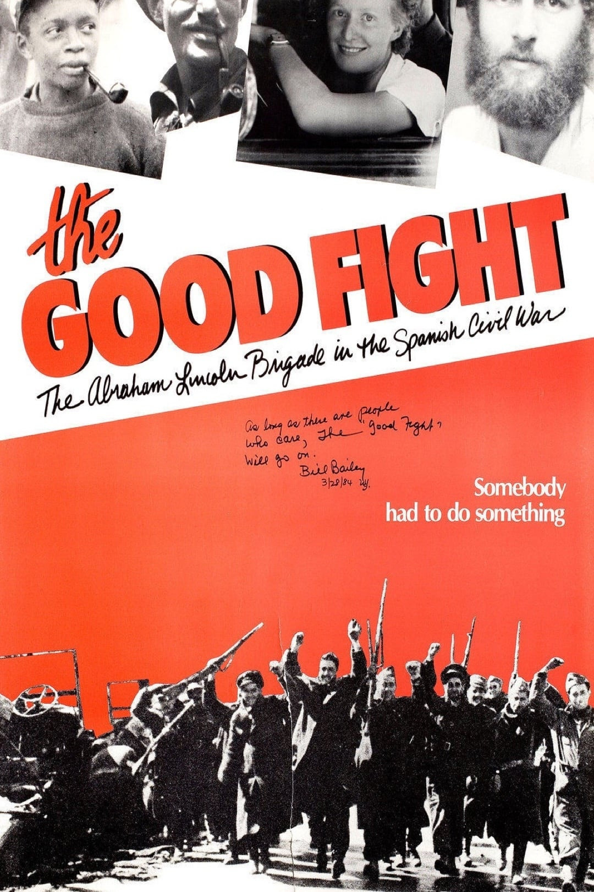

# after *The Good Fight* 
### *the Abraham Lincoln Brigade in the Spanish Civil War* (1984)

### 1984 dirs. Noel Buckner, Sam Sills, Mary Dore
[_Letterboxd_](https://letterboxd.com/mufasa_lives/film/the-good-fight-the-abraham-lincoln-brigade-in-the-spanish-civil-war/)

--- 

Thank you to Charlie and his mother and all the folks at Low for making these screenings happen!! I've read the Hemingway and the Orwell and the Neruda, but it was marvelous to hear from the everyday Americans who felt the pangs of political and class consciousness loudly enough to ship themselves overseas and risk their lives, well over half a decade before Japanese bombs brought America grumbling into the fight against global fascism and genocide. 

This was an inspiring but difficult watch for myriad reasons, creative and historical and political. I teared up a lot watching these wonderful old saints describing in plain terms why they felt they had to leave to help out their brothers and sisters in Spain; it was the ghost of a kind of simple, morally dignified spirit of class consciousness that seems to have vanished from the face of the earth at some point. 

But no: it was a privilege to watch this with one of the co-directors, and followed by a Q&A with neighbors who joined the Freedom Flotilla fighting the good fight in our own time. We're as far-removed from the creation of this film as the filmmakers were from the war itself; we do have elders, they just aren't the folks put up on the posters or the t-shirts. They're gray-haired agitators bearing down upon Skokie, Illinois and one-armed piano men singing decades-old songs calling forth mañana with the same steely-eyed international anti-fascist glee.

"It's a reason for living."

#film #history #america
