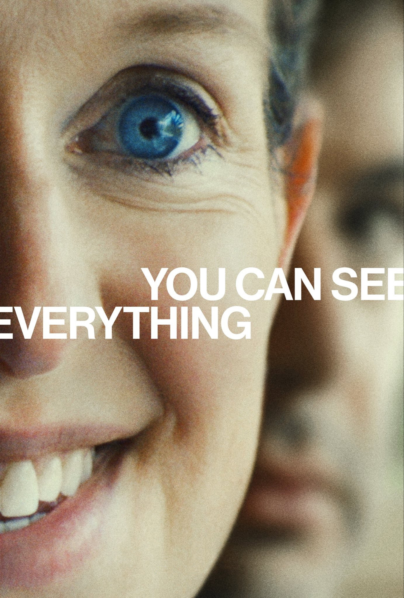

# after *You Can See Everything*
**2026, dirs. Nathan Fielder + Lance Oppenheim**

### ★★★★★

[_Letterboxd_](https://letterboxd.com/mufasa_lives/film/you-can-see-everything/)

--- 

I have a general rule not to apply star ratings to documentaries, with very few exceptions. This is one of those exceptions. There is not much to say beyond the impossibly promising setup, and Fielder, Oppenheim, and all of their subjects more than deliver. 

Even as it turns itself inside out and kaleidoscopes way beyond the boundaries of strictly documentary space, with your hands over your mouth, you have to keep pinching yourself and remembering that what you're witnessing is "real". They should absolutely run this for Best Picture. 

No human being who has ever lived is more qualified than Nathan Fielder to capture Elizabeth Holmes in her "element," whatever the fuck that is. I have always loved how he frames himself in rooms, decked out with various monitoring devices, openly avatar-ing his place as a stand-in for his audience, all of us desperate to find the impossible borders between fact and fiction, communication and performance.

Disturbingly moving, at the credits I suddenly felt like crying. Something about the impenetrable irrationality of the human psyche and the impossibility of ever really reaching another person, yes, but then also something about how don't we also sometimes come into contact with something beyond that, even the most unreachable among us? Is that truth?? and what of it can be communicated? Who's on first???
