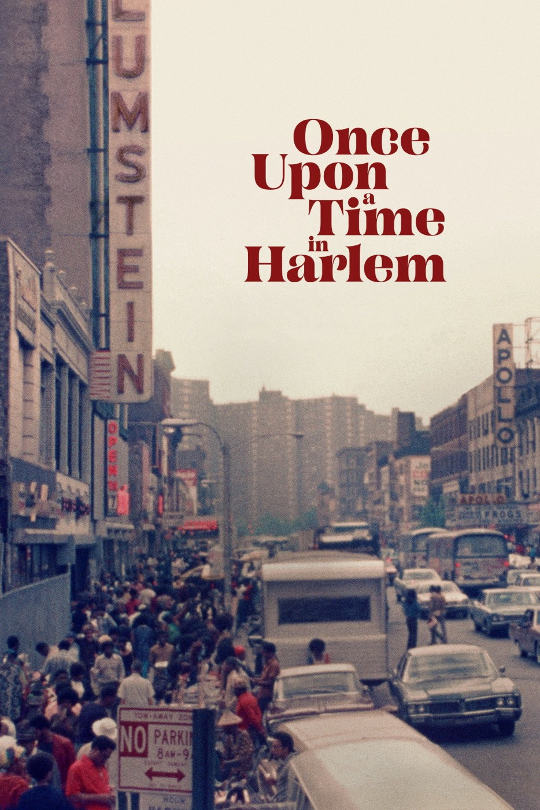

# after *Once Upon a Time in Harlem *(2019)  
  
### 2026, dirs. William & David Greaves  

[_Letterboxd ](https://letterboxd.com/mufasa_lives/film/once-upon-a-time-in-harlem/)

---   
  
My accidental personal Doc-tober continues with this beautiful piece of living history featuring a multi-generational menagerie of artists and activists grappling with the collective legacy of what they once experienced as simply community. The idea of a cocktail party as an engine for oral history is cool as hell, and at Duke Ellington's place, no less!   
  
Just incredible to think that we are less than four years out from the high watermark of the Civil Rights Era here, and that there are figures captured at this party who were then nearing a full century of life, who remember Reconstruction, who were in middle age at the time of the Renaissance, and who can recite the poetry, lyrics, and speeches of all those decades between as if they had just memorized them that morning.   
  
I am realizing about myself that I am a sucker for seeing things through a generational lens, something which is implicit in the very existence of this film. I wasn't able to snag a ticket to one of the Q&As with David Greaves but I have so many questions about the long gestation of this wonderful movie, which itself took multiple generations to complete.   
  
And I loved watching this with my Film Forum Sunday matinee audience, lots of little cheers and applause at so many of the songs and poems and impassioned soliloquies ♥️  
