# sweet day w/ FILM CLUB
  
I've been wandering about the West Side this week. Autumn seems to have come earlier to Lower Manhattan as compared to Central Park. Sophiæa sent me a video from her keep on Central Park South and the tops of the trees were nearly completely green. A few days prior, I took this photo at the baseball fields:  
  
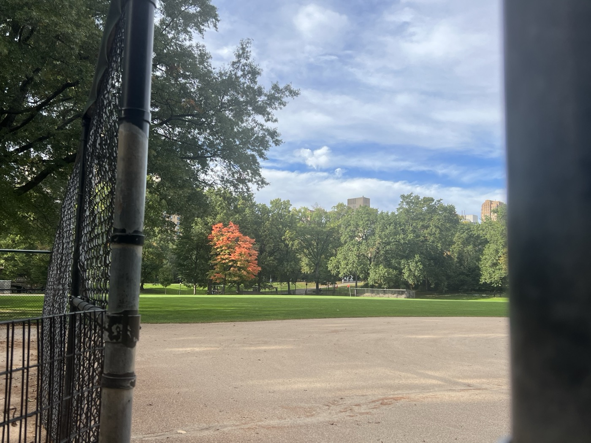  
> It's a process.  
  
---  
  
In the West Village, however, the trees have gotten the message from the cool air and have changed their outfits accordingly. I wonder if they can feel the absence of their severed old-growth forest networks like phantom limbs.   
  
After working a bit from the library, sinuses and bronchial tubes dry as a bone, I grab tea from the Ten Ichi Mart and sit writing and reading *On the Calculation of Volume* in Father Demo Square. Why are all the triangles in the city called Squares?  
  
I listen to the new record from @.  
  
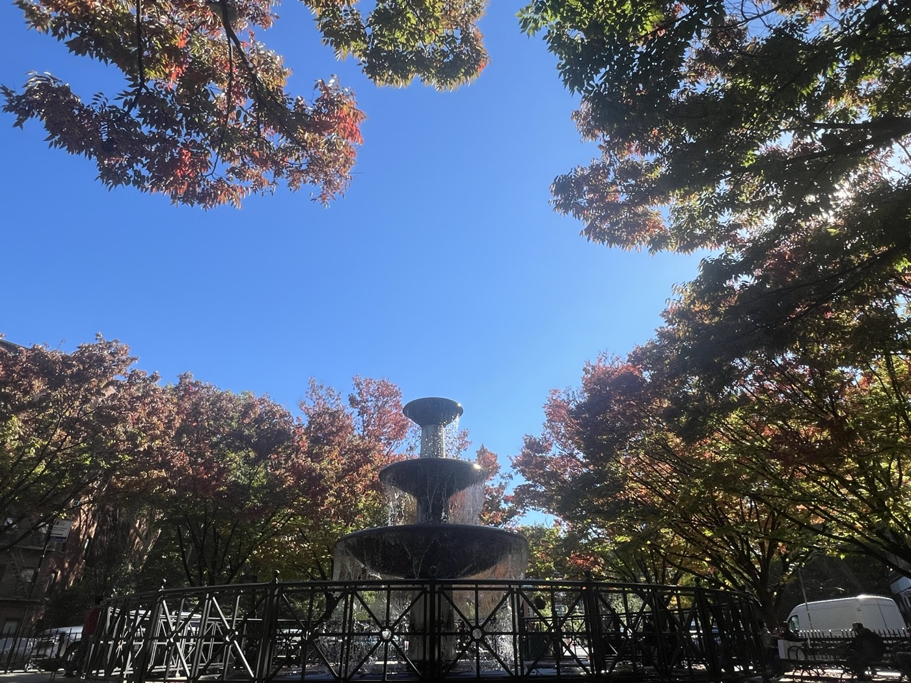  
  
> *I thought magic was a tool just for me, but then I realized it's not a tool at all. The world in a dream turned and said to me, "Whether you are winning or losing, it's all the same: the music and the joy are both tied to the pain." But I don't feel ready, I'm not strong enough. So I will keep on searching for that earthly love.*  
>   
> *The demons in the nighttime don't have glowing eyes. They don't shake the bed frame, they don't scream, and I don't cry. They each have a first name: Regret, Time, and Luck. Together they are paving the road to earthly love.*  
  

I am waiting here for Pearl, Richard, and Lane. We are to see the newly remastered *The Devils* at IFC. I'm sitting sighingly when Emma Sterling crosses my path holding a long bouquet (of course) topped with fennel. I call out her name and she joins me. She's just grabbed lunch from Ten Ichi. She offers me a piece of sushi and we have a very sweet and very simple conversation, one which I will hold close to my heart for a long time. Using her point-and-shoot we take photos of each other holding her bouquet in front of the fountain. I turn the camera to get the tops of the trees and hope she comes out as beautiful on film as she's made the moment feel.   
  
Richard, Pearl, and Lane had dropped by in the midst of this and then skipped ahead to IFC, so I join them. Austin is meeting us at the theater too.   
  
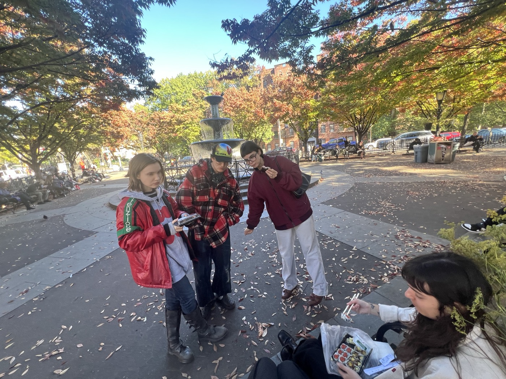  
---  
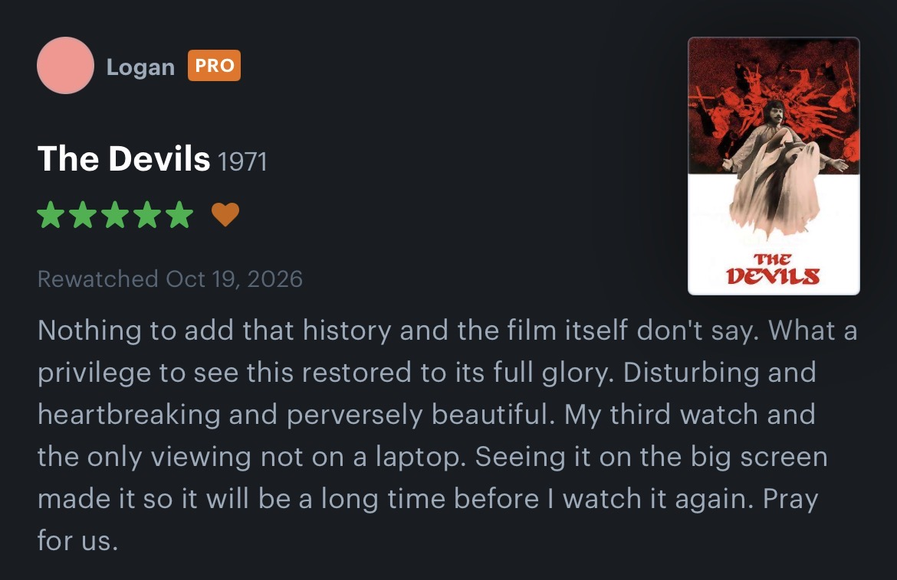  
When we exit the ruins of Loudon, the sun is setting over Manhattan, and the Empire State Building looks beautiful. There's still time to make the $5 happy hour at Art Bar, so we head there, marveling at the stateliness of the West Village, as vagrants like us are wont to do.  
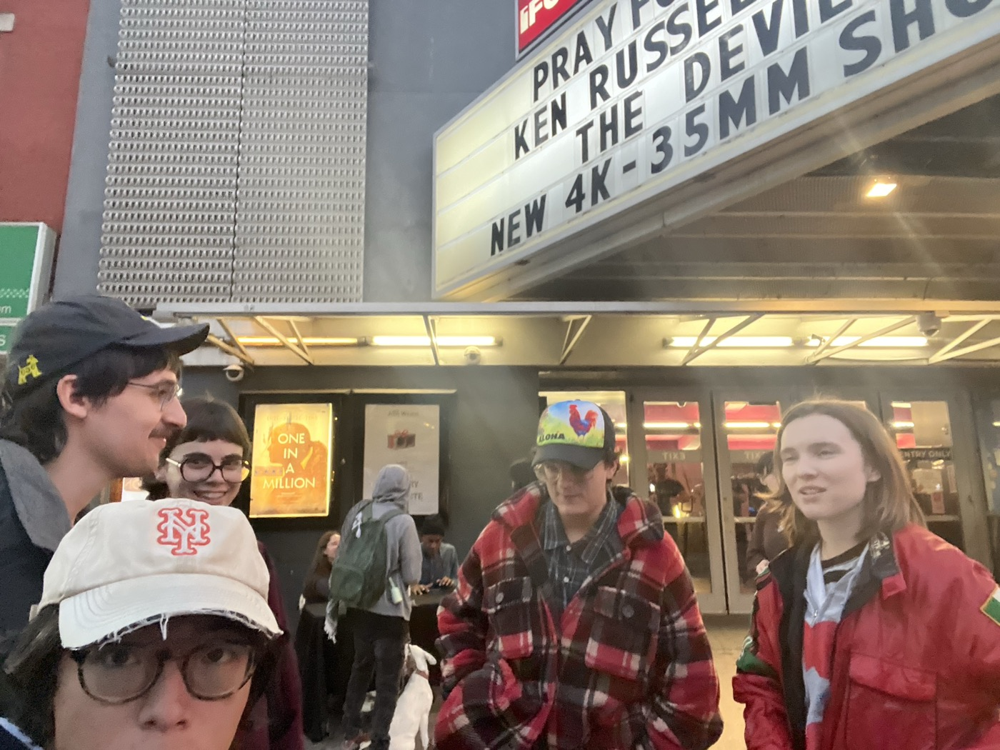  
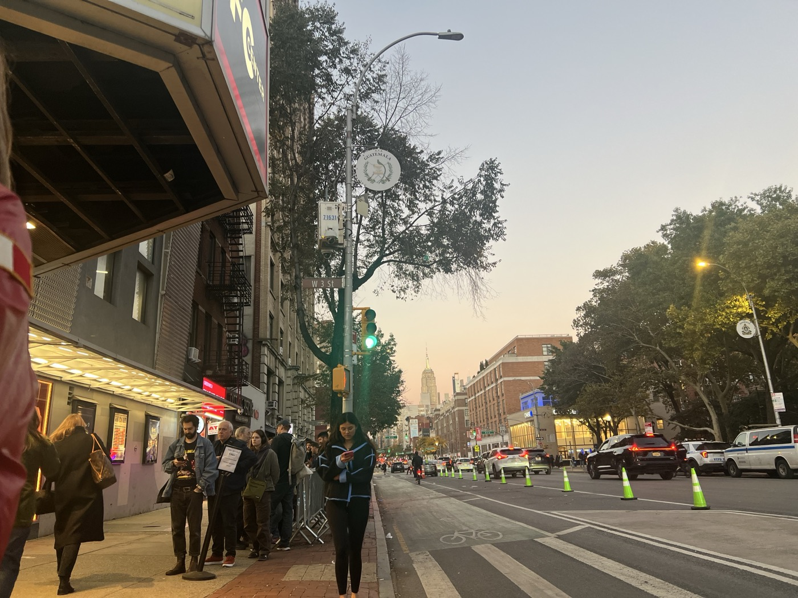  
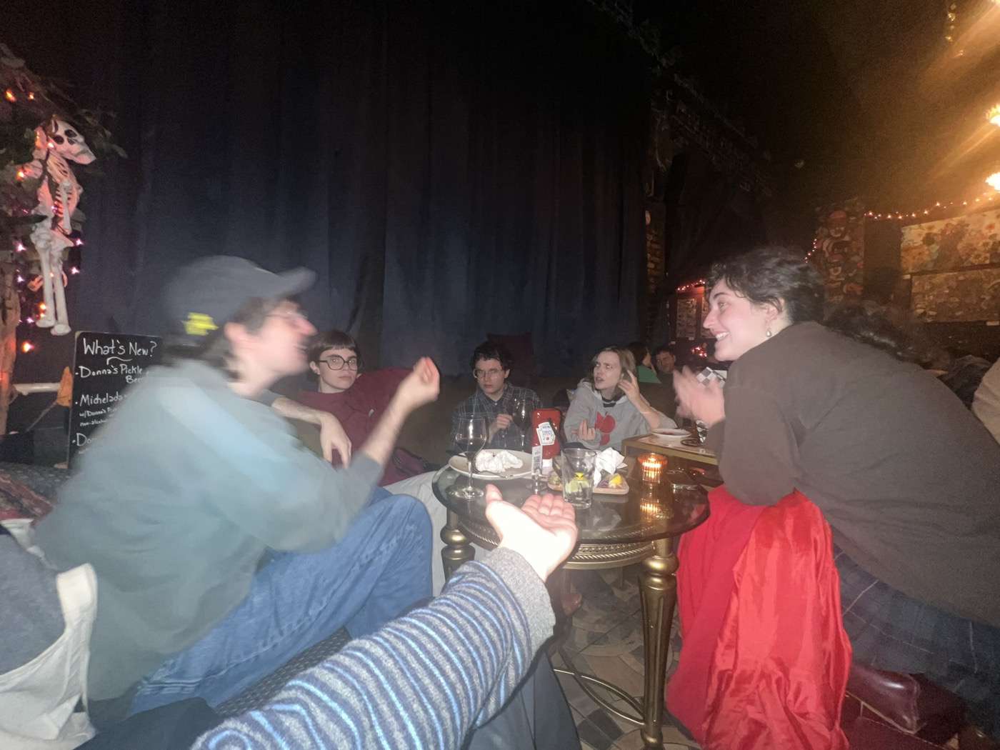  
  
Lucinda joins us after her viewing of *You Can See Everything.* She's got that pleasantly buzzy energy she carries when a piece of art has rattled her soul. But we're all out of phass; we can't discuss anything because she hasn't yet seen *The Devils*. And the rest of them haven't seen *You Can See Everything*.   
  
But we still manage to have a blast at the first informal meeting of our temporary Film Club. My friends buy me a very special shot and we ponder the adapted Last Supper mural adorning the wall behind us.   
  
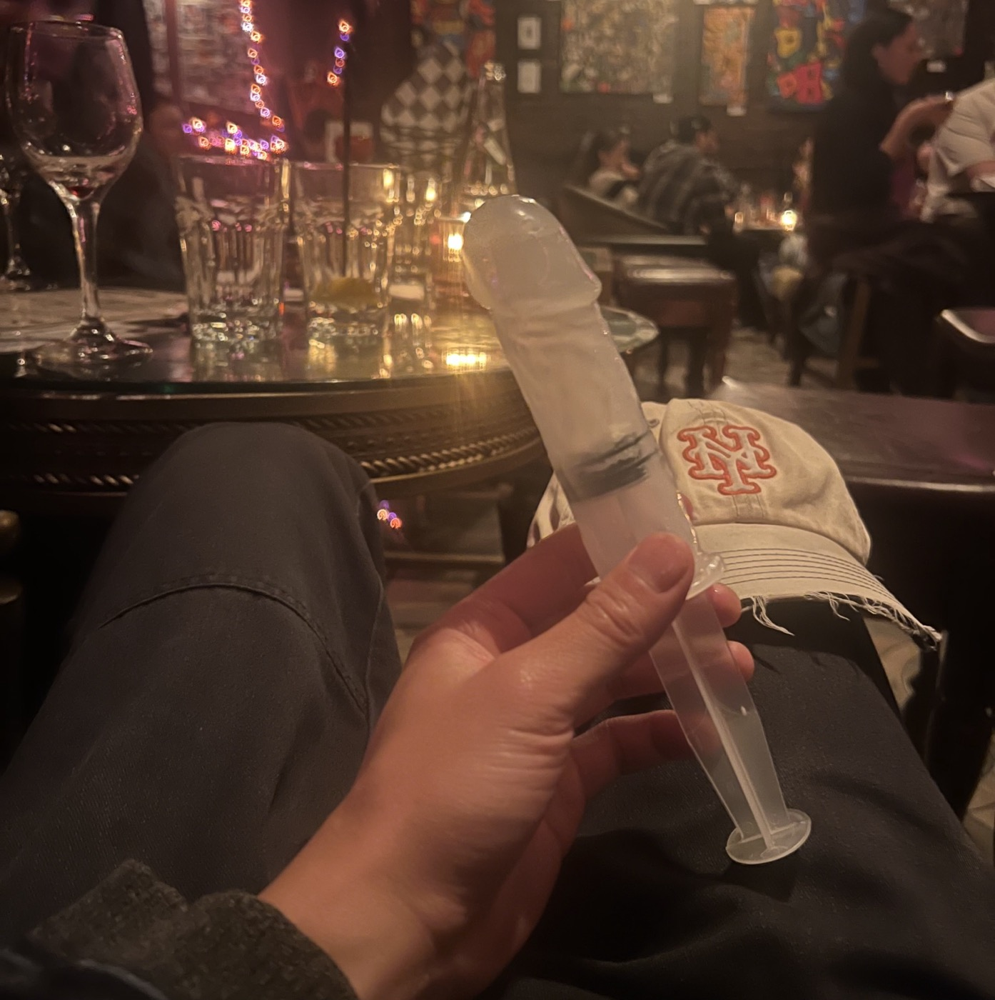  
  
It's my second time at Art Bar in a week, having come here with Mavis on a bit of a lark. Art Bar is a magical place, suspended in time, where the sounds — and prices — of Obama's second term live on. I was just a kid when I would come here then. That era was its own kind of autumn, was it not?  
  
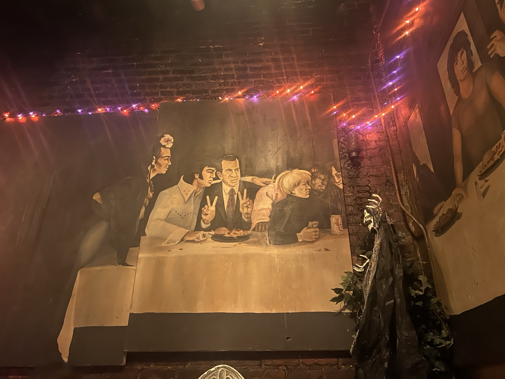  
  
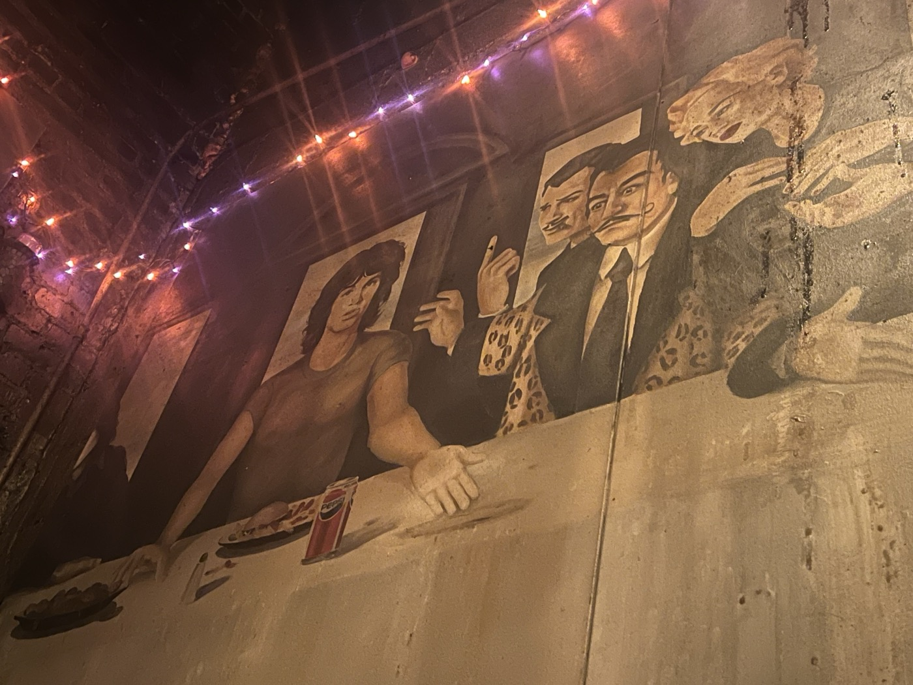  
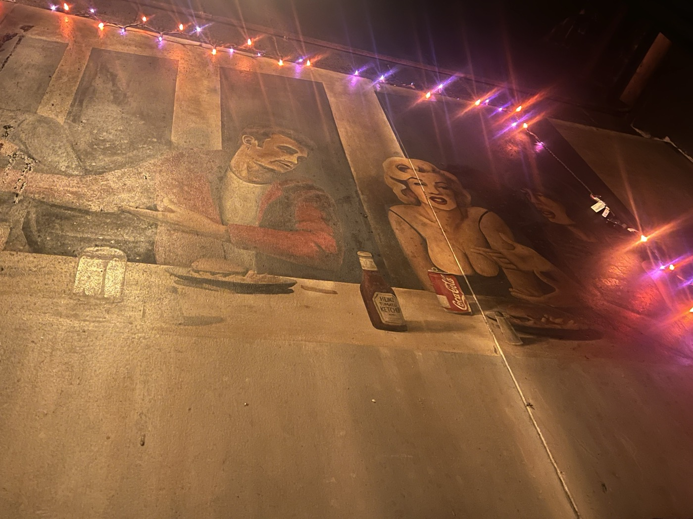  
  
-- FILM CLUB  
  
#life  
