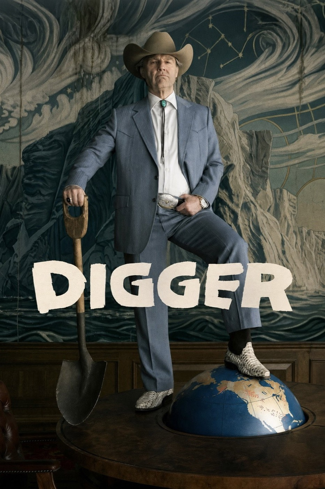

# after *Digger *(2019)  
  

### ★★★  
  
---   
  
Made me rethink a few other contemporary movies that it's in dialogue with, which I guess is part of the point. But it made me like some of them more. This movie is interested in some pretty important questions about What Art Can Do, and finds itself answering on behalf of film and theater with a hefty serving of despair. But I find a lot of solace in the belief that a lot of the limits of film and theater are transcended by other mediums, particularly literature. Not to sound insufferable.  
  
*Digger* is the latest in a spate of recent films exploring the limits of what art can accomplish in a world where the truth is more brutal and ridiculous than satire. It is also interested in the more general question of what makes something fiction and what fiction owes the Real Life Ore from which it is mined. If this sounds like Postmodernism or Media Theory 101, then maybe you'll see why, despite leaving the theater pleasantly surprised, within a few hours I found myself feeling rather *shrugglesome* about it.  
  
I would never expect any art, especially satire, to save the world; I am not a child. But I do sometimes have to laugh at the ridiculousness of our pitiful situation down here, and I refuse to accept that impulse as some kind of Sin Against Reality induced by some Demon of Commodified Art. Anyways, I thought Tom Cruise did an amazing job. I struggle with him sometimes so it's always nice when he is able to transport me away from knowing I'm looking at Tom Cruise — obviously the character design helped with that.   
  
Impressively constructed  

#film 
