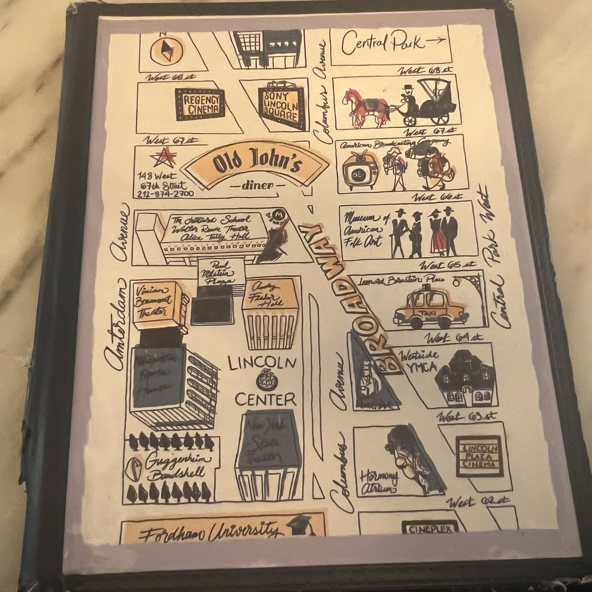
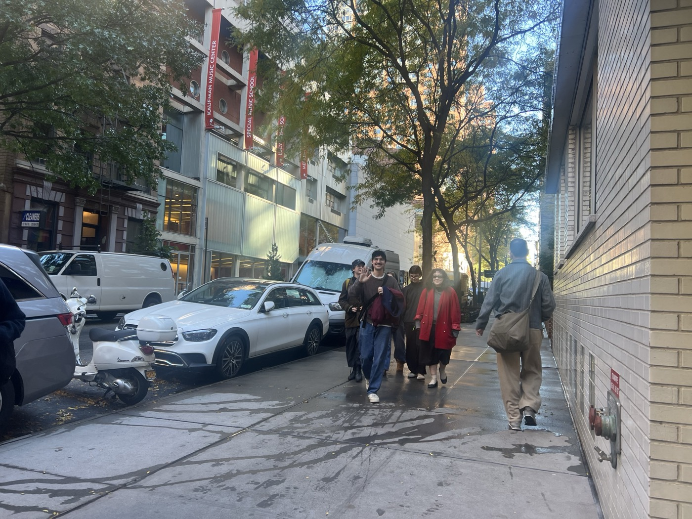
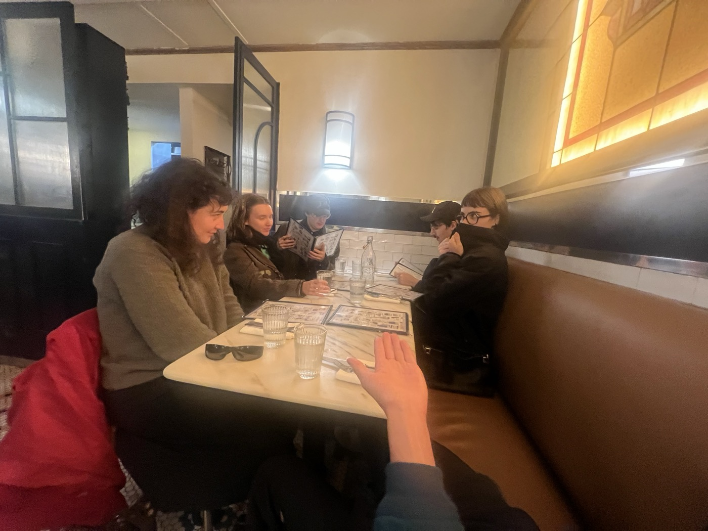
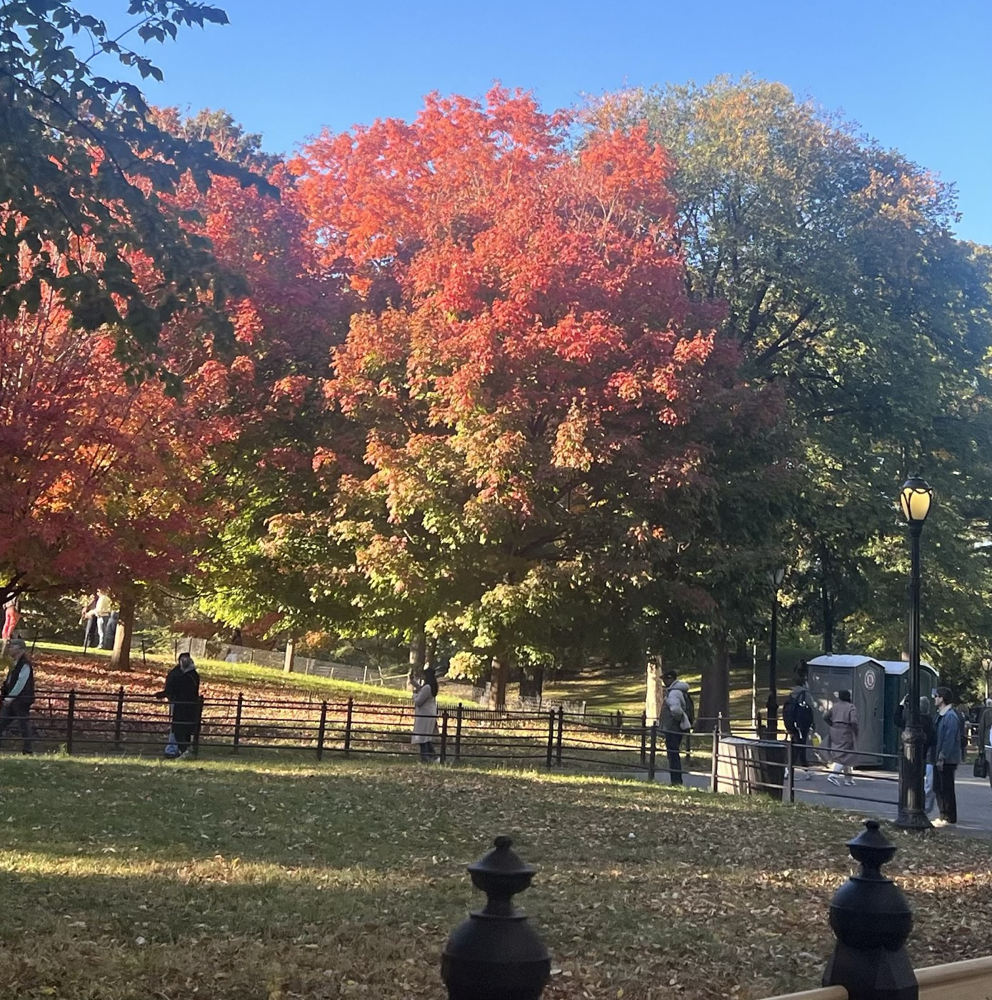
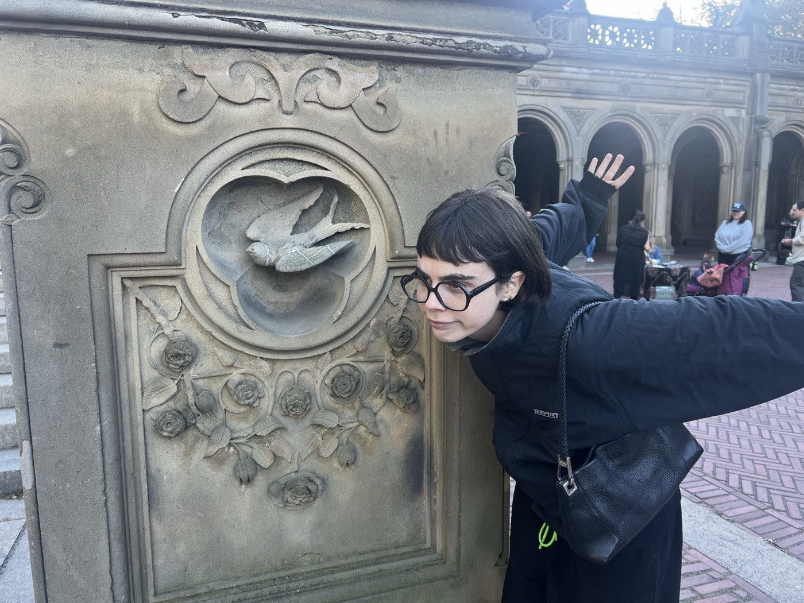
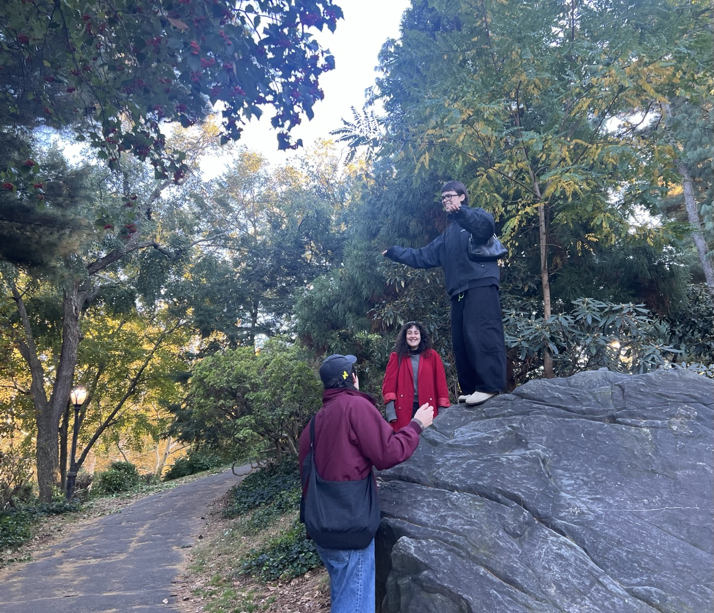
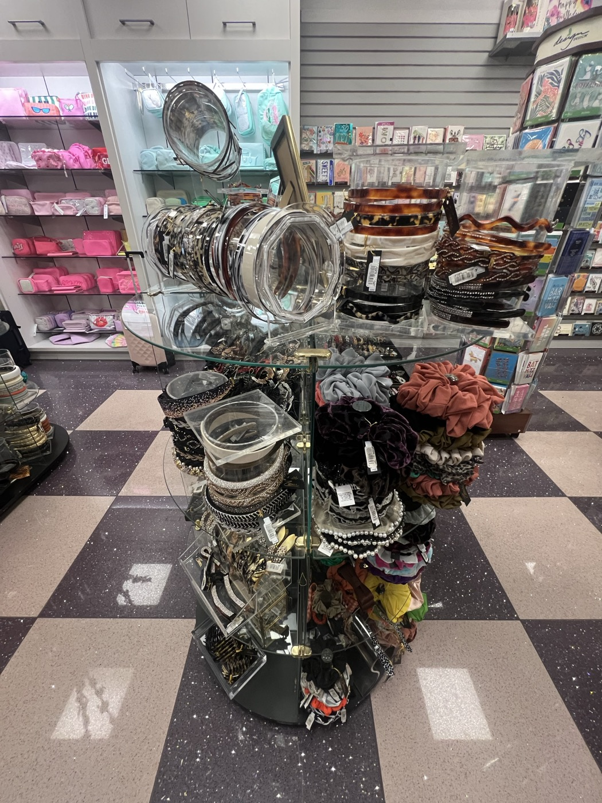
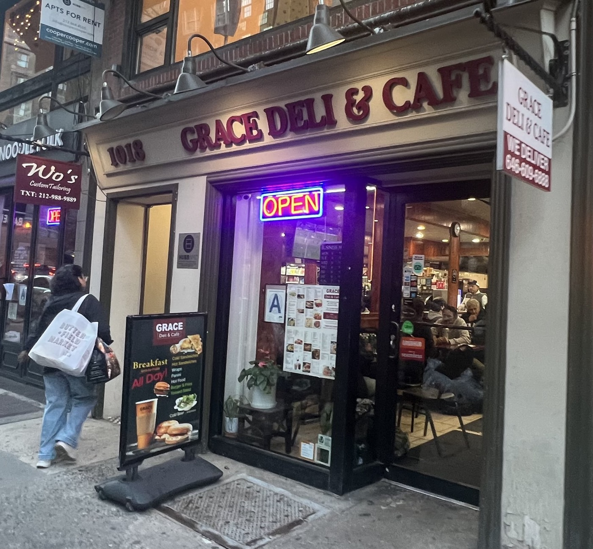
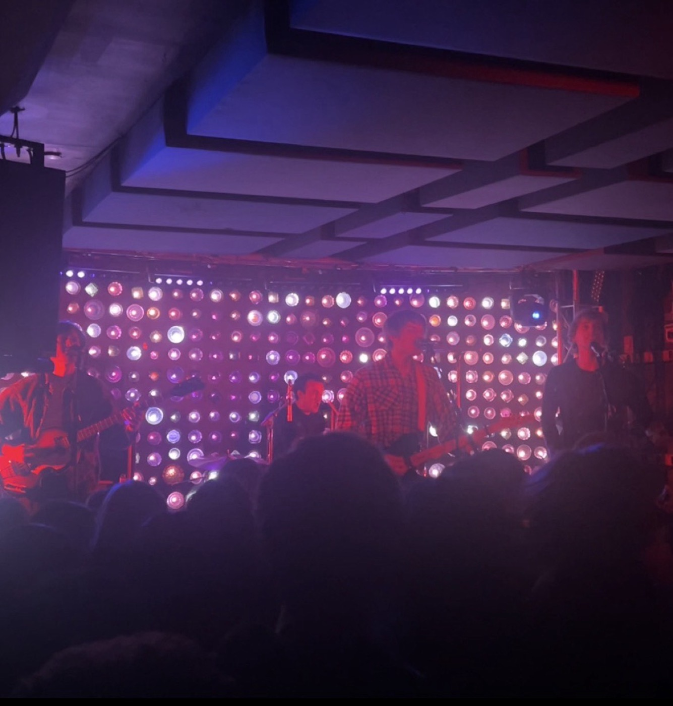

# 2026-10-23 3-borough day!  
  
## 1. MANHATTAN:  
  
after a brief stopover at the best library in the world to put the finishing touches on my brand new website, complete with a "supply"-side iOS notes app integration which allows me to "blog" directly from my iPhone, the first live edition of which you are currently reading.....   
  
FILM CLUB meets two blocks away at a diner which I last attended with miss Kathryn after shooting a promo video for the aforementioned library, which was one of the highlights of my life, to be quite honest! Mavis recently said one of her dream jobs would be to work in a stall at that library. I really like that.   
  
  
  
  
The crew has just seen *Digger*, which we all feel rather shrugging about. Ah well, we say. It's not really for us, anyway. It's for this guy:  
  
  
---   
  
It's three PM and Old John's must have put amphetamines in the coffee because everyone was acting insane. I have my Sudafed and can keep up just fine. Pearl and Richard don't join us for our foliage walk. Austin has been awake for work since 2am. He got off at 8am and went to the Met this morning.   
  
  
  
 *It's a process*, I keep saying.   
  
We visit my favorite fucked up bird relief and Bethesda. The fountain is under restorations, so Lucinda's angel is trapped behind a wall of fencing. Her waters are scheduled to flow again by summertime. Last night I cracked into the fifth hour of Ric Burns' massive, 23-hour long documentary *New York*. The angel was hated by art critics when it was first unveiled.   
  
But we loved, and we still love, her everyday qualities, her humility, her hand extended gently within her reach, ready to help, making contact with the needy, to work with her war-torn and spiritually listless people before she's even had the chance to fully land. Lucinda points this last part out to me, noting her foot, the toe extended and heel still aloft.    
  
"FREE HER!" I joke.   
  
  
  
We also reenact the Lion King on this rock.   
  
  
---   
  
After a visit to the ducks at Stuart Little's Pond, we embark upon a dangerous trek through the treacherous Upper East Side at dusk. We speak admirably of Hunter College and at a store that Lane likes, I gaze at a collection of $100 tiaras while the old employees complain loudly about their young clientele.   
  
Later, Austin and I muse about the demographic crisis heading towards the UES in the coming years. What will happen to all this wealth and property? Who the hell wants to live here? Who the hell could? Who the hell does? But we know it will all work itself out. Hunter College, you're my only hope.  
  
  
  
... well, and Grace Deli. ♥️   
  
---  
  
## BROOKLYN  
  
I separate from the crew at Bedford and sit for an hour and change reading and writing at Ten Ichi Mart. I should shoot for a corporate sponsorship from them. Various types of Williamsburg couples sit next to me. God bless their hot tea cabinet. Then onwards to Babies for the best show of the season.  
  
  
  
I hug Carol outside of Baby's and she says she was just thinking about me. I miss her all the time. It's our season, I say. It's my first time seeing Billy's street sign. During the show I stand with Renny's parents and Lucie. Renny asks me if I can believe it's been two years since we played here for the last album release and I tell the truth: I cannot believe it. And I am overjoyed for James.   
  
Renny is such a special talent. I want to grab his parents by the shoulders and tell them this, but I wouldn't really need to tell *them* of all people. Maybe something more like: *I'M A BELIEVER! MARY AND JOSEPH, I BELIEVE IN YOUR SON!!*   
  
> *Prospect Park, I′m sitting up straight*\
> *With the knowing posture of a monk*\
> *It′s May of 2024 and I'm writing*\
> *To get myself out of a death-induced funk*
> 
> *People go out the same way they came*\
> *Through territory uncharted*\
> *Then a life is spent, just waiting for it to change*\
> *Until you′re back where you started*  
> 
> - *San Francisco, 2005*  
  
---  
  
## QUEENS  
  
On the train ride, X tells me at great length about his readings. I've read one of them but not the other. I'm not sure how it's relevant to the question I asked — about James' guitar playing — but I'm happy he's reading. X is not a member of BOOK CLUB but he is tagging along anyway for the adventure.   
  
We (BOOK CLUB) have agreed to meet at last week's spot on the outskirts of our neighborhood. The establishment shall remain gatekept. Suffice to say: I feel the ghost of Giuseppe Tomasi di Lampedusa there. There is no music and the lighting is atrocious. It is perfect. And when the weather turns full of ice blades, it will be even better.   
  
When I arrive with X, it is clear that we've missed the closing of the festivities. I was prepared for this, seeing as we had actually walked past C and P on their way down Forest. I said hello, but they did not hear me. This is the second or third time this has happened. I think it must be my fault.   
  
X leaves BOOK CLUB to head back to Honore Square. He is meeting my soon-to-be neighbors there before they leave their hallowed grounds. MW shows up immediately afterwards, but many members are missing, including MA, IV, and S2. However, the core is in attendance: JK, MW, JG, as well as L and S1, fresh off their shift.   

**_[EVENTS OF BOOK CLUB MEETINGS REDACTED ON PRINCPLE. RECORDS MAY BE REQUESTED BY CONTACTING BOOK CLUB FACILITATOR OR LOG ADMIN. REQUEST DOES NOT GUARANTEE FULFILLMENT.]_**  

  
...at the end of the night, L walks me home and I love her ♥️  
  
#life #threeboroughday   
