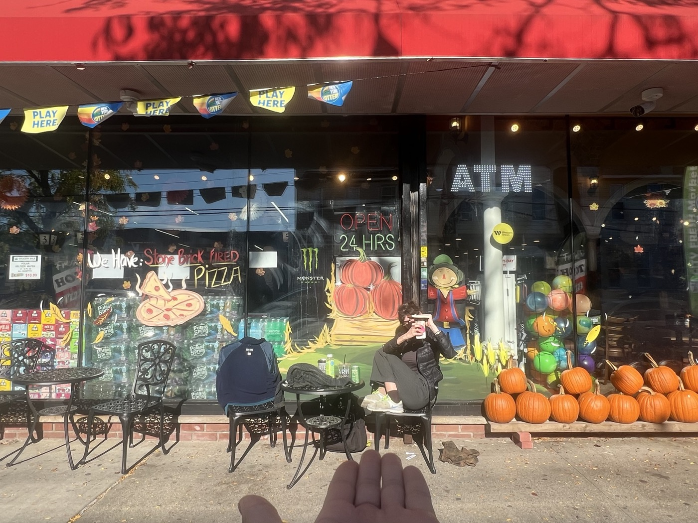
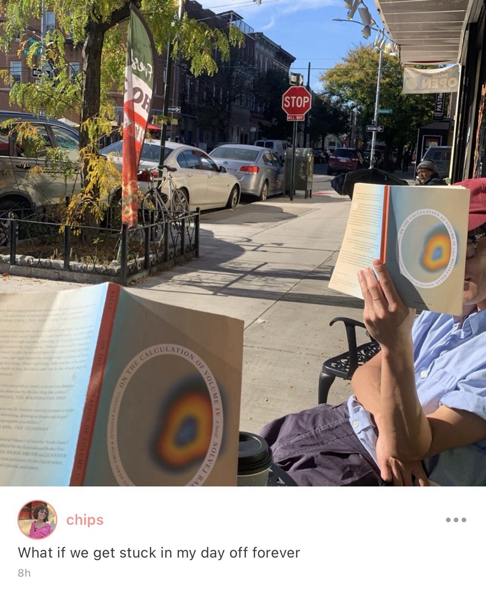
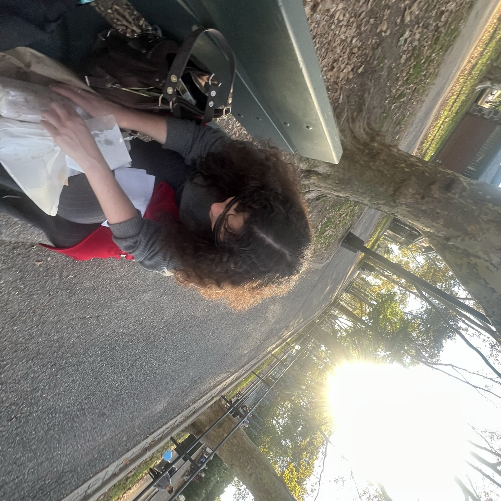
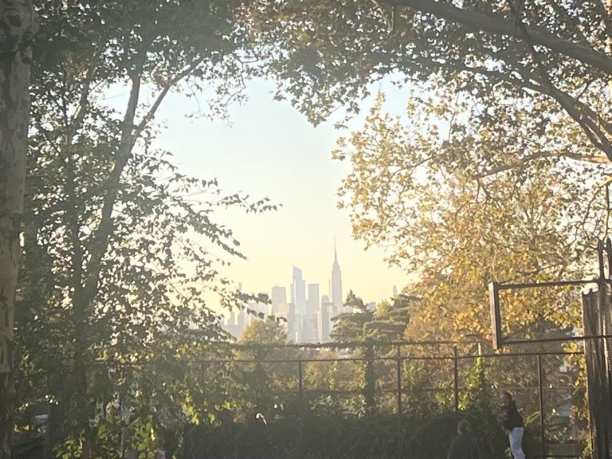

# 2026-10-24 grocery store 
  
What I did today was sit with ilulia on her only day off, and read from the book we're both reading, and enjoy the privilege of sweating in the sun. We talk about the book and about the place we'll soon both be working (if her sources are to be trusted) and she tells me I'll need to work hard. I don't mind.   
  
  
  
  
Some of our elders, fellow grocery store regulars like us, showed up and literally commandeered our seats from us but we were itching to leave anyways. It's interesting to be reliably bullied by an old woman named Diana. ilulia says we shouldn't romanticize people just because they're old — even the elderly can be straight-up annoying. I laugh because she's right: Diana *is* annoying. 
  
So we migrate to the park and we discuss ourselves some more. The book we're reading is about finding yourself caught in the same day over and over again. I tell her that's how I've felt for the last two years. Little things change; you can travel, you wake up wherever you fell asleep, the food you eat is gone. But everything outside you, anything that would allow for growth and change, is mercilessly repeating itself. It's always November 18th.

I tell her I'm trying to change my days. I know we understand each other. Eventually we've discussed all we can and it's time that she ought to leave to finish her chores. One day off is not enough. She knows that. Then it's just me and the trees for a few minutes. All the leaves are yellow now. They were green last week.   
  
---   
  
Light of Twenty Miles drops by with a pair of gigantic sandwiches from her new work. We run in to M from BOOK CLUB. He's going to a wedding.

Tomorrow's the last 6pm sunset. But good omens abound.   
  
  
  
  
  
#life   
  
