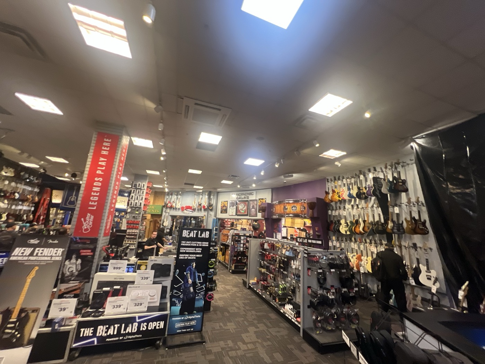
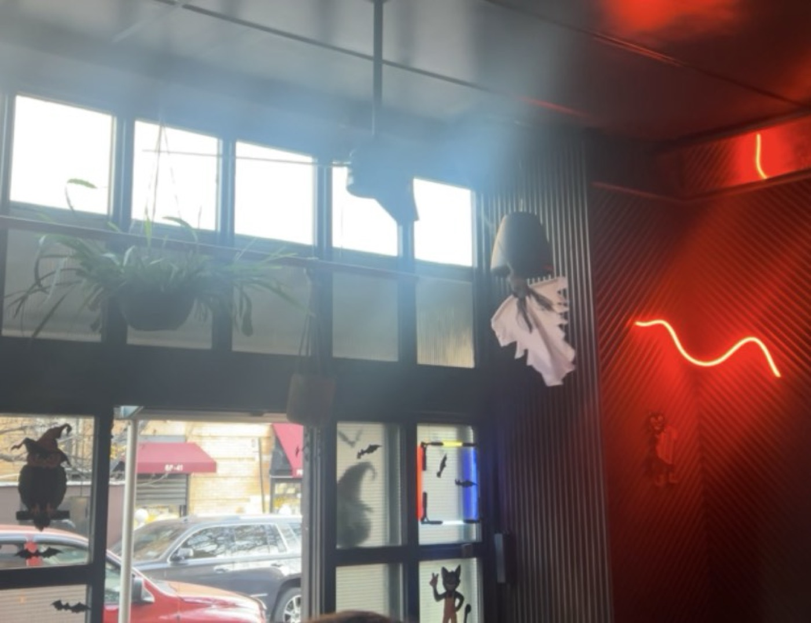
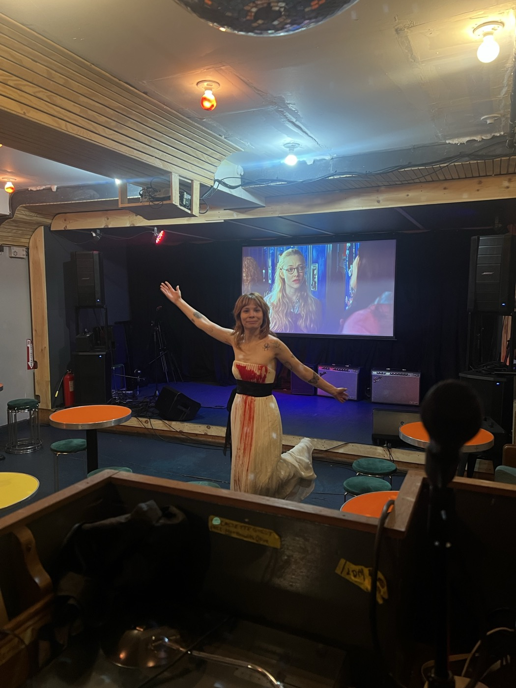
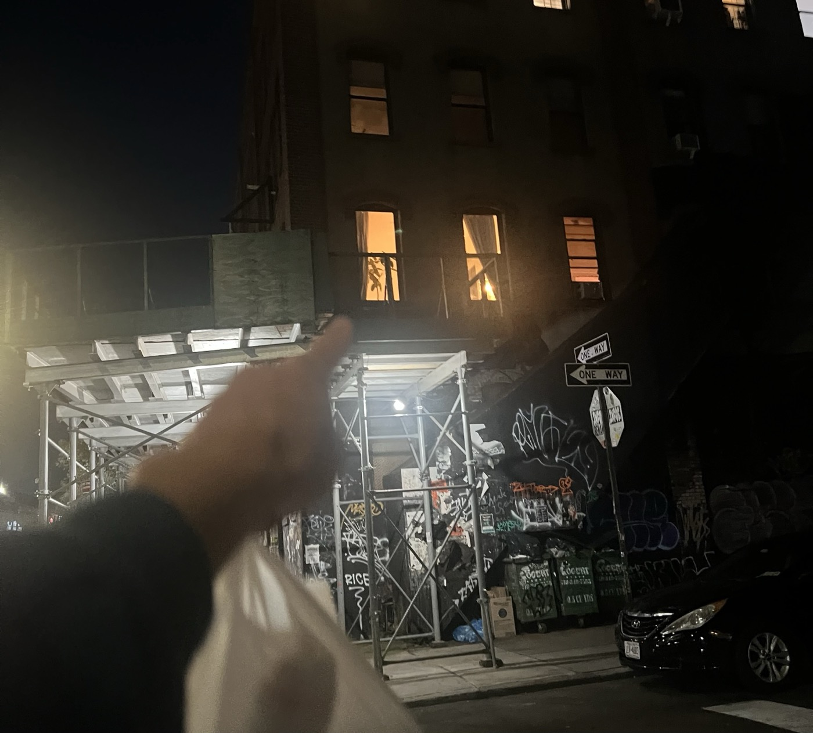
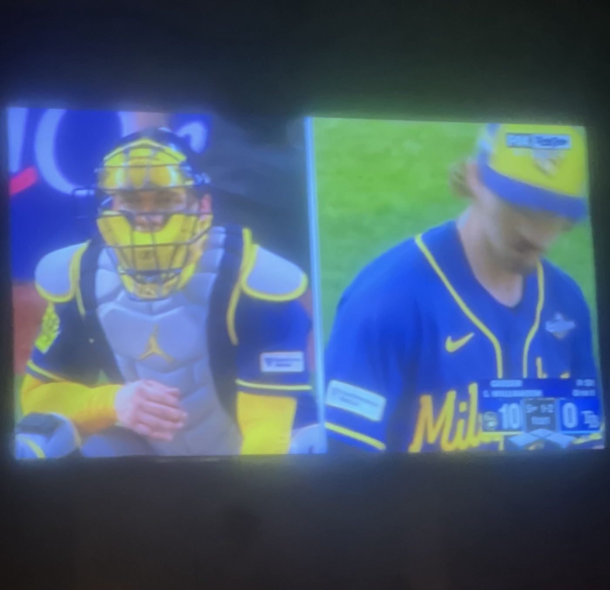

# 2026-10-26 three-borough day!  
###   
## BROOKLYN  
I bike frantically to the studio with my guitar on my back. The CitiBike parking dock is full, so I have to lug the gigantic bike into the studio building with me. I wind up having to bike all the way to the Montrose stop, biking up Bushwick Avenue like a total asshole. But it's a curiously nostalgic route, I don't come over here much these days and certainly I've never biked it.
  
  
## MANHATTAN  
At Guitar Center, they have skeletons set up in front of the CDJs. I want to take a picture but feel it would be condoning "cute" behavior from a major corporation. So I just smile silently and think of DJ Academy and wonder again how old I am allowed to feel. I buy a pickup for my guitar and remember when I was here on Disney's dime with Miles, Tony, and Vita. That was, impossibly, four years ago. I finally text Torri back.  Elaine's quitting smoking thanks partially to the Allen Carr I recommended.
  
  
  
Afterwards I sit on Sixth Avenue with an onigiri and stroll to Father Demo. The garden is closed on Mondays, so there's really no reason for me to be here. I think of dropping in on Allison but I don't. But maybe she could have helped me with my costume idea.  
  
  
## QUEENS  
At Variety, J and M and C. We pilot a new handshake for BOOK CLUB and discuss where we might source our text. We sold it out on ThriftBooks. I answer some emails. J's cortado sends me to another planet. I have been feeling wonderful lately. Then it's time to help Shannon set up at Dinky's. She is wearing a bloody white dress and she and Joey are struggling to put the wig on her.    
  
It's lovely to see Rona again and we giggle at Jacob, who is taking a video of a ghost spinning around in circles attached to one of the ceiling fans while Chris Isaak plays in the background.   
  
  
  
  
David Orkin is cohosting the event. I chat briefly with Lauren M., congratulating her on the campaign and her recent election to the DSA delegation. She says that our campaign in '22 is what brought her into DSA, and that losing so narrowly is what made her resilient. Well then, what does that make me. We agree that it is incredible how far the movement has come in the last few cycles. But we hope the new blood is durable.   
  
## BROOKLYN  
  
  
  
Back to the studio for B&S rehearsal. The moon makes me gasp. Unlike last night's spotlight luminosity, this one is humble and yellow and giving us that perfect October amber light. Every inch of the city feel suffuse with that lovely yellow air these days. It has been a lovely stretch of weather these past many weeks, even for being sick for about half of it.  
  
Rehearsal goes swimmingly and we have such a lovely crew of friends. Jane and I walk back through Bushwick afterwards and get to catch up a little bit. We talk about cute girls and coming into your strengths late. She's settled in with Erica at their new place. The new job can be a lot. She tells me about a rather cursed interaction. You should come over for dinner, she says. And deposits me at Honore2 so I can watch my baseball. 
  
  
## QUEENS  
I arrive just in time to watch the Brewers open up a massive rally against the Rays. I was right, they are going to win it all. I will miss these evenings of sipping whiskey and watching such a fun team. It's hard to believe that this is the same body that ran the bases every day back then. But then it's not. 

There's barely anyone at the bar and S is playing a wonderful playlist of Gary Stewart, Ricky Skaggs, Willie Nelson. I have poor service at this bar and there's too many good songs to keep asking about, so I sheepishly keep a Note of as many of the lyrics as I can. I'm texting and having a nice time with my whiskey. Shannon says the screening went well, despite several people showing and not knowing I would not actually be attending. 
  
  
  
Kathy joins me for the last out. She's fresh off her trip to [redacted] for [redacted] and we catch up about our weeks and weekends. She really wanted to know what happened between [redacted] and [redacted]. I tell her to interrupt me more, which is something of a once-in-a-lifetime opportunity for her. Two men with a tiny tape measure invite us to play "the measuring game" with them, which involves guessing the length of various things and spaces, and it is actually really fun. I win one round and S wins another.

Katy and I walk homewards. Now that she's home to stay for a while it really feels like the holiday season. She says [redacted] and I advise her to give it some time. We yell at each other in a fun way and how I love her so. Now we're both coughing that horrible cough and I implore her to quit smoking again. It's hard to believe it's been a full eight years since I quit with Katy's angelic assistance. So much was happening then and that was before anything happened. How old are we allowed to feel?  
  
#threeboroughday  
