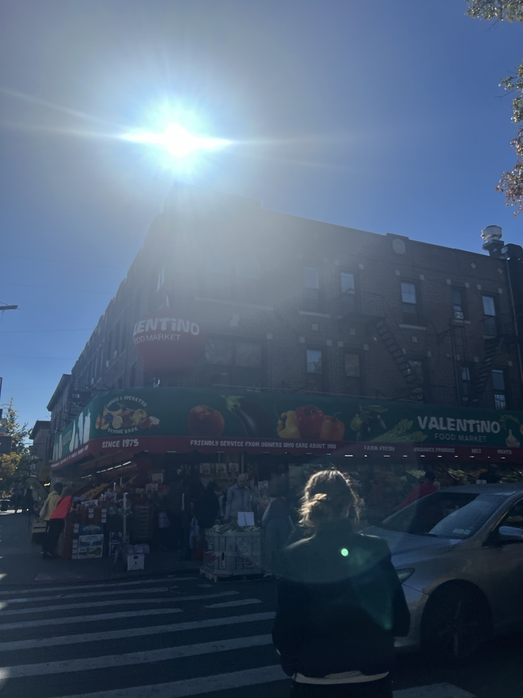
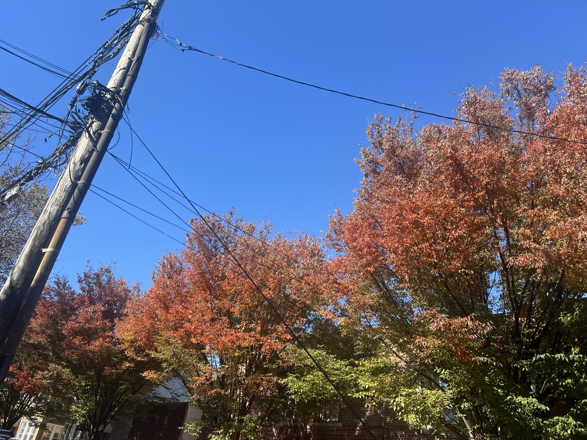
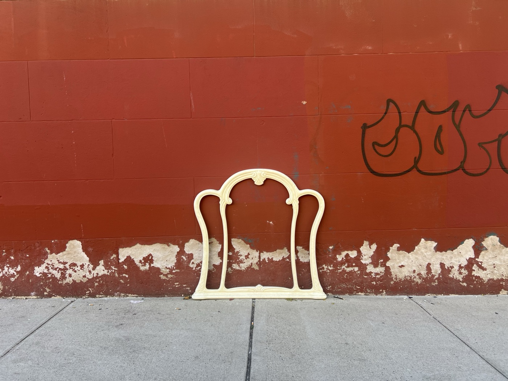
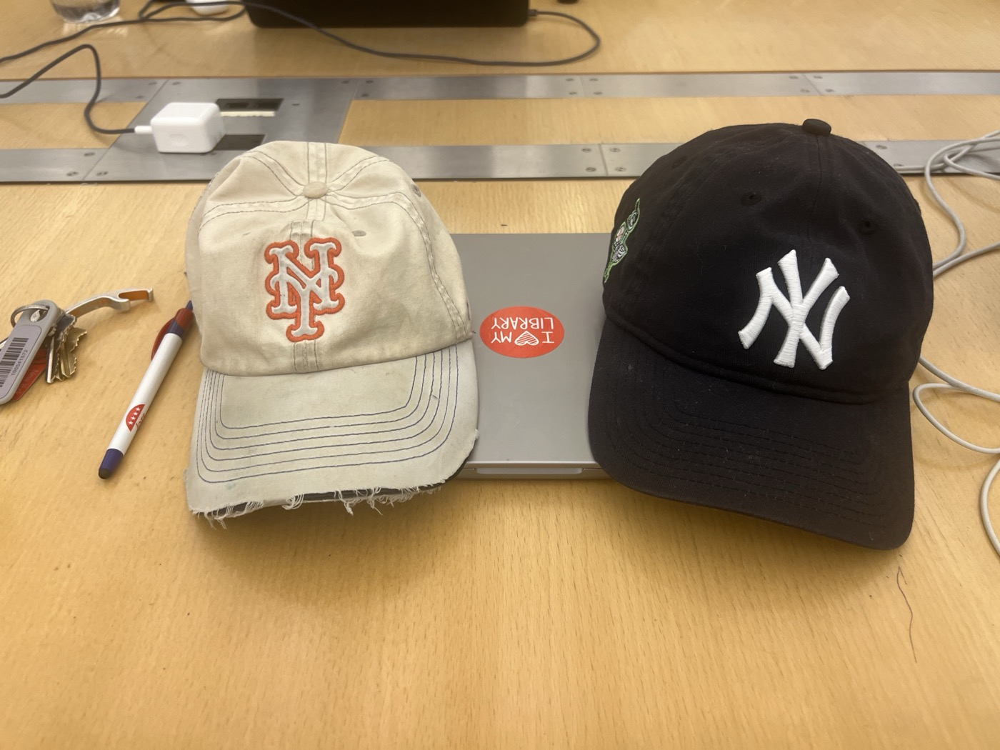
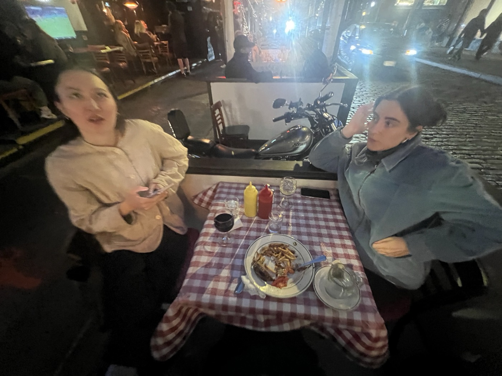
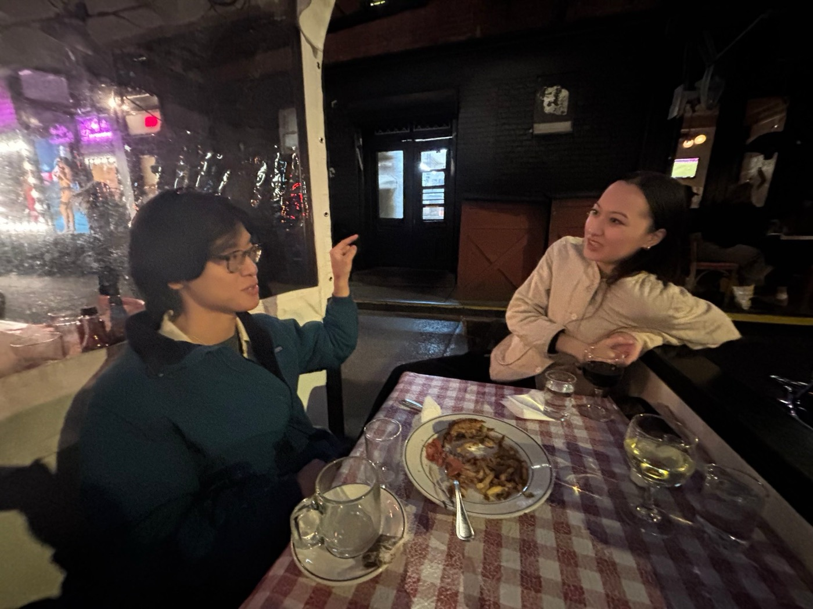
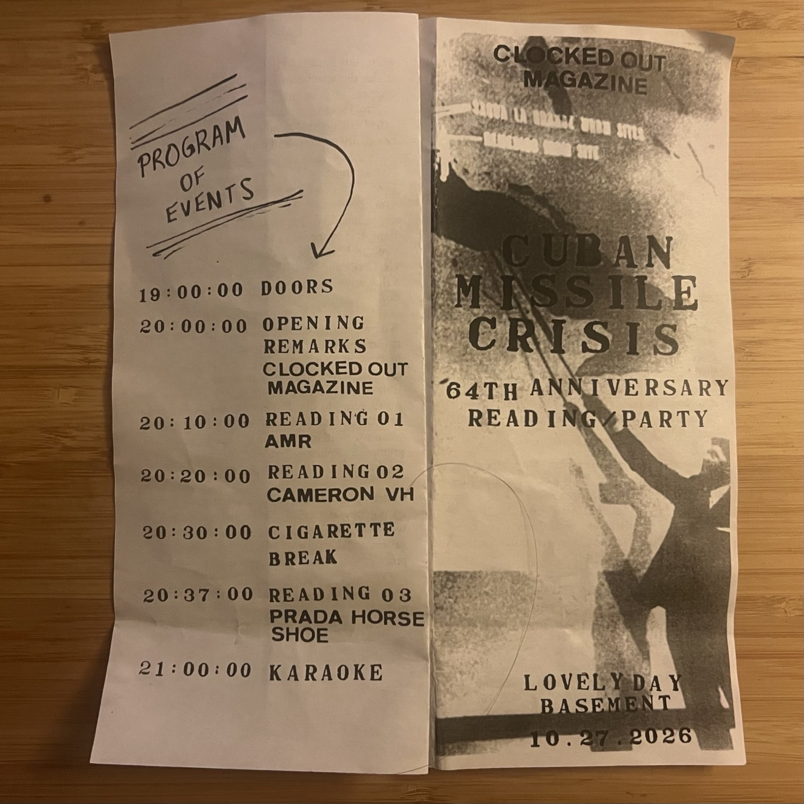
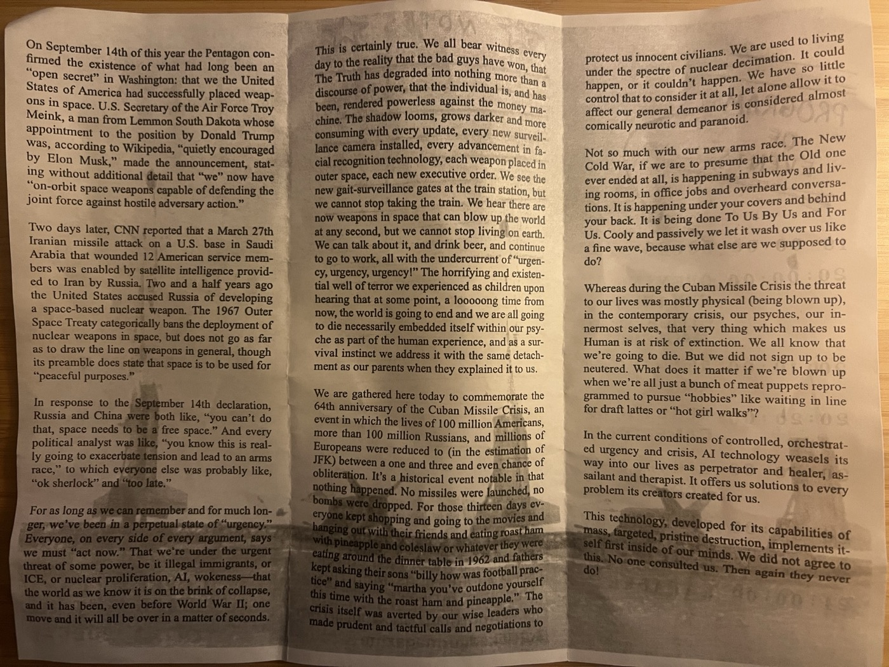
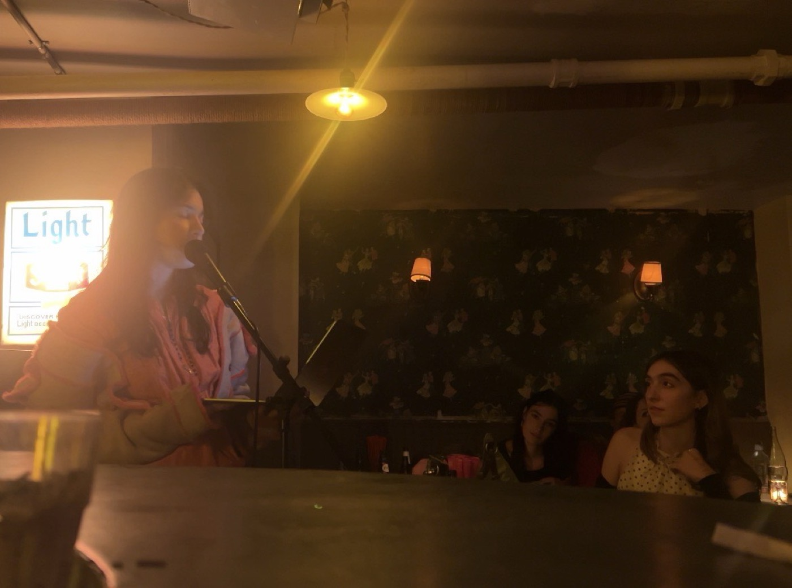
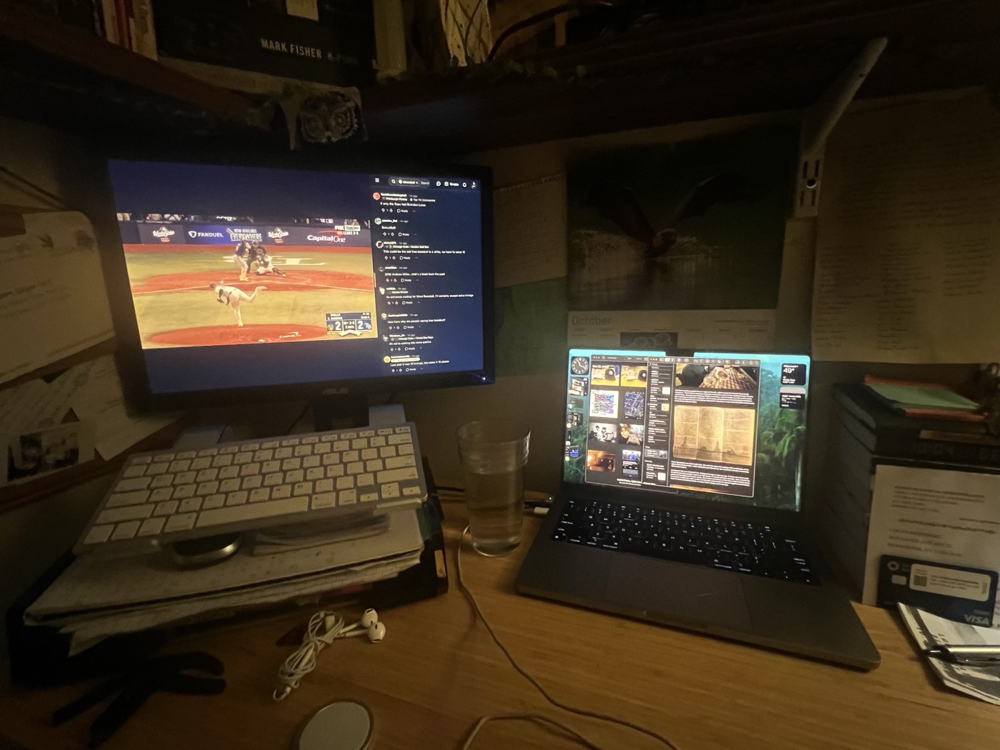

# 2026-10-27 my day of "libbing" out  
  
I started my day with a surprise interview. I had just voted early at Gottscheer — was struck by emotion while filling in the bubble next to Claire's name. On my way out, two people with a camera and microphone say they're with Democracy Now! and ask if I want to share my thoughts on the election and the issues that matter to me. My breakfast this morning was two pieces of toast and an extra cup of coffee, but I jokingly agree to "make a media appearance."  
  
It's strangely nervewracking even though I have the thoughts all together. They ask me to film another take, they want me to specify the campaign Claire and I worked on together. I repeat a lot of my words but their natural order is all jumbled up now. It's a strange sensation to restate something I just said, and to have it come across as casual. It's the camera's fault. I wonder how it will look when it airs on Election Day. And it gives me a reason to text A, who the interviewer knows and seems to have swapped jobs with.   
  
Then I go grocery shopping and am overcome with a swell of civic pride looking at the silly red apple adorning Valentino's. There is no reason that grocery shopping should so reliably cause me to enter a manic episode of neighborhood appreciation, but I can't help it. Fresh Pond Road is the dream of America, and at DII it is already Christmas. And so moved, I post about electoralism, I say Ridgewood should secede from the United States. It is a much better version of what I said to the sweet friends of Amy Goodman.  
  
  
  
  
  
  
---  
  
## Librying Out  
  
My initial plan for today had been similar to many of the past few Tuesdays: wake up, manage to make my way into the city and work on my laptop for a while until the Guggenheim's pay-what-you-want period opened at four in the afternoon. I have been trying for many weeks to see the Taryn Simon show, knowing that it would likely be a multiple-date effort due to the sheer size of the show. But every time I've attempted to begin, my plans have taken me down a different path. It's hard to get me to the Upper East Side.   
  
And so I wind up joining Mavis at our library. We're wearing complementary hats. Sort of. I finally renew my library card, it takes me about 20 seconds. The woman who renews me keeps remarking about how good my ID photo looks. Mavis is studying for the LSAT; I am studying for whenever I actually see the Taryn Simon show. I also read about Solvej Balle's life on her island. She doesn't drive and she doesn't fly. She's written a previous novel about a man who attempts to measure the footprints of God. And so it all makes sense. We have about three weeks until the release of Volume V.   
  
We work and chatter sporadically for a few hours until it's time to go. Next time I'll see the Martha Graham exhibit, but next time needs to be soon, because it's leaving next week. Mavis and I might both work at bookstores coming soon. We hug about a million times before parting. Mavis is fitted today like a baseball coach; it's a fetching look on her. Neither of us like the LED installment in the entrance stairwell; both of us like the sculptures in the plaza. Today's the anniversary of Lou Reed's death and I think of the videos of the celebration of life they held here a few weeks after he passed.   
  
  
  
  
I've got just enough time for my midafternoon mission: obtaining a copy of *The Piano Teacher* from the city's dwinding supply. I feel resentful that there seems to be only one edition available, but even the library doesn't have many in stock. I'd intended to scoop some from The Store™  in SoHo, but on my way there, M and L text to say that they just scooped them. So I'm left to suddenly scramble to the Barnes & Noble at Union Square, which for some reason has about a dozen copies. This must be most of the city's inventory of the Austrian classic.  
  
  
  
---  
  
Then it's time for Yvonne's new tradition: happy hour in the city after work. When she first relayed this idea to me, it struck me as brilliant. We had intended to meet at a hotel bar in SoHo but wound up at Fanelli, where I get to briefly catch up with Kelsea, who puts a solid dent in the bill. Luisa drops in as well, so I'm suddenly sitting with two people who saw *You Can See Everything* and shrugged. They explain their unique mental circumstnaces that led them to respond with ambivalence to the fundamental irrationality of the human psyche.   
  
  
  
  
But there's nothing gluten free or vegan at Fanelli, which means it's time for them to go elsewhere. There's been repeated confusion around the name of the restaurant that Yvonne wants to try. We part ways and they finally head there. And so I make my way to the Lovely Day basement to attend a reading in a fit of cross-generational anthropological inspiration. I'm very interested to see what today's Bushwick-ians have to say about the 64th anniversary of the Cuban Missile Crisis.  
  
---  
  
## IN LIGHT OF WEAPONS IN SPACE AND THE 64TH ANNIVERSARY OF THE CUBAN MISSILE CRISIS  
  
  
  
  
  
I've arrived at Nerd Hour, which is what I've just decided to call it when you show up at the time listed on the poster and then have to sit around for a full hour until the event Actually Begins. Upstairs, K and E are dealing with a rush from hell, so I just sit next to a smelly boy in a cool vintage Cubs hat and bomber jacket, much like Mavis', who spends the rest of the evening pounding Mahou and doodling something pleasantly scary in Sharpie. Eventually Ashley feeds me the WiFi, which I use to look at pictures on my iPhone.   
  
It's been a minute since I've been in this situation. I don't know pretty much anyone, but Fiona remembers me which feels nice. Eventually she and Zoe open the reading with a recitation of the above. There's two readers; "AMR" takes us on a whirlwhind geographical tour of American empire which opens with a hilariously-altered version of Hegseth's recent bigoted military gatekeeping rant, and which closes wonderfully reminding us that there is still a Cuba, sitting out there in the water, just a small ways away from "America's big swinging dick." After this is Cameron, who I see often around town in both Bushwick and on the Lower East Side, who offers a frenetic overview of the weapons not in space but here on Earth, and who points out that the current "borderless" arrangement of space weaponry and technologies is predicated on a philosophy which ought to destroy the notion of borders here on Earth, too, but alas.   
  
And then Amana reads; she's laying the groundwork for her manifesto release on Monday. She asks me to film it. My doodling friend's Sharpie enters the frame over and over again while she draws the explicit parallels between the era of Elaine Scarry's "thermonuclear monarchy" and the pre-disastrous deferred responsibility matrix of our AI-Big Tech overlords. She's reading from her laptop and seems to have be the only one interested in this aspect of the Atomic Era's contemporary resonance, which seems self-evident to me, but then again she keeps saying that AI is going to kill us all, so I can understand why it might have been a slightly tougher sell amongst this clientele.   
  
  
  
I don't stick around for karaoke. Then a charming thing happens which reminds me why one should always try to do things, try to make the days different than what their natural *slothular intertia* might pull you towards. I'm gathering my things and throwing my jacket on when I notice a cute and familiar face down at the other end of the bar, newly arrived and looking over the menu. It's one of my stranger-friends from posting2. I introduce myself and we have a nice meeting. She says she's never been here before but that she works around the corner. Her name is L.  
  
Upstairs, the rush has barely ended but I pop in to say hi to K, who asks me what I thought of the event. I tell her that I've been trying to figure out how old I'm allowed to feel. She tells me I shouldn't fret: everyone here is more or less my age. It takes me a few beats to realize that this actually makes me feel much worse. Not connecting with people younger than you is one thing; failing to connect with a crowd full of peers just means I can't connect.  
  
But it was nice to meet L, and then I'm walking towards the Williamsburg Bridge on a crisp autumn night with *I Can Feel the Heart Beating as One* in my heapdhones, and the trains come on time, and it's time to watch the Brewers finish the World Series. Extra innings, as we type. There might be a lockout next year, which means no baseball. I've learned by now to take what blessings we can.  
  
  
  
---  
  
### *"New York City is the Place Where"*  
  
***[https://www.youtube.com/watch?v=bJ9VrfIvsH8](https://www.youtube.com/watch?v=bJ9VrfIvsH8)***  
***[https://www.youtube.com/watch?v=aCmlEtFToeE](https://www.youtube.com/watch?v=aCmlEtFToeE)***  
  
> *No consolations please for feelin' funky*  
> 
> *I got to get my head above my knees*  
> 
> *But it makes me mad and mad makes me sad*  
> 
> *And then I start to freeze*  
> 
> *In the back of my mind I was afraid it might be true*  
> 
> *In the back of my mind I was afraid that they meant you*  
>   
> *The Halloween Parade*  
> 
> *At the Halloween parade*  
> 
> *At the Halloween parade*  
> 
> *See you next year, at the Halloween parade*  
