# 2026-10-29   

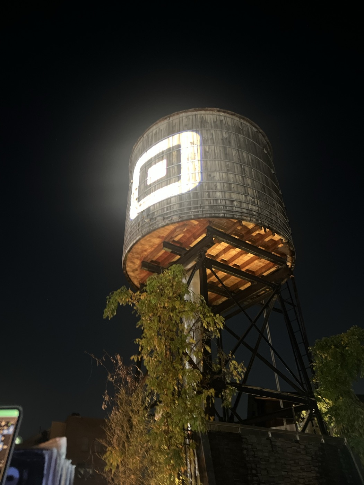  
> *... and we worship an awesome God in the blue states.*

---

## BROOKLYN-MANHATTAN
  
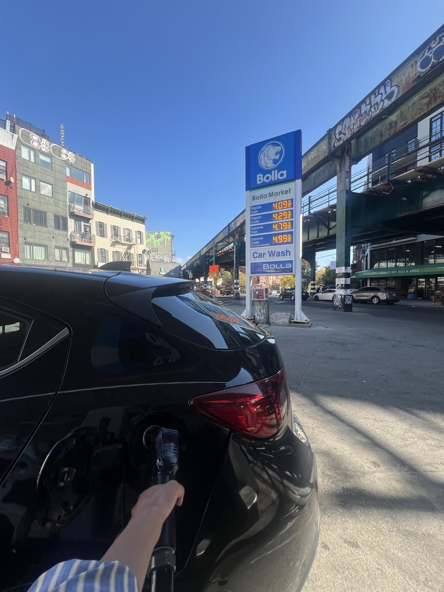  
> *PRESSURE AT THE PUMP: With gas prices soaring across the country due to conflict and instability in Iran, we visited a gas station in the heart of the "Commie Corridor" to find out whether the honeymoon is over for Zohran Mamdani.*  

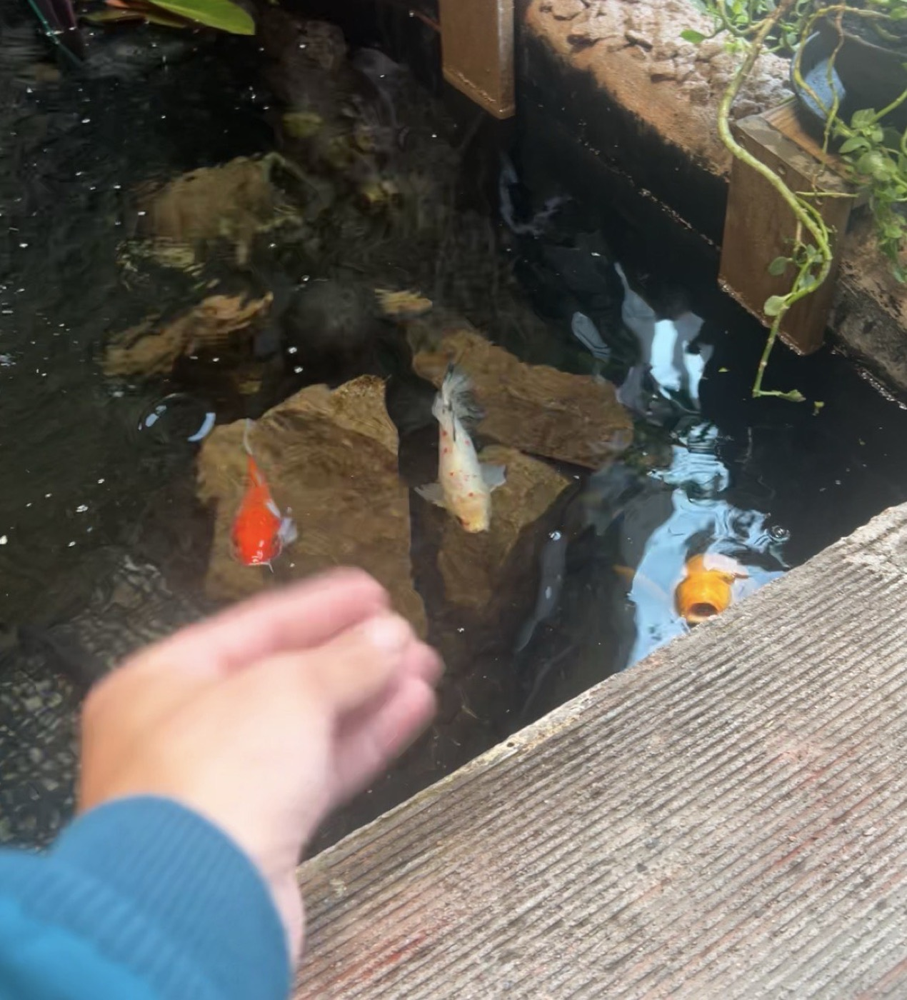  
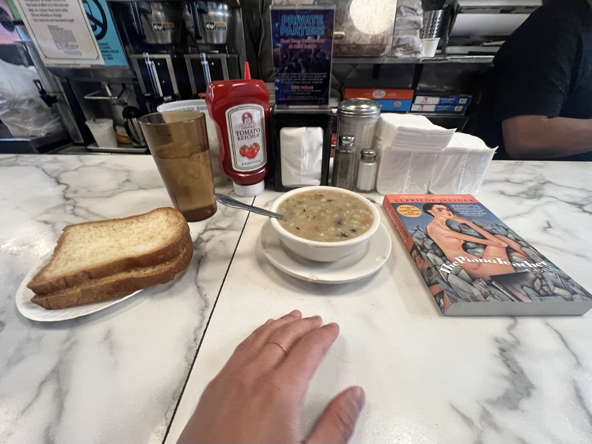  
  
At B&H my fellow patrons are all considerably older than me, and the workers switch fluently between Spanish and several other languages. I crack into *The Piano Teacher*, order the Thursday soup+pierogi special, and think that I myself might happily grow old doing this.   
  
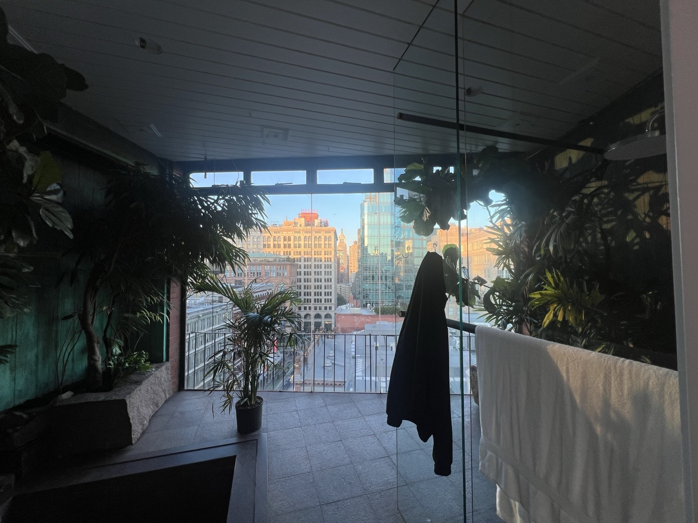  
> *419 Lafayette, walk past the fountain and the elevator to the "A Stairwell" and ascend nine flights of stairs to the rooftop. For anyone who asks, just say "I'm the DJ"*  

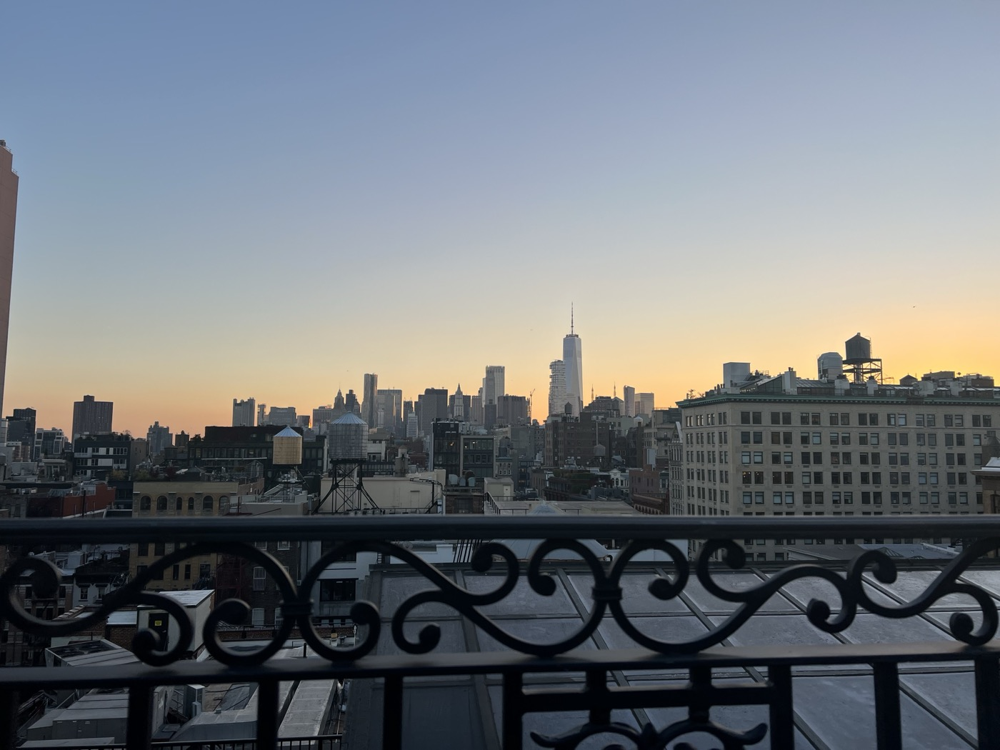  
  
---   

## MANHATTAN-BROOKLYN-QUEENS
  
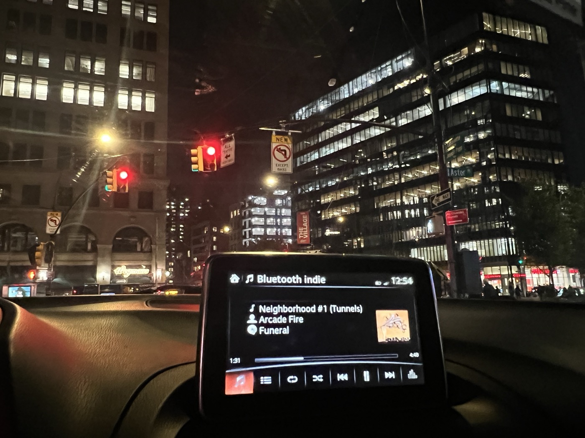  
Driving back from the gig, I listen to *Funeral* in preparation for tomorrow's show. I cry a few times, as is usual — it's been a long time since I put the album on. I didn't even listen to it on my cross-country drive this spring. I remember being amazed by the opening lyrics, how perfectly it mirrored my daydreams as a child. It's tired to say "lightning in a bottle," but they would never again quite capture the brazen spiritual urgency captured here. *Funeral* is a magical combination of grief-inflected raging against the world's concentrated destruction of the spirit of youth. And it is a debut!
  
It makes me miss everyone I have ever met, and of course it makes me miss my father, but it makes me miss my mother too. I miss the life we all had, or that I imagined we had, and I miss my bedroom with the stars on it, and hiding on the bottom bunk with a book or my CDs. And my bike, I miss rolling down the big hill, playing with B at the creek, baseball games, playing violin and driving down the road with my father in his van, his hands at the controls like his own gigantic bike, asking him questions about the Beatles and the Who, all of this before he got too sick to stay, but still even afterwards I miss some.    
  
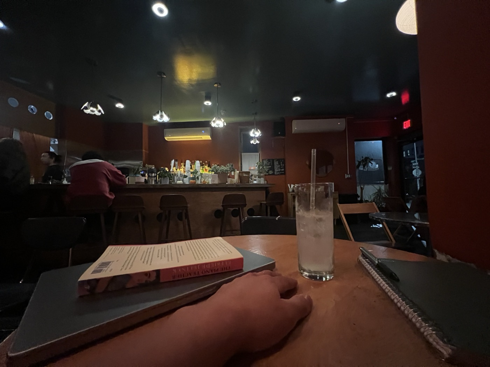  

For some reason after loading into the studio (and possibly overseeing a light crime against my employer), I step into Sunrise/Sunset for the first time in about three or four years. There's an itchiness driving me here; some part of me has become stuck back in time on the summer night that I stayed up with E until she was finished closing and she touched my shoulder, etc. But the interior is feeling much nicer, warmer, and they don't have WiFi after 6pm now. A mixed well drink is about $13 higher than I remember.   

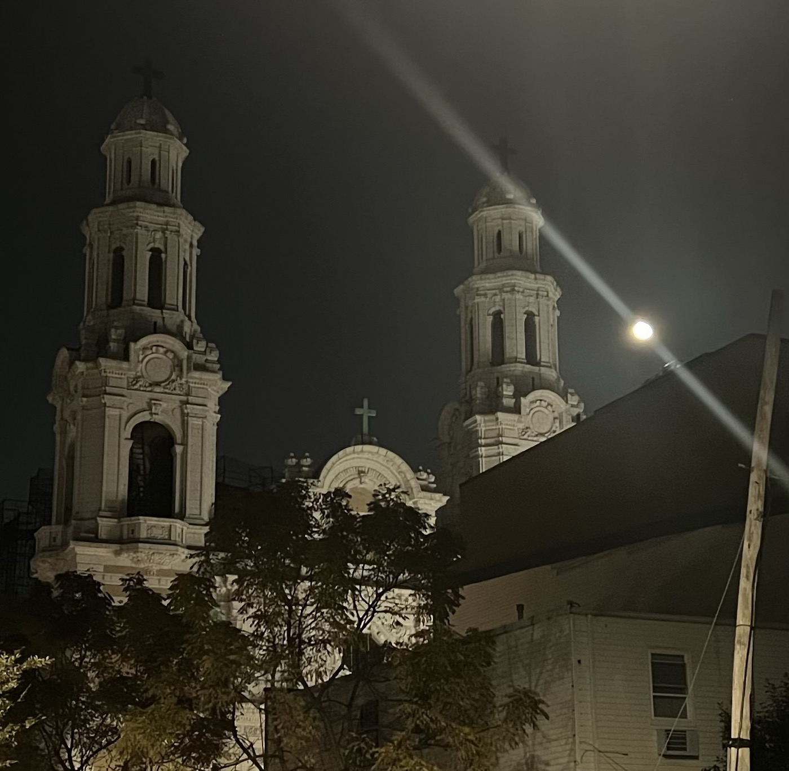  
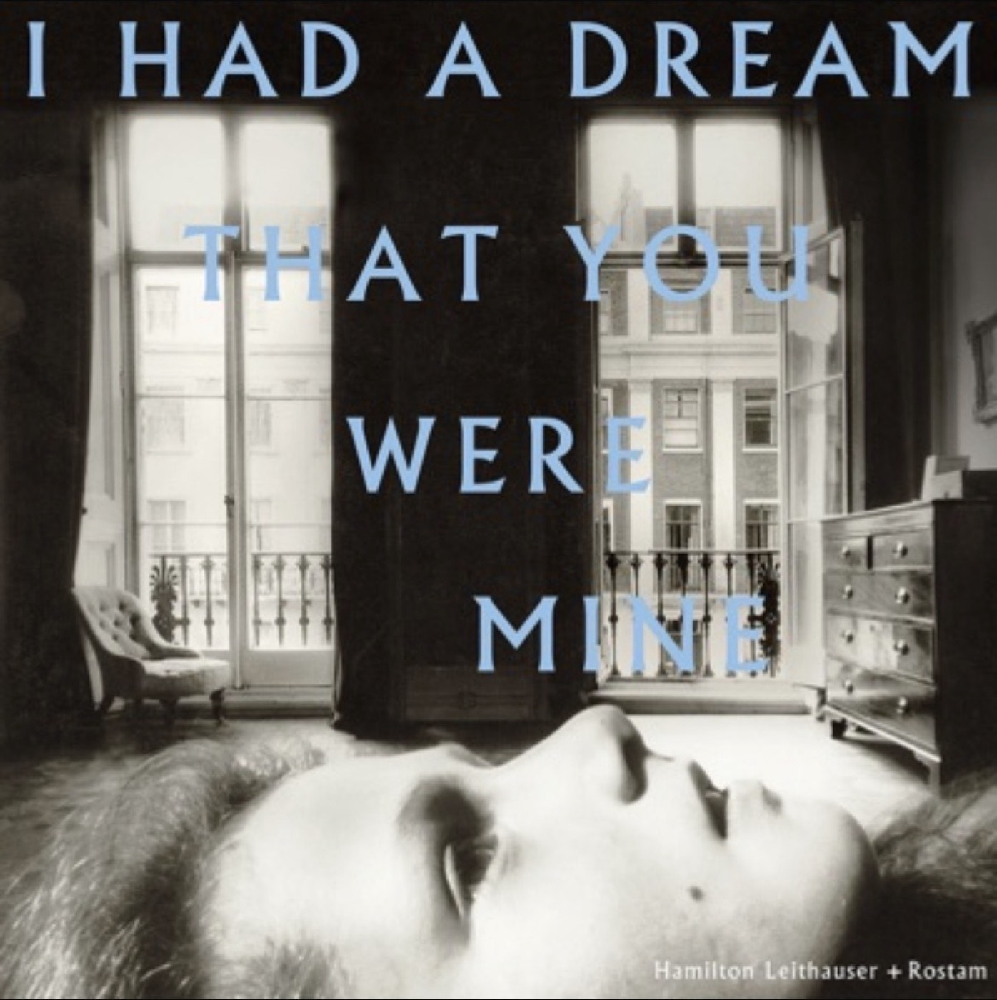  
  
> *Jesus is* a *way*, says Mavis
  
Mavis texts while I'm sitting at my table and I realize I will not be able to read tonight. We text about music; she's never heard of Rostam and Hamilton Leithauser's *I Had a Dream You Were Mine*, which somehow just turned ten. I was a baby then, wandering around New York and wondering how I'd get here. Tonight listening to "Neighborhood #3 (Power Out)" driving back over the Williamsburg Bridge with the lights all behind me. She keeps sending me songs. They are lovely. She says she'll keep supporting my ideas as long as they are not stupid. I think that is fair.   
  
I check in with the children doing karaoke at Mr. Nancy's and enjoy a side of fries to myself. I am obliterating what is left of my brain after soudntracking a corporate event celebrating a new partnership between Square, Pasta Louise, and Gnocchi on 9th. I enjoy doing this for some reason. I tell Elaine it is anthropological and medicinal — anthropological in that I like to know what songs the kids are thinking of, and medicinal in the way that they used to give whiskey to sick children. The youths at Mr. Nancy's seem to not believe in a year prior to 2001. Eventually of course they'll have their moment with *Harvest* or *Blue* or *God Save the Animals*.   
  
But I can obviously understand their pre-occupation with the Oughts, especially given my nostalgic state of mind today. And this ignites quite the firestorm of late-night debate in the *Funeral* Groupchat, but I will say: They quite literally do not make them like anything even approaching this anymore:  
  
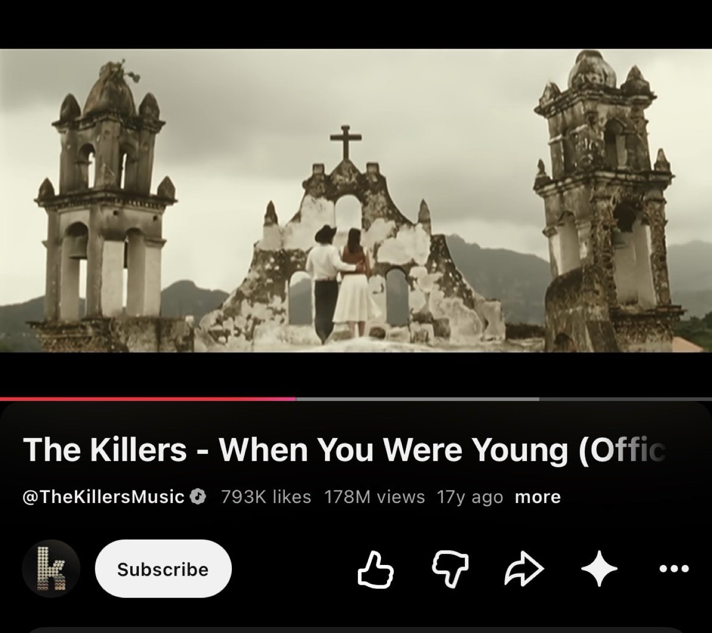  
  
---  
  
> *What a way to change an evening*  
> 
> *Was my number hard to find?*  
> 
> *You know, I'd given up believing*  
> 
> *But the song had somewhat lingered on my mind*  
>   
> *It went, la la la la la la la la la*  
> 
> *La la, something something, Caroline*  
>   
> *Caroline, you're like an ember*  
> 
> *A rock that burst back into life*  
> 
> *A song I only just remember*  
> 
> *That goes oh, something something, Caroline*  
>   
> *La la la la la la la la la*  
> 
> *La la, something something, Caroline*  
>   
> *Caroline, we are old now*  
> 
> *I got married, and I loved my wife*  
> 
> *I have kids, they're good and grown now*  
> 
> *All in all, I've been happy with my life*  
>   
> *I was never really far from you, was I?*  
> 
> *Something, something, Caroline*  
>   
> *I'd like you not to call again*  
> 
> *I'd like to keep you off my mind*  
> 
> *You're the one who went away, Caroline*  
> 
> *So the song was forgotten over time*  
>   
> *It went la la la la la la la la la*  
> 
> *La la, something something, Caroline*  
> 
> *La la la la la la la la la*  
> 
> *La la la, something something, Caroline*  
  
#threeboroughday  
