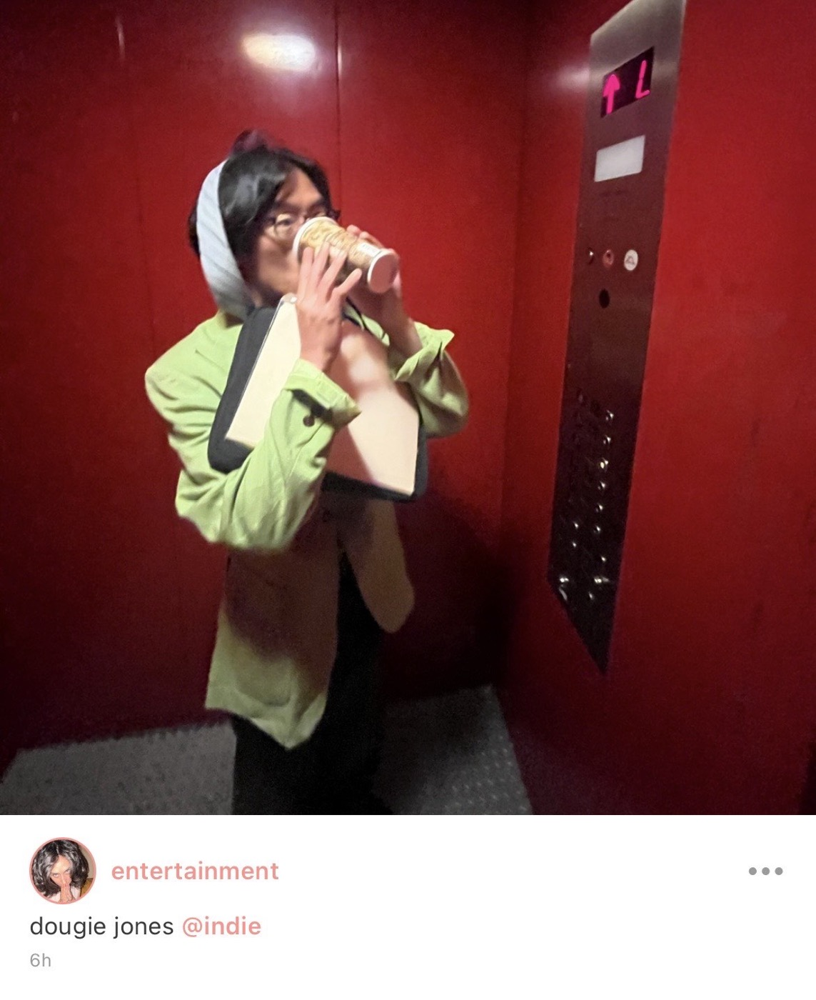
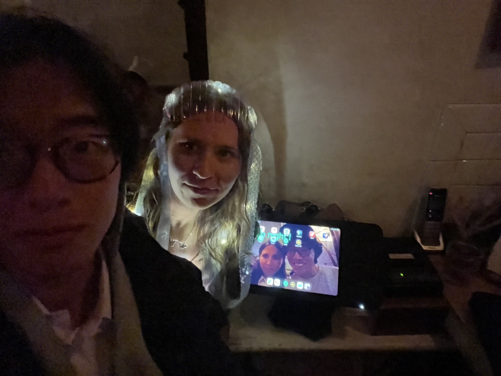
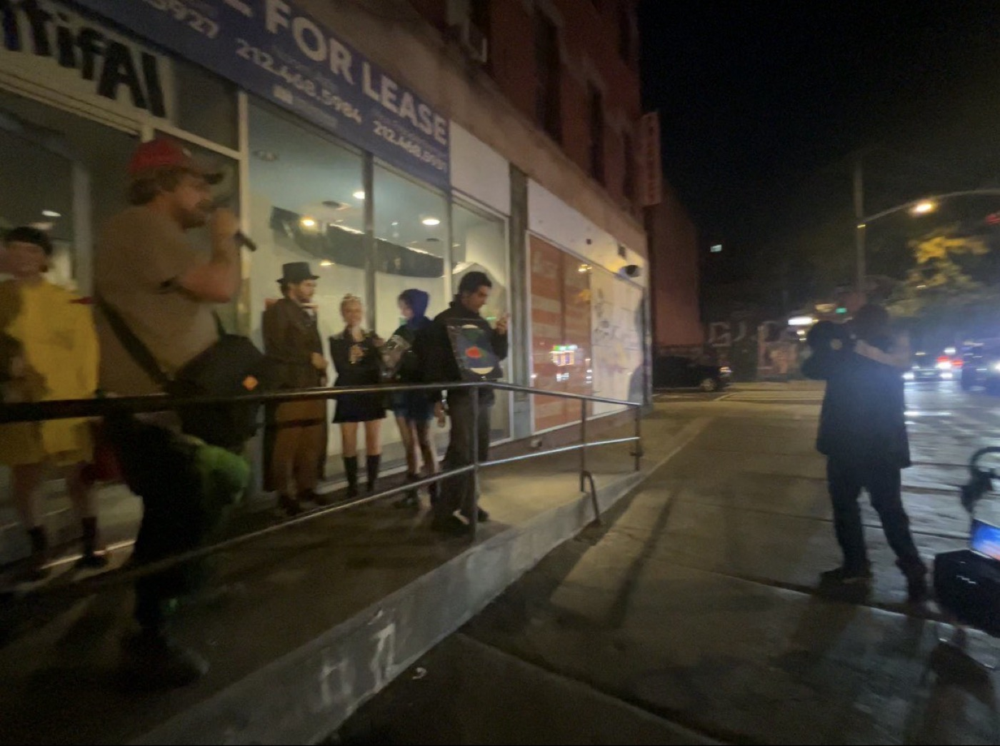
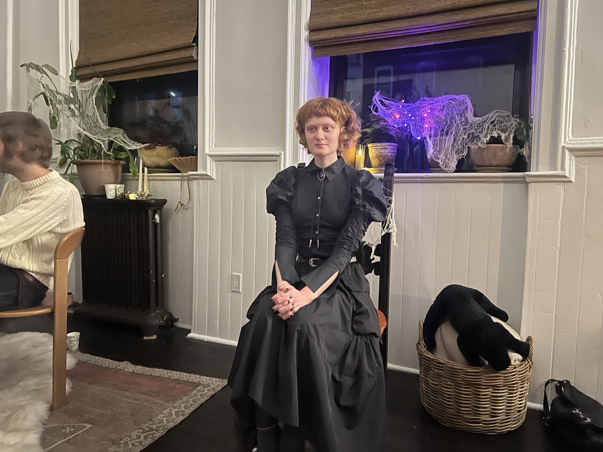
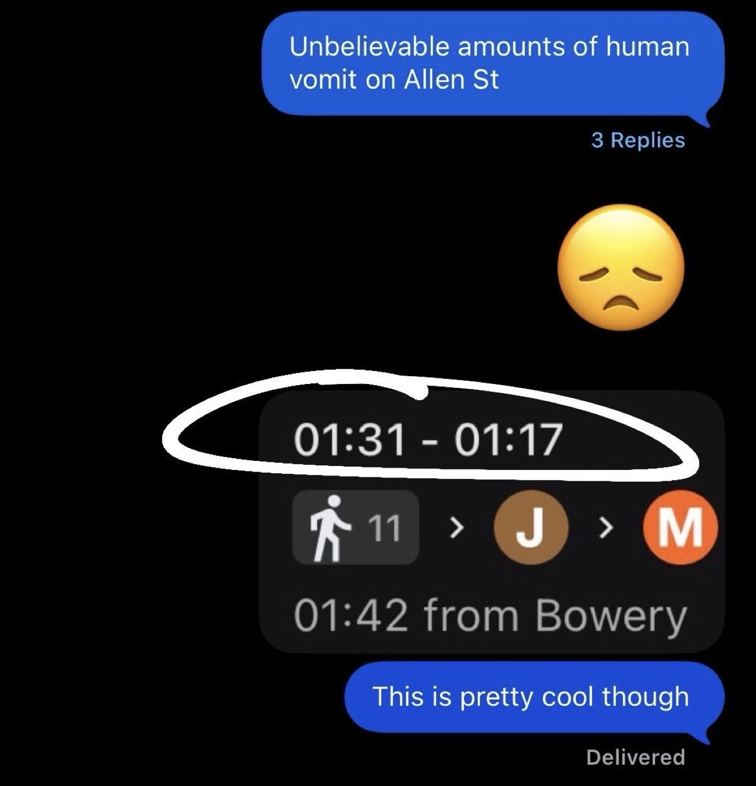

# 2026-10-31 honestly thank God that's over

*I start my day closing out the fifth hour of Ric Burns' New York documentary, which covered the 1870s through the end of the 1800s. My thoughts are filled with the image of Liberty's hand and torch sitting desolate on Fifth Avenue. then I stumble out the door to Variety and tumble headfirst into a pow-wow with Xtian and J. we talk about books — Xtian is reading This Side of Paradise. we talk about AI — they explain what is happening in the field of reverse-engineering video games — and speak cynically about the ways it might finally be regulated. sometimes I do love talking with my bros about the topic of the day. B is working and J takes out three heaping bags of garbage for her. children are constantly streaming in and out of the place. it's a holiday Saturday in Ridgewood, Queens.*  
  
*we are also streaming in and out. S and R appear and suddenly I'm hamming it up with two of the guy-iest guys I know and Ridgewood's best lesbian couple. a real kwisatz haderach moment. I want to be like both of them simultaneously. we start to grab the candy. eventually Brita's shift ends, which means I've been sitting here for close to two hours accomplishing nothing, and J and X leave with her to play video games and build a better world for their child to enter.*  
  
*in the relative quiet that follows, I answer emails for a moment and do some research on graduate programs because at some relatively recent point in my life that became a way to maintain a minimum floor of "productive" activity. then ES comes by and suddenly we find ourselves in another pow-wow with G, who thinks twee is due for a resurgence, and then with S and R, who are nose deep in books and writing even on this best of Saturday holidays, and then even M strolls up. it's a p2 meetup for the ages.*  
  
*eventually though ES and I escape Variete's vortex of socialization and manage to land at Hi-node. they are out of onigiri and so I overspend on an undersized rice "bowl" and we catch up about her burnout. Half her hair is streaked a silvery gray; she's Cruella de Vil. it's one of those costumes that suit the person and highlight some hidden aspect of them. maybe it's wrong to say that about such an evil character.*  
  
*Lucinda drops in and declares that she is confused; she has been working since the morning and is now both uncaffeinated and unfed. The three of us venture to the plaza where a DJ is blasting Millennial EDM for the hoardes of becostumed children and parents of Ridgewood, teeming about the Flowerama intersection in a massive swarm. Kissing heads home and I keep Lucinda company while she finally eats and then Nico joins. I'm trying to sort out my evening plans and head home as the sun sets after 5pm for the last time.*  
  
---  
  
## my first Halloween  
  
it was fun but I do not feel a pressing need to repeat it again. one of the funniest things you can do in New York is to think constantly about Walt Whitman. I've been doing this lately for some reason and it has led to many self-contained giggles. for example, after the insane party put on at the plaza by the Myrtle Ave BID, walking up Forest, passing in front of Wan's and looking over to see if we will exchange our friendly waves; in front of me crosses a multi-generational Latino family. the oldest matriarchs are in the back wearing turkey hats.   
  
similarly, later in the evening, Alphabet City is a mess of youthful human striving. diving down through the gauntlet that is Tompkinsville, I repeat these words like a mantra to myself: *Love for my fellow man, love for my fellow man*. with Nicole the jellyfish we discuss leaning into the festivities this year. *I'm a little too young to be acting so old*, I tell her between rounds of her running around serving the children who've infiltrated her establishment. There's elves and witches and nurses and sherriffs. Only I am specific; only Nicole is Natural.   
  
Nicole gets me two beverages and we catch up on her tour out West, where the sherriffs used to roam free. I help G with some short-form video content and eventually Kathy and E meet me. we do shots and venture down the street to M and E's screening party next to the old Kite Club. I would have paid $100 to have that place be open tonight. I know it would have been peacably empty, save for the smattering of 30-somethings like us, taking refuge from the storm of collegiate pheremones blowing through the streets outside.   
  
but instead we meet M and E outside, and I meet the host of the show, too, Danny, when he recognizes and shouts out my costume. M is dressed as an "early bird" in an adorable yellow mac adorned with three birds, one of which is a cardinal. we hug multiple times and I knock a bird down each time. spirits seem jovial here. a man walks by with a boombox, laptop, and two karaoke mics. Danny jumps at the opportunity and suddenly the guys are rapping to each other. *I do love my fellow man*, even if I do not understand his show.   
  
  
  
  
  
  
---  
  
at C & M's party, they are dressed up as Christ and one of the Marys, though I'm not sure which. I am excited to see D and A, who always helps me feel grounded, and it's been a long time since I saw B as well, and we share with each other again about Korea and Dayton, OH. SF is also in attendance and we have a post-Belle and Sebastian debrief. her partner S is charming as always and drags me playfully when I start making jokes about The Doors having "revolutionary potential" as "a site for a reactionary cultural mechanism". in the background, F and M and two women whose names I forget sway to "Riders on the Storm." SF and I marvel: *His brain is squirming like a toad*. I tell S to listen to "Peace Frog" — *Really loud, and think about protest culture.* this is how I know I should switch to wine.  
  
NM is also here. we see each other immediately and for some reason I wasn't expecting it. she hugs me warmly and we catch up briefly in the dark, candlelit smokers' den in the back of the place. this room is the complete opposite of the living room, which is wide and white and the ceilings seem unfathomably high. I think I hold it together admirably well but I do cringingly insinuate that she is a wench, I cringe as I say, *Oh, so you're a wench.* No, she says, last night she was a wench. tonight she's a bit more respectable. I think of saying, *Right. No wenches for Jules Buckley and the BBC. By the way, your performance was amazing*. Instead, I say that the smoke back here is going to kill me and as we leave she gets pulled away by Rip van Winkle.  
  
perhaps the most interesting part is that I finally meet Samantha Kattan, who is dressed as a stoplight, and her husband Clark. I tell her what I told Democracy Now! and what I told Instagram, which is that it was an honor to vote for her. we talk about Claire and N and she laughs when I say "Little Gottschee." Clark tells me about the ~~[redacted]~~ he's worked on for ~~[redacted]~~ as well as ~~[redacted]~~. there's a variety of Ridgewood folks in attendance tonight, actually, I meet a girl named E and off in faraway corners I keep seeing M, who like D is dressed as Shelley with the bat.   
  
  
  

*shortly before the time change, standing on the platform at Delancey-Essex, everyone loses cell service and the train arrival screens stop working. I have no connection for about 10 minutes while waiting the whole time for a train that was supposedly one stop away at Bowery. my mind considers whether it is a terrorist attack and I am so tired that I realize I wouldn't really care. but eventually the train does come, and I don't even have anything I feel like listening to, and I'm home before the magic hour ends.*  

*The next Saturday Halloween will not occur for another eleven years. this morning I saw parents dressed up with their children and later I saw the swarms of slightly older children crowd the avenues of Alphabet City, a mess of humans striving for various candies. I'm a little too young to be feeling so old, but then again I'm a little too old to kid myself. On Saturday, October 31st, 2037, I will be 42 years old.* 
