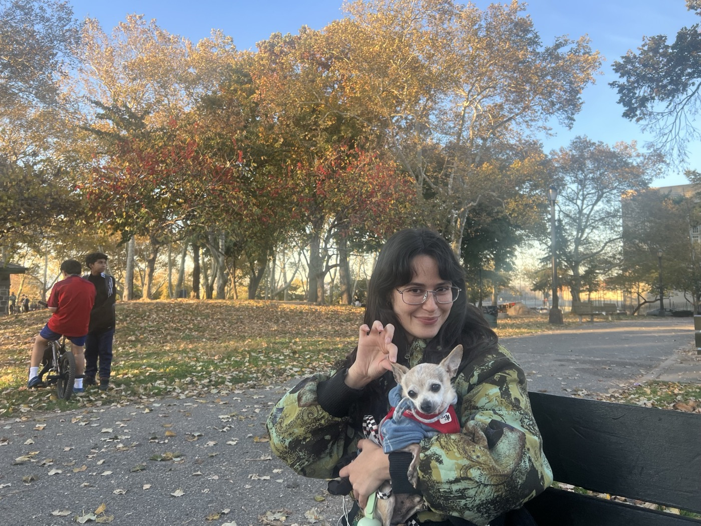
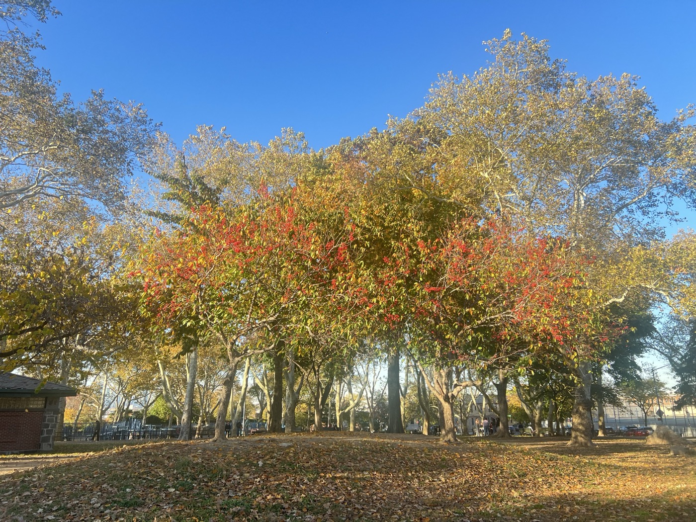
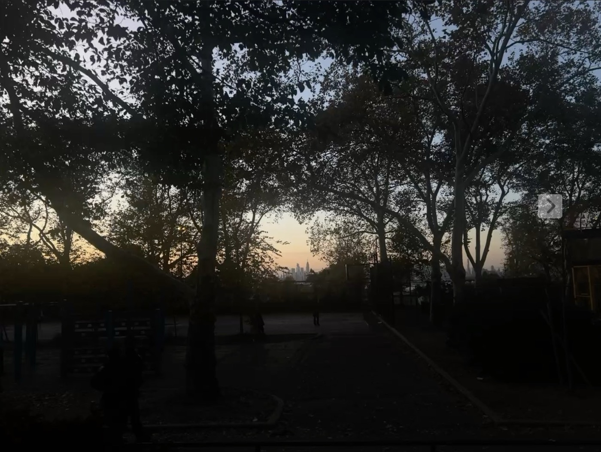

# 2026-11-02 my office hours at Grover Cleveland  
  
### with MARIA and ALAN  
  
*(I also took a video of two flies copulating and then uploaded it to my story set to "Moby Octopad" but no one has liked it thus far and honestly? It doesn't need to be here.)*  
  
  
  
  
  
  
---

afterwards we have pre-dinner at Light's new workplace and then visit Rona for our main course. at the Italian café I meet Issa, who was also at the Cuban Missile Crisis reading and "had a lot of thoughts about it." she invites me to Rodeo on Wednesday. over our souvlaki pitas we listen to all of "Arthur McBride." _for it bein' on Christmas mornin'....._
