# 2026-11-03 other pictures from the day  
  
---   
  
### my important meeting  
  
Oops, I sleep in. I try to stop myself from feeling emotional about the midterms and focus on my important business meeting with L from the Myrtle Avenue Business Improvement District. We are meeting at the plaza and I am fully expecting it to be awkward. We chat about books for a minute. She is in a book club with a bunch of older women who she met while living in the East Village. They read the first book of *On the Calculation of Volume* at the suggestion of one of the members, who suggested it as an apt exploration of a dementia-addled brain. This seems to be a theme today: I've packed *Switzy* in my bag and later will be seeing the Taryn Simon show at the Guggenheim.   
  
After this halting but rewarding small talk about contemporary literature, we get down to brass tax, and L is surprisingly open to my musings and together we have a kind of brainstorming session — or more accurately, something like a brain-drizzle — as the sun begins to beat down on the plaza. There's a lot of history here, and she wouldn't mind me being a little guy with a microphone running around exploring it.  We love our neighborhood and she likes my energy. As we're sitting there, I wave at Samantha and Clark, and Yae, and Jimmy and Brita stop by with Grande. I'm curious and excited to see what we can bring about. She even offers to set me up with the coveted email, the thing I thought I'd have to really work for: [logan@ridgewood-ny.com](mailto:logan@ridgewood-ny.com).   
  
  
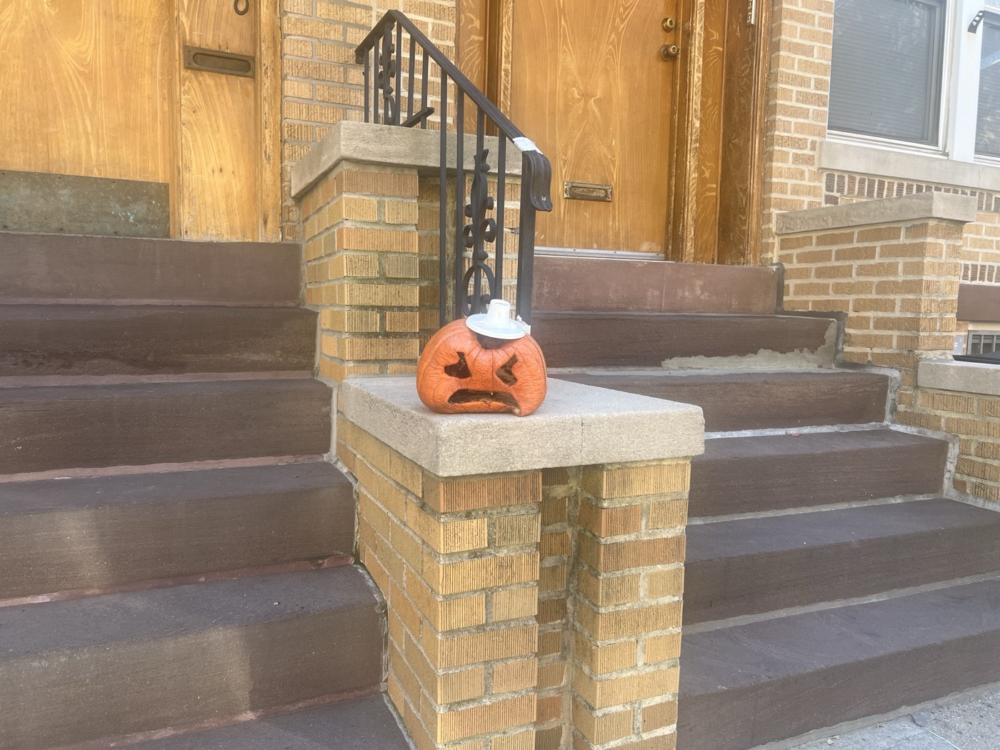  
  
This was in front of Paint and Yae's place.   
  
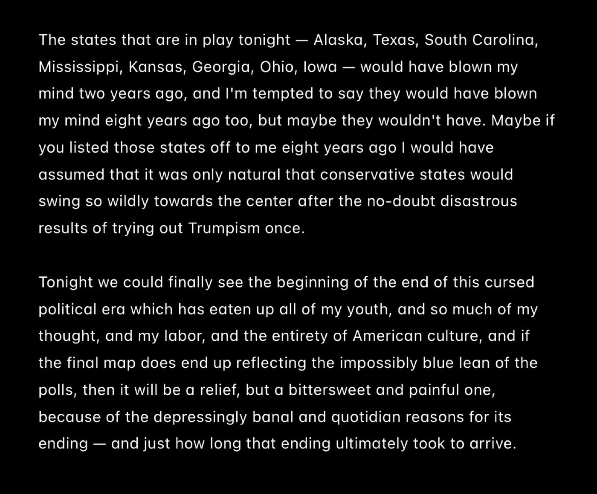  
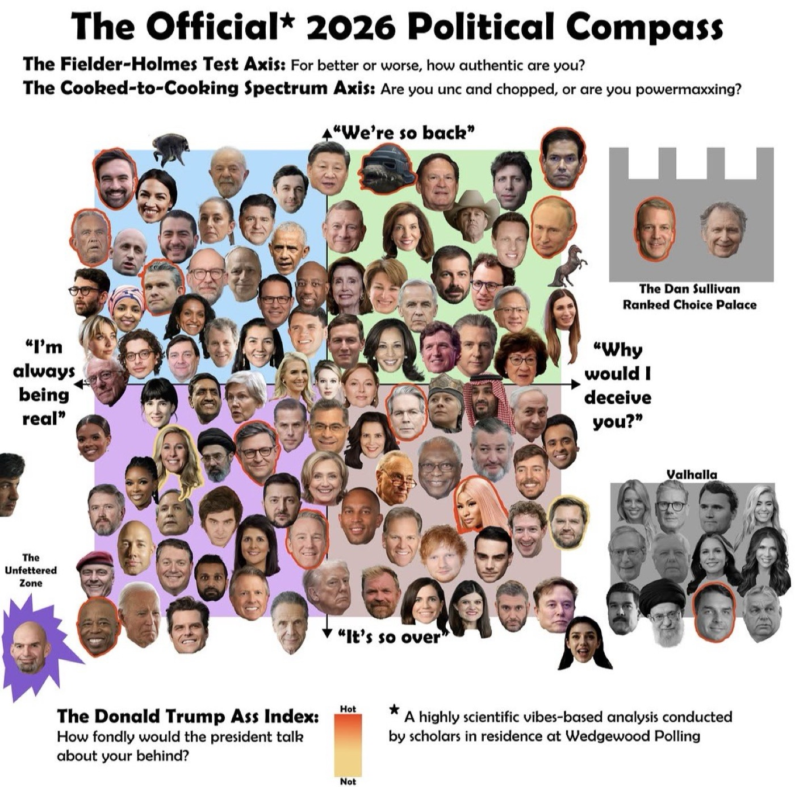  
  
I allow myself to feel emotional on the train into Manhattan, and Shaughna sends this "new political compass" to me. after my meeting with L, I had stopped into Topos and run into Samantha again. she was about to take a car to Sunnyside and asked what I was doing today. I appreciated that she didn't try to rope me into canvassing. *We'll be watching at Freda, but the afterparty is at Pegs,* she said. my plans exactly, I said.  
  
---  
  
### my walk through the park  
  
outside the Guggenheim I run into P and D. I thought of P recently, for some reason on Halloween. she seems to have vanished from my life and then here she is again. there was a time I thought we'd become a new regular something but then it just ended. that was so long ago, M was still living in Greenpoint then and throwing shows at the loft.   
  
less than an hour until sunset and the perfect weather is holding well into its third week, so I decide to walk across the park to the West side. the whole time I am texting Hunt about the show. the light is beautiful in Central Park, it has a lot of warmth to bounce off and it gets scattered around in the loveliest ways. I don't even mind, necessarily, that it's not even 5pm.   
  
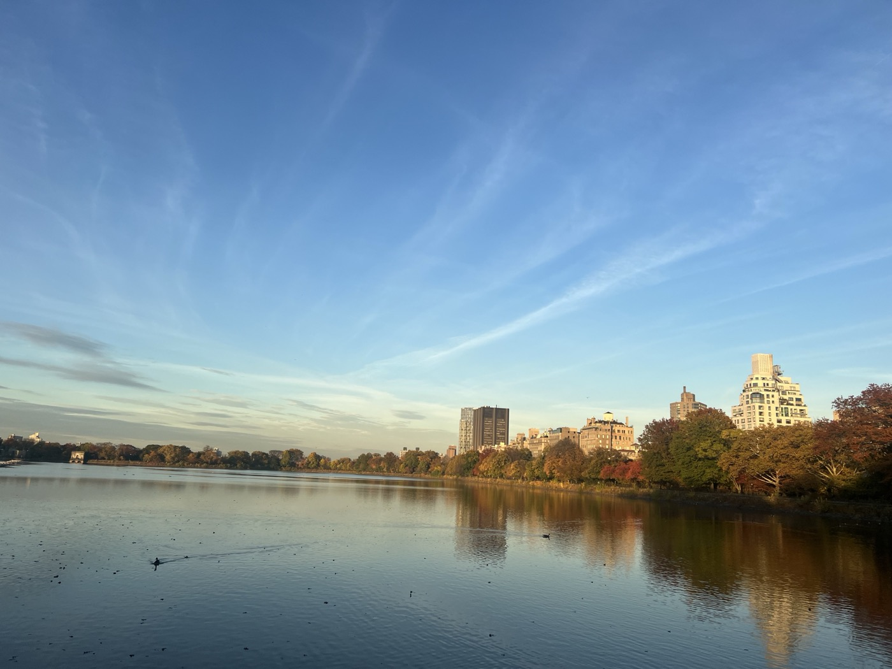  
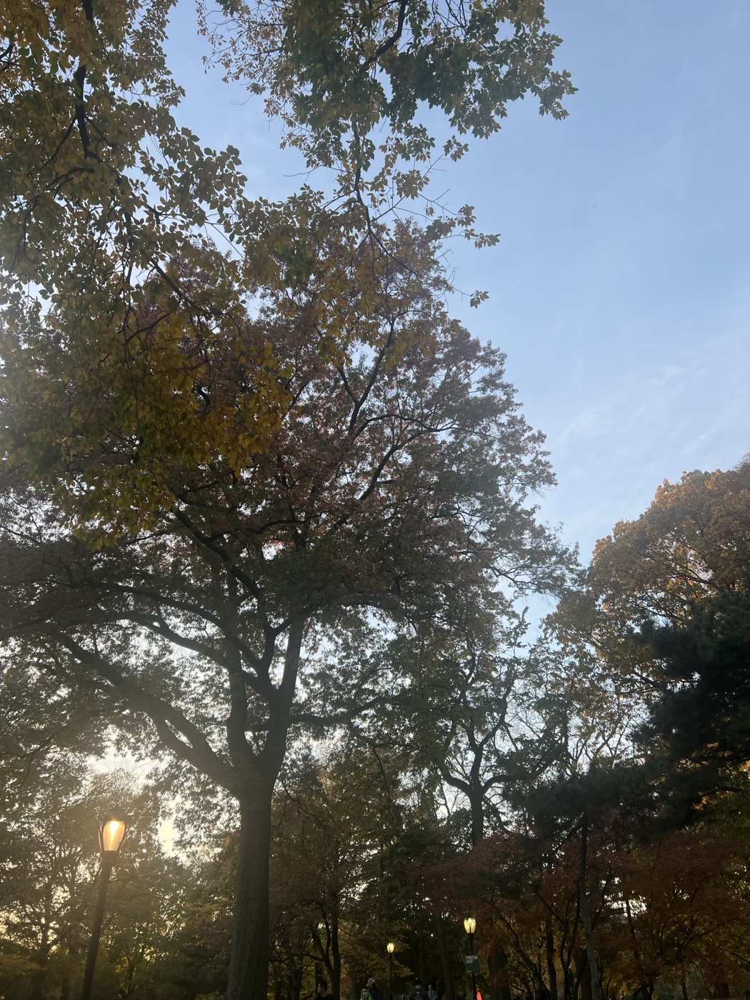  
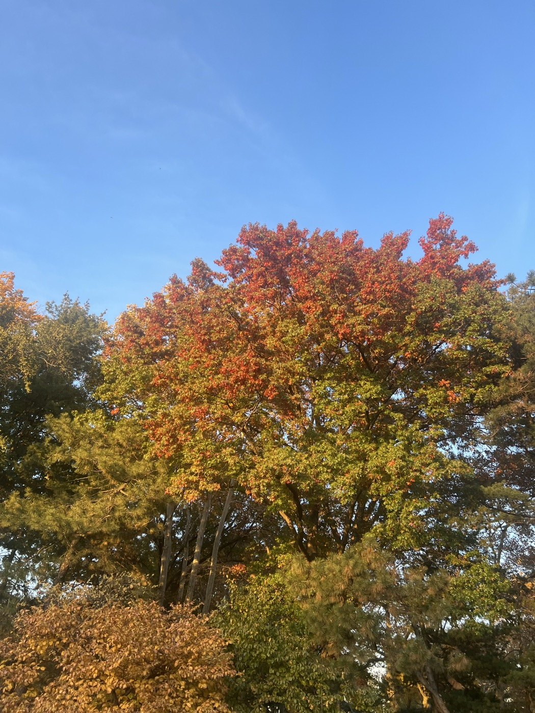  
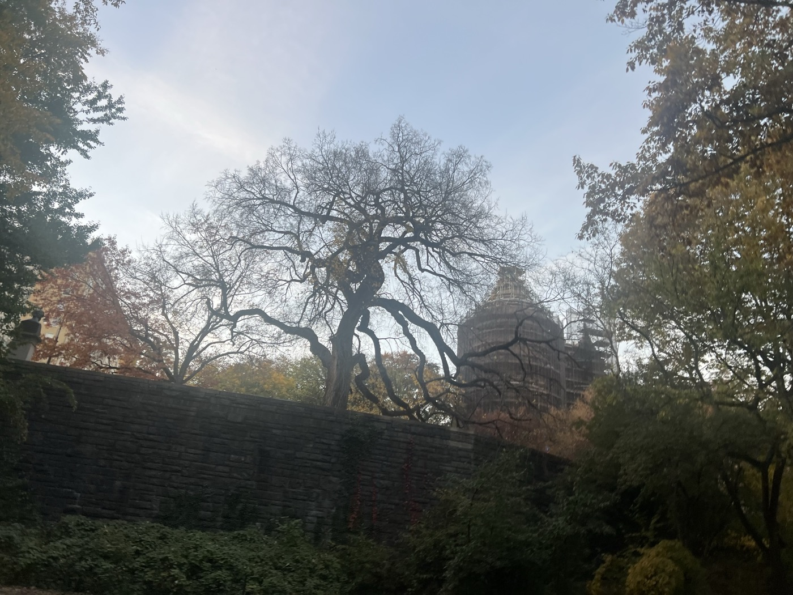  
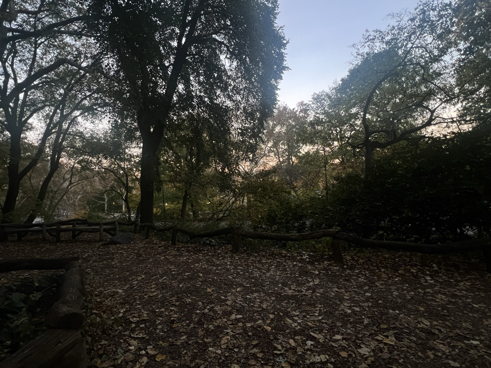  
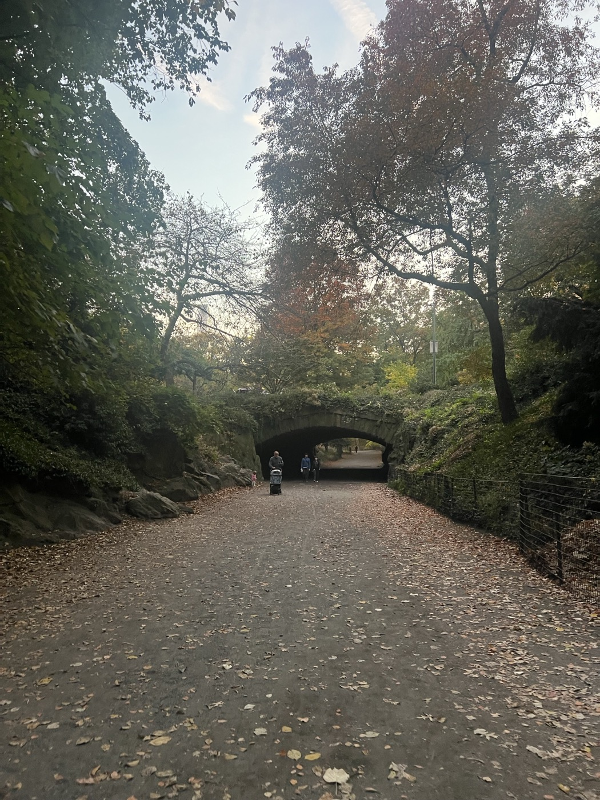  
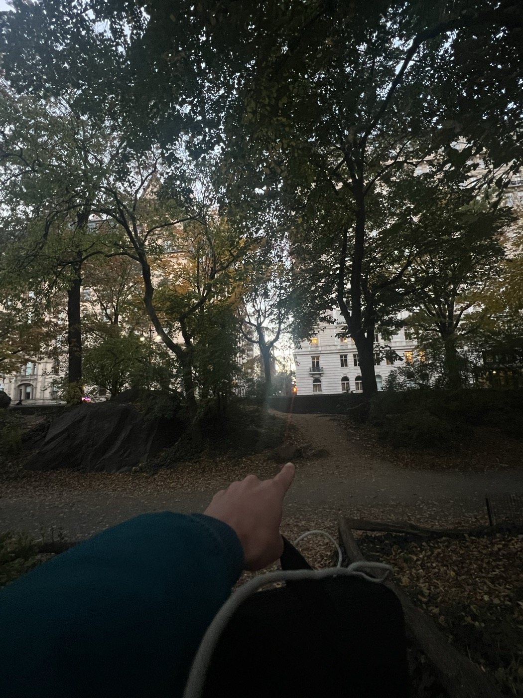  
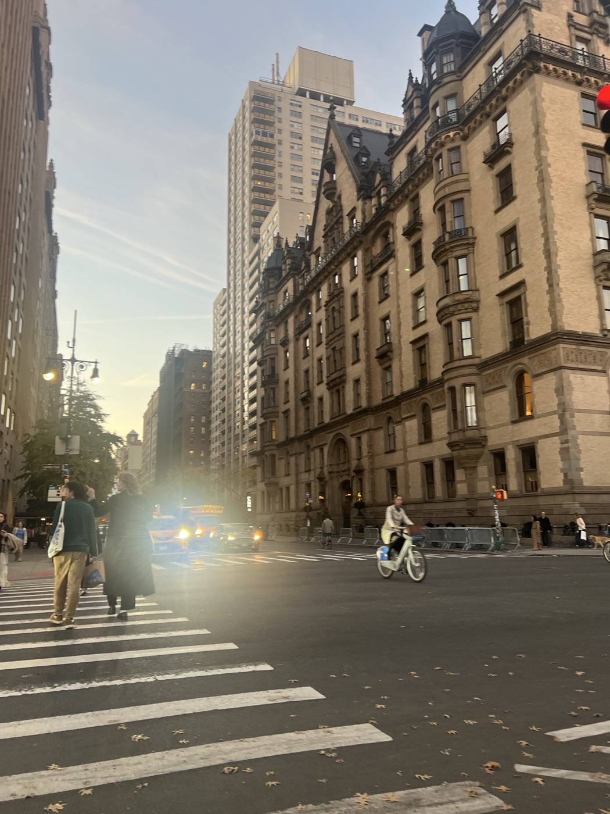  
  
by the time I reach Columbus the sun has fallen below the horizon and dusk has arrived. I grab a sandwich at a cheap eatery and don't do much noteworthy thinking. it's dark by the time I'm finished eating and I walk down to Lincoln Center and begin a rather warm train ride back to Queens, where I will catch SK and MW's show at Dinky's, and then migrate to Pegs, where hopefully we will all have a lot to celebrate.   

---

### some sweetnesses before the storm/dessert before dinner at Dinky's

before the big game it's time for some vocationing. SK is coming out of musical retirement as part of one of the more underrated and lovely three-act billings in a long time. Kitba and MW are playing solo as well. it is a night of beautiful singers and song. it's also MW's birthday celebration. her songwriting is brute-force tenderness, like that expression about fists of iron in a velvet glove. and M&M show as well, it must be time for our seasonal mini-reunion. they won Met Opera tickets via the rush lottery and went to see _Lincoln in the Bardo_ but did NOT recommend it. noted. SK is worried she performed poorly but I point out to her that maybe that's not the point of the show or any show really. 

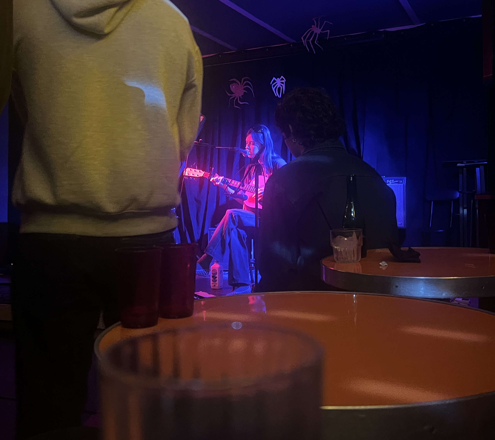
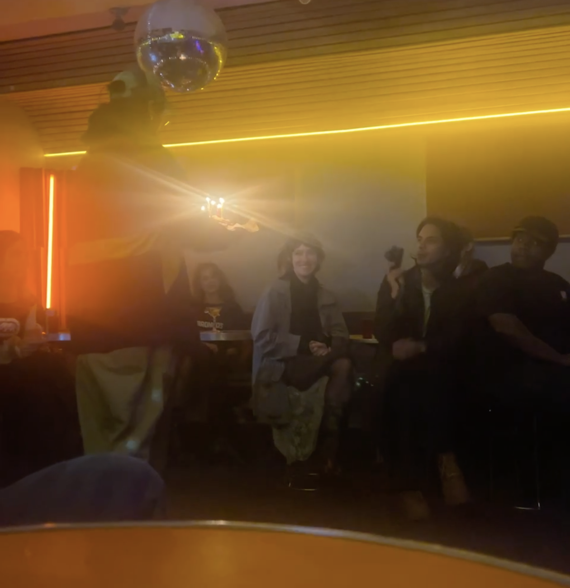

the whole time I am furtively, and rather guiltily, checking results via X and the NYT and fielding excited texts from the crew beginning to gather at Pegs. it's about to be the best night of our sad and paltry political lives.

