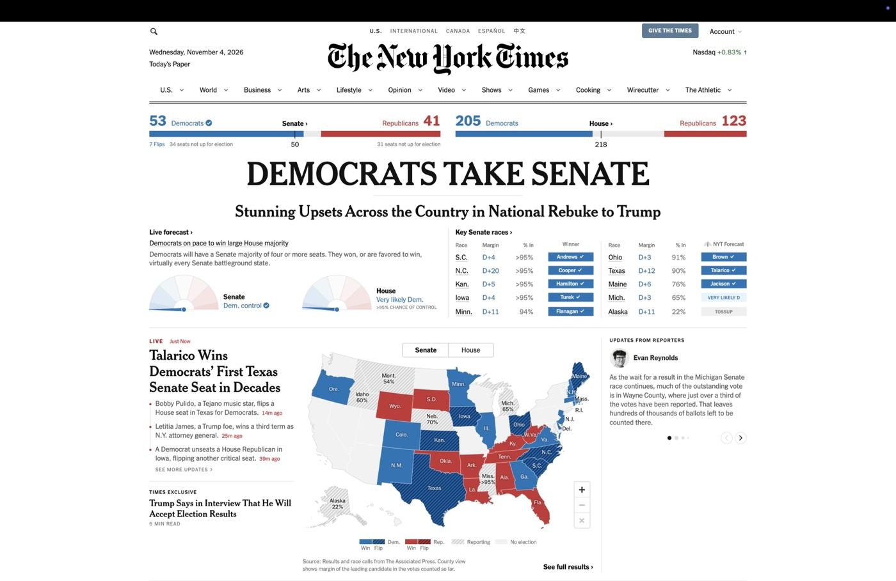
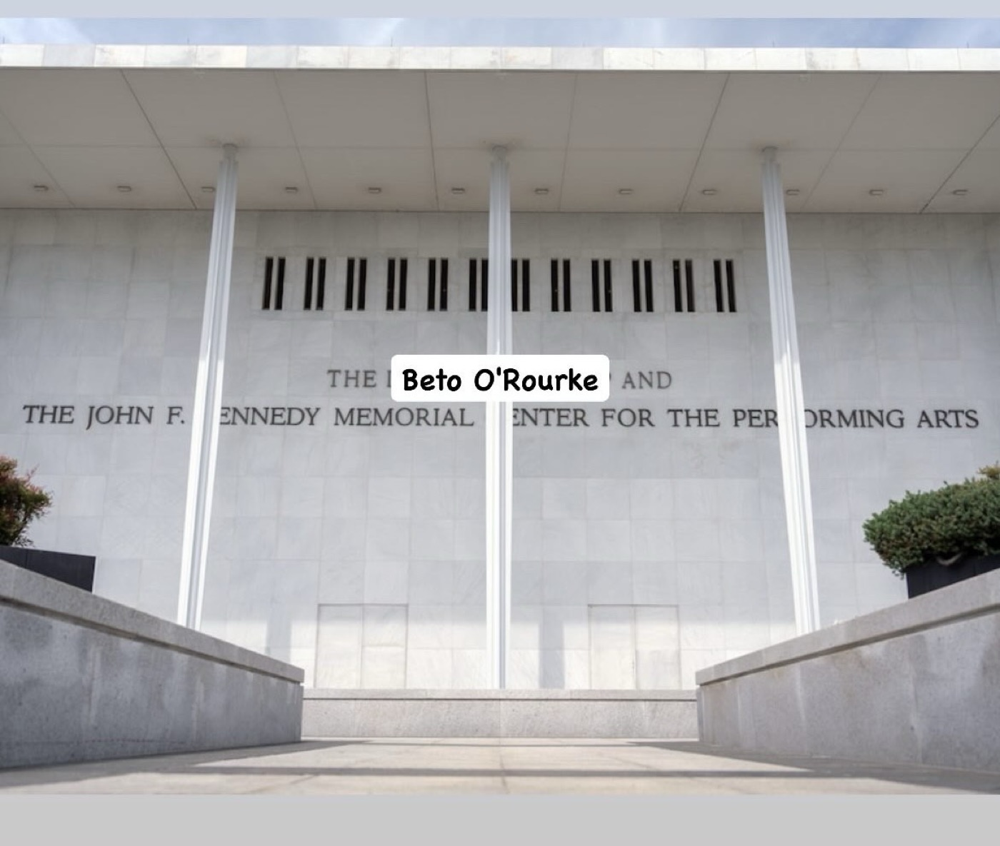

# 2026-11-03 tsunami  
  
## OVERJOYED.  
  
The Long 2016 ended tonight at Pegs Cavalier in Ridgewood, Queens. some members of BOOK CLUB were in attendance (M, E, and E's effusive twin sister Z), as was local celebrity JW, and Light, and Austin, and later the electeds. shared a hug with Claire and David and smiles with Samantha. I had whiskey, I had too much to drink. Bob had poured my vodka strong at Dinky's. we watched the results continue to roll in and the little NYT needles continue to be yanked dramatically leftward. E looked so damn cute and she thanked me for dropping by on Halloween. she was tired from protesting earlier in the day and she can't come to any of our new meeting days. I tell her I'm thinking of starting my own book club. JPS and M's partner C met at the bar and did shots in honor of a blue Texas. more and more people came. cheers went up every time a race was called. we knew before the room did because we each were monitoring a different network; I had Decision Desk from my custom "election nights" feed on X, Austin had NBC, Light had the AP. online, the mood was similarly glorious, but we'll let that sail along in its own cloud. OVERJOYED to live right amidst the beating heart of real political hope and change in our time. 
  
  
  

#life #politics #america