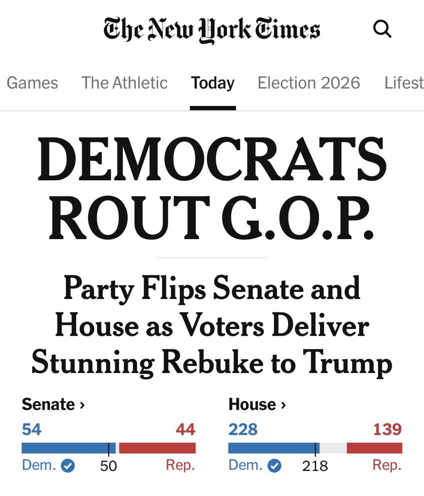
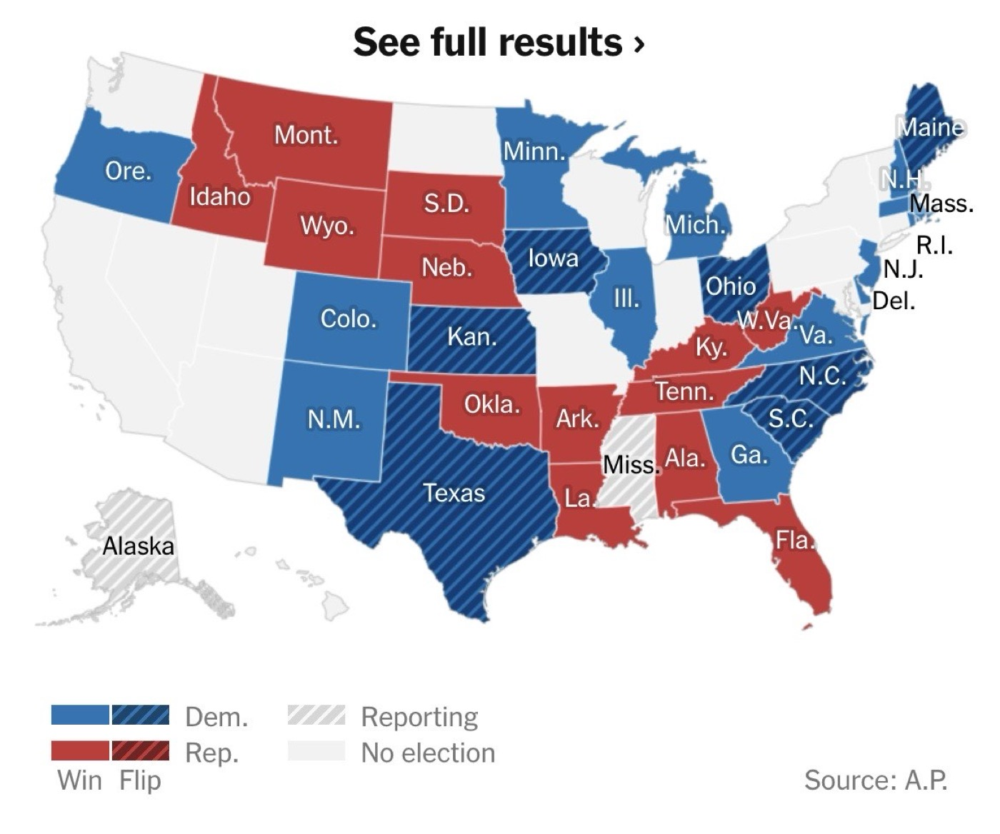
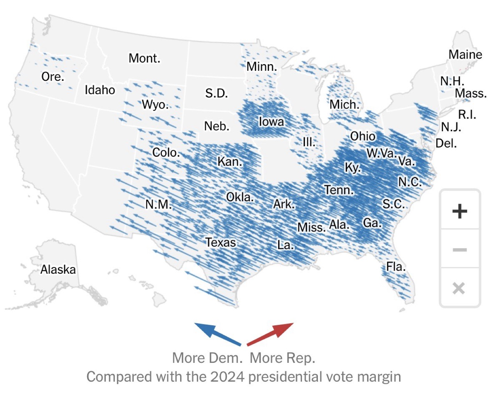
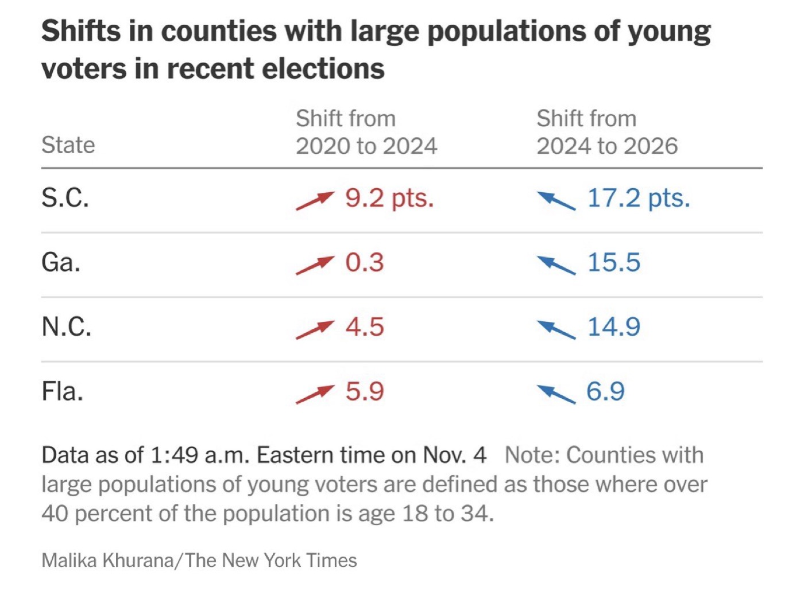
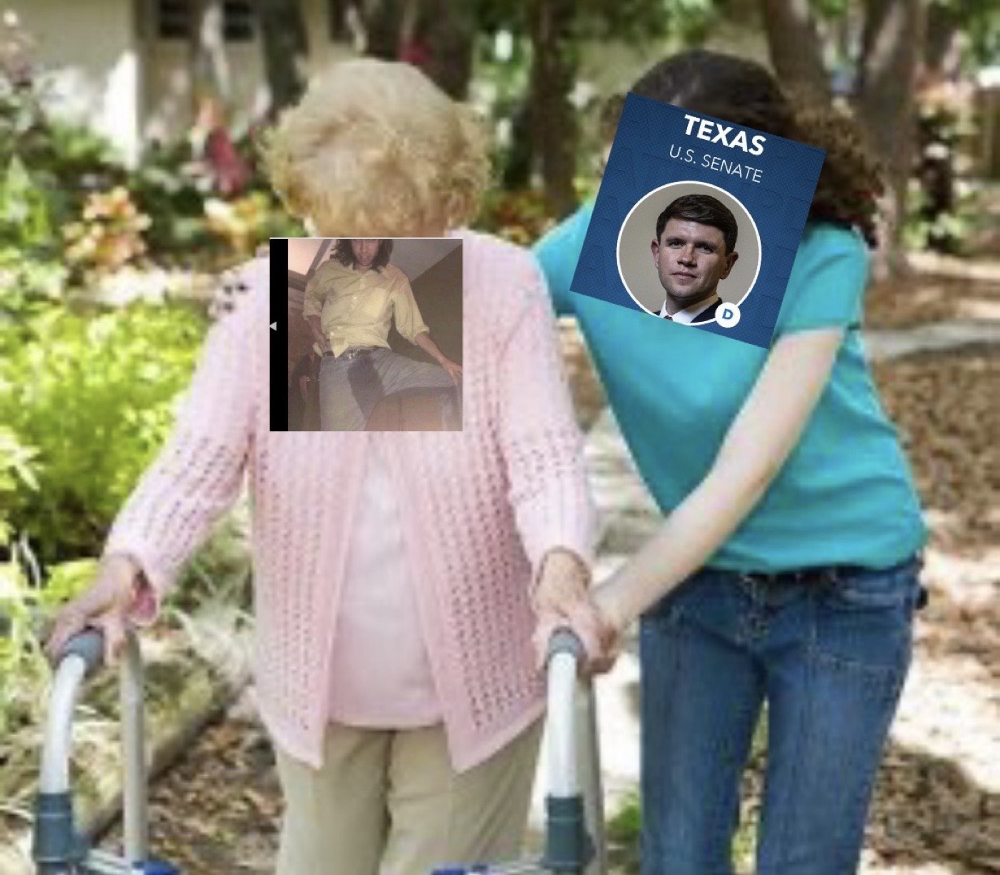
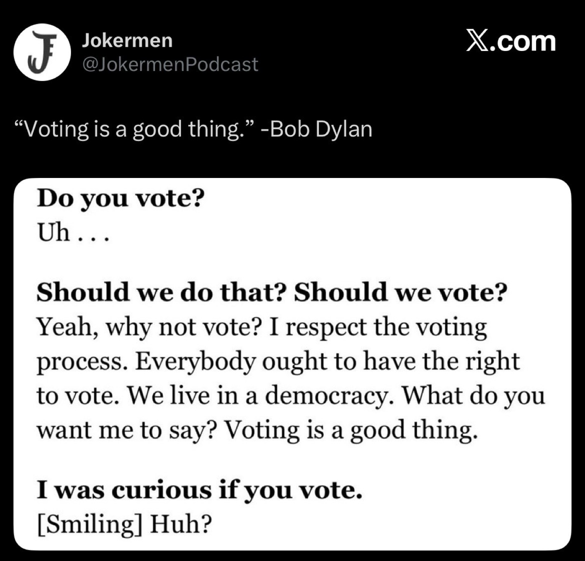
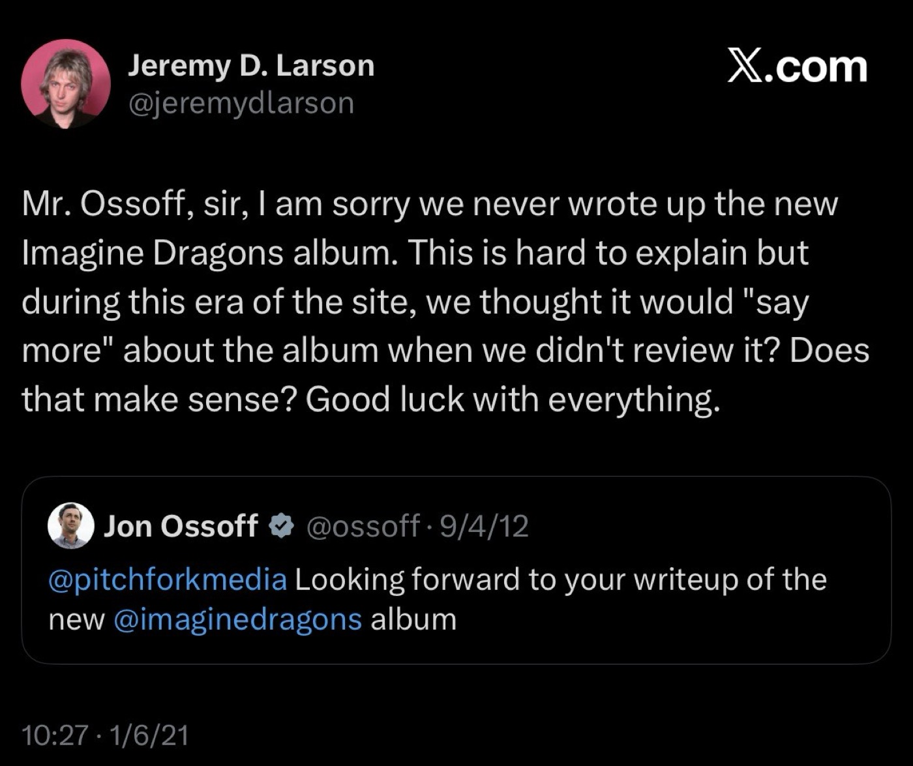

# 2026-11-04 LIBBING OUT-ERATION DAY  
  
---  
  
  
  
  
_I thought I had learned all the lessons_, I just texted M. but there was one more waiting for me: what it feels like for things to take time. I wrote over and over again from 2016-2018 about the possibility that we were in for a long stretch of turmoil, I wrote that we should buckle up for a decade or more of this. And I was right, but at some point I took my eyes off of the horizon; the fuel ran out and I forgot what it really felt like to believe that there could be a turnaround.   
  
'18 and '20 felt like maintenance. This is the day we've been waiting for since 2016. And I am in the same city. And I am older. Yesterday talking with Samantha about having at some point shut down the capacity for hope before elections. *I feel nothing*, I said. But David's district saw a 35 point swing. and I'm looking at these little counties in Tennessee, Georgia, Texas, Montana, Florida, Ohio, Michigan — counties where I have met and spoken with the people who make up those tenths of a percentage point.   
  
and I'm thinking about myself in 2016, drunkenly kicking pumpkins off the Promenade, and in 2018, phonebanking in the garage in West Nashville, and then in 2020, sick with food poisoning in an in-law suite at an Airbnb in Little Five Points, and in 2022, knocking every door in Bushwick and Cypress Hills, and we're sending socialists to Albany. it takes time, but time it takes.   
  
  
  
  
  
---  
  
It is remarkable how much this day feels more like a release or relief than it does a victory. and of course one wonders and doubts about its durability. but I've saved the cynical takes for my private correspondence. Social media in particular is a medium of propaganda, and what I believe is needed today is a letting out of joy.  
  
  
> _COMRADES! TO SHITPOST IS TO CELEBRATE JOY, AND TO CELEBRATE IS RIGHT. THE OUTLETTING OF JOY IS A LODESTONE OF ANY POLITICAL PRAXIS, AND WE SHOULD SEIZE EVERY OPPORTUNITY FOR EXUBERANCE THAT IS GRANTED TO US. JOY IS AN ESSENTIAL INGREDIENT TO HOPE, IMAGINATION, AND ORGANIZATION._  
>   
> _THESE MOMENTS OF JOY ARE NOT GIFTED TO US BY SPIRITUAL FORCES OR THE GODS; THEY ARE DELIVERED TO US BY OUR FELLOW CITIZENS WHO ARE A PART OF OUR POLITICAL CAMARADERIE; INDEED THEY ARE THE WHOLE BODY POLITIC; THE ENTIRE POINT._
>   
> _WHAT HAS HAPPENED TODAY IS THE OPENING OF A PATH. WE HAVE BEEN GRANTED NEW VISIONS OF AN ACHIEVABLE, ACTIONABLE FUTURE, ONE WITH A NEW AND FRESH POLITICS FOR A DECAYED AND DESSICATED WORLD. THIS ROAD WHICH LIES AHEAD WILL NOT BE AN EASY ONE; WE WILL HAVE TO PAVE IT OURSELVES, AND IT WILL NOT CONSIST WHOLLY OF FAITH, HOPE, AND LOVE._  
>   
> _BUT SUCH PATHS HAVE CERTAINLY NEVER BEEN MADE PURELY FROM THE JOYLESS, COOL REMOVE OF THE CYNICS, WHO BLEAT ON AND ON THAT "NOTHING CAN BE DONE" WHILE THE REST OF THEIR COMRADES PULL THEIR LAZY DEADWEIGHT ALONG INTO A REAL AND POSSIBLE UNDETERMINED FUTURE._  
  
  
  
  
  
  
  
  

#life #politics #america