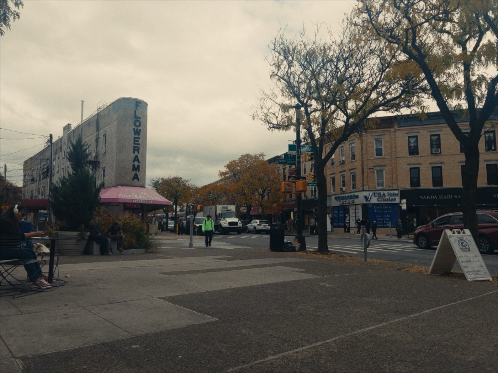
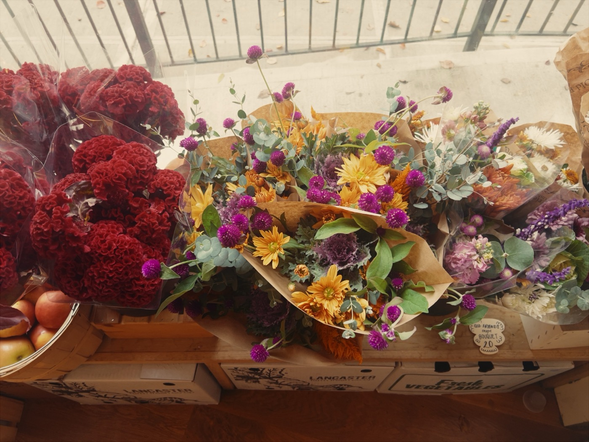
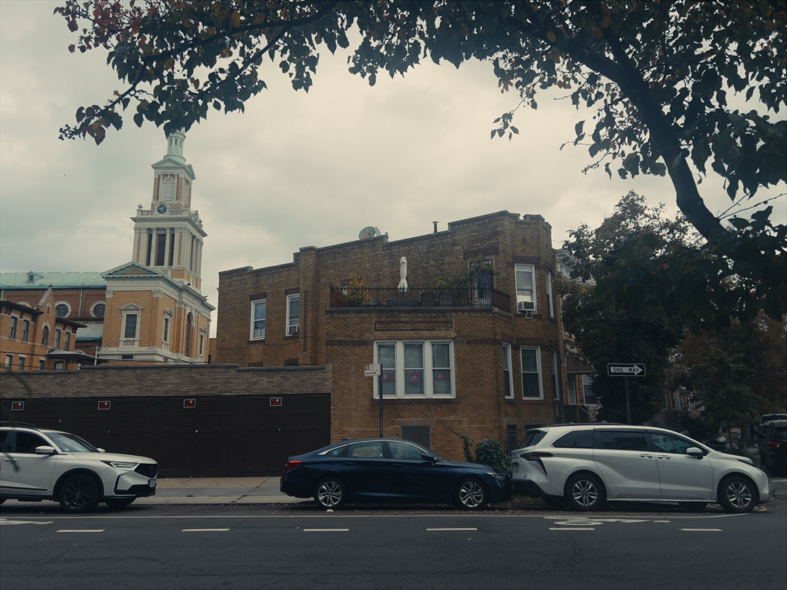
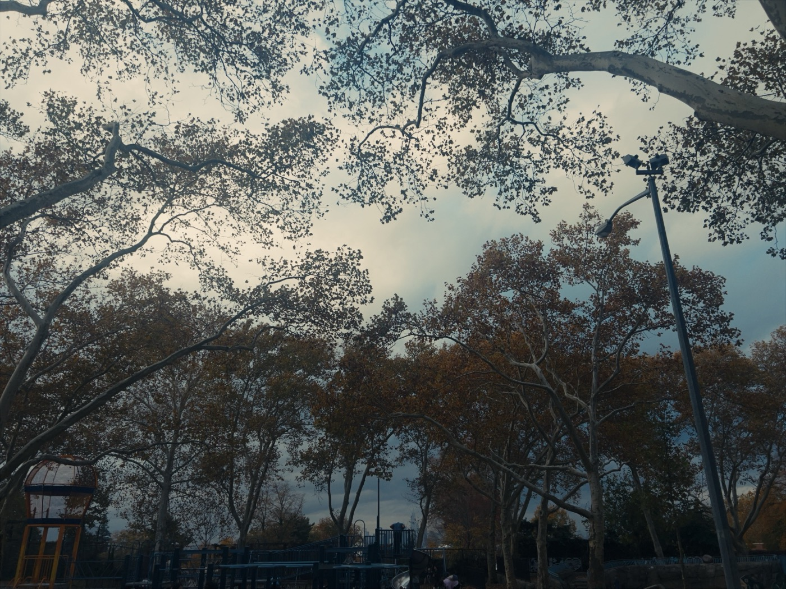
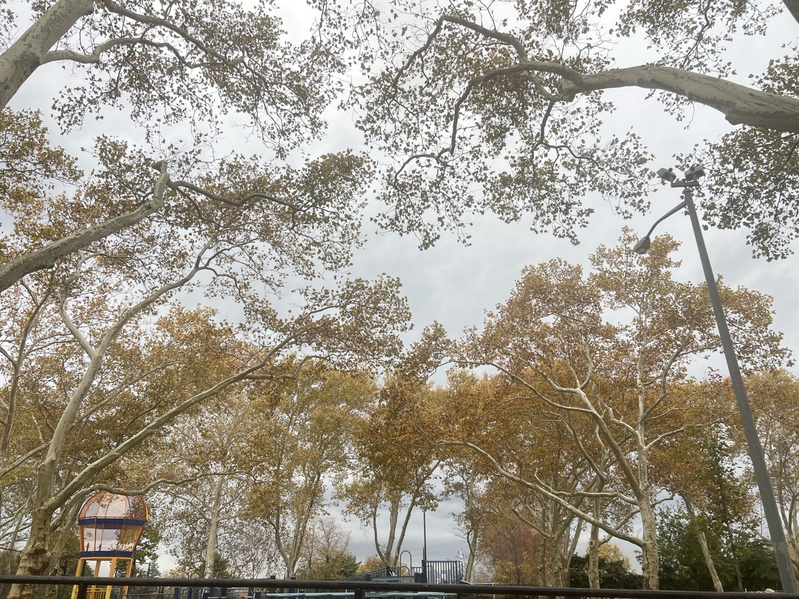
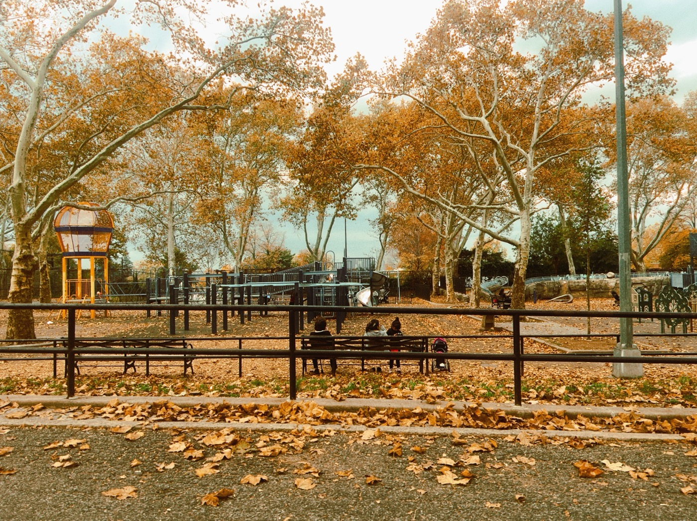
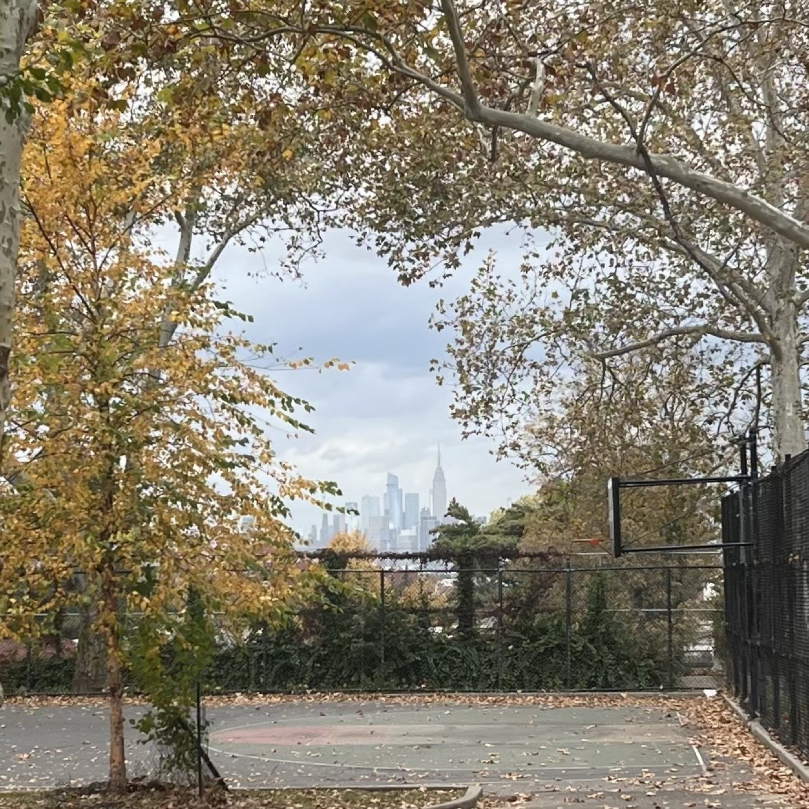
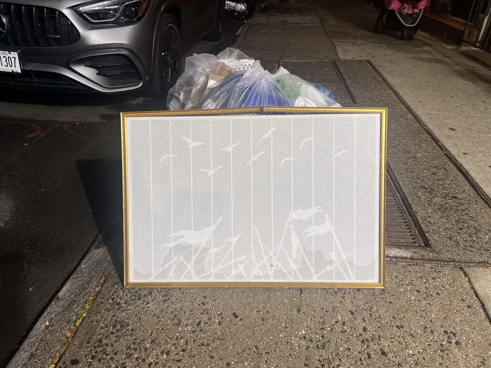

# 2026-11-05 after the storm before the storm
  
---  
  
the weather today turned sour for the first time in three weeks. the air was grey and heavy. I spend most of the day feeling strangely dour and anti-social, maybe I caught some kind of bug at Mr. Nancy's last night. Kathy meets me as I finish some chores at Nomad. we talk about cyberattacks on the University of New Mexico's health system, as well as the Queens Public Library.   
  
I tell her that the experts seem to be warning that we should be prepared for years of potential chaos touching all facets of life. I really, really try not to stress her out like this but sometimes the world makes it difficult. we talk about various devices and ways to store our ideas without passing through the networks. we walk to Topos and I get to wish Felicia a happy belated, Light is in there, as is JW and I see Julie for the firs time since she's moved back. she has a cake for Felicia.   
  
  
  
Kathy and I sit with Light in the plaza and I muse to myself about what I can do for this place with an Instagram account and the funniest email address ever (to me). we catch up about our past few days but for some reason I just can't stop scowling, neither can I think of anything to say. so I leave with Kathy and we drop by Pierogi Boys to buy some strange groceries and then hug goodbye, a nice mirror of our run-in late last night. we've been parting with *Merry Christmas* since the first of the month.  
  
  
  
at the park I read today's quota from *The Piano Teacher,* which absolutely does not help my mood, and spend too long downloading different camera apps and taking comparative photos of the brittle foliage as dark grey clouds continue to gather on the horizon. they're so full of moisture that they're almost blue to the point where they're also almost purple. Heather walks by with a friend O and we exchange pleasantries. "a balmy November day," her friend jokes, which makes me laugh, and also makes me think of Balle.   
  
  
  
  
  
  
then I get chilly and return to my room and change and then the sun is setting already and I do a lap around the neighborhood. I plug in my headphones and listen to the last of my libbing out playlist and wonder why the hell I'm doing this, podcast after podcast. it feels strangely like a relapse. and I guess it is. but there's a sweetness to it, like visiting true believers after a crisis of faith or something.   
  
so of course instead of listening closely I mainly think about what happened to my politics after '22 and '24, how far into nihilism I'd fallen, not in a global sense but in terms of what these spaces held for me. what happened was, more or less, I packed it in, bought a pickup, and drove straight into the ditch.   
  
later at home I thumb through *The Years* and watch her seasons change. I think about what compels us to write these things down. last night talking to [NAME?!?] about Annie Ernaux and Natalia Ginzburg, about *The Years* vs. *Family Lexicon*; two exercises of almost self-negation in an attempt to trace the course of time and history as it occured.  
  
even the listening, the gorging of op-eds and commentary, sometimes feels related to this, part-and-parcel of being able to tell the story to myself in real-time, as well as ensuring I will be able to do so in the future. it's all a hedge against the fickleness of memory. you can write down what happened, you can write down what has been said, but in the end it'll all get schmeared around. can a screenshot of a Tweet relay something to the future that a data visualization map cannot? can you save any details?   
  
  

Above: It has the beginning of War & Peace on it.

---  
  
### the privileged worldblindness of the youthful  
  
> 	She sees the future as a great red staircase, the one in a Soutine painting reproduced in the journal *Lectures pour Tous.* She cut it out and hung it on the wall of her residence room.   
> 
> 	She sometimes lingers over images of her childhood, the first day of school, a funfair in the rubble, holidays at Sotteville-sur-Mer, etc. She also imagines herself in twenty years trying to remember the discussions of today—everyone's—on Communism, suicide, and contraception. The woman of twenty years from now is an idea, a ghost. She will never live to be that age.  
> 
> 	To see her in the photo, a handsome solid girl, one would never suspect that more than anything, she fears going mad. Only writing—or perhaps a man—can protect her from that, if only momentarily. She begins a novel in which images past and present, her dreams at night and visions of the future, alternate with an "I" who is her double, detached from herself.  
> 
> 	She is convinced that she has no "personality."  
> 
> 	There is no relation between her life and History... the time of current events, no more than that of sensationalistic news items, which she disdains, is not *her* time, which is wholly comprised of images of herself.  
  
### versus the one who, just a few handfuls of years later, has finally come around the bend with History  
	  
> 	The "new philosophers" popped up on television and did away with the old "ideologies." ... Unlike Sartre, who was said to be senile and still refused to go on TV, or de Beauvoir with her rapid-fire diction, they were young. They challenged our consciences in words that we could understand and reassured us of our intelligence. The spectacle of their moral indignation was entertaining, though it was not clear what they were trying to do...  
> 
> 	For us, who as children were enjoined to save our souls with virtuous deeds, in philosophy class to live by Kant's categorical imperative, *act only according to that maxim whereby you can will that it should become universal law*, by Marx and Sartre to change the world—and who, in '68, had believed that we would—saw no hope in any of it.   
  
> 	And we, on the threshold of the 1980s, when we would enter our fortieth year, were suffused with a weary sweetness that came of accomplished tradition, and gazed around the table of faces, dark against the light. For a moment we were struck by the strangeness of repeating a ritual in which we now occupied the middle position between two generations. We were overcome with a kind of reverse vertigo, brought on by immutability, as if nothing in society had moved. In the hubbub of voices, which we suddenly perceived as detached from the bodies, we knew that a family meal was a place where one could go mad without warning and push the table over, screaming.  
  
> 	During that summer of 1980, her youth seems to her an endless light-filled space whose every corner she occupies. She embraces it whole with the eeyes of the present and discerns nothing specific. That this world is now behind her is a shock This year, for the first time, she seized the terrible meaning of the phrase *I have only one life*. ... Paralyzed and mute, her face covered in tears, the woman gazes at photos on the wall while the same songs play over and over again. The films she wants to see and the ones she's recently seen form story lines inside her and she seeks her own life therein—Wanda, A Simple Story. She asks them to draw her a future.   
>   
> 	She feels as if a book is writing itself just bheind her; all she has to do is live. But there is nothing.  
  
---  
    
- _**Sarah Longwell** tells Jon Stewart on "The Weekly Show" that you can usually just ignore people online because once you talk to even a handful of voters, you can tell that the average American has both a good heart and totally incoherent politics, which is true;_
- _**Nate Silver** believes that Trump may simply "quit" or resign the Presidency, I kind of wonder if he'll simply soft-quit, he already sort of has;_
- _his colleague **Galen Druke** takes the anti-progressive take and muses that Trump may even choose to work with Democrats because he believes nothing, which strikes me as idiotic;_
- _**Ezra Klein** says this is not the end of Trumpism becuase there was never such a thing, there was only ever Trump;_
- _**Jamelle Bouie** points out that amongst the murky, swingy waters of the electorate shift, the clearest path forward for either party is through the South, and particularly the Southwest, and by extension, Texas;_
- _**Ron DeSantis** calls this election an extinction-level event for the GOP and predicts that they won't be able to win back the House in 2028 and the Senate until 2032;_
- _**J.D. Vance** says that "everybody knows why" we lost, meaning Iran;_
- _**Masha Gessen** encourages electeds to remember why Netanyahu, Orbán, Putin and other autocrats stay in power even as their support craters_;
- _you even check in with the **Pod Save America** boys in a nod to a younger, more idealistic self, the most interesting thing they have to say is an anecdote about an email chain on Election Night ten years ago as the numbers from Florida started rolling in: "If our numbers are that wrong in Florida, then they are wrong everywhere";_
- _**Derek Thompson** dubs the new Millennial electeds the "Mr. Brightside caucus," notching yet another grievance in my strange parasocial love-hate campaign with his work;_
    - _but he also points out several important things, like that this is likely not a permanent realignment;_  
    - _and, both in a Substack piece and on X with **David Wallace-Wells**, he also points out that moderates did well while campaigning on a set of issues and rhetoric (wealth inequality, for example) that would have read as patently progressive or leftist in earlier election cycles;_
- _**Nate Cohn** worries that this may be a kind of "zombified" coalition a la 1976, so the Dems must find a way to deliver new solutions;_
- _meanwhile **everyone online** is declaring that "Woke 3" is in, pronouns are back, and have today begun the clamoring to prevent Schumer and Jeffries from becoming party leaders._  

maybe it's like watching a car wreck, or actually maybe it's like one of DeLillo's sunsets, so horrible with moments of impossible beauty where the real light of the sky shines through the toxic dust just often enough to remind you that there are sometimes clear days where you can see all the way to the other side of town. I share with KM my food poisoning story from working in Atlanta during the Georgia Senate runoffs in 2021. she was a student at UGA at the time. we marvel at the possibility that he could be the guy.

---  
  
#life #politics #lit   
  
