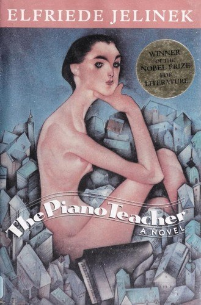

# after The Piano Teacher

### by Elfriede Jelinek

---

horrific and gravely disturbing, transportive and miserable  -- one of the "trippiest" , ugliest reads I've ever had -- fascinating to be suffocated and completely removed from the person the whole time -- perhaps a bit overhyped and overexcused for its time -- it must be interesting to actually be able to *see* Erika moving through the world, acting upon it, emoting, etc -- not sure I need to revisit her or that I would have even finished if not for --

---

#lit
