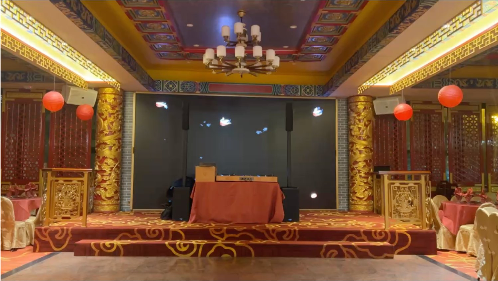
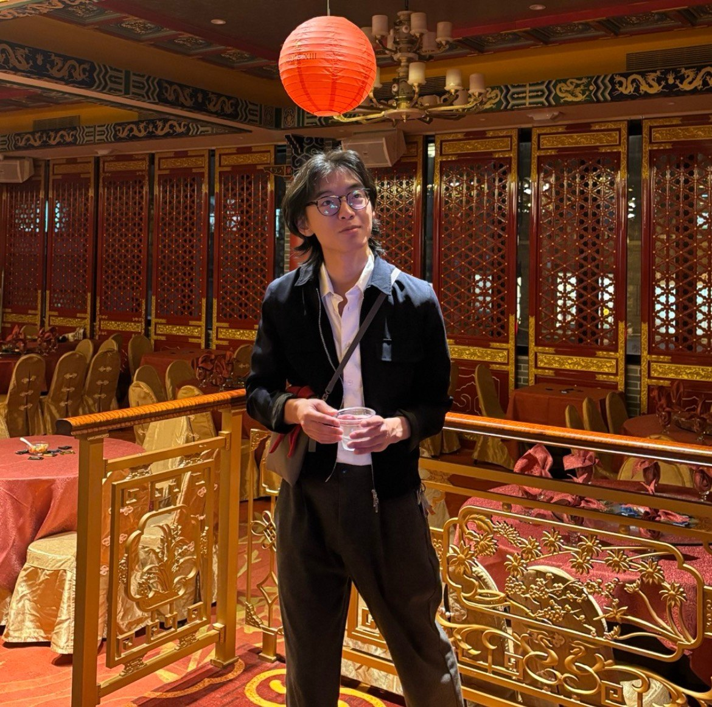
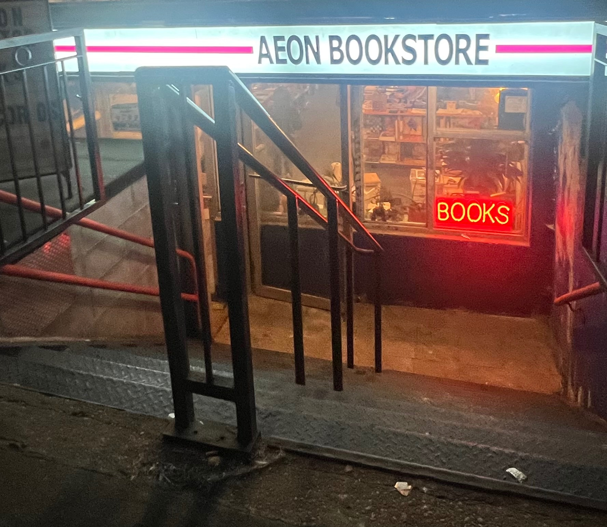
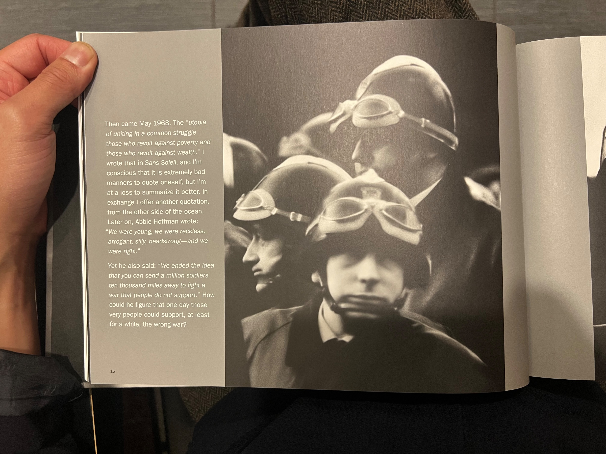
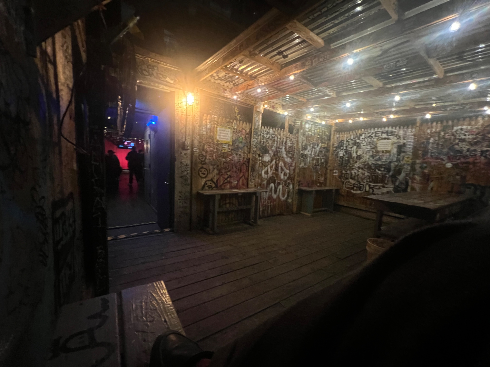
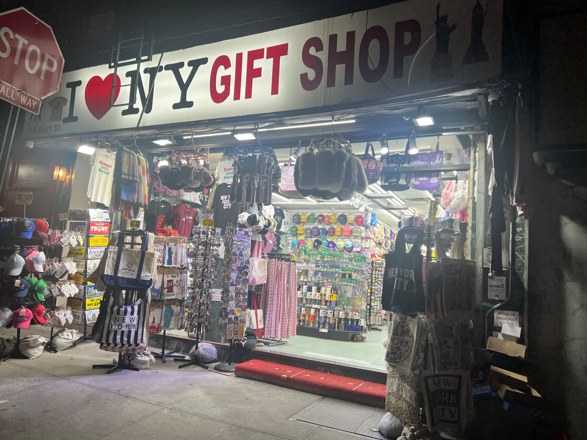
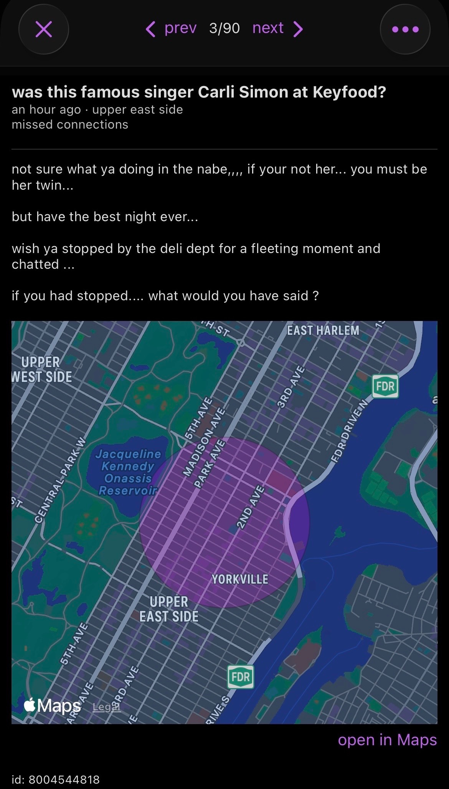
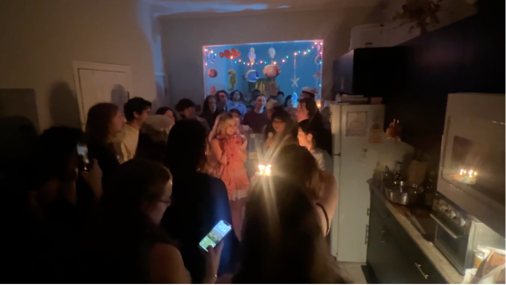
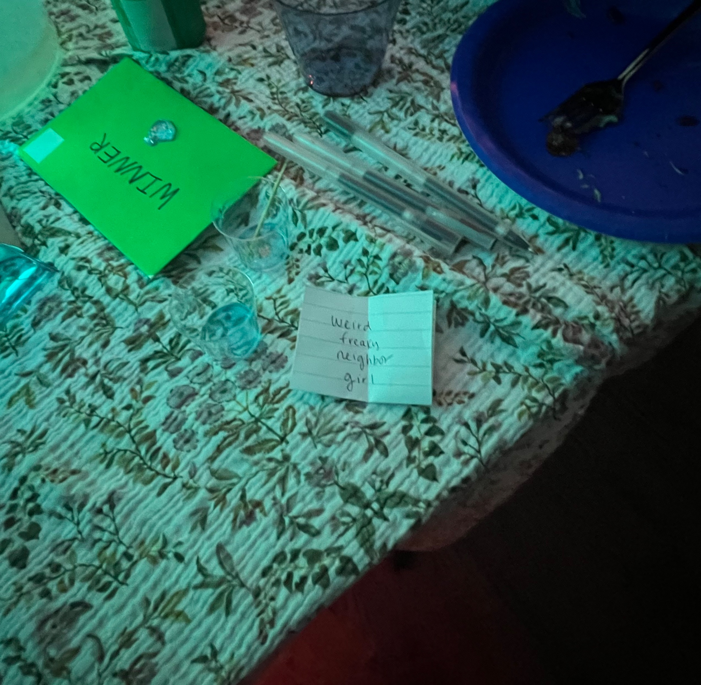
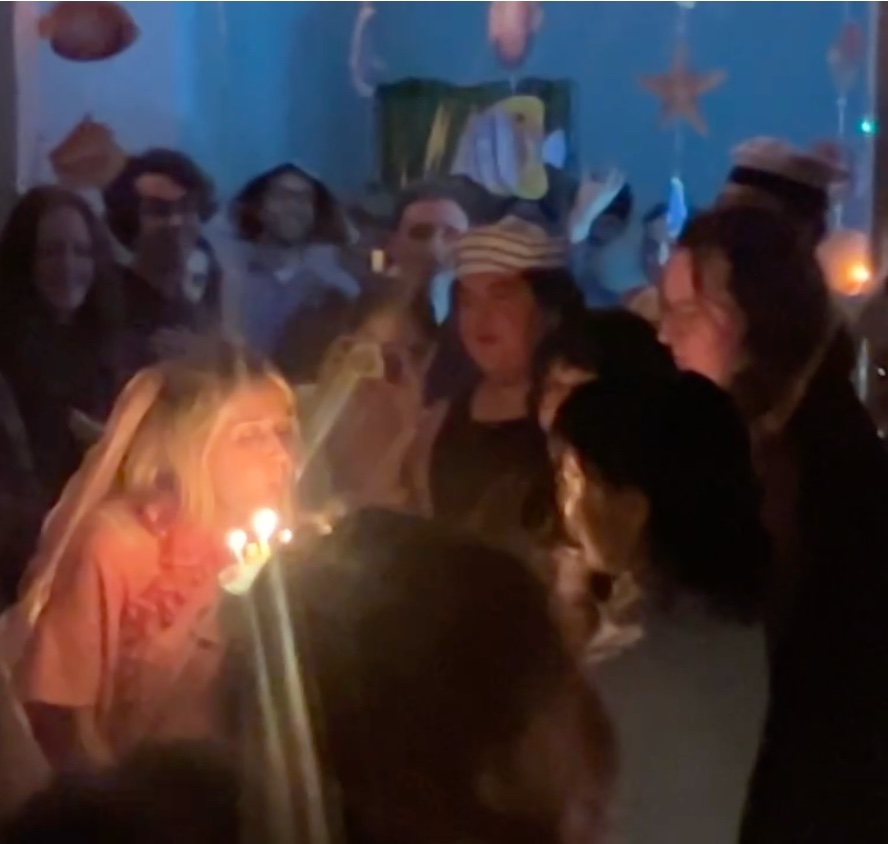

# the holidays arrive

---

A brief sit at the plaza with Nico, where we agree that it's been a little too nice for a little too long. If the holidays are to commence, the weather needs to get a bit more frightful. Micah joked that we're in the "golden era of climate change." Nico tells me about Kiribati -- Izzy showed me some of their texts about this -- an island nation just on the inside of the International Date Line, the first to receive each day and thus each New Year. I make a joke about time travel tourism. There's only one flight in and out each week, and one hotel. He says they're slowly working on moving the native population off of the islands because they won't be around much longer.

X is working the Ridgewood office and we talk about the book we both finished. I'm slightly underdressed compared to your usual work Saturday because it's not a wedding this time and also I don't care as much. Ashley picks me up and we embark upon another beautiful day of serving up signal flow and music. We're in the city this time and I don't have to DJ so I'm looking forward to wandering around Chinatown for a few hours once we get everything set up.

*📍 Golden Unicorn. Caroline once told me about this place.*

---

Once the party gets a-rolling, then I get to go a-strolling. I drift down East Broadway towards The Zone. There are beautiful people everywhere and the evening wind is cool. It's barely 6pm and I'm hungry but we'll be fed at the restaurant later so I settle for nothing. I do the thing where I think of all the different memories I have on these few blocks alone. The city is impossibly dense with the stupidest and most memorable memories.

### INT. CHINATOWN:

> We once had spaghetti at A&K's; now they are in Australia. Ten months ago, H&D in town and the temperature plunging below zero degrees; after the gallery show we stopped in there for Burger and A scared the shit out of us by knocking on the glass door, wrapped up in an impossibly reflective puffer jacket. That same night they "pranked" me by insisting I "explain Dimes Square" while standing at the bar at Clando. The reading at the library, noodles, singing at an empty Winnie's with A, which is also the night I met Z for the first time even though she has no memory of it, while I worked; I spent the rest of the night miserable and collapsed in front of A's toilet.

And of course I step into Aeon, where my most recent memory is meeting E, who was playing Eastern Orthodox choral music, pretty much exactly what I wanted to hear. She has invited me a few times to her programming at the Roxy but I've yet to be able to attend. But she's not here, today it's that guy, and he's keeping the store open late, so I sit a while and thumb through some Chris Marker.

There is a woman chatting about having done a presentation on UFOs as the opening act for the Sun Ra Arkestra. She said she would understood if no one in the audience could grasp what the hell was going on, because she herself kind of had no idea what she was doing, or talking about. She asks for books on UFOs, for a friend.

I wander back into Chinatown. At Yu & Me they let me have some tea before they're closing for an event — a combined Korean literature and Soju club hosted by Jinwoo Park. I decide to stick around, maybe I'll meet my father. Most of the attendees are a bit younger; I meet two nice young men, who to their credit are both separately unafraid to strike up conversation with me. Paul is from "outside Austin," and he's shocked when I ask if he's from Round Rock. Anthony just moved from Atlanta.

Mr. Park gives us a brief history of soju. It's from the Levant! And the bottles used to be blue; the green bottles came about as the result of a greenwashing campaign after a soju-related environmental disaster. Over the years it's suffered from alcohol shrinkflation. And the bottles used to be sealed with corks -- hence all the bottle-opening rituals.

During the break, Paul suggests two Korean indie bands, Togo and The Volunteers. He says my outfit reminds me of them. I'm beginning to get worried that I should check back in at our birthday party and sure enough, while Jinwoo is describing a set of Korean books -- this is the "literature" half of the evening -- Ashley texts that she is hungry. It's impossible for me to leave without everyone seeing, because Jinwoo is standing against the door.

Once he's finished I wish Anthony and Paul well and dash out. I chew on two of the books he's recommended (in addition to his own, *Oxford Soju Club*): *Love in the Big City* and *Capitalists Must Starve.* When it comes to imagining a space for myself in that foreign place, which is nevertheless at my body's roots, I am interested in those more like us here, who have fought and suffered under the repressive, conservative, ultracapitalist social culture.

---

Ashley and I scarf down some of the remnants of the buffet and she steps outside to smoke while I throw on Theophilus London. I grab us some dumplings from North Dumpling and then step back out into the night. There's a crowd gathered outside the door to the Golden Unicorn, concerned about a man face-down on the pavement. They've called for an ambulance.

It's 8pm now so I walk to Winnie's. Business is starting to pick up but none of the children are singing. I read for a while on the porch and then wander again. I step into a souvenir shop and the men eye me warily. They have gigantic models of Lady Liberty and the Empire State Building, and snow globes, but none as nice as the one my mom brought back for me when I was a child, the one that's sitting on my nightstand now.

---

Ashley and I pack up and drive the gear back to Bushwick and talk about holiday plans, how we're using artificial intelligence, and I tell her that thanks to the IPO, Anthropic now employs more hundred-millionaires than exist in the entire city of Los Angeles. I catch a CitiBike to Erica's party. In fitting with the ocean theme, their apartment feels like an aquarium. My glasses don't fog up but it's hot as the tropics inside. I make a beeline for C and we hug; I can tell she's tired again. I sit with her a while and we watch the costume contest and the cake but then I lose her to the Irish.

I hear tales of an interloper from downstairs, a girl named Emily who barged into the party and was negging everyone. We talk about various aquaria and I meet Eggs. After Jell-O shots, Lizzie tells me that everyone in NorCal called grinding "freak-dancing." Erica says I should work in development at NYU. Jane shows me some of her books, of course we're well-aligned. She offers me *Angels* by Denis Johnson but I'm committed to some other fiction first. Erica wants the party to go 'til 4am. So I try my best; I'm asleep by 3.

---

#life #threeboroughday
