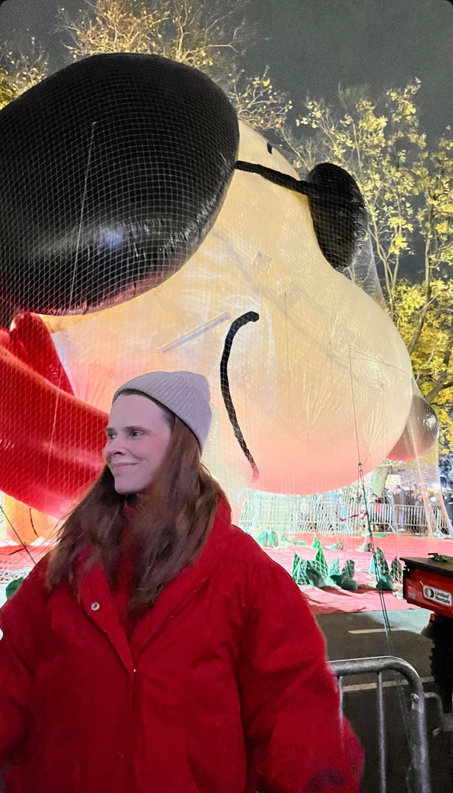
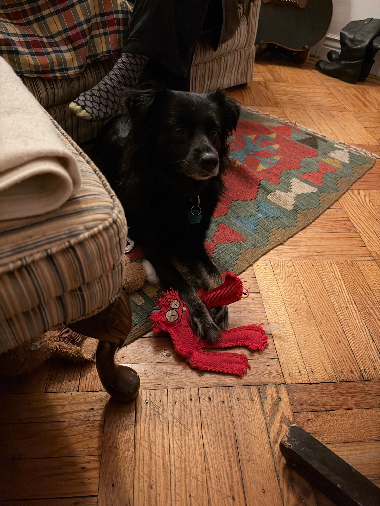
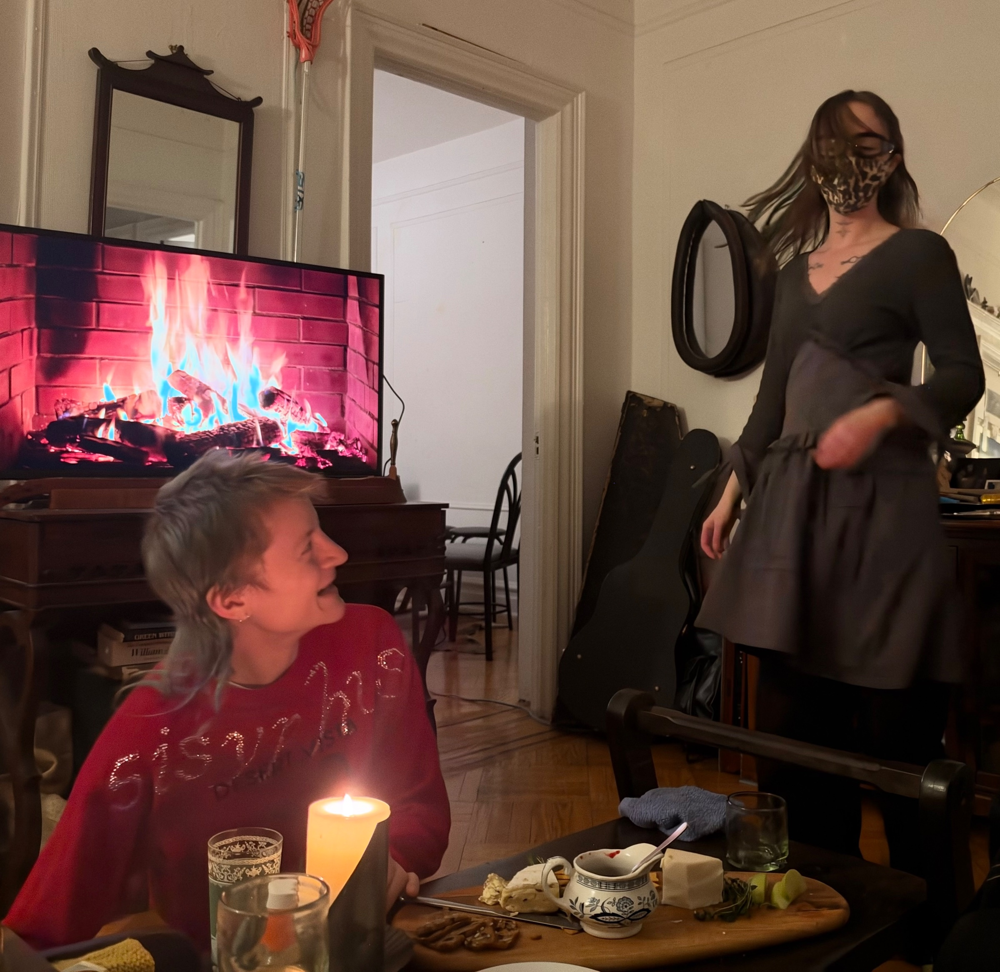
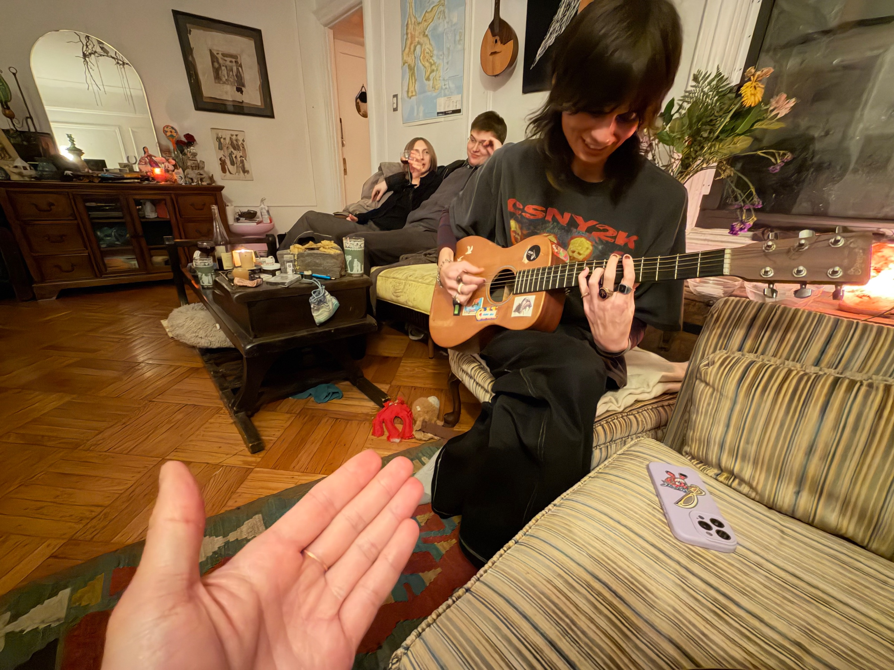
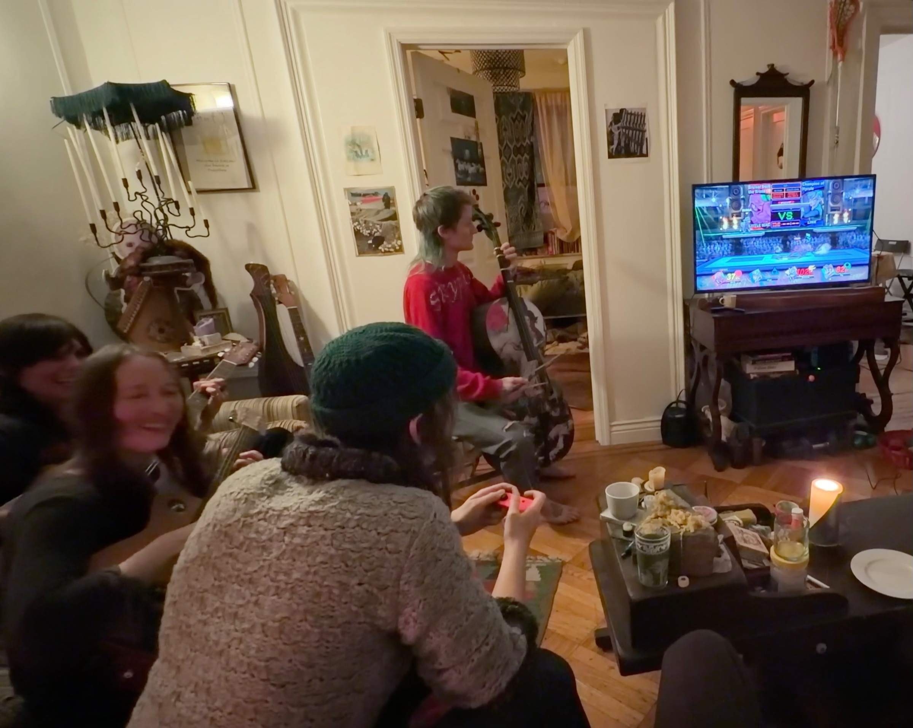
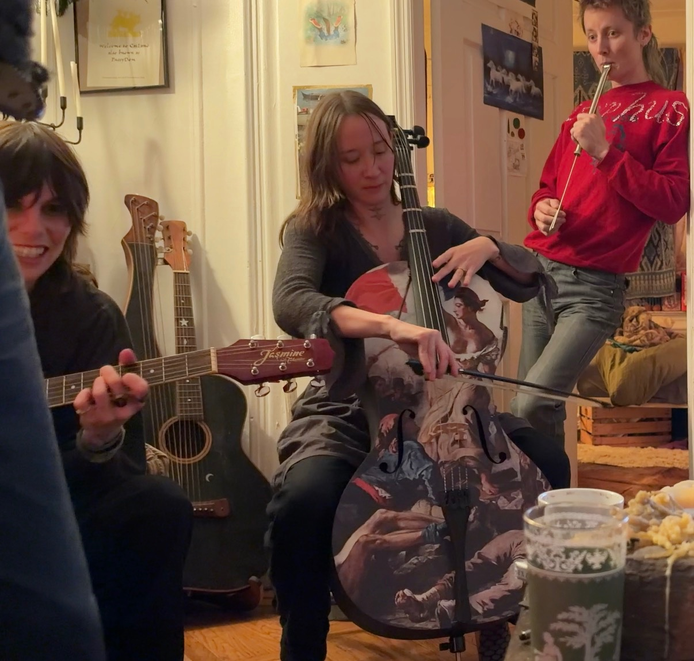
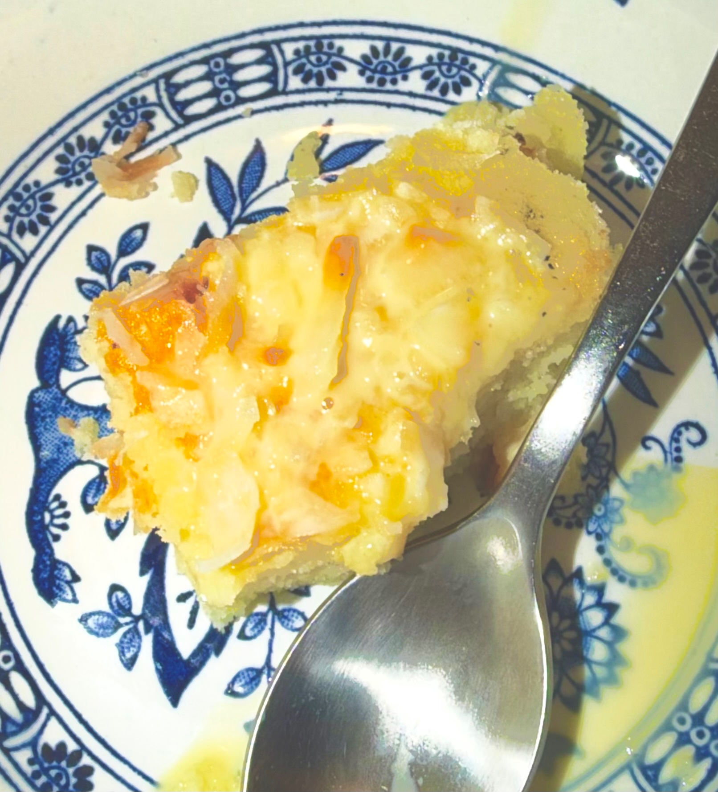

# IRL

Blackout Wednesday in the Groupchat, Thanksgiving in the real world. After sleeping in and recording all afternoon I trudged across Ridgewood through the hurricane squall and found myself at A&A's table for the second time in a week. We sang silly songs and sang songs sillily. Beatles, White Christmas, Fairytale of New York, a lovely test of River as a traditional ballad with L, and more. Outside the winds were roaring but we had the yule log on the screen. Later I did the dishes and A put on the Christmas tunes. We all kept singing along.

A says she took her ancestry results from 23 and Me and turned them into a long playlist of traditional music from the various areas that makeup her ethnic background. I thought that was a fabulous idea and then I got jealous that my playlist wouldn't be so disparate and interesting. But -- in p3 a discussion about European's racism and condescension towards Americans led me to think again-- how lucky I am to be in this city. As precisely I.

---

#life
