# 2026-11-07 anthem  
  
---  
  
## Some photos that tell the story of my Election Night 2016, ten years ago tomorrow  
  
### THE DAY BEFORE  
  
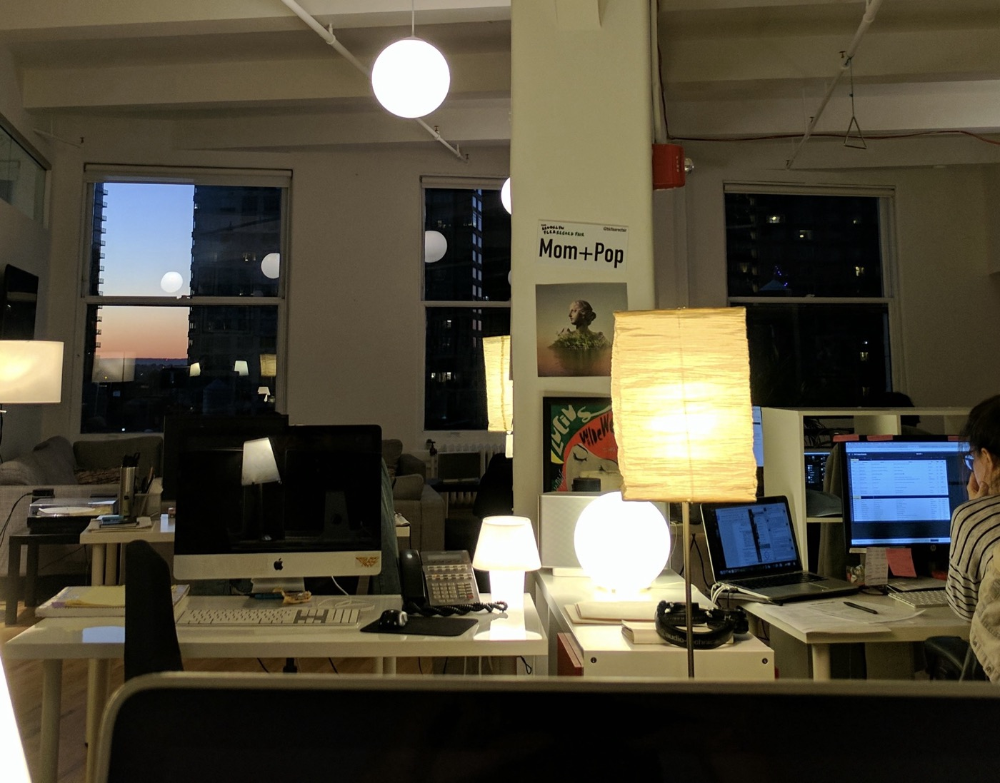  
The day before the election, I took a picture of the wonderful sunset through the window of the office of the indie record label where I was an intern. I was terrified of my bosses, who were probably 23 or 24 at the time. Some of my friends are signed to that label now.   
  
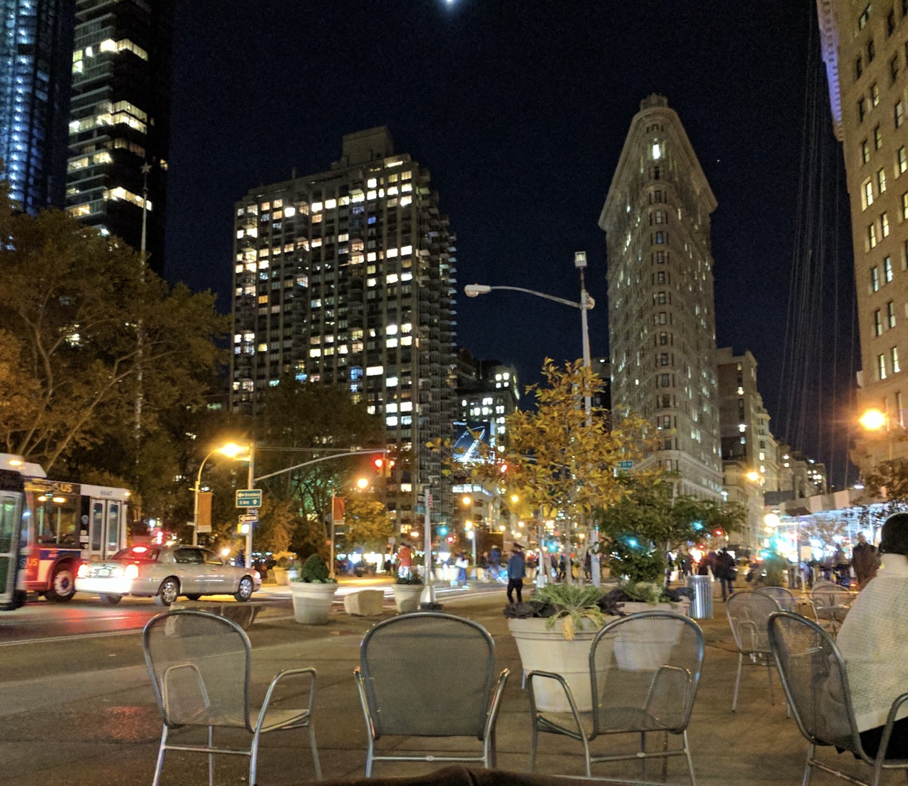  
After work that night I sat at Madison Square Park and thought about the future. I was listening to Bob Dylan that night, which is a little strange to remember now, because Leonard Cohen had passed away earlier that day. I remember after the election finding a lot of solace in his lyric:  
  
> *Ring the bells that still can ring*  
> 
> *Forget your perfect offering*  
> 
> *There is a crack in everything*  
> 
> *That's how the light gets in*.  
  
But that night, I was listening to "Visions of Johanna." That song was like reading a book back then.  
  
---  
  
### ELECTION NIGHT  
  
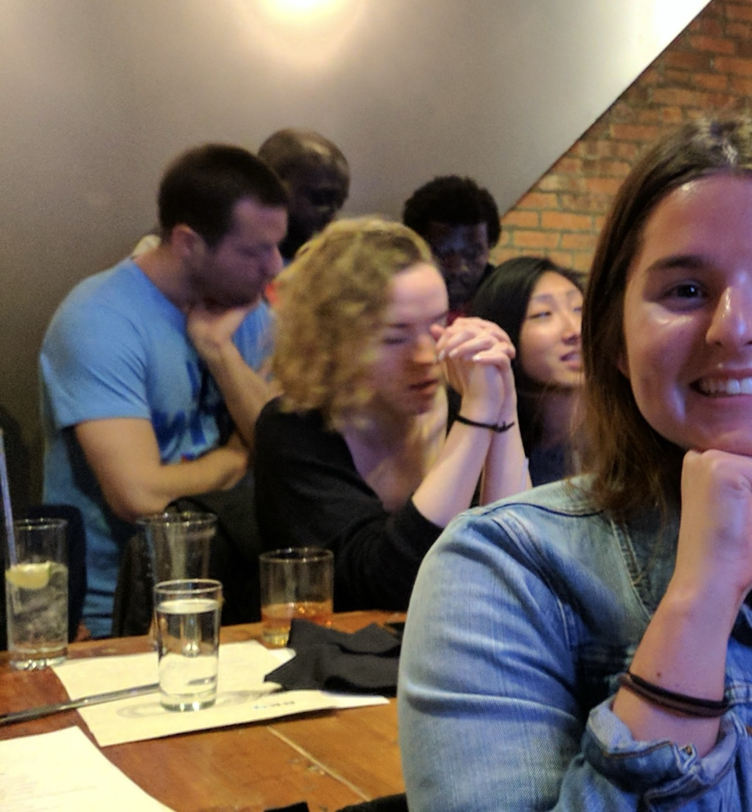  
  
A photo of EG, taken around 10pm, which is probably around the time Florida results were making it clear that this night was not going the way that it "should have." I think about this photo a lot: the folks in the background know, but we were kids then, raucously drunk and blissfully unaware. I was freshly twenty-one. Drunk. After we left this place, wherever the hell we were, we got on the train back to Brooklyn. I took a photo of myself and M (the photo shall remain redacted) while our friends continued their drunken blather loudly in the train car. Suddenly a stranger screamed at us. I remember this vividly.   
  
He was furious. *This is YOUR fault!* he spat at us.  His partner grabbed his arm. *This is all happening because of fuckers like YOU!* This was the moment I realized something must have gone horribly wrong. We hadn't been paying any attention. Back then we didn't have cell service in a lot of the subway stations, so I couldn't check my phone until M and I disembarked at Clark St, where we separated from the others, and walked the Promenade. That's where I sat and really saw the numbers for the first time. I remember two people from the flurry of phone-based conversations that night: C called me from Nashville, and J, my high school ex, texted me. She said she was scared.   
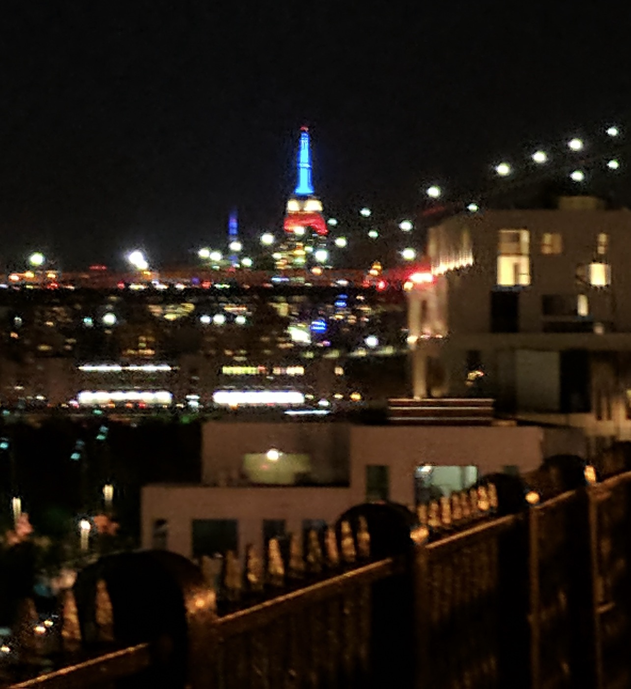  
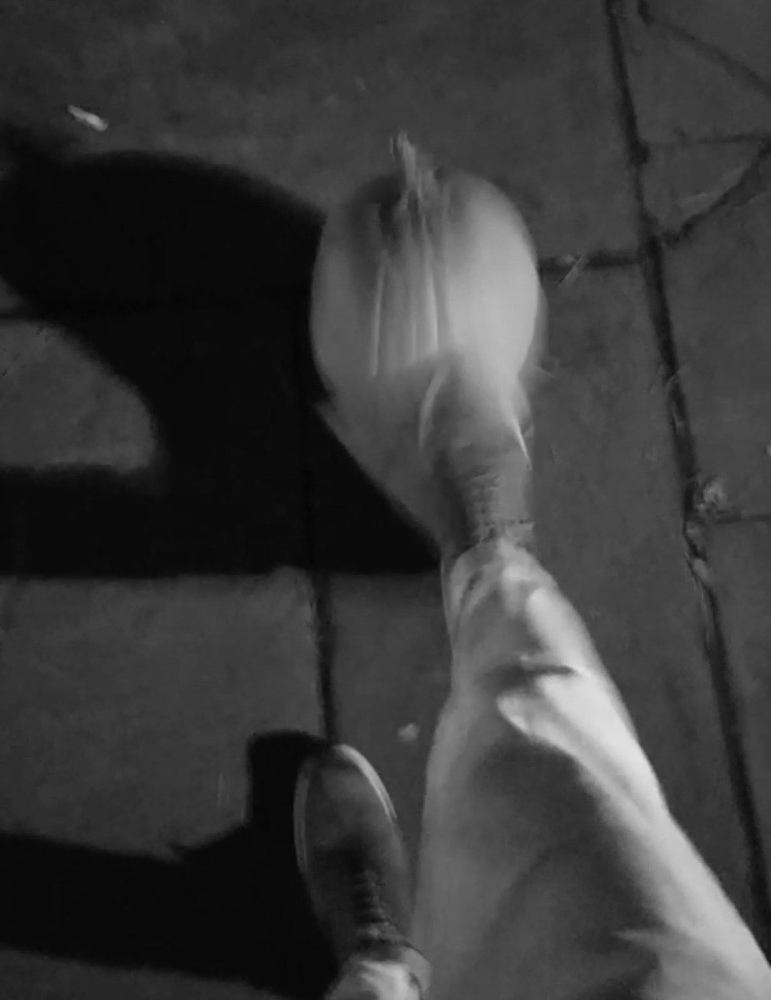  
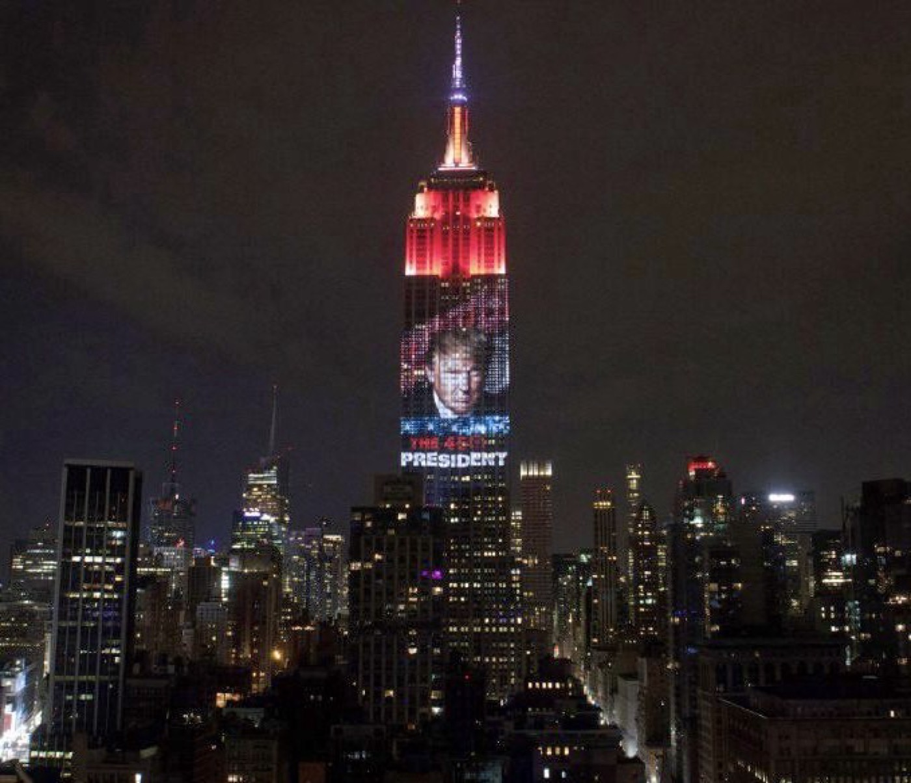  
  
M and I found a pumpkin leftover from Halloween. I remember kicking it lazily along the Promenade and I remember taking a photo of the Empire State Building lit up in red, white, and blue. This would serve as the backdrop for his portrait emblazoned above the Midtown skyline when the AP called the race a few hours later. I didn't see it, but I was awake in bed when the call came through, at around 2:30am. I was alone in the bed but not in the room, M having left to cry and call a friend, P sleeping soundly in his bunk beside me.   
  
---  
  
### THE DAY AFTER  
  
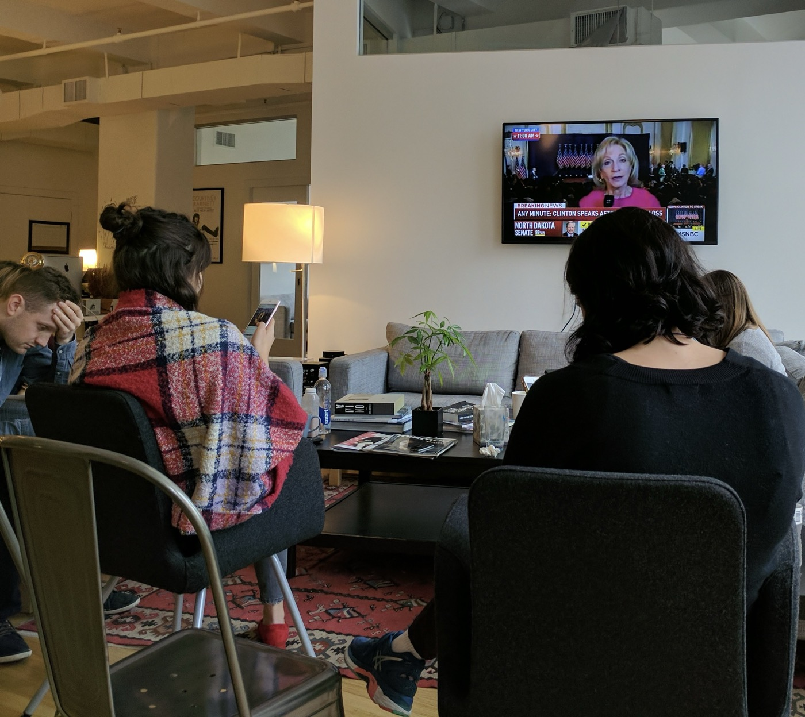  
The next morning I went to work at the indie record label and everyone was inconsolable. The other interns and I sat quietly behind our bosses, who were crying and wrapped in blankets. I'm realizing now they were all viciously hungover, most likely. We sat like this and watched Hillary's concession speech from the Rose Garden. I realized that most of my bosses had likely cast their first ever votes for Obama. Mine had been for Bernie Sanders. They let us go early — *Indie rock doesn't matter today* — and I remember chatting with B and G over sandwiches afterwards but I don't remember what we said. Maybe we talked about the politics of where we were from: Ohio, Michigan, New Jersey.  
  
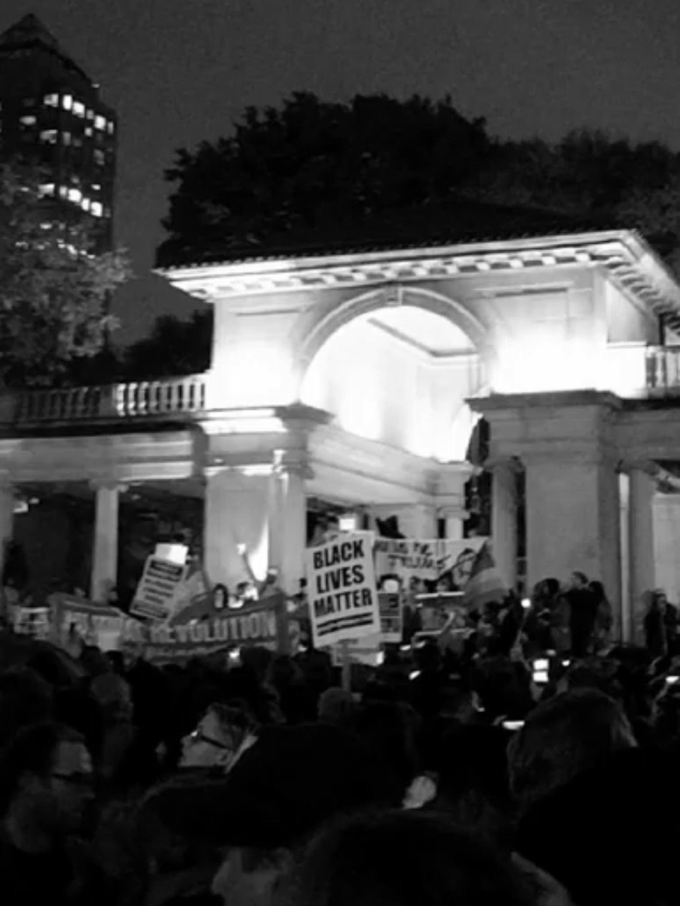  
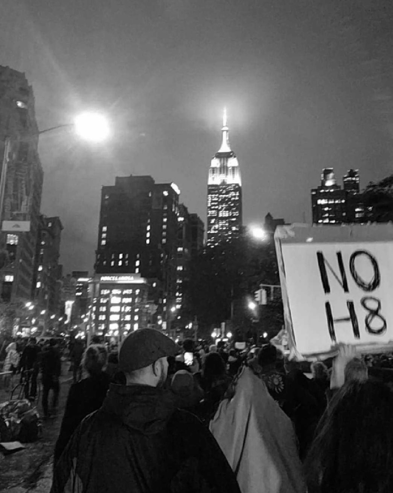  
  
Later that night I skipped class and joined the protest in Union Square, where the NYPD ran every siren they could as we chanted, *NOT MY PRESIDENT!* and *NO TRUMP / NO KKK / NO FASCIST USA!* and *FUCK YOUR WALL!* and I met real-life, actual socialists for the first time, from the fledgling DSA and from PSL, and all of us marched up Fifth Avenue to Trump Tower and "the rest is history."  
  
The next morning found me at a still-nascent Hudson Yards at 6am, boarding a Greyhound bus to Washington. C and I had arranged to meet in order to be close to one another for a day or two. I listened to Leonard Cohen the whole way and marveled at the  Manhattan skyline from a bus window and thought of course about the future. I stayed in D.C. through Armistice Day.  
  
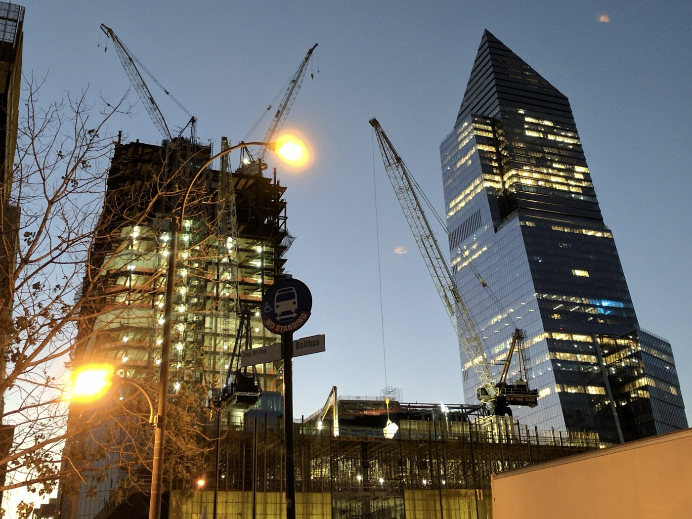  
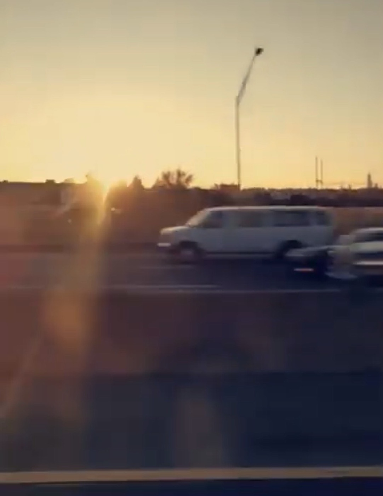  
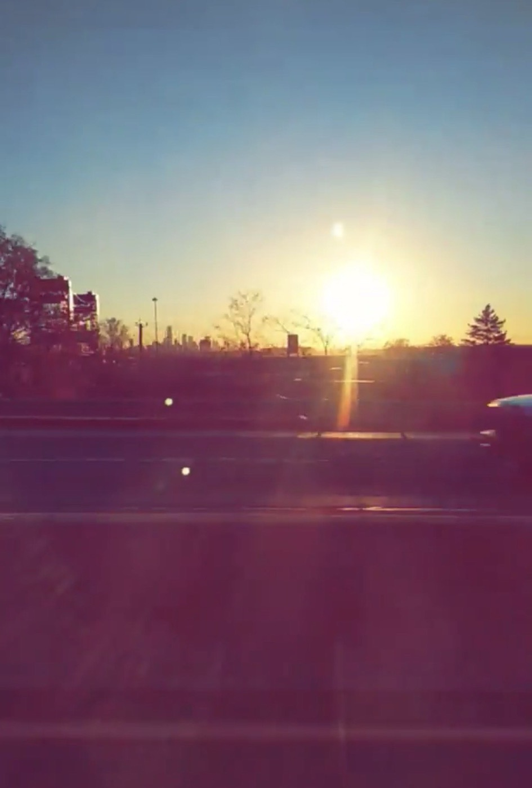  
  
---  
  
### AFTERWORDS   
  
Back in New York a few days later, I took a morning and wandered around Washington Square Park, where I videotaped every happy thing I possibly could. Music filled every corner of the park: on either side of the fountain a circle of old men improv'ed "Earth Angel" while a brother-sister duo no older than ten performed Vance Joy's "Riptide" on ukuleles. A pianist had set up in front of the arch and was blasting away his aggression with some Rachmoninoff, while at the western wing a woman with wonderfully curly grey hair sang at a tribute to Leonard Cohen. She was singing "Anthem."  
  
I have video of all of this. Rewatching them today, it is still a wonder to me that one place could hold and contain all that music. I remember the weather that day as being unseasonably beautiful for November, and I remember a sweet, sad camaraderie suffuse throughout the city. The initial shock had worn down and all that was left was a strange grief. A *New Yorker* op-ed said we were in mourning: for the country we could have been, for the country that many of us still believed we were. Ten years later, after all of this, I'm still not sure which is more true.   
  
During my trip to D.C., C and I had talked about what could be done — what our particular responsibilities were now that History was Happening. I can't remember any of what we said, but by the time the holidays were in full-swing a few weeks later, I'd arrived at an answer which, if humble and incomplete, felt actionable enough: music. So we made a compilation for immigrant rights organizations. We threw it together in less than a month. I didn't see much of the city the rest of the season because I was inside 24/7, working and recording. This is how I met everyone, Katy included. What can music do? Ten years later, I'm still not sure of that either, but when it comes to my life, it has been most of everything I've really tried.   
  
#life #nyc #politics #music   
  
---  
  
  
> *The birds they sang at the break of day*  
> 
> *Start again, I heard them say*  
> 
> *Don't dwell on what has passed away*  
> 
> *Or what is yet to be*  
>   
> *Ah, the wars they will be fought again*  
> 
> *The holy dove, she will be caught again*  
> 
> *Bought and sold, and bought again*  
> 
> *The dove is never free*  
>   
> *Ring the bells that still can ring*  
> 
> *Forget your perfect offering*  
> 
> *There is a crack, a crack in everything*  
> 
> *That's how the light gets in*  
>   
> *We asked for signs, the signs were sent*  
> 
> *The birth betrayed, the marriage spent*  
> 
> *Yeah, and the widowhood of every government*  
> 
> *Signs for all to see*  
>   
> *I can't run no more with that lawless crowd*  
> 
> *While the killers in high places say their prayers out loud*  
> 
> *But they've summoned up a thundercloud*  
> 
> *They're going to hear from me*  
>   
> *Ring the bells that still can ring*  
> 
> *Forget your perfect offering*  
> 
> *There is a crack, a crack in everything*  
> 
> *That's how the light gets in*  
>   
> *You can add up the parts*  
> 
> *But you won't have the sum*  
> 
> *You can strike up the march*  
> 
> *There is no drum*  
> 
> *Every heart, every heart*  
> 
> *To love will come*  
> 
> *But like a refugee*  
>   
> *Ring the bells that still can ring*  
> 
> *Forget your perfect offering*  
> 
> *There is a crack, a crack in everything*  
> 
> *That's how the light gets in*  
> 
> *That's how the light gets in*  
  
---  
  
> *Steer your way past the ruins*  
> 
> *Of the altar and the mall*  
> 
> *Steer your way through the fables*  
> 
> *Of creation and the fall*  
> 
> *Steer your way past the palaces*  
> 
> *That rise above the rot*  
> 
> *Year by year, month by month,*  
> 
> *Day by day, thought by thought*  
>   
> *Steer your heart past the truth*  
> 
> *You believed in yesterday*  
> 
> *Such as fundamental goodness*  
> 
> *And the wisdom of the way*  
> 
> *Steer your heart, precious heart*  
> 
> *Past the women whom you bought*  
> 
> *Year by year, month by month*  
> 
> *Day by day, thought by thought*  
>   
> *Steer your way through the pain*  
> 
> *That is far more real than you*  
> 
> *That smashed the cosmic model*  
> 
> *That blinded every view*  
> 
> *And please don't make me go there*  
> 
> *Tho' there be a god or not*  
> 
> *Year by year, month by month,*  
> 
> *Day by day, thought by thought*  
>   
> *They whisper still, the ancient stones,*  
> 
> *The blunted mountains weep*  
> 
> *As he died to make men holy,*  
> 
> *Let us die to make things cheap*  
> 
> *And say the Mea Culpa*  
> 
> *which you've probably forgot,*  
> 
> *Year by year, month by month,*  
> 
> *Day by day, thought by thought*  
>   
> *Steer your way, O my heart,*  
> 
> *Tho' I have no right to ask*  
> 
> *To the one who was never, never equal to the task*  
> 
> *Who knows he's been convicted, *  
> 
> *Who knows he will be shot*  
> 
> *Year by year, month by month,*  
> 
> *Day by day, thought by thought*  
>   
> *They whisper still, the ancient stones,*  
> 
> *The blunted mountains weep*  
> 
> *As he died to make men holy,*  
> 
> *Let us die to make things cheap*  
> 
> *And say the Mea Culpa,*  
> 
> *Which you've gradually forgot*  
> 
> *Year by year,*  
> 
> *Month by month,*  
> 
> *Day by day,*  
> 
> *Thought by thought*  
  
