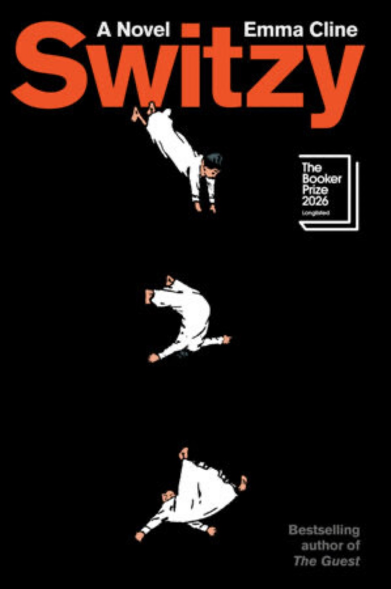
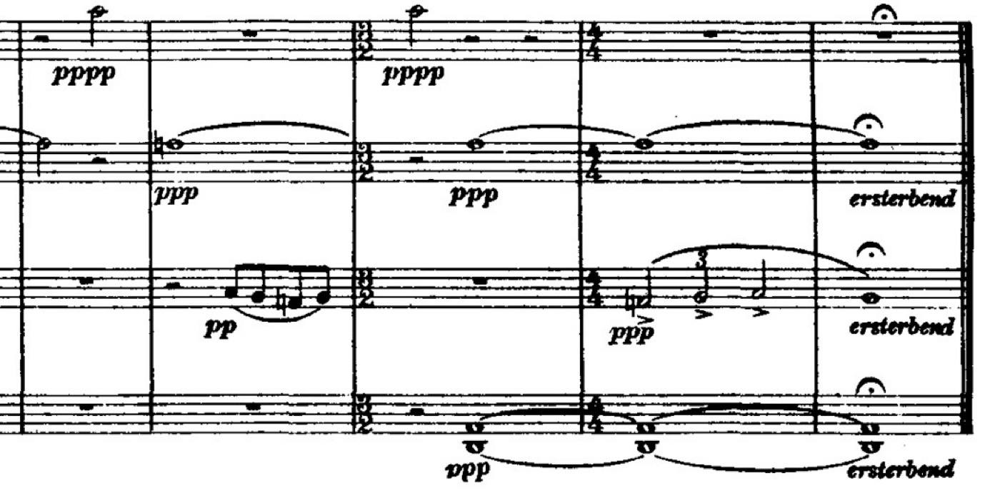
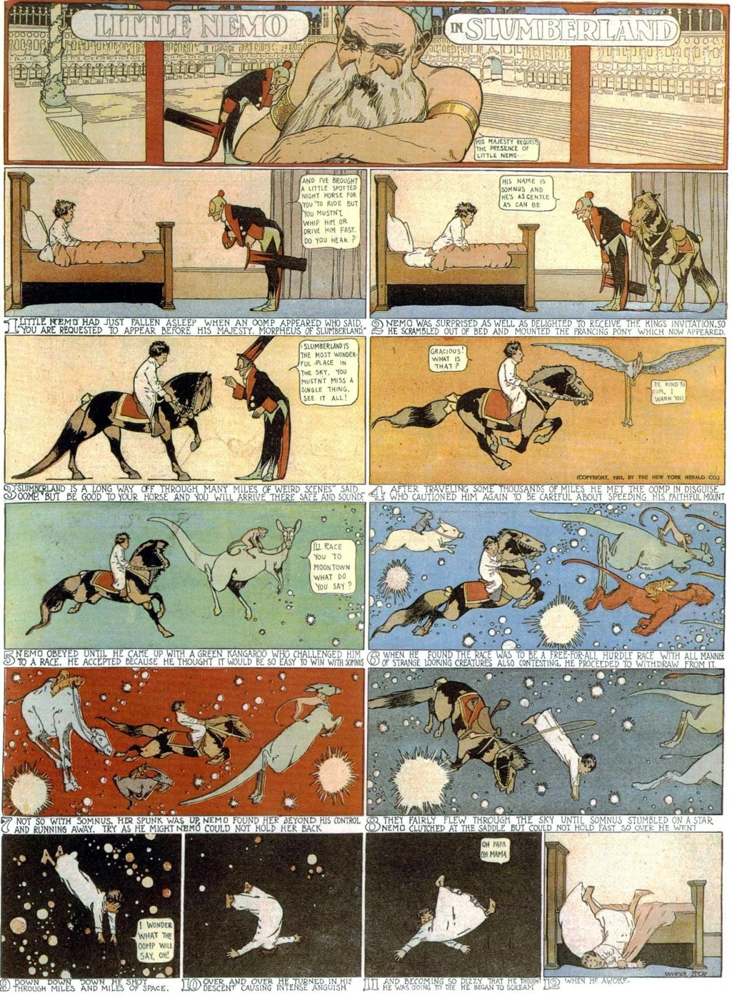

# 2026-11-13 after *Switzy* (2026)  
  
### by Emma Cline   
  
  
  
> *You wanted the whole reel presented to you—the highlights, of course. Moments when he had fulfilled his duty. Calmed the distraught wife, dried a child's tear-struck face. When he had driven the car through the night as his family slept buckled and dreaming in their seats. When he had let his young daughter hang onto him in a warm foreign ocean, Annabel a hazed-out figure on the shore, a woman waving back. A moment that already contained its own nostalgia.*  
> 
> *What was family but a machine for forgetting?*  
  
---  
  
Longlisted for the Booker, eminently readable and self-assured, my first foray in to Emma Cline's work leaves little to be desired, though there is something glancing about this. Chalk it up to David's condition, perhaps — "close third person" is perfect for this work. An interesting pairing alongside *The Piano Teacher* (and to a lesser degree, *Transcription*) for precisely this expertly managed distance between an impenetrable mental landscape. How much, though, is managed and how much is the natural result of the tension between the closeness and the third-person-ness of the narration? Let's play around with it.  
  
Memory is everywhere for him these days: just recently, he plucked from his shelf Ernaux's *The Years* and found a beautiful, heartbreaking reference to *Cria Cuervos* (1976). Metrograph screened it the next day. and just yesterday, *Sans Soleil* in the rain. and a contagious kind of lyrical rhythm to this prose, too: David's entire final days in Zurich he pictured as a mirror of his real life by the Office window, two days of rain in Ridgewood.   
  
but that's not quite right, is it? getting closer still to say that the book made him reflective. It had enough space within it to do that. Down to the format itself, double line breaks constantly, a reflection of Hastings' stuttering thought process but which also provided rhythmically reliable opportunities to trace his own internal thoughts alongside the narrative itself. it played off of the standard, clichéd but unassailable human terrors: no one to hold your hand at the end, guilty tabs left open, anticlimatic and awkward encounters with dramatic figures from your past.  
  
> *He should have someone with him. The regret was total. There should be someone there, one of his family members. He would die far away from them. He could have called Annabel. He could have asked her. Annabel, who had known him back before their lives happened to them.*  
>   
> *Members of his family — just the phrase made his eyes wet. For they were just that, members of his family, as he had been a member of their family. Not much, but more than anything else. Anything else in this world.*  
>   
> *Where are they, stars? My family? Are they sleeping—can you find them for me?*  
  

Cline, in an interview, says that one of the worst terrors is the idea that one could spend a whole life on this planet without ever really opening up to someone. He feels safe from this terror at the end, but there's something in Hasting's terror at the end that makes him double-back. Family, family, family: so absented from Hastings' life, more or less a choice on the character's part but how true is that, really? This man who sheltered himself from himself out of fear and guilt. His path was set by his own ignorance and cowardice in youth, and this would define him forever, such that even the ostensibly brave decision to face the end with Dignitas could be seen as yet another corner he'd been shepherded into.   
  
By that logic, what of his own life set him down paths that keep him out of the reach of others — out of the reach of family? He's never known it. The first thing he knew, in fact, was that it was not up to him at all, this answer to the question about who stays, who is family. One makes it for oneself, he shrugs. One reaches out the hand and finds it. But it is hard to keep one's hand outstretched forever. and harder still to know when contact has really been made. One can spend a life that way, reaching and withdrawing and reaching again.   
  
He listens to Mahler 9 too, the Walter and the Karajan and the Bernstein, the "dying away," and remembers: that's not what it was about at all. A wonderful story can be found in the music but it's not what the composer meant to put there at all, not for himself at least. But then again, *"ersterbend..."*
  
  
---  
  
Others online seem to be attached to the quandry of Hastings' wealth. He's not sure what it means that he wasn't too tripped up by this. Everyone dies, and it's interesting to learn how everyone thinks about it. It takes you right up to the end, and it's certainly no *Stoner*, but he does think that its appeal will grow throughout the years. But then again the main reward of the reading was everything outside of the book itself: where his mind went, or happened to go, while reading. How the phones are making us all *demented*, how he might handle losing his grip like this, the importance of closing accounts before it's too late. *Bleak*, according to one Reddit user. *Life*, he would respond. It's how you read it.  
  
  
  
---  
  
#lit  
