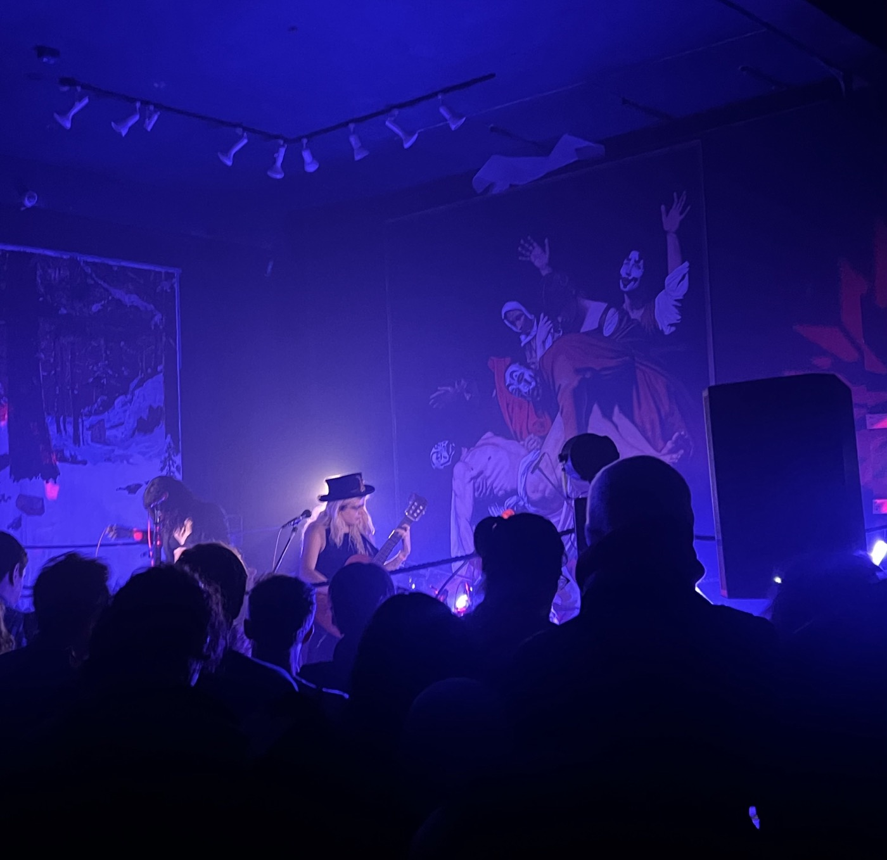
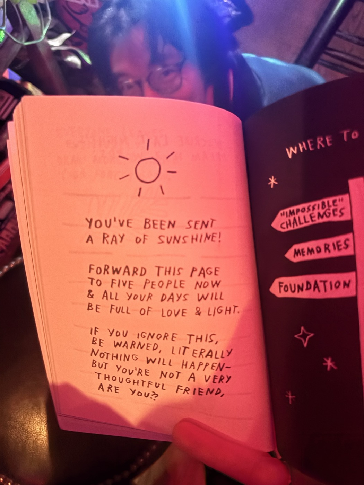

# 2026-11-14 wrestling ring  
  
---  
  
After a string of shows that felt more like Concerts, what a joy to stand in that strange space on Frost St that I have heard so much about and watch some of my dearest friends celebrate their music with us :D  
  
Something I like to do when Heaven's singing, especially in the quietest moments: I like to look at the crowd. Hard to believe that for over a decade now, I've watched them win this moment. Seeing them quietly capture all those people. The softest power of the human voice. It never gets old.  
  
  
  
I have a solo round at Diane's around the corner before the show and watch *You've Got Mail* on silent, with the speakers blaring Gang of Four and the Kinks at me. I probably damaged my hearing but I can never take my eyes off of Meg Ryan. the whole bar is watching. then I walk around the corner and it's a joyous reunion, my people are all assembled outside, Lane's back from Europe for a few days. I tell her that when she's out on the road again I'll still be saying she's in Europe. the return of Richard's headlamp.   
  
Holden says *Moonstruck* is the only truly great rom-com. there's a funny, extended moment of tension after I ask, "What about *Annie Hall*?" — Holden is taken aback. after a long pause filled with blinking, he says, *Well, that's just a crazy thing to ask*, and I'm not sure what this means. this whole time I'm still leaning in expectantly. eventually he makes a funny [redacted] joke and explains that, in his estimation, *Annie Hall* isn't a rom-com, it's a real movie, so of course *Moonstruck* couldn't hold a candle to it.   
  
one might say that they are just completely different mediums, like opera and musicals. what did he say? he said it hilariously. something like: *Annie Hall* is like *La Bohème*, and *Moonstruck* is the *Wicked* of *Annie Hall*. hahaha. yes!! and he recommends *Lincoln in the Bardo*, so I'm 50/50 on friend recommendations for that one. I check the Met Opera for rush tickets but later learn that we were speaking on the final night of its run.   
  
inside, many happy hugs and passing along the whiskey. certain people never recognize me but why focus on them. I am lucky enough to get some dregs of the soap in one of the rather disgusting bathrooms. friends keep asking me what I think of the space. I have to like it on principle because we're finally not at a bar. No offense, Natalie. the band sounds good. they always do. Diego rips an amazing solo and I shout their name; I actually shout several times between songs but eventually stop because it seems like people find my masculine voice to be rather alarming. oops. my friends are all scattered around but I've got a privileged spot standing high on a pew.   
  
  
  
there's some sloppiness afterwards but it's all in good fun. Kylie and I ask each other questions at Diane's and spill a lot of things. another run-in with Caroline and a huge hug, I tell her that last night's was my favorite hug of the year. I still have her stick in my room. Julia's hair is curly. she looks so pretty. I tell her this and she reacts with emphatic shyness. later she's excited having met the man who interviews children on Instagram. I make a joke about her being a little too old for him and no one gets it. the sports bar we're standing outside was playing "Everything In Its Right Place" when we walked in so I don't like it. _Let's go back inside,_ so I reluctantly follow. this time it's "Sugar We're Goin' Down" and some of the people who never recognize me are drunkenly singing along. it's a wedding you're working, it's a Saturday night in Williamsburg, Brooklyn. 
  
FRINDLEGAP: the music of your youth is being gentrified by people who apparently share your taste and cultural interests but not your values or socioeconomic brackets, and who might have spurned you from their lunch table back when this stuff belonged only to you. once you're thinking like that it's time to either grow up or go. you're thirty-one, remember? and full of love. but I'm too tired to do the former so with my adult wisdom I choose to do the latter. the walk home from the train is cold. it's hard to believe that many nights last winter were forty degrees colder than this. I remember crying walking home in that deep freeze but then again I had someone on the other end of the line. thinking like that it's time for bed. down some psyllium husk to soak up the Jameson and pull the comforter over your head; out like a light. 
  
---  
  
#life   
