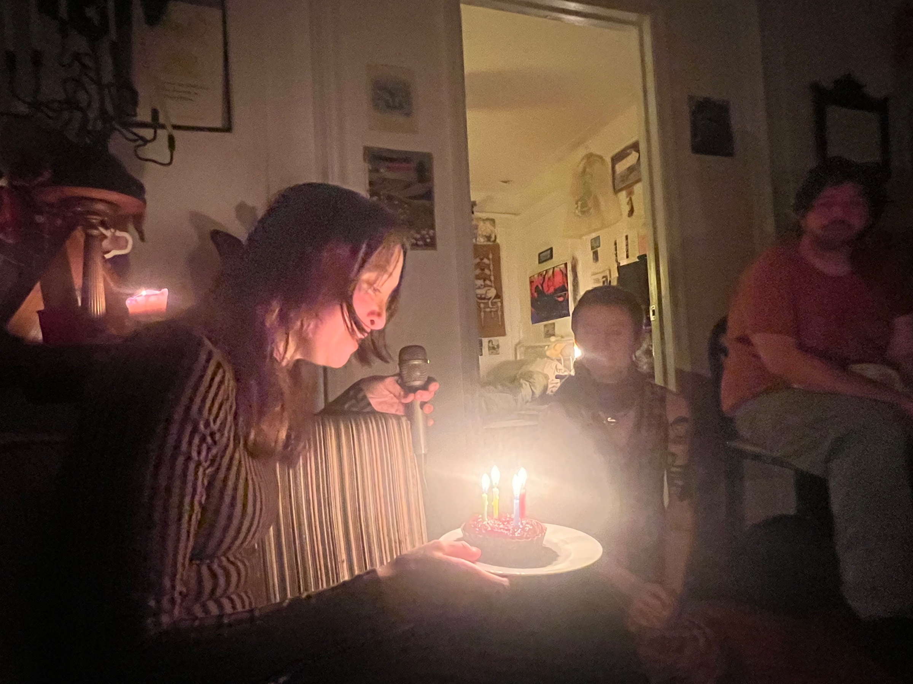
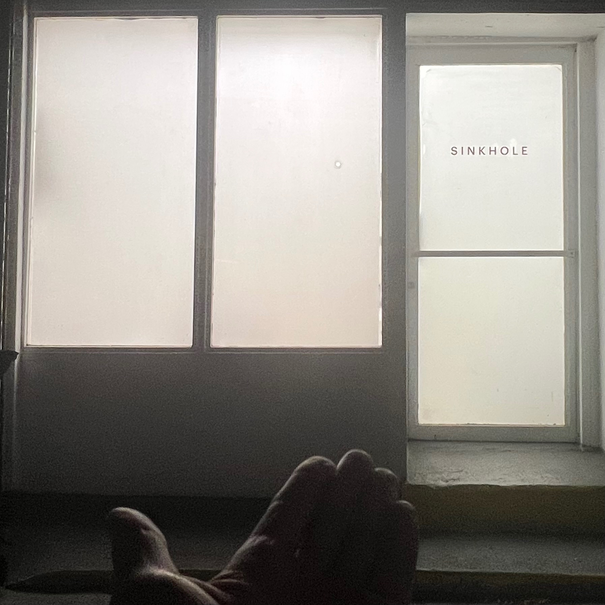
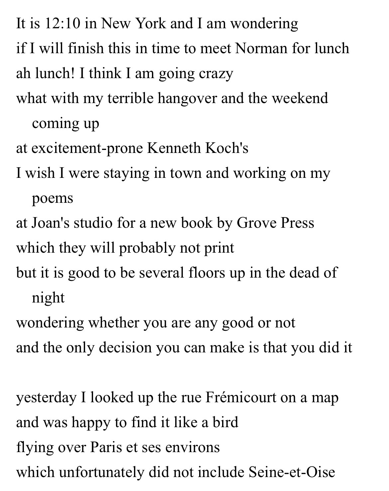
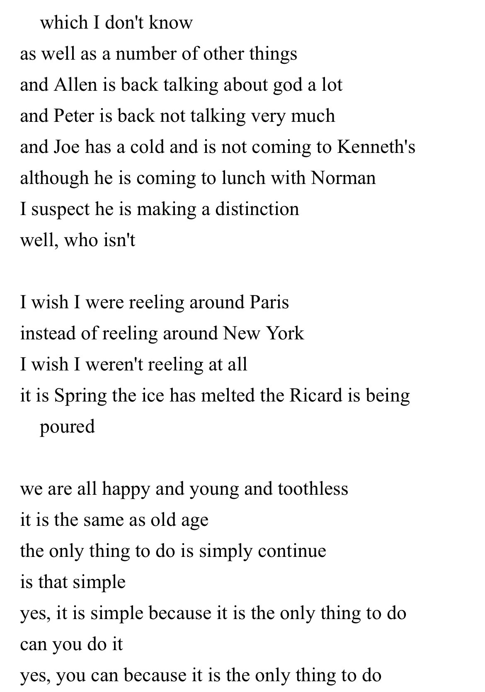
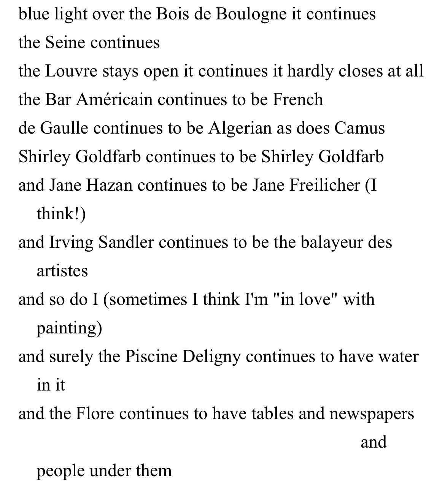
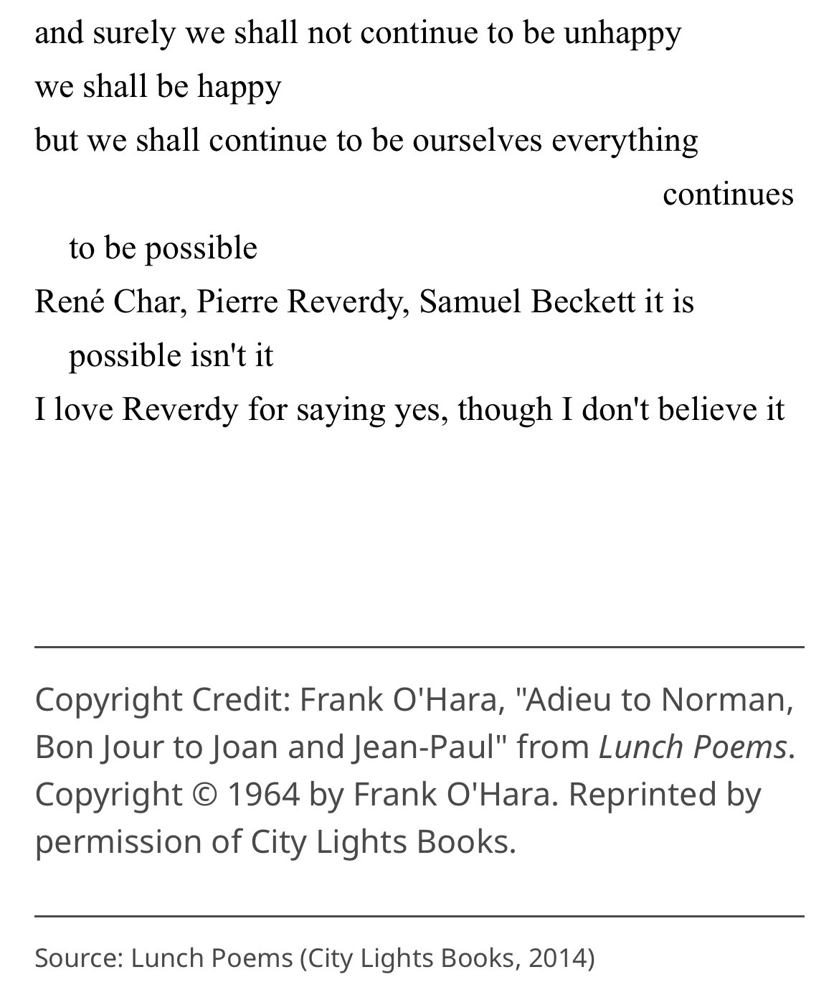

# birthday

---

A sleepless morning saw me rising before the sun and taking a photo of my laundry coins. Then it was a day spent maneuvering through some mental sloppiness, running into E at the office and hearing both her joyous and her heartbreaking news, giving her a gold dollar for her flight to Paris, thinking about Frank O'Hara, and attempting to finish the BOOK CLUB book, which with the help of the park and my bed I did manage to finish just in time to head to A's birthday party, where everyone read poems and swapped tales of automobile bravery in the face of adversity and made wonderful pithy little jokes that made me feel for a moment like maybe a contemporary retelling of *Metropolitan* would be possible, after all. *It is good to be several floors up in the dead of night...*

A room full of musicians and writers sang the worst happy birthday I've ever heard, terrible in a way that only a chorus of musicians and writers could accomplish. We were sitting on my and Katy's old couch and in my pocket my phone would not stop buzzing. It's the posting2 book club chat, a topic for another time. As the headline act, A constructed a poem out of everything we've said. We'd been writing them down on slips of paperz It made us think about collage. Ever the folklorist, I read *Jabberwocky* and thought of E's plane soaring above the ocean, so thinking of her I also thought about Paris and wished I'd read either of the O'Haras but especially 'Norman', though it was not E's birthday. But A tells me they'd hear me read them any time.

https://www.dropbox.com/scl/fi/rrudp48kz8kvp7js223ly/26.11-20-Happy-Birthday.mp3?rlkey=p9edbwkv63s0c8atdj388wuvo&dl=0

https://www.dropbox.com/scl/fi/9xc6of4aqdqw14svqqd0b/26.11-20-Our-Poem.mp3?rlkey=buit8c6ca7vzenrpnmwy84amv&dl=0

---

### Adieu to Norman, Bon Jour to Joan and Jean-Paul

---

#life
