# yes culture, and yes more rock and roll

---

### things that happened...

- starting in on Balle V
- the early return of posting2
- a beautiful new friendship there

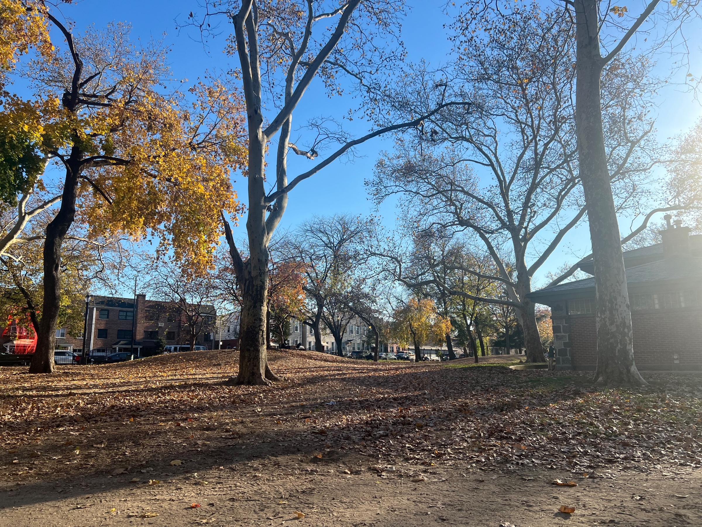
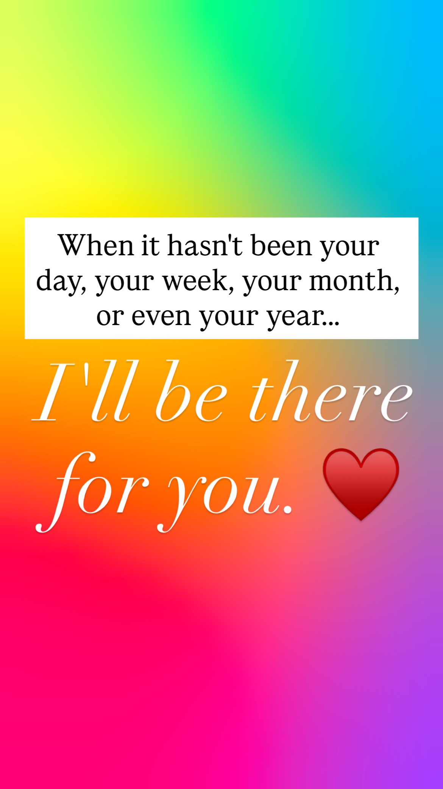
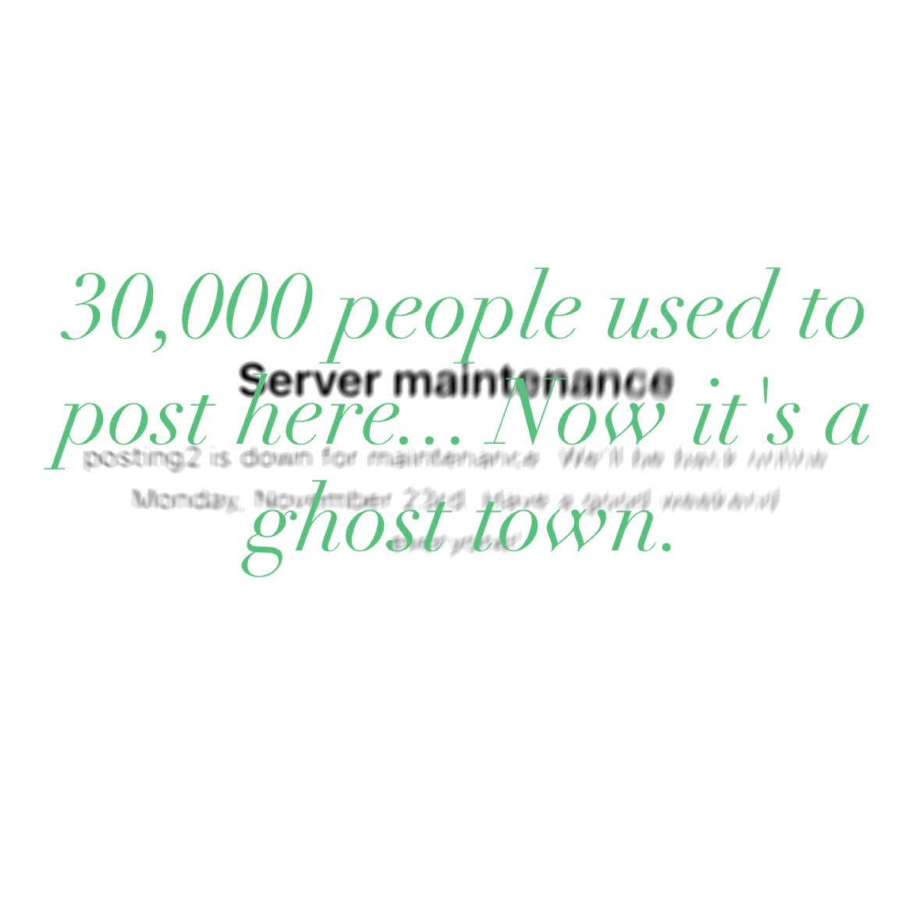
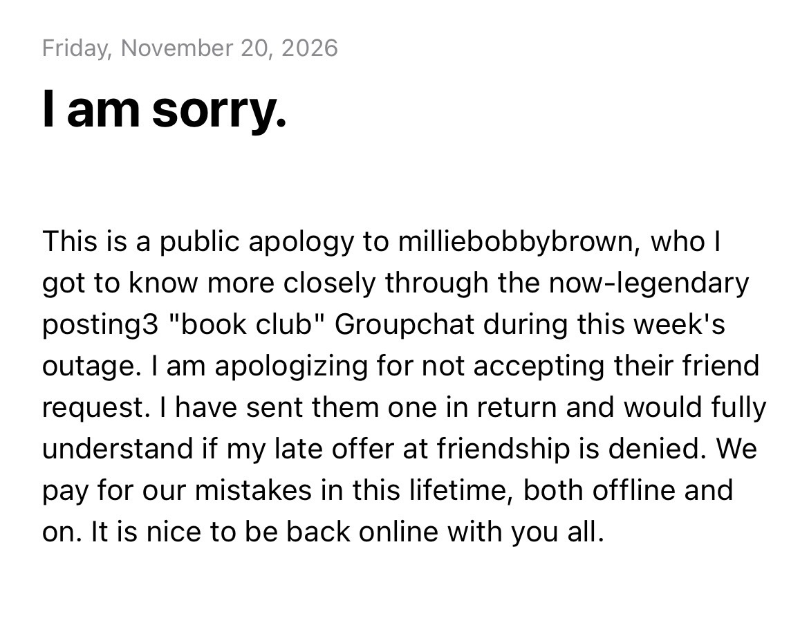
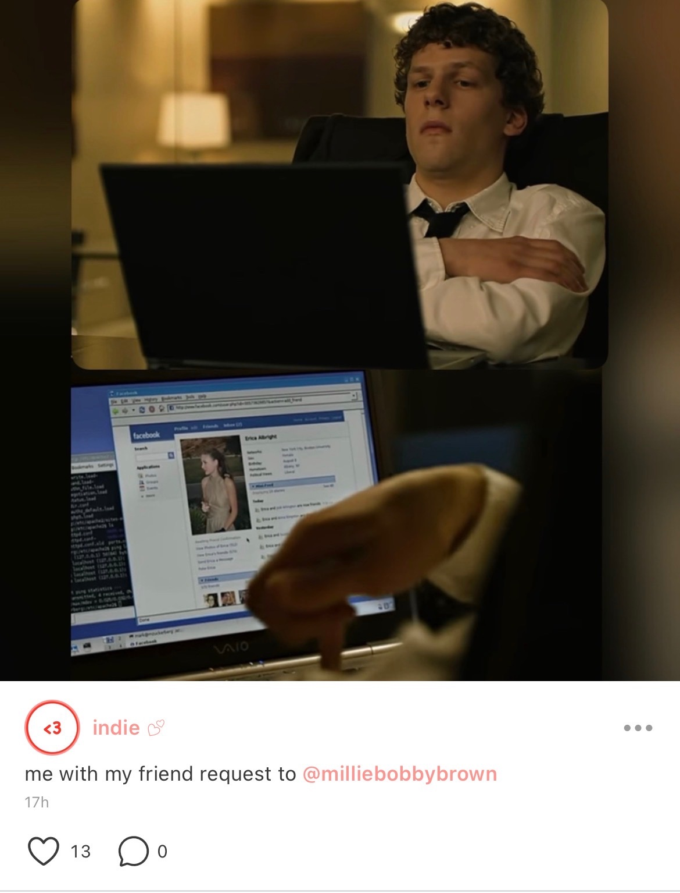

- dinner at Lil P's
- meeting K at 12th St and re-meeting Grey from Coney Island
- I and N are sitting at the bar and I accidentally intrude
- running into R there and having a catchup w/ him and his friend N

https://www.dropbox.com/scl/fi/6at2ocnb82ktwmbcum2lg/26.11-20-GREG-FREEMAN-BURY-ME-THE-SHOVEL-LIVE-AT-WEBSTER-HALL.mp3?rlkey=p4l0av7cow5sa5tg0qka0jedt&dl=0

- at the show, so many friends including S&J (who is quite bearded)
- & magnets, who is with some coworkers from NYTM, both named R
- I step away to use the bathroom at the Moxy and inside is blasting "Freaky Friday"

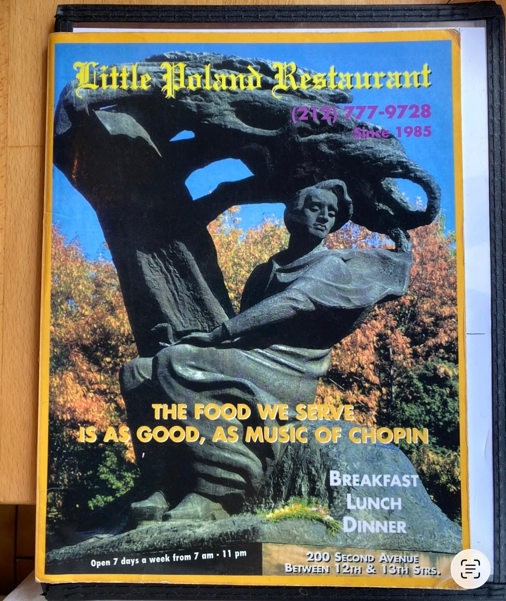
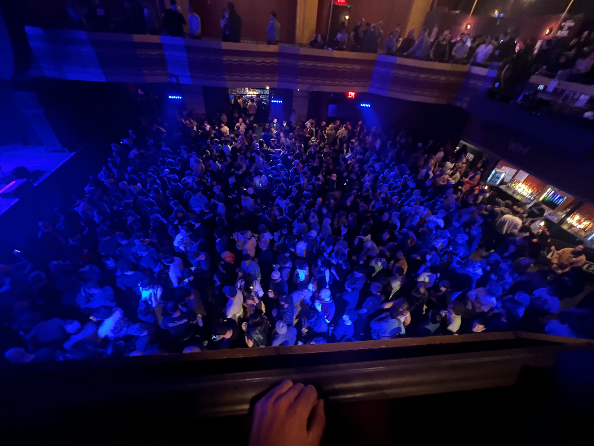
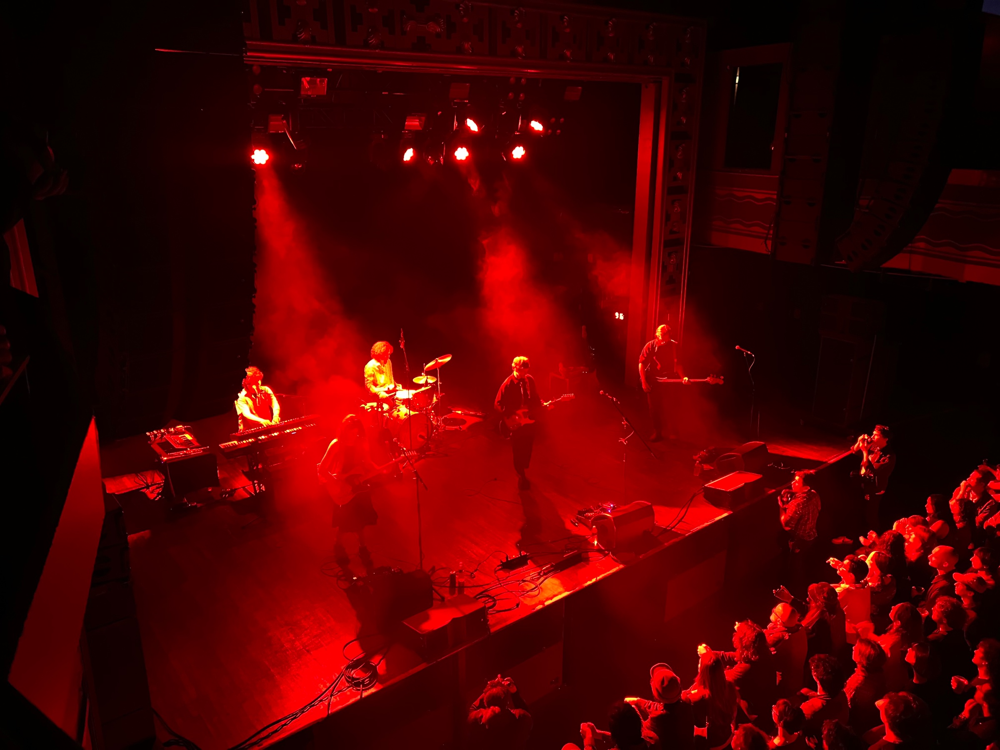
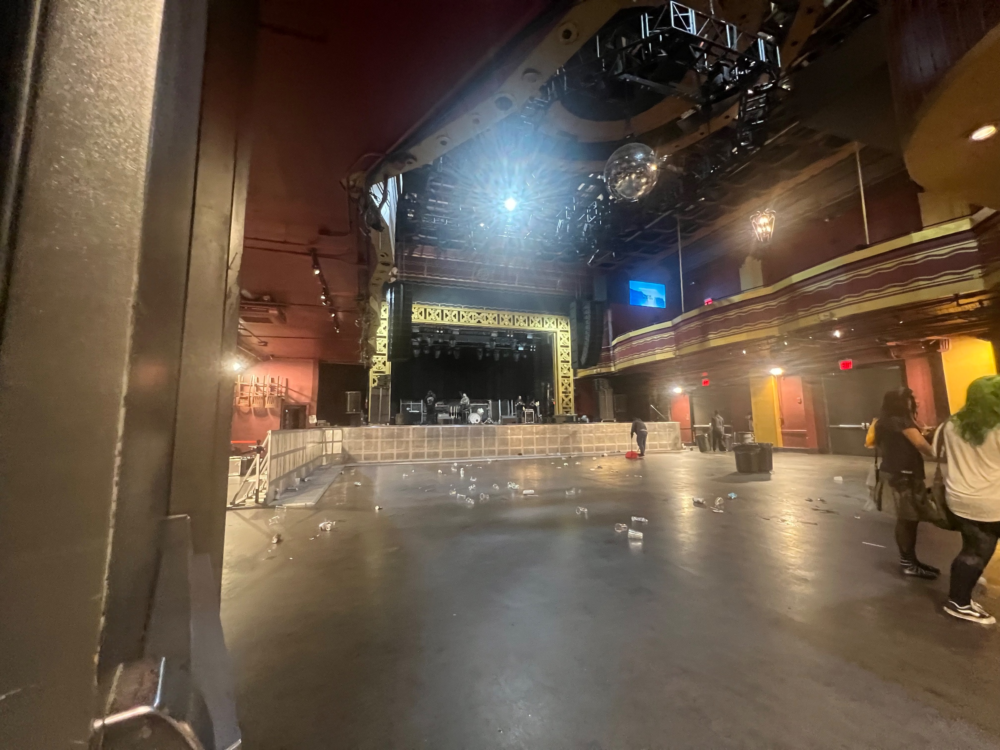

- train back to Ridgey w/ I & N, plus Léna's fam
- sitting outside my building texting Lane who has just asked me about The Thirsty Crow. then M walks by. it has been ages! she picks me up in joy.
- she is with three people I've not met before but who are randomly familiar from conversations earlier this week with Y
- so I, being still young and adventurous, went back out with them (one block away).
- where I run into E and A, and M, it's karaoke night. E met Vivien Goldman at a reading tonight: *E — stay punky! Nice to meet you in Ridgewood tonight*.

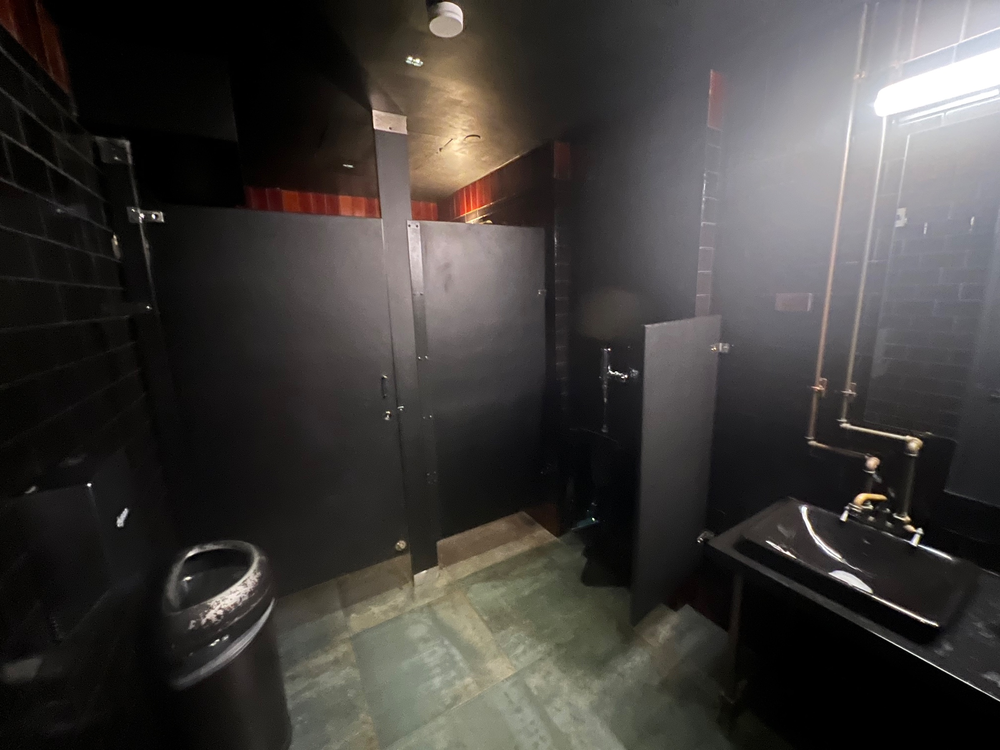
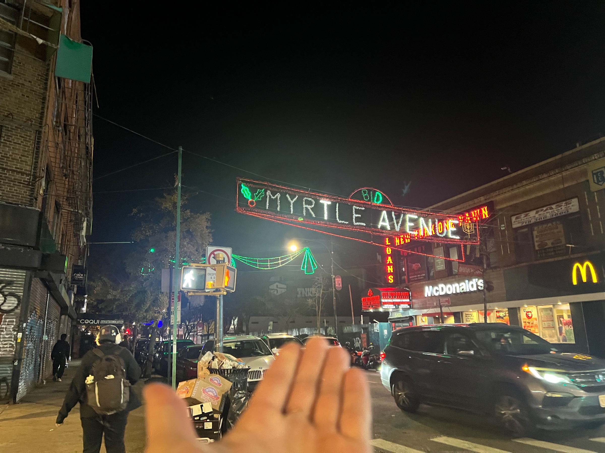
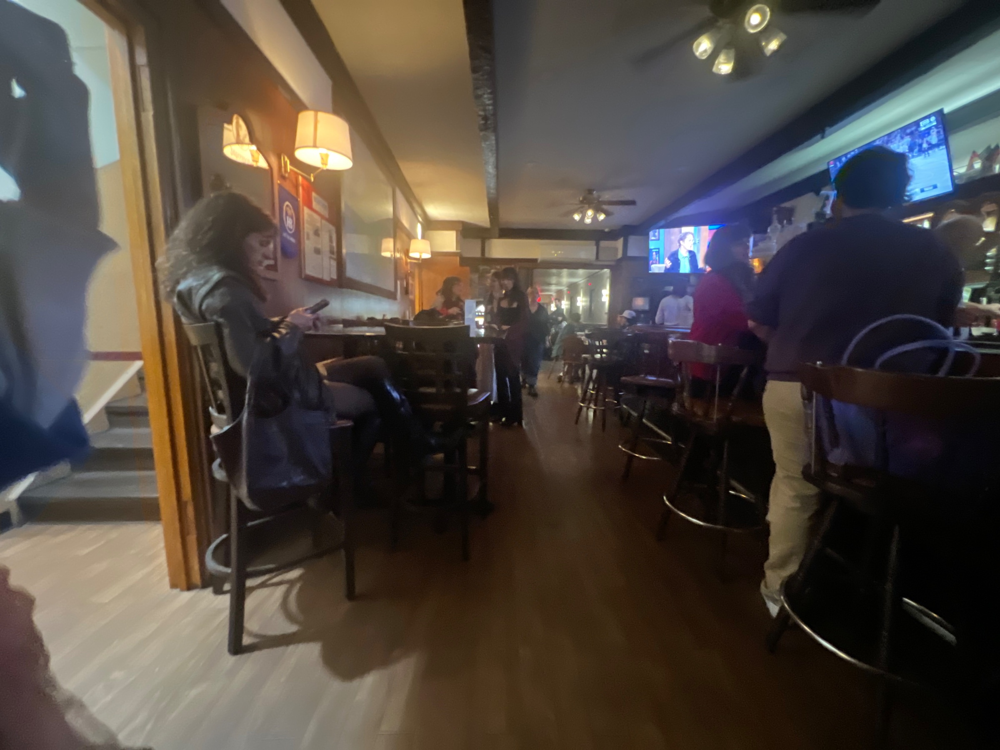

- I talk most of the time with a new person named K. I tell her she looks familiar and she says it's because we met five minutes ago on the street. so now I'll be indebted to her forever but she's nice about it. among other things we discuss the social safety net (in very practical, immediate terms), "science stuff", folk music, and Chicago. we have a lot of friends in common. we are neighbors and wind up walking each other home. I have a hypothesis that she lives with D. I've seen her around the neighborhood before, I think, and we expect to see each other again.

---

#life #music
