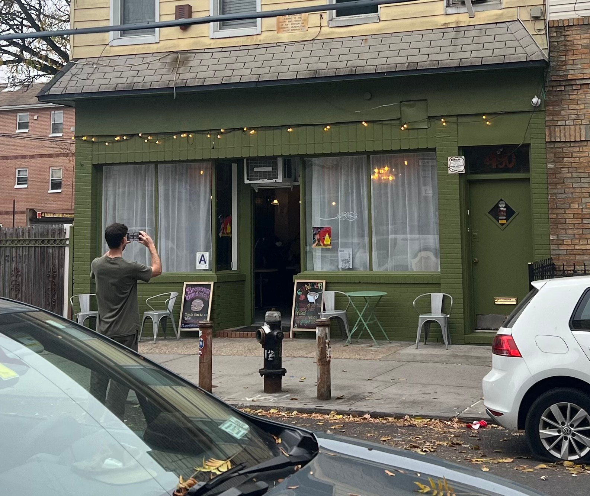
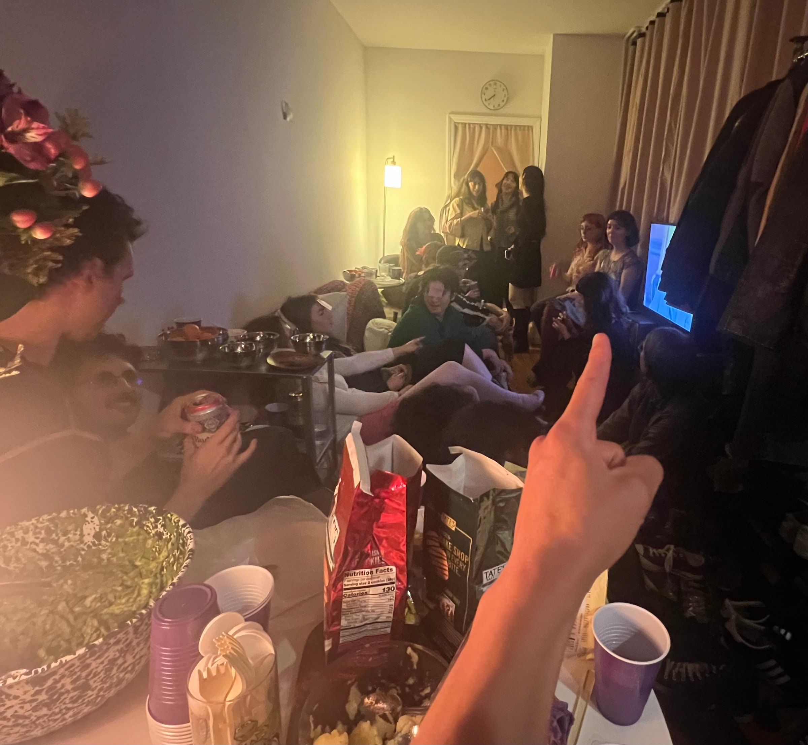
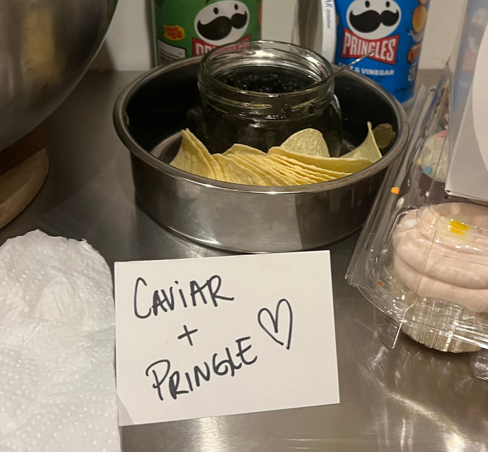
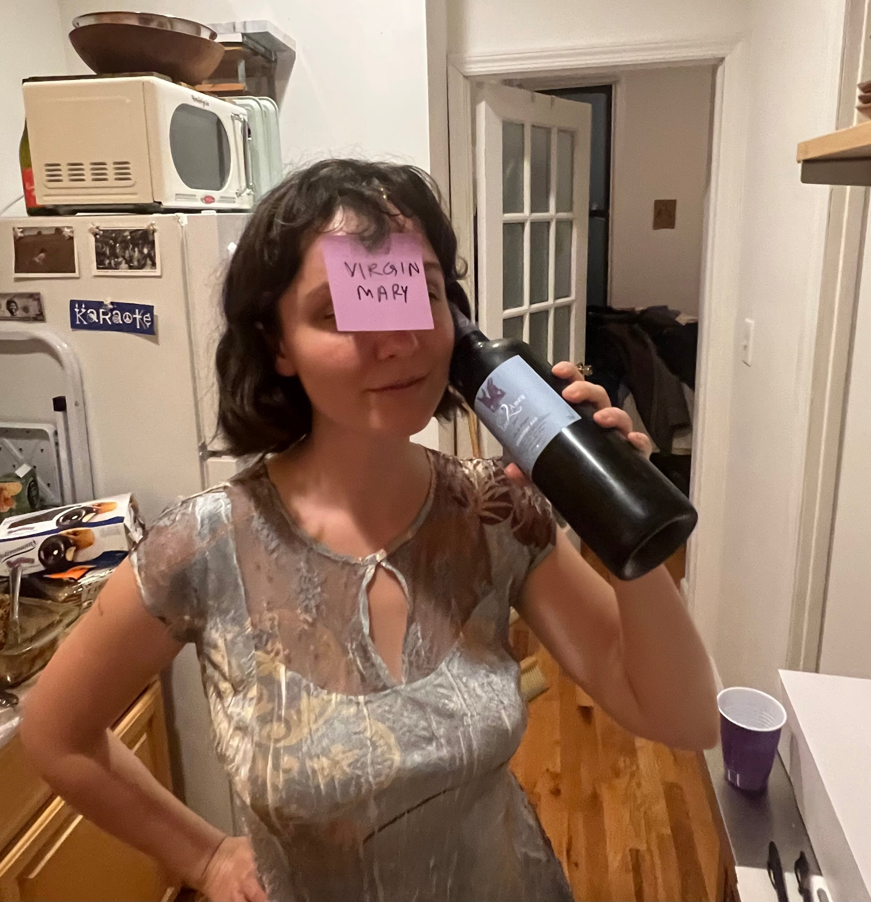
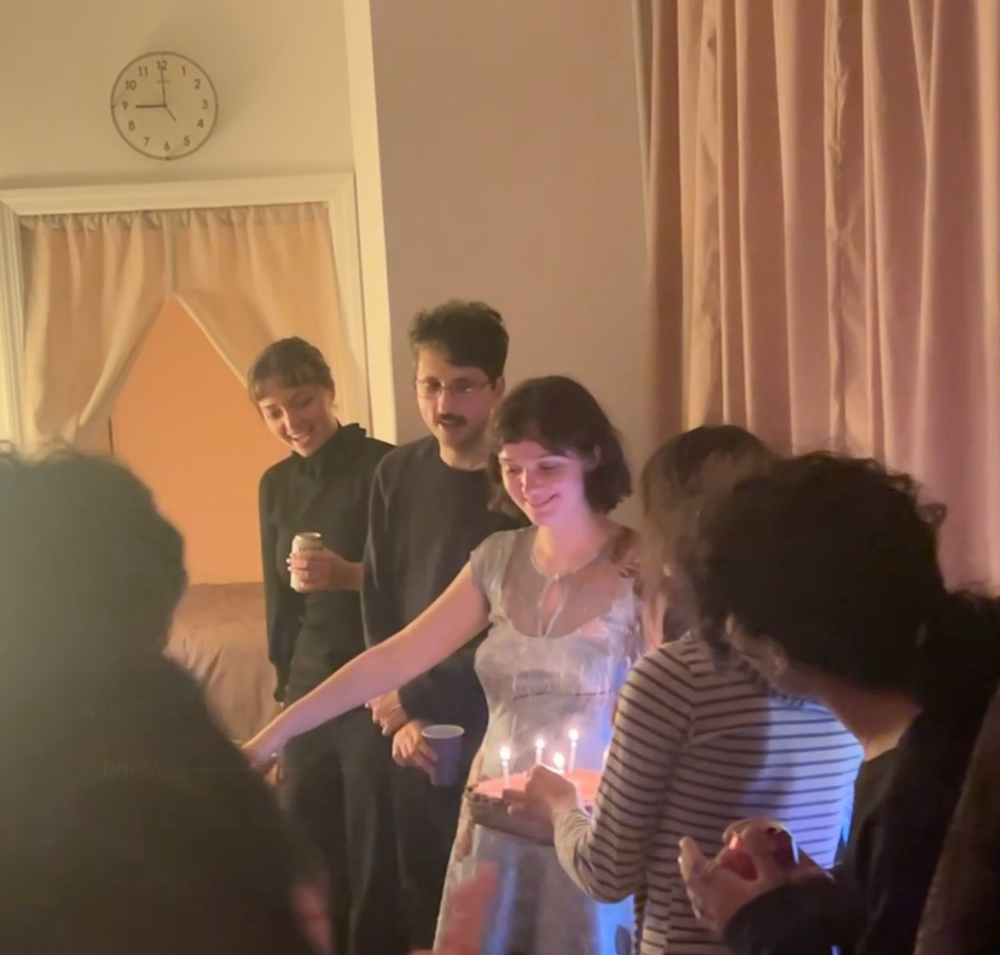
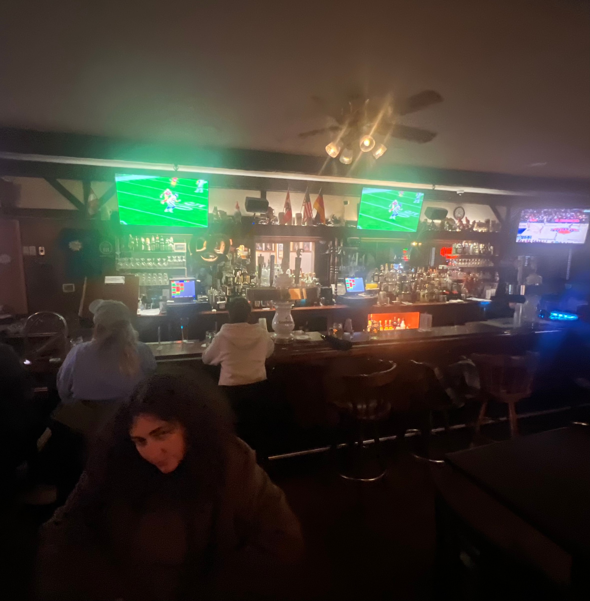
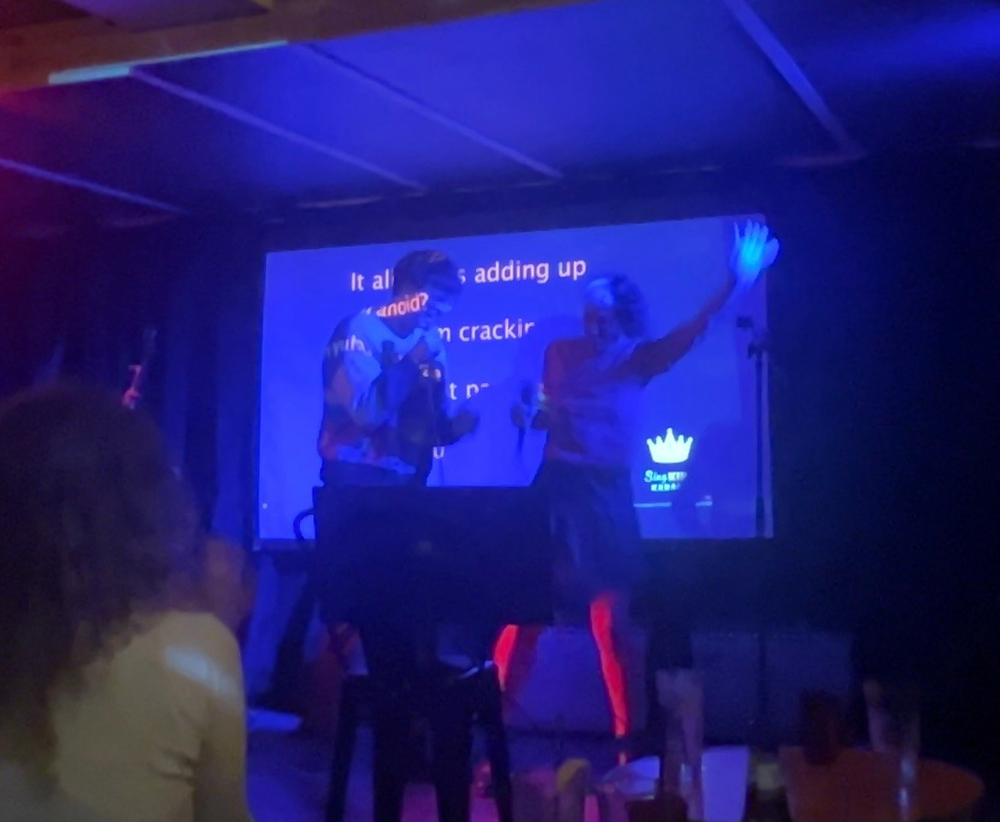

# ridgewood birthday 3

---

at the office, michael and s, and lauren says michelangelo has red hair? and brita and I laugh. he and Kate moved in yesterday. overcaffeinated and hungry. I chat with S's friend who is in town after having lived in Cambodia for a few years during Covid, now is union organizing at Penn State. sushi at cityfresh with "must be santa," — hahaha, i laugh a lot — and texting K this embarassedly and asking if she's seeing Bridget St John even though i can't go. ugh! we'll never talk again.

on the way to the park i am startled by a sudden burst of green emanating from the west side of the street; it's Katan, and it's green now. i take my phone out to alert the masses and just then the owner walks out to do the same; to avoid awkwardness i say, "It's green now!" and he says "Yep! But it's the wrong green." he says he's been waiting to do this for like six months and he asks if i like it more and i lie.

i read a while at the park and have a nice run-in with Charlie who says she's making mac and cheese for a potluck. we watch with curiosity as a woman with a large parrot-like bird perched on her shoulders walks into the soccer fields. I'm cold in a feverish kind of way and worried I'm getting sick again for a while but it's just the ominous creepy weather. Forêt for wine then back home. I lie in bed and then head to Emily's via the train which is silly. But the raininess.

I chat mostly with Frankie and Chelsea (who was at Erica's last night as an angler fish) and a beautiful brunette girl named C who it turns out doesn't really know anyone, including Emily. they just met two weeks ago. for some reason I assume they met at the pickle party. C got an MFA at Columbia. everyone has work tomorrow. I meet a funny tall guy who went to high school in Nashville, his name is Colin or maybe he was Clayton. he was banned from the Kroger down on 21st -- all Kroger properties, actually -- as a senior in high school for accidentally stealing a candy bar. they treated him like 24601 or something, told him he'd be arrested and sent to prison for burglary and trespassing if he ever step foot in a Kroger again.

everyone plays the "tape a person's name to your head and you have to guess who it is" game except C and I. at some point she Irishes to go to a reading with "a bunch of annoying people." I could have made it easier for us to close accounts. a shocking number of people think that the Virgin Mary and Mary Magdelene are the same person. a sweet girl named Renee can't figure out that she's Johnny Knoxville and I keep trying to remember where we met. after the game we have Frankie's beautiful cake, an eggplant purple cake with a star on it, perfectly sweet, it's a chai cake, she keeps saying.

it's hot at this birthday party too and now that the cake is done Frankie is tired out so I take the opportunity to leave with her. and then i skip joyfully home and change and brush my teeth. Lucinda is at Gottscheer so I drop in and I know that she is with Chip and we have a brief hang. but interlopers named Emily seem to be a theme this weekend.

Literal Matt and Kim are at karaoke and the overall attendees are both shockingly random and extremely exuberant.Emily's crew has made it over, including her beautiful baby sister, a flight attendant (16 on / 14 off), and also Matt Donovan, who introduces me to Anna McClellan who opened the Hello Shark show, and Josie is there too, she knows Matt York. Neither Matt knows "Same Love," nor does Josie's friend Lily. so I don't sing it. Aminta sings "Babushka" and  "Anything Goes". Ray and PJ sing an assortment of random songs including "Fuck You Unclefucker" from South Park. Anya sings "Supercalifragilisticexpialadocious" and Kim and Matt sing "Basket Case." "I'VE HAD TOO MANY VODKAS TONIGHT!!" Kim screamed, proceeding to grind on Matt. "EVERYBODY'S GETTING LAID TONIGHT!" Elaine and Owen show up, he had his birthday party tonight too and it seems they're an object tonight. Emily asks if she and I were dating and I explain. Having Owen there is helpful for a quicker explanation. I tell her about Frankie and she approves and she never approves.

Aminta walks home with me and we're both bone-tired. They like even numbers and not prime ones and they did a modern dance routine to Annie Lennox's "Why" with a bunch of 60+ year olds. And they never can figure out how to get home from Dinky's. after their Cole Porter they pulled up an article about the bicameral consciousness and Homer. _I have an overactive bicameral consciousness and it makes it impossible to get home. That's also why I got a dog,_ and also, _What do you mean 'SpongeBob'_. hahaha. the moon, she's been putting on quite the cloudy show the last few nights.

---

#life
