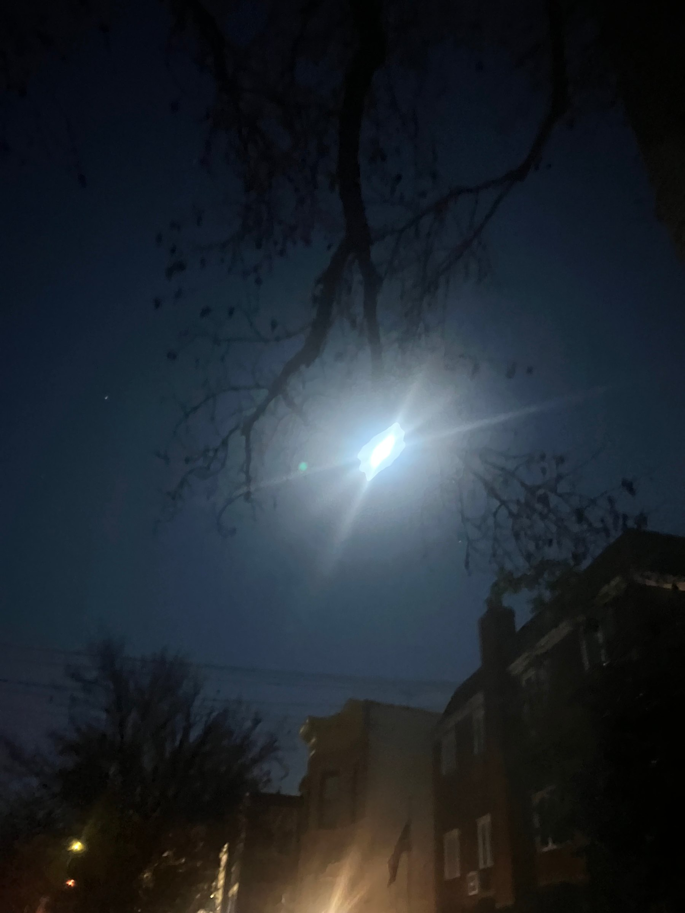
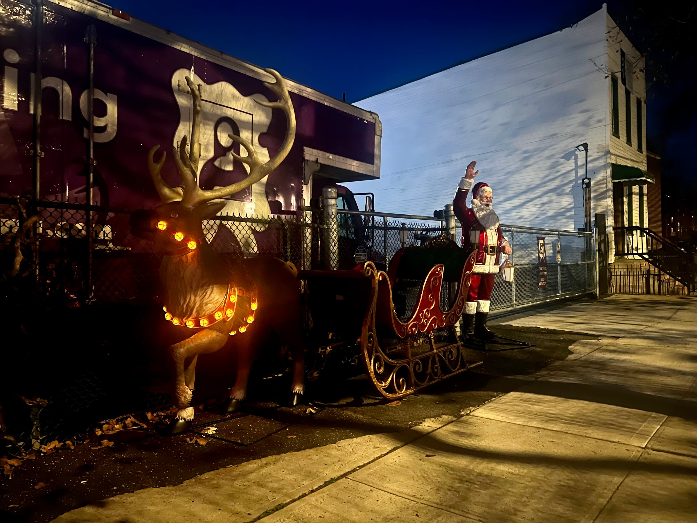
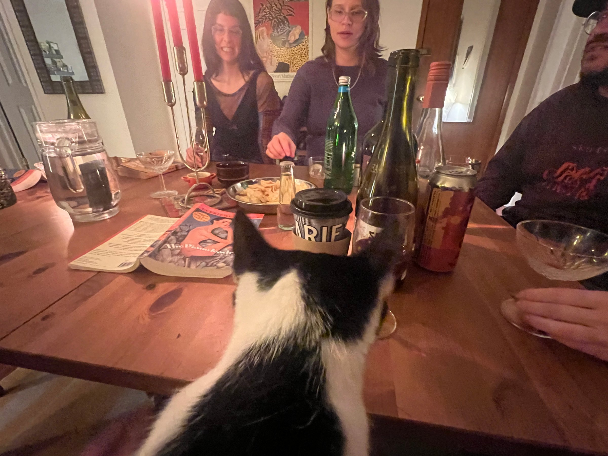

# we didn't start the book club

---

a federal appeals court cleared the way for the United States military to detonate a weapons cache which will ignite a massive cloud of toxic leaden dust into the air in Middletown, Iowa. So I revisit some of *White Noise.* Jensen Huang is back as CEO of NVDIA thanks to backroom pressuring and dealing by the Trump administration, a new high watermark of corruption.  in the posting2 "book club" chat, they are posting thirst traps; at our BOOK CLUB, we sip wine and pass Goose around and discuss Elfriede's ugly masterpiece, warts and all. Life Without Buildings reunited for two reunion shows at KOKO club in London. J marvels, C says they almost went. I beg M and E for MORE POSTS from these shows. chips drives X and I home, we listen to M's new album and then Yo La Tengo. I make her promise to drive safely this week. it's freezing cold: the holidays are officially here.

---

#life
